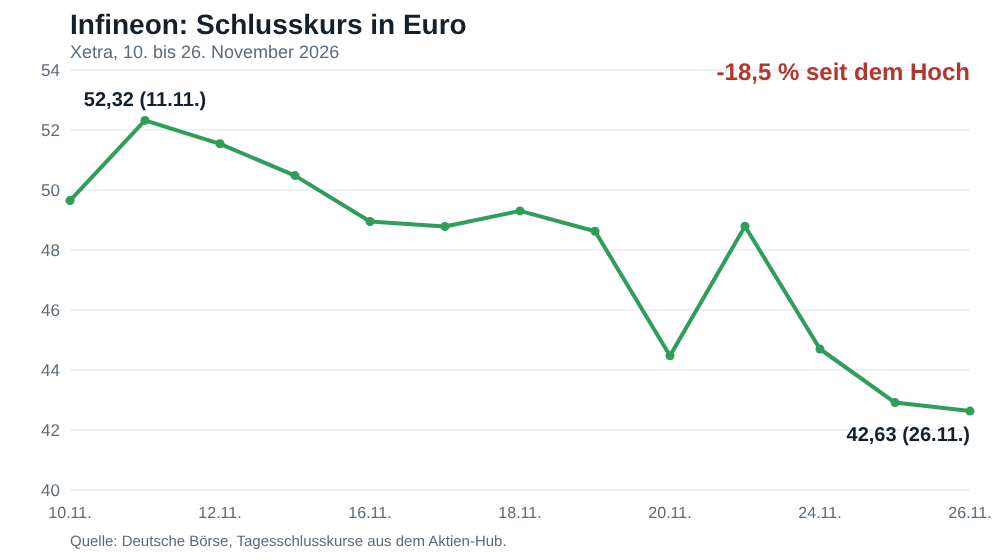

<!-- PRÜFEN: Aufmacherfoto fehlt (Unsplash, z. B. Chip/Platine/Reinraum ohne erkennbare Fremdlogos) und image, image_alt, image_credit, image_source, image_lizenz ergänzen. -->
<!-- PRÜFEN: Kursangaben aus Hub-Schlusskursen (data/firma-kurse/IFX.DE.json): 11.11. 52,32 €, 26.11. 42,63 €; Freitag 27.11. rund 44,7 € aus Tagesmeldung, vor Veröffentlichung aktualisieren. -->
<!-- PRÜFEN: Kursziele (Jefferies 74, Deutsche Bank 75, JPMorgan 80, BofA 80, Bernstein 82, Berenberg 100, DZ 77, UBS 64, Morgan Stanley 65) und Konsens um 80 € stammen aus Pressemeldungen, einzeln nicht gegengeprüft. -->
<!-- PRÜFEN: Erklärung „Zweifel an KI-Renditen / Nvidia -27 % im November / Euro" ist Marktdeutung aus Berichten, keine Unternehmensmeldung. Zu Infineon selbst gab es offenbar keine eigene Nachricht. -->
<!-- PRÜFEN: KGV von rund 37 ist eigene Rechnung (Kurs durch erwarteten Gewinn je Aktie 1,14 bis 1,15 € für 2026), Hub zeigt 54,7 auf Basis des Geschäftsjahres 2025. -->

!!! kurz "Kurz gesagt"
    **Der Kurs:** Von 52,32 € am 11. November auf 42,63 € am 26. November, ein Minus von 18,5 %. Am Freitag erholte sich die Aktie auf rund 44,70 €.
    **Der Anlass:** Offenbar keiner aus dem Unternehmen selbst. Die Zahlen zum Geschäftsjahr waren solide, der Ausblick wurde bestätigt.
    **Das Umfeld:** Chipwerte und KI-Titel fielen im ganzen November, der Nasdaq 100 berührte zwischenzeitlich die Marke für einen Bärenmarkt.
    **Die Dividende:** 0,38 € für das Geschäftsjahr 2026, das sind rund 0,9 % Rendite. Infineon ist ein Wachstumswert mit Dividende, kein klassischer Dividendenwert.

Wenn eine Aktie in zwei Wochen fast ein Fünftel verliert, suchen Anleger nach der schlechten Nachricht. Bei Infineon fällt die Suche schwer. Das Unternehmen hat Mitte November Zahlen vorgelegt, die den Erwartungen offenbar entsprachen, und danach rutschte der Kurs trotzdem Tag für Tag ab. Hier ist, was sich über die Gründe sagen lässt und was nicht.

## Der Kursverlauf

Der Hub hat die Schlusskurse seit dem 11. November gespeichert. Die Grafik zeigt einen Rückgang in Stufen: ein Absturz am 20. November, eine kurze Erholung am 23. und weitere Verluste am 24. und 25. November.

Der Tiefpunkt der Schlusskurse lag am 26. November bei 42,63 €. Am Freitag ging es nach einer Erholung am Gesamtmarkt wieder aufwärts, im frühen Handel um rund 4,8 % auf etwa 44,70 €.

## Was Infineon selbst gemeldet hat

### Die Zahlen

Im vierten Geschäftsquartal erzielte der Konzern einen Umsatz von 4,71 Mrd. €, die Segmentergebnis-Marge lag bei 23,8 %. Für das neue Geschäftsjahr nennt Infineon einen Umsatz von rund 16,4 Mrd. €, ein Jahr später sollen es etwa 20 Mrd. € sein. Das Geschäft mit Rechenzentren soll im kommenden Jahr bei rund 4 Mrd. € liegen. Die Investitionen sind mit 3,0 bis 3,5 Mrd. € hoch, der freie Cashflow lag zuletzt bei rund 1,0 Mrd. €, die Nettoverschuldung bei 4,7 Mrd. €.

### Die Ansage zur Kapazität

Konzernchef Jochen Hanebeck hat am 10. November erklärt, dass er vor weiteren Kapazitätsausbauten Zusagen der Kunden sehen will. Das lässt sich als Vorsicht lesen: Infineon baut nicht auf Verdacht. Es lässt sich auch als Hinweis verstehen, dass die Planbarkeit der KI-Nachfrage geringer ist, als manche Anleger hoffen.

## Warum der Kurs fällt

### Ein Sektor unter Druck

Für den Rückgang gibt es nach den vorliegenden Berichten offenbar vor allem Gründe außerhalb des Unternehmens. Im November haben Zweifel zugenommen, ob sich die hohen Ausgaben für künstliche Intelligenz auszahlen. Nvidia verlor im Monatsverlauf rund 27 %, der Nasdaq 100 berührte am 25. November die Marke, ab der Börsianer von einem Bärenmarkt sprechen. Infineon wird an der Börse inzwischen auch mit dem KI-Thema verbunden, weil das Unternehmen Stromversorgung für Rechenzentren liefert. Wenn die KI-Fantasie nachlässt, fallen offenbar auch die Zulieferer.

Dazu kommen Zinsen und Währung. Die Renditen zehnjähriger US-Staatsanleihen lagen zuletzt bei etwa 4,8 bis 4,9 %, und die Fed dürfte im Dezember weiter erhöhen. Wachstumsaktien mit hoher Bewertung leiden unter höheren Zinsen besonders. Ein Euro von rund 1,10 $ belastet zusätzlich, weil Infineon einen großen Teil seiner Umsätze in Dollar erzielt. Jefferies schätzt, dass ein schwächerer Euro dem Konzern im Geschäftsjahr 2027 rund 720 Mio. € mehr Umsatz und etwa 7 % mehr Gewinn je Aktie bringen könnte. Das ist eine Einzelschätzung.

### Was die Analysten tun

Mehrere Häuser haben ihre Kursziele gesenkt, die meisten aber bei ihrer Kaufempfehlung geblieben. Die folgende Übersicht zeigt, was in Berichten genannt wurde.

| Haus | Kursziel | Empfehlung |
|---|---|---|
| Jefferies | 74 € (zuvor 96 €) | Kaufen |
| Deutsche Bank | 75 € (zuvor 85 €) | Kaufen |
| JPMorgan | 80 € (zuvor 96 €) | Kaufen |
| Bank of America | 80 € (zuvor 88 €) | Kaufen |
| Berenberg | 100 € | Kaufen |
| Bernstein | 82 € | Kaufen |
| DZ Bank | 77 € | Kaufen |
| UBS | 64 € | Neutral |
| Morgan Stanley | 65 € | Halten |

Der Durchschnitt der Kursziele liegt bei etwa 80 €. Das ist gut 80 % über dem Kurs von Mitte der Woche. Solche Abstände sind bei Analysten üblich und besagen wenig, doch sie zeigen, dass die Branche den Kursrückgang offenbar nicht mit schlechteren Geschäftsaussichten begründet.

## Was für Infineon spricht

Der Umsatz soll im Geschäftsjahr 2027 auf rund 20 Mrd. € steigen, gut ein Fünftel mehr als 2026, getragen auch vom Geschäft mit Rechenzentren. Die Segmentmarge liegt bei knapp 24 % und soll Mitte der Zwanziger liegen. Der Hub zeigt ein Gewinnwachstum von 22,5 % pro Jahr über fünf Jahre, die Dividende wuchs über denselben Zeitraum um 9,7 % pro Jahr, und die Ausschüttung nimmt nur 32 % des freien Cashflows in Anspruch. Die Bewertung ist nach dem Rückgang gesunken: Auf Basis des Gewinns für das laufende Geschäftsjahr von rund 1,14 bis 1,15 € je Aktie ergibt sich nach eigener Rechnung ein KGV von etwa 37. Im Hub steht noch 54,7, weil dort das Geschäftsjahr 2025 zugrunde liegt.

## Was dagegen spricht

37 ist für einen Industriewert weiterhin hoch. Das Unternehmen muss die Erwartungen für 2027 erfüllen, um diese Bewertung zu rechtfertigen. Der Hub weist für das letzte Geschäftsjahr einen Gewinnrückgang von 22 % aus, bei einer Nettomarge von 6,9 %. Die Investitionen von 3,0 bis 3,5 Mrd. € fressen einen großen Teil des operativen Cashflows, und der freie Cashflow von etwa 1 Mrd. € liegt bei einer Marktbewertung im zweistelligen Milliardenbereich nur bei 2,6 % Rendite. Dazu kommt die Abhängigkeit von der Stimmung am Markt für KI, die Infineon kaum steuern kann. Gerade der Hinweis des Konzernchefs auf Kundenzusagen zeigt, dass auch das Management die Nachfrage nicht blind fortschreibt.

## Was das für Dividendenanleger heißt

Infineon schlägt für das Geschäftsjahr 2026 eine Dividende von 0,38 € vor, 8,6 % mehr als im Vorjahr. Bei einem Kurs um 43 € entspricht das rund 0,9 %. Wer Einnahmen sucht, findet sie hier nicht, wer an das Wachstum glaubt, bekommt eine Dividende dazu, die gut gedeckt ist und wächst. Die Frage ist weniger, ob Infineon die Dividende halten kann, als ob der Kurs nach einem solchen Rückgang eine Basis findet. Das lässt sich im Moment nicht beantworten. Am 9. Dezember entscheidet die Fed über die Zinsen, bis dahin dürften die Schwankungen groß bleiben.

Das ist keine Anlageberatung.

## Quellen

- Infineon Technologies, Ergebnisse zum vierten Quartal und Geschäftsjahr 2026, Mitte November 2026
- Analystenmeldungen und Marktberichte zu Infineon vom 11. bis 27.11.2026 (dpa-AFX, Börse Online, finanzen.net)
- Eigene Auswertung der Hub-Schlusskurse und Kennzahlen, Stand 26./27.11.2026
