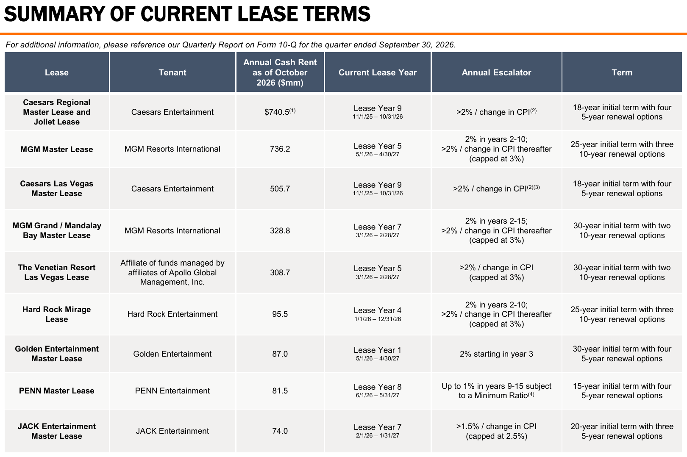
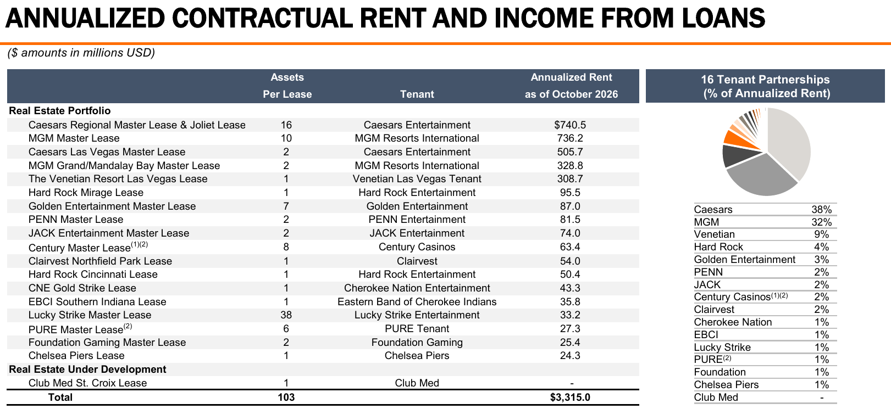
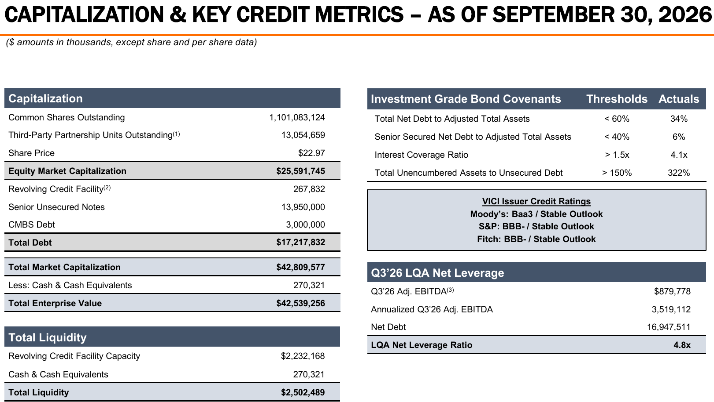

<!-- PRÜFEN: Zinsvergleich nutzt die Rendite zehnjähriger US-Staatsanleihen von rund 4,9 % (Stand 27.11.2026, Vorbörse). Aktuellen Wert vor Veröffentlichung prüfen. -->
<!-- PRÜFEN: Mieteranteile, Las-Vegas-Anteil, Kreditkennzahlen und Rückstellung sind jetzt mit der Präsentation und dem 10-Q zum dritten Quartal belegt. Aussagen zu Spirit, den Casino-Umsätzen und den Gesprächen mit Caesars stammen weiter aus der Telefonkonferenz bzw. Pressestimmen. -->

!!! kurz "Kurz gesagt"
    **Dafür:** hohe Rendite von 7,2 %, langlaufende Mietverträge mit eingebauten Erhöhungen, eine Dividende, die rund 74 % des operativen Gewinns kostet, und eine Aktie, die im Hub unter Buchwert gehandelt wird.
    **Dagegen:** Abhängigkeit von Caesars und MGM, Konzentration auf Las Vegas, teureres Geld für die Refinanzierung ab 2027 und eine Notenbank, die die Zinsen erhöht.
    **Der Kern:** Wer VICI kauft, kauft Planbarkeit und nimmt ein Klumpenrisiko in Kauf.

Eine Rendite von 7,2 % wirkt auf Dividendenanleger wie ein Magnet und gleichzeitig wie ein Warnschild. Bei VICI Properties, der Vermieterin von Caesars Palace, Venetian und MGM Grand, sind beide Eindrücke begründet. Wie das Geschäft aufgebaut ist und was die Zahlen vom dritten Quartal zeigen, steht in unserer [Analyse vom Samstag](../vici-properties-casino-mieten-dividende-7-prozent/). Hier geht es um die Abwägung: Was spricht für einen Kauf, was dagegen, und was lässt sich offenbar nicht abschließend beurteilen?

## Was für VICI spricht

### 1. Die Rendite liegt weit über dem Marktzins

Die Dividendenrendite von 7,2 % liegt rund 2,3 Prozentpunkte über der Rendite zehnjähriger US-Staatsanleihen von zuletzt etwa 4,9 %. Dazu kommt, dass die Dividende vermutlich weiter steigt. Anleger bekommen also mehr als den Marktzins und eine Chance auf Zuwachs.

### 2. Die Verträge laufen lange und enthalten Erhöhungen

VICI vermietet nach dem Muster langer Verträge, bei denen der Mieter Steuern, Versicherung und Instandhaltung trägt. Die Restlaufzeit aller Verträge beträgt im Schnitt 39,4 Jahre, und bei den großen Mietern steigt die Miete jedes Jahr um mindestens 2 % oder um die Inflation, bei MGM und dem Venetian gedeckelt auf 3 %. Zusätzlich haften bei 88 % der Miete Muttergesellschaften der Mieter. Das erklärt, warum der operative Gewinn je Aktie auch in einem schwierigen Quartal um 4,3 % auf 0,62 $ wuchs. Die Prognose für 2026 hob das Management auf 2,47 bis 2,48 $ je Aktie an.

### 3. Die Dividende ist solide gedeckt

1,84 $ Dividende je Aktie stehen 2,47 bis 2,48 $ operativer Gewinn gegenüber, das sind rund 74 %. Im dritten Quartal standen 0,62 $ operativer Gewinn je Aktie einer Quartalsdividende von 0,46 $ gegenüber, die Quote lag also gleich hoch. Das lässt Raum für Erhöhungen, ohne dass der Konzern Schulden aufnehmen muss, um die Dividende zu zahlen.

### 4. Las Vegas und regionale Casinos laufen

Die Einnahmen der Spielbanken am Strip stiegen im dritten Quartal um 1,8 %, im Juli um 3,6 %. Landesweit wuchsen die Erlöse der kommerziellen Casinos bis Juli um rund 6 %. Mieter, die gut verdienen, zahlen ihre Miete eher zuverlässig.

### 5. Die Aktie ist günstiger als Konkurrenten

Im Hub kostet die Aktie das 0,96-Fache des Buchwerts, Realty Income das 1,4-Fache, NNN REIT das 1,8-Fache. Das Kurs-Gewinn-Verhältnis liegt bei 11,5. Eine Aktie unter Buchwert ist bei einem Immobilienkonzern ein mögliches Zeichen, dass der Markt die Risiken stark einpreist.

### 6. Das Management hat Spielraum

Der Verwaltungsrat genehmigte am 27. Oktober einen Aktienrückkauf über bis zu 2 Mrd. $, der bis September 2029 läuft. VICI muss nichts zurückkaufen, kann aber bei niedrigem Kurs eigene Aktien erwerben. Außerdem hat VICI mit 2,5 Mrd. $ Liquidität Luft für die Refinanzierung. Die Zahl der Mieter wächst, im laufenden Jahr kamen unter anderem Golden Entertainment, Clairvest und mit dem Kauf von Gamehost ein neuer Betreiber in Kanada hinzu.

### 7. Der Gewinn wächst auch ohne große Zukäufe

Der Umsatz stieg im Hub um 4,1 %, der Gewinn um 3,6 %. Wer eine Aktie sucht, die ohne Übernahmen wächst, findet bei VICI zumindest einen Grundbaustein.

## Was gegen VICI spricht

### 1. Wenige Mieter bestimmen das Ergebnis

Caesars stellt 38 % der vertraglichen Jahresmiete, MGM 32 %, zusammen also 70 %. Weitere 9 % entfallen auf den Betreiber des Venetian. Fällt einer der beiden Großen aus oder verlangt niedrigere Mieten, trifft das den Konzern direkt. Mit Caesars verhandelt VICI offenbar bereits über die Zukunft des Vertrags über die regionalen Casinos, einen Zeitplan nennt das Management nicht.

### 2. Las Vegas ist fast die Hälfte der Miete

Die Casinos am Strip von Las Vegas stehen für 46 % der vertraglichen Miete und im dritten Quartal für 48 % der Mieteinnahmen, also knapp die Hälfte aus einer einzigen Stadt. Im Sommer belastete offenbar der Wegfall der Fluggesellschaft Spirit die Besucherzahlen. Ein Abschwung in Las Vegas träfe VICI deutlich stärker als einen breit gestreuten Vermieter.

### 3. Die Vorsorge für Caesars war hoch

Im dritten Quartal buchte VICI 458 Mio. $ für mögliche Ausfälle, davon 313 Mio. $ für Caesars. Anlass war die Herabstufung des Kreditratings von Caesars, mit der eine Ratingagentur die Kapitalstruktur nach der geplanten Übernahme des Konzerns einpreist. Dazu kamen neue Schätzungen für die Verlängerungsperioden des Vertrags über die regionalen Casinos, die ab August 2035 beginnen. Der Gewinn nach Steuern sank dadurch von 762 auf 343 Mio. $, also um 55 %. Geld ist nicht abgeflossen, und der operative Gewinn blieb unberührt, aber die Zahl zeigt, wie VICI das Risiko bei seinem größten Mieter einschätzt.

### 4. Die Refinanzierung wird teurer

Im Februar 2027 werden zwei Anleihen über je 750 Mio. $ fällig, eine mit 5,75 % und eine mit nur 3,75 % Zins. Die im August ausgegebenen neuen Anleihen kosten 5,4 % bei fünf und 5,75 % bei zehn Jahren Laufzeit. Die Nettoschulden betragen das 4,8-Fache des auf das Jahr hochgerechneten Ergebnisses vor Zinsen, Steuern und Abschreibungen, die Zinsdeckung liegt bei 4,1, die Anleihebedingungen verlangen mindestens 1,5. Die Ratings stehen mit Baa3 und BBB- an der untersten Stufe der Anlagequalität. Höhere Zinsen drücken auf den Gewinn und lassen weniger Raum für die Dividendenerhöhung.

### 5. Die Notenbank erhöht die Zinsen

Die US-Notenbank entscheidet am 9. Dezember, und eine Erhöhung um 0,25 Prozentpunkte gilt als nahezu sicher. Immobilienwerte reagieren auf steigende Zinsen meist mit Kursverlusten, weil festverzinsliche Anlagen attraktiver werden.

### 6. Das Wachstum stockt

Im dritten Quartal schloss VICI keine neuen Geschäfte ab. Bei dem aktuellen Kurs von knapp 23 € rechnen sich Zukäufe zu üblichen Mietrenditen von 7 bis 8 % nach Einschätzung von Beobachtern kaum noch für die Aktionäre, weil das eigene Kapital teurer ist. Der Rückkauf der eigenen Aktien ist außerdem keine feste Zusage.

### 7. Die Rendite ist auch ein Preis

Die Aktie notierte Ende Oktober mit rund 24 $ nahe dem unteren Ende ihrer Jahresspanne von 22,43 bis 30,83 $. Dass die Rendite so hoch ist, hängt vermutlich auch damit zusammen, dass der Markt Risiken einpreist, die in den Zahlen noch nicht sichtbar sind.

## So lässt sich das einordnen

VICI lässt sich als Anleihe mit Wachstumsoption lesen: eine hohe laufende Zahlung, solide gedeckt, mit eingebauten Erhöhungen und einem Mieter-Klumpenrisiko. Wer die Dividende zum Einkommen braucht und das Klumpenrisiko tragen kann, findet hier eine höhere Rendite als bei Realty Income oder NNN REIT. Wer es breiter streuen möchte, ist bei Realty Income oder NNN REIT besser bedient, mit weniger Rendite, aber auch weniger Abhängigkeit von Las Vegas.

Drei Termine zeigen in den nächsten Monaten, wohin sich die Argumente neigen: die Zinsentscheidung der Fed am 9. Dezember, die Verlängerungsprüfung beim Fontainebleau-Darlehen im Januar und die Refinanzierung der Anleihen im Februar.

Das ist keine Anlageberatung.

## Quellen

- [VICI Properties, Third Quarter 2026 Results, 28.10.2026](https://investors.viciproperties.com/news-releases/news-release-details/vici-properties-inc-announces-third-quarter-2026-results)
- [VICI Properties, Supplemental Financial & Operating Data, drittes Quartal 2026](https://investors.viciproperties.com)
- [VICI Properties, Quartalsbericht (10-Q) zum 30. September 2026](https://www.sec.gov/cgi-bin/browse-edgar?action=getcompany&CIK=0001705696&type=10-Q)
- [Investing.com, Earnings call transcript: VICI Properties Q3 2026, 29.10.2026](https://www.investing.com/news/transcripts/earnings-call-transcript-vici-properties-posts-mixed-q3-2026-results-shares-rise-93CH-4984560)
- [Crawford is an Analyst, VICI’s Scared. I’m Starting to Sweat (a Little), 2026](https://crawfordisananalyst.substack.com/p/vicis-scared-im-starting-to-sweat)
- [xtb, Marktbericht Börse 27.11.2026](https://www.xtb.com/de/Marktanalysen/Trading-News/boerse-aktuell-nasdaq-erholt-sich-von-der-baerenmarkt-schwelle-27-11-2026)
