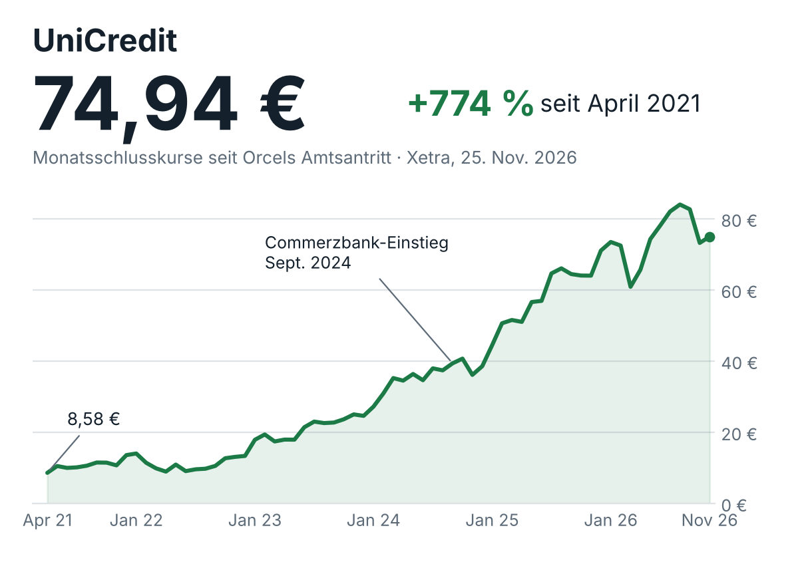

!!! kurz "Kurz gesagt"
    **Aktie:** 74,94 Euro, das 8,7-Fache des Kurses vom April 2021 (8,58 Euro)

    **Gewinn:** 10,9 Milliarden Euro 2025 nach 2,1 Milliarden Euro im Jahr 2021

    **Reichweite:** Banken in 13 Ländern, mit Commerzbank und mBank zusammen rund 250 Millionen Einwohner in den Märkten und rund 1,5 Billionen Euro Bilanzsumme

    **Ziel:** 13 Milliarden Euro Nettogewinn 2028, bis 2030 rund 50 Milliarden Euro an die Aktionäre

Als Andrea Orcel im April 2021 an der Spitze der UniCredit antrat, kostete die Aktie 8,58 Euro. Heute sind es 74,94 Euro, der Börsenwert liegt bei 126 Milliarden Euro, und die Bank übernimmt die zweitgrößte börsennotierte Bank Deutschlands. Dazwischen liegen fünf Jahre und sieben Monate. Orcel kam aus dem Investmentbanking und hatte vorher nie eine Bank geführt.

## Wer ist der Mann hinter der Übernahme?

Schon äußerlich gilt Orcel als Prototyp des Investmentbankers: groß, braun gebrannt, das Haar weiß. Die Presse verglich ihn mehr als einmal mit George Clooney. Geboren wurde er 1963 in Rom, er studierte Wirtschaft an der Sapienza und machte seinen MBA am Insead in Fontainebleau. Über Goldman Sachs und die Boston Consulting Group kam er 1992 zu Merrill Lynch nach London und blieb zwanzig Jahre. Er stieg dort zu einem der gefragtesten Fusionsberater Europas auf, einem sogenannten Rainmaker, und war an der Fusion beteiligt, aus der 1998 die UniCredit entstand. 2008 begleitete er den Verkauf der Banca Antonveneta an Monte dei Paschi, ein Geschäft über 9 Milliarden Euro.

Nicht jeder Rat ging gut aus. Der Royal Bank of Scotland riet er 2007 zur Übernahme von ABN Amro, damals der teuersten Bankenübernahme überhaupt. Kurz darauf brachen die Märkte zusammen, und die britischen Steuerzahler mussten die RBS mit 45 Milliarden Pfund auffangen. Britische Medien nannten ihn danach den Mann, der die RBS ruiniert habe. Seiner Karriere schadete das offenbar wenig: Mit einem Antrittsbonus von 25 Millionen Franken wechselte er 2012 zur Schweizer UBS, führte dort die Investmentbank und war von November 2014 bis September 2018 Präsident der Sparte.

Das Ende der UBS-Zeit zeigt, wie hart er um sein Geld streitet. Santander hatte ihn im September 2018 zum Vorstandschef ab 2019 ernannt, doch die UBS verweigerte ihm die Auszahlung zurückgehaltener Aktienboni von mehr als 50 Millionen Dollar. UBS-Präsident Axel Weber fasste die Regel mit „Leave, lose“ zusammen, wer geht, verliert. Santander zog das Angebot im Januar 2019 zurück. Orcel klagte, und ein Madrider Gericht sprach ihm Ende 2021 eine Entschädigung zu, die nach einer Korrektur im Januar 2022 bei rund 51 Millionen Euro lag. Dass er dafür als gierig dastand, nahm er offenbar in Kauf.

Im Haus gilt er als fordernd. Mitarbeiter soll er um Mitternacht oder um fünf Uhr morgens anrufen, die Work-Life-Balance nannte er einmal Nonsens, und mit Widerspruch in Besprechungen soll er schlecht umgehen können. Im Januar 2021 holte ihn der UniCredit-Verwaltungsrat trotzdem einstimmig als Nachfolger von Jean Pierre Mustier. Orcel hatte bis dahin nie eine Bank geführt.

## Die ersten Jahre: aufräumen

Orcel baute das Management seines Vorgängers um, verkleinerte das mittlere Management und holte sich Vertraute, von denen manche nach kurzer Zeit wieder gingen. Das Russlandgeschäft schrumpfte er rasch, das kostete rund eine Milliarde Euro. Bei Versicherung und Fondsgeschäft setzte er auf Partner wie Allianz, CNP und Azimut, Kapital zog er aus weniger profitablen Geschäften ab, und die Übernahme der Monte dei Paschi lehnte er ab. Unbeliebt machte er sich bei der Münchner Tochter HypoVereinsbank, die er Ende 2023 in eine GmbH umwandelte, um besser durchregieren zu können. Mit der Bankenaufsicht der EZB geriet er aneinander und klagte sogar gegen deren Forderung, sich in Russland zu verkleinern.

Die Zahlen gaben ihm zunächst recht. Der ausgewiesene Nettogewinn stieg von 2,1 Milliarden Euro im Jahr 2021 auf 6,5 Milliarden Euro 2022, 9,5 Milliarden Euro 2023, 9,7 Milliarden Euro 2024 und 10,9 Milliarden Euro 2025, bereinigt um Steuergutschriften waren es 10,6 Milliarden Euro. Dass er einen Sanierungsfall gerettet habe, wie er gern sagt, sehen Kritiker zurückhaltender: Er setzte die erfolgreiche Arbeit seines Vorgängers fort, und neben dem Kostenkurs und den Aktienrückkäufen halfen die steigenden Zinsen und eine geringere Risikovorsorge. Von 2021 bis 2025 flossen rund 36 Milliarden Euro als Dividende und Rückkauf an die Aktionäre. Im Februar kündigte Orcel weitere 50 Milliarden Euro bis 2030 an, mindestens 80 % des Gewinns sollen zu den Aktionären gehen.

## Der Weg nach Deutschland

Die Hypo-Vereinsbank gehört der UniCredit seit 2005, Orcel hat sie geerbt. Sie erzielte 2025 ihr bis dahin stärkstes Ergebnis und gewinnt nach seinen Angaben Marktanteile. Im September 2024 stieg UniCredit bei der Commerzbank ein, zunächst mit 9 %, dann Schritt für Schritt, zeitweise gegen den Widerstand von Bundesregierung und Vorstand. Orcel gab sich damals harmlos, lächelte freundlich im Fernsehen und sprach von Kompromissen, obwohl er auf Berliner Seite als Rambo gefürchtet wurde. Am 19. November gab der Bund seinen Widerstand auf, nachdem Orcel Frankfurt als Börsenplatz und Sitz der vergrößerten deutschen Einheit zugesagt hatte. Mit den Aktien aus dem Übernahmeangebot, die voraussichtlich um den 7. Dezember übertragen werden, steigt UniCredit von 27,9 auf rund 46,3 % des Kapitals, mit Derivaten auf knapp 50 %.

Seitdem verschärft sich der Ton. Am 26. November teilte UniCredit mit, auch die letzte ausstehende Genehmigung einer Aufsichtsbehörde erhalten zu haben, und leitete in derselben Mitteilung den Austausch der Commerzbank-Führung ein. Auf einer außerordentlichen Hauptversammlung soll der gesamte Aufsichtsrat abgewählt werden, Orcel soll offenbar selbst den Vorsitz übernehmen. Danach könnte der neue Aufsichtsrat den Vorstand um Bettina Orlopp absetzen. Mit knapp 50 % hat er auf einer Hauptversammlung faktisch die Mehrheit, weil dort nie alle Aktionäre erscheinen. Dass eine Hauptversammlung den ganzen Aufsichtsrat entlässt, um dem Vorstand gleich hinterherzuschicken, ist in der jüngeren deutschen Konzerngeschichte kaum denkbar.

Die Kritik folgt prompt. UniCredit schreibt, die Hauptversammlung stehe im Einklang mit der Unterstützung der Bundesregierung für ein zügiges Verfahren und einen geordneten Kontrollübergang. Finanzminister Lars Klingbeil hatte zwar ein rasches Verfahren befürwortet, aber auch gesagt, offene Fragen sollten in konstruktiver Zusammenarbeit mit allen Beteiligten gelöst werden. Ein Kommentar der WirtschaftsWoche vom 26. November wirft Orcel deshalb vor, die Vereinbarung zu seinen Gunsten auszulegen und nie ernsthaft über Strategie oder einen gesichtswahrenden Wechsel verhandelt zu haben. Die Folgen sieht der Autor bei den Mittelständlern, die der Commerzbank unter einem Eskalationskämpfer als Chef womöglich weniger vertrauen. Ob das eintritt, ist offen.

Mit der Commerzbank kommt die mBank dazu, an der die Commerzbank 69 % hält. Sie hat mehr als sechs Millionen Kunden, eine Bilanzsumme von über 300 Milliarden Zloty und zählt in Polen zu den fünf größten Banken. Die Aufsicht in Warschau hat dem Kontrollwechsel zugestimmt. Die Bank wächst mit zweistelligen Raten bei Krediten und Einlagen und trägt mit 1,06 Milliarden Euro gut ein Viertel zum operativen Ergebnis der Commerzbank bei.

## Wie groß ist das Imperium?

Zahlen helfen beim Einordnen. Die größten Banken Europas nach Bilanzsumme zum Jahresende 2025, in Milliarden US-Dollar, mit dem Platz in der Weltrangliste der Global Banker (Reihenfolge = Platz in Europa):

| Bank | Welt | Mrd. $ |
|---|---|---|
|  BNP Paribas | 7 | 3.282 |
|  HSBC | 8 | 3.233 |
|  Crédit Agricole | 9 | 3.151 |
|  Santander | 14 | 2.194 |
|  Barclays | 16 | 2.077 |
|  Groupe BPCE | 18 | 1.934 |
|  Société Générale | 21 | 1.817 |
|  **UniCredit + Commerzbank** | **23** | **1.716** |
|  Deutsche Bank | 23 | 1.686 |
|  UBS | 25 | 1.617 |

Zum Vergleich liegen UniCredit allein auf Platz 39 (1.023) und die Commerzbank auf Platz 59 (693).

UniCredit allein ist damit kleiner als Deutsche Bank und UBS. Zusammen mit der Commerzbank überholt die Gruppe beide knapp, liegt weltweit auf Platz 23 und in Europa auf Platz acht, hinter BNP Paribas, HSBC, Crédit Agricole, Santander, Barclays, BPCE und Société Générale. Das sind rund 1,5 Billionen Euro (UniCredit gut 900 Milliarden, Commerzbank umgerechnet knapp 600 Milliarden). Die drei großen Häuser BNP Paribas, HSBC und Crédit Agricole sind fast doppelt so groß, Santander ist gut ein Viertel größer. Eine gemeinsame Zahl für die Kundeneinlagen liegt noch nicht vor. Die Bilanzsumme entspricht grob einem Drittel der jährlichen Wirtschaftsleistung Deutschlands.

Der Börsenwert beider Banken liegt zusammen bei rund 165 Milliarden Euro. Wie die beiden Häuser zueinander stehen, zeigt die Gegenüberstellung (Börsenwert vom 25.11., Erträge und Gewinn der ersten neun Monate 2026):

| Mrd. € |  UniCredit |  Commerzbank | Summe |
|---|---|---|---|
| Börsenwert | 126 | 39 | 165 |
| Erträge (9 Mon.) | 20,3 | 9,7 | 30,0 |
| Gewinn (9 Mon.) | 9,4 | 2,7 | 12,1 |
| Kosten je Ertrag | 33,8 % | 53 % | |
| CET1-Quote | 15,0 % | 14,2 % | |

Beide Banken verdienen gut. UniCredit gibt für jeden Euro Ertrag 34 Cent aus, die Commerzbank 53 Cent. Dazu kommt die Eigenkapitalrendite: Die Commerzbank erreichte in den ersten neun Monaten 12,4 %, UniCredit lag 2025 bei 19,2 %. Genau in diesem Abstand liegt das Versprechen der Übernahme.

UniCredit ist bisher in 13 Märkten aktiv, von Italien über Deutschland und Österreich bis nach Tschechien, Ungarn, Rumänien und auf den Balkan, mit der mBank kommt Polen dazu. In diesen Ländern leben grob gerechnet gut 250 Millionen Menschen. Den Sitz behält die Gruppe in Mailand.

## Ist die Dividende gedeckt, und woher kommt das Wachstum?

Die Dividende ist gedeckt. UniCredit hat für die ersten neun Monate 7,3 Milliarden Euro an Ausschüttungen zurückgestellt, bei 9,4 Milliarden Euro Nettogewinn. Die Kernkapitalquote liegt bei 15,0 %. Die Zwischendividende von 3,00 Euro je Aktie wurde am 25. November gezahlt.

Für 2026 peilt die Bank 11 Milliarden Euro Nettogewinn an, für 2028 13 Milliarden Euro. Das entspricht einem Wachstum von rund 7 % im Jahr. Hinzu kommen Kostensenkungen, das Verhältnis von Aufwand zu Ertrag soll bis 2028 auf ein Drittel sinken, von 38 %, sowie Erträge aus den Beteiligungen an der Commerzbank (derzeit 27,9 %) und der Alpha Bank in Griechenland (29,8 %). Die Eigenkapitalrendite soll 2028 über 23 % liegen. Bei der Commerzbank liegt sie in den ersten neun Monaten bei 12,4 %, darin liegt der Hebel der Übernahme: Gelingt es, sie dem Niveau der UniCredit anzunähern, steigt der Konzerngewinn deutlich.

!!! zitat "Andrea Orcel, Vorstandschef der UniCredit, im November 2023"
    Hoffentlich liefern wir weiter und kosten die Skeptiker viel Geld.

## Was bedeutet das für Europa?

Orcel spricht seit Jahren davon, dass Europas Bankenmarkt zersplittert ist und Konsolidierer braucht. Die europäischen Kapitalmärkte nannte er 2023 „nicht zweckmäßig“. Für Europa wäre die UniCredit nach der Übernahme eine Bank, die in zwei der größten Volkswirtschaften der Eurozone zu Hause ist und grenzüberschreitend mit einer Bilanz arbeitet. Zu den ganz Großen reicht es aber noch nicht: BNP Paribas, HSBC und Crédit Agricole haben fast doppelt so viel Bilanzsumme. Außerdem hängt der Erfolg an der Umsetzung. Die Commerzbank soll Stellen abbauen, bei der Spitze beginnend, die HVB soll mit ihr verschmolzen werden, der Betriebsrat verweist auf geltende Tarifverträge, und viele Mittelständler fragen sich, ob sie Kunden bleiben.

## Was kommt als Nächstes?

Orcel hat es nach eigenen Worten nicht eilig. In einem Interview mit Milano Finanza am 23. November sagte er, UniCredit müsse sich nicht um jeden Preis an der italienischen Konsolidierung beteiligen und wolle nicht „einfach dafür, größer zu werden“ kaufen. Offen ist er für Filialen, die Monte dei Paschi abgeben könnte, wenn der Preis stimmt. Seit Februar misst die Bank Übernahmen am Rückkauf eigener Aktien, eine Mindestrendite von 15 % gilt nicht mehr. Das senkt die Hürde.

Das Angebot für Banco BPM scheiterte im November 2024. Neue Versuche würden an staatlichen Auflagen und am Großaktionär Crédit Agricole mit 22,8 % hängen, derzeit ist keiner in Sicht. An Generali hält UniCredit rund 9 %, Orcel nennt das eine rein finanzielle Beteiligung und kündigt an, Aktionär zu bleiben und die Zusammenarbeit auszubauen. Bleibt als nächste große Aufgabe die Integration der Commerzbank.

## Quellen

- [The Global Banker: World's 100 largest banks 2026](https://www.theglobalbanker.com/rankings/)
- [Wikipedia: Andrea Orcel](https://en.wikipedia.org/wiki/Andrea_Orcel)
- [finews.ch: Andrea Orcel ist CEO – auch ohne UBS-Boni?, 28.1.2021](https://www.finews.ch/news/banken/44799-andrea-orcel-unicredit-ceo)
- [Börsen-Zeitung: Orcel wirbelt UniCredit kräftig durcheinander, 2023](https://www.boersen-zeitung.de/personen/orcel-wirbelt-unicredit-kraeftig-durcheinander)
- [Reuters via Investing.com: Orcels „Bank of Europe“-Ambition, 14.11.2023](https://investing.com/news/stock-market-news/unicredit-ceo-orcels-bank-of-europe-ambition-tough-to-realise-3233203)
- [Reuters via MarketScreener: UniCredit hebt Gewinnerwartungen an, 9.2.2026](https://de.marketscreener.com/boerse-nachrichten/unicredit-hebt-gewinnerwartung-an-beteiligungen-an-rivalen-und-steuergutschriften-staerken-einkommen-ce7e5adedd8bf627)
- [finews.ch: Orcels Versprechen, 9.2.2026](https://www.finews.ch/news/banken/71122-unicredit-dividenden-commerzbank-uebernahme-banking-andrea-orcel-m-a)
- [Il Sole 24 Ore: UniCredit Jahresergebnis 2025](https://en.ilsole24ore.com/art/unicredit-closes-2025-net-profit-106-billion-14percent-AIWtj2JB)
- [Il Sole 24 Ore: UniCredit Ergebnis 9 Monate 2026](https://en.ilsole24ore.com/art/unicredit-7-per-cent-94-billion-in-nine-month-profit-and-24-per-cent-in-q3-above-expectations-AJg2bw9B)
- [MarketScreener: Orcel hat es nach Commerzbank nicht eilig, 23.11.2026](https://de.marketscreener.com/boerse-nachrichten/orcel-hat-es-nach-commerzbank-nicht-eilig-mit-weiteren-uebernahmen-ce785ed3d08afe2d)
- [MarketScreener: UniCredit und Generali, 9.6.2026](https://de.marketscreener.com/boerse-nachrichten/unicredit-beobachtet-das-marktrisiko-waehrend-die-herausforderung-generali-waechst-ce7f5dd3dc81f322)
- [MarketScreener (Reuters): Einigung mit der Bundesregierung, 19.11.2026](https://de.marketscreener.com/boerse-nachrichten/unicredit-und-deutschland-erzielen-weitreichende-einigung-ueber-commerzbank-uebernahme-ce785edddf8cf522)
- [Der Aktionär: UniCredit-CEO kann es nicht lassen](https://www.deraktionaer.de/artikel/fintech-versicherung-banken/unicredit-ceo-kann-es-nicht-lassen-20381050.html)
- [Commerzbank: bestes Neunmonatsergebnis, 5.11.2026](https://www.commerzbank.de/konzern/newsroom/pressemitteilungen/bestes-neunmonatsergebnis-konzerngeschichte.html)
- [mBank: Kennzahlen 1. Halbjahr 2026](https://en.media.mbank.pl/466431-mbank-6-million-clients-over-pln-300-billion-in-assets-and-pln-106-billion-net-profit)
- WirtschaftsWoche: Kommentar „Wie ruchlos kann man sein, Herr Orcel?“, 26.11.2026
- Süddeutsche Zeitung: „Wer ist der Mann hinter der Commerzbank-Übernahme?“, 15.9.2024
- [ZDFheute: Was eine Übernahme bedeuten würde](https://www.zdfheute.de/wirtschaft/unternehmen/unicredit-commerzbank-angebot-uebernahme-100.html)
- Börsendaten: Xetra-Monatsschlusskurse (Alpha Vantage) und Schlusskurs vom 25.11.2026
- Einwohnerzahlen: eigene Rechnung mit gerundeten Werten der Länder, in denen UniCredit und mBank Banken betreiben (ohne Russland)

*Dieser Beitrag fasst Unternehmensangaben und Berichterstattung der genannten Quellen in eigenen Worten zusammen. Keine Anlageberatung, alle Angaben ohne Gewähr.*
