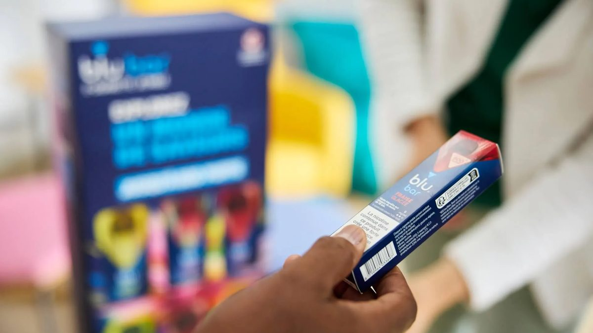
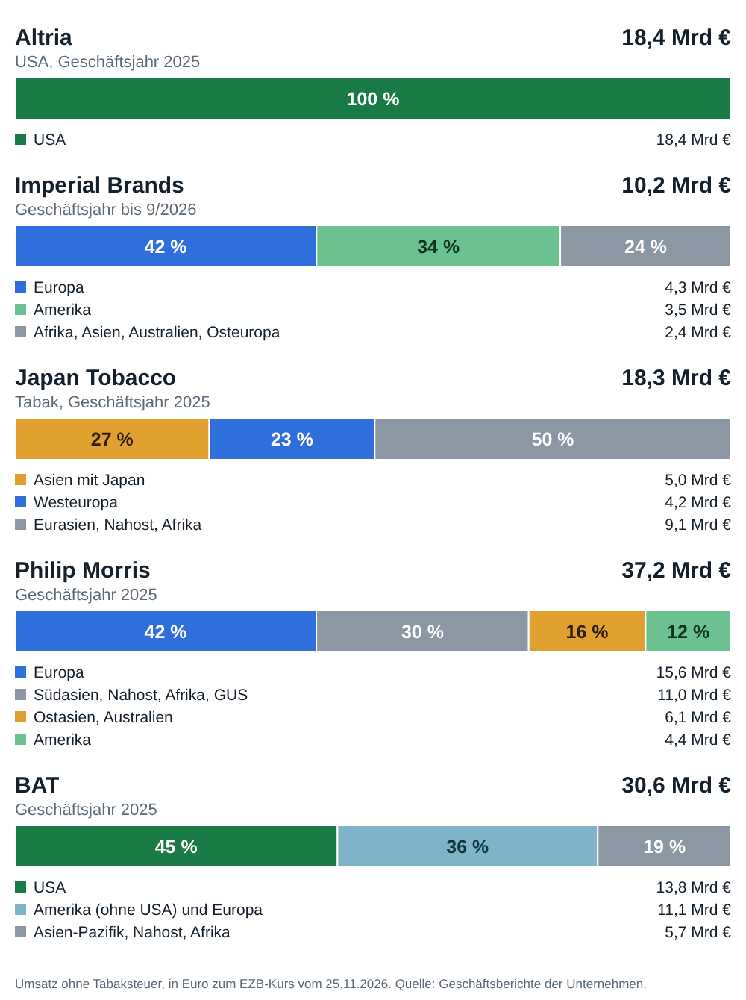
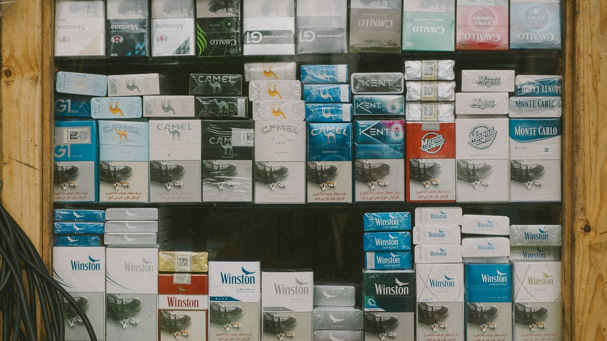
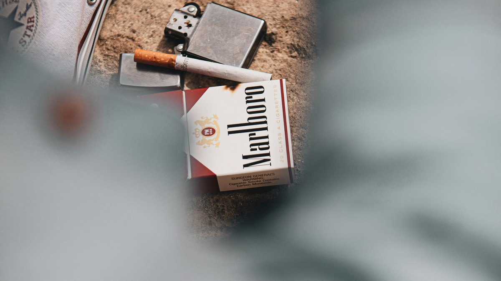
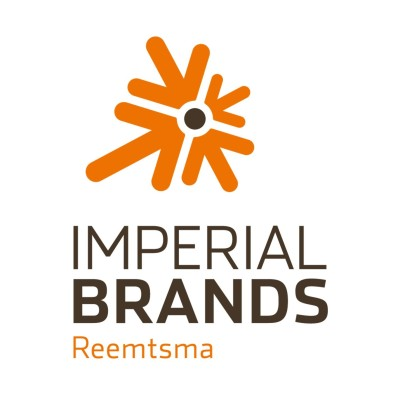

<!-- PRÜFEN: Aufteilung (Altria international, Japan Tobacco USA, Afrika, Naher Osten) ist ein Szenario von Analysten und Medien, von keinem der drei Konzerne bestätigt. Im Text so gekennzeichnet. -->
<!-- PRÜFEN: Winston gehört außerhalb der USA bereits Japan Tobacco (aus der Übernahme von RJR International 1999); in den USA liegt die Marke bei Imperials Tochter ITG Brands. Vor Veröffentlichung gegenprüfen. -->
<!-- PRÜFEN: Regionalgrafik: Umsätze aus Imperial FY26-RNS (Tabak und NGP), JT Präsentation FY2025 (Tabak Core Revenue, ohne Pharma), PMI/BAT/Altria Jahreszahlen 2025; EZB-Kurs 25.11. (1,0935 USD, 0,8373 GBP, 174,22 JPY) als Näherung. Auslandsanteil 19 % und Zuordnung Amerika=USA bei Imperial sind eigene Annahmen. Quelle des Instagram-Posts und Foto-Credits (Logan Weaver, Mdreza Jalali) prüfen. -->
<!-- PRÜFEN: Das Rechenbeispiel mit 30 % Aufschlag ist eine eigene Überlegung, kein berichteter Preis. -->
<!-- PRÜFEN: Hub-Kennzahlen Stand Schlusskurse 26.11.2026 (Imperial nach dem Kurssprung, Japan Tobacco Tradegate vor dem Plus vom Freitag). -->

!!! kurz "Kurz gesagt"
    **Der Stand:** Altria prüft ein Barangebot für Imperial Brands und verhandelt mit einem Dritten über einen Teil des Geschäfts. Ein Angebot ist nicht sicher, Frist ist der 24. Dezember.
    **Das Szenario:** Analysten rechnen damit, dass Altria das internationale Geschäft von Imperial nimmt und Japan Tobacco das US-Geschäft sowie Afrika und den Nahen Osten. Bestätigt ist das nicht.
    **Die Börse:** Imperial steigt um 13 %, Japan Tobacco um 4,5 %, Altria gibt um 2 % nach. Philip Morris und BAT reagieren kaum.
    **Das Risiko:** Ein Barkauf in dieser Größe würde Altria so hoch verschulden wie nie zuvor, bei einer Ausschüttungsquote von schon jetzt 92 %.

Altria hat in den USA ein Problem, das sich nicht wegverkaufen lässt: Der Markt schrumpft. Im dritten Quartal fiel der Zigarettenabsatz der Branche in den USA um rund 5 %, Altrias eigene Auslieferungen sanken um 2,9 %. Wer ein Geschäft hat, das jedes Jahr kleiner wird und trotzdem Milliarden abwirft, sucht irgendwann nach einem zweiten Standbein. Am Donnerstag hat der Konzern erstmals öffentlich gemacht, wo er es offenbar sucht: bei Imperial Brands, dem britischen Hersteller von Davidoff, Gauloises und West.

## Was bekannt ist

Altria bestätigte in einer Pflichtmitteilung, dass der Konzern ein Barangebot für Imperial erwägt. Einen Preis nennt die Mitteilung nicht, und es gebe keine Gewissheit, dass ein Angebot kommt. Zugleich führt Altria Gespräche mit einem Dritten über den Kauf eines Teils von Imperial. Nach den britischen Übernahmeregeln muss Altria bis zum 24. Dezember um 17 Uhr Londoner Zeit ein festes Angebot ankündigen oder verzichten. Eine Verlängerung braucht die Zustimmung der Aufsicht.

Imperial selbst erklärte, es habe weder mit Altria noch mit einem Dritten gesprochen und kein Angebot erhalten. Der Verwaltungsrat werde jeden Vorschlag prüfen. Die Aktie schloss in London 13,3 % höher bei 34,32 Pfund, der Börsenwert liegt bei rund 26 Milliarden Pfund. Japan Tobacco, nach Bloomberg-Informationen der mögliche Partner, kommentiert nichts und legte am Freitag in Tokio um 4,5 % zu.

Drei Konzerne auf drei Kontinenten, Altria in den USA, Imperial in Europa und Japan Tobacco in Asien, könnten damit die nächste Konsolidierungswelle der Branche auslösen. Käme der Deal zustande, wäre es vermutlich die größte Übernahme im Tabaksektor seit mehr als zehn Jahren.

## Wer wo wie viel umsetzt

Um die möglichen Aufteilungen einzuordnen, hilft ein Blick auf die Regionen. Altria ist ein reines US-Unternehmen: Der gesamte Umsatz von rund 18,4 Milliarden Euro (ohne Tabaksteuer) kommt von dort. Imperial setzt insgesamt 10,2 Milliarden Euro um, davon 42 % in Europa, 34 % in Amerika, das dürfte überwiegend die USA sein, und 24 % in Afrika, Asien, Australien und Osteuropa. Japan Tobacco setzt im Tabakgeschäft 18,3 Milliarden Euro um, die Hälfte davon im Verbund aus Eurasien, Nahost und Afrika, die USA weist der Konzern nicht gesondert aus. Philip Morris (37,2 Milliarden Euro) ist stark in Europa, BAT (30,6 Milliarden Euro) macht fast die Hälfte des Umsatzes in den USA.

*Die Regionen sind bei jedem Konzern anders zugeschnitten und deshalb nur grob vergleichbar. Japan Tobacco ohne das ausgelagerte Pharmageschäft, Altria ohne Tabaksteuer.*

Rechnet man das Szenario grob nach, ergibt sich vermutlich dieses Bild: Das Europageschäft von Imperial mit 4,3 Milliarden Euro würde zu Altria gehen, das Amerikageschäft mit 3,5 Milliarden Euro zu Japan Tobacco. Wie die übrigen 2,4 Milliarden Euro aus Afrika, Asien, Australien und Osteuropa verteilt würden, ist offen, weil Imperial sie in einem Block ausweist. Selbst mit ganz Europa käme Altria damit nur auf einen Auslandsanteil von knapp 19 % des Umsatzes, der Rest bliebe der schrumpfende US-Markt. Für Philip Morris, das nur 12 % in Amerika umsetzt, wäre ein neuer Wettbewerber also vor allem in Europa spürbar, für BAT mit seinem hohen US-Anteil vor allem im Heimatmarkt von Altria.

## Das Szenario: Die Welt wird geteilt

Wie eine Aufteilung aussehen könnte, ist bislang Sache der Analysten. Offenbar am meisten diskutiert wird diese Variante:

| Teil von Imperial | Möglicher Käufer | Was dazugehört |
|---|---|---|
| Europa und internationale Märkte | Altria | Davidoff, Gauloises, West, Rizla |
| USA | Japan Tobacco | ITG Brands mit Winston, Kool, Salem |
| Afrika und Naher Osten | Japan Tobacco | wachsende Märkte, passen zum eigenen Afrika-Geschäft |

*Szenario nach Einschätzung von Analysten, von Altria, Japan Tobacco und Imperial nicht bestätigt.*

Die Logik dahinter ist vermutlich Kartellrecht. Würde Altria die US-Marken von Imperial selbst kaufen, träfe es mit Marlboro, die im dritten Quartal 39,5 % des US-Zigarettenumsatzes im Handel hielt, auf scharfe Prüfung durch die Wettbewerbsbehörde. Japan Tobacco dagegen hat in den USA bisher einen kleineren Auftritt und würde mit ITG vermutlich aufsteigen. Beide Konzerne arbeiten dort bereits zusammen: Im Gemeinschaftsunternehmen Horizon Innovations, das erhitzten Tabak in den USA aufbaut, hält Altria 75 % und Japan Tobacco 25 %. Die Marken von ITG gehen auf einen Zwangsverkauf zurück: 2015 musste Reynolds American im Zuge der Lorillard-Übernahme Winston, Kool und Salem abgeben, Imperial zahlte damals 7,1 Milliarden Dollar.

## Für Altria geht es um die Region

Für Altria ist die geografische Verteilung der Kern des Geschäfts. Seit der Abspaltung von Philip Morris International 2008 verkauft der Konzern Zigaretten ausschließlich in den USA. Damals hatte die Trennung gute Gründe: Klagen und Behördendruck zu Hause, dazu mehr Spielraum für die internationale Firma, in Schwellenländern zu wachsen. Altria behielt Marlboro für die USA, Philip Morris bekam den Rest der Welt.

18 Jahre später zeigt sich der Preis dieser Entscheidung. Das US-Geschäft wirft hohe Margen ab, kommt aber kaum noch voran. Preiswerte Marken erreichten im dritten Quartal 34,1 % des US-Handelsumsatzes, zwei Punkte mehr als ein Jahr zuvor. Altria hält mit Preiserhöhungen und den Nikotinbeuteln on! dagegen, die Preise sichern die Margen, die Menge retten sie nicht. Ein internationales Portfolio würde die Abhängigkeit vom schrumpfenden Heimatmarkt verringern, und Imperial wäre dafür ein vergleichsweise günstiger Weg: Das erwartete Kurs-Gewinn-Verhältnis liegt bei 8,3, bei Altria bei 12,6 und bei Japan Tobacco bei 17,7. Selbst nach dem Kurssprung verlangt der Markt für Imperial deutlich weniger als für die Konkurrenz.

## Philip Morris: Der Bruder von einst wird Konkurrent

Für Philip Morris International ist die Meldung eine Rückkehr der Vergangenheit. Beide Konzerne waren bis 2008 eine Firma, 2019 sprachen sie über eine Wiedervereinigung mit einem Marktwert von mehr als 200 Milliarden Dollar, die Gespräche endeten im September 2019 ohne Ergebnis. Nun könnte Altria auf eigene Faust in Philip Morris' Revier zurückkehren.

Der Hebel ist allerdings kleiner, als es klingt. Marlboro gehört außerhalb der USA weiter Philip Morris, Altria müsste also mit den Marken von Imperial antreten. Dazu zählen Davidoff, Gauloises, West und Rizla. Imperial selbst hat zuletzt vor allem Marktanteile abgegeben: In Großbritannien verlor die Marke im Geschäftsjahr 70 Basispunkte, das Tabakvolumen fiel um 3,4 % auf 180,6 Milliarden Stück, das Unternehmen streicht bis zu 4.600 Stellen. Dass Philip Morris bei den Kursen am Donnerstag kaum zulegte und nicht verlor, spricht für eine gelassene Einschätzung des Marktes. Der Konzern wird mit einem Gewinn-Multiple von gut 27 bewertet, knapp dem Doppelten von Altria, weil Anleger ihm die Umstellung auf rauchfreie Produkte zutrauen.

Bernstein-Analyst Callum Elliott sieht Imperial in einer schwierigen strategischen Lage, Japan Tobacco und Altria in geringerem Maß. Keiner der drei habe genug finanzielle Kraft, um Philip Morris und BAT wirklich anzugreifen. Das ist die Gegenposition zur Idee vom großen Comeback.

## BAT: Mehr Druck in den USA und in Afrika

Für BAT liegen die Folgen weniger in der Zahl der Konkurrenten als in ihrer Stärke. In den USA ist die Tochter Reynolds mit Camel, Newport und Pall Mall der zweite große Anbieter hinter Altria. Käme Japan Tobacco mit ITG dazu, entstünde ein dritter Wettbewerber, der nach Einschätzung von Jefferies-Analyst Andrei Andon-Ionita auf Dauer ein ernst zu nehmender, breit aufgestellter und preisbewusster Konkurrent mit Kostenvorteilen sein könnte. Das trifft vor allem das Preissegment, in dem BAT ohnehin um Kunden kämpft. Wer den US-Markt von unten aufrollt, drückt die Preise.

Dazu kommt Afrika. Japan Tobacco baut dort bereits aus, mit Imperials Geschäft in Afrika und im Nahen Osten bekäme es mehr Vertrieb und Marken. BAT ist in diesen Märkten traditionell stark. Die BAT-Aktie gab am Donnerstag im Xetra-Handel 1,5 % nach, ein Zeichen für leichte Sorge, aber keine Panik. Auf der anderen Seite rückt der Sektor insgesamt in den Fokus: Wenn Imperial mit rund dem Achtfachen des erwarteten Gewinns bewertet wird und Anleger Angebote über dem fünfjährigen Höchststand von 9,6 erwarten, kann das auch für BAT mit einem Gewinn-Multiple von 13 die Bewertung stützen.

## Die Kosten: Altrias Bilanz und die Dividende

Der entscheidende Punkt für Dividendenanleger ist die Finanzierung. Altria zahlt eine Quartalsdividende von 1,11 Dollar und hat sie zuletzt um 4,7 % angehoben. Im Hub liegt die Ausschüttungsquote bei 92 %, die Rendite bei 5,9 %. Zum 30. September stand die Verschuldung bei 1,9-fachem EBITDA, die liquiden Mittel beliefen sich auf 2,7 Milliarden Dollar.

Imperial ist an der Börse rund 34 Milliarden Dollar wert. Ein Rechenbeispiel: Bei einem Aufschlag von 30 % wären es etwa 44 Milliarden Dollar, gut ein Drittel von Altrias eigenem Börsenwert von knapp 127 Milliarden Dollar. Dazu kommen Imperials Schulden von 8,8 Milliarden Pfund. Altria würde nur einen Teil des Geschäfts behalten, trägt aber bei einem Barangebot zunächst die gesamte Last, bis Japan Tobacco seinen Anteil bezahlt hat. Morningstar-Analyst Kristoffer Inton warnt, dass Altria dadurch die höchste Netto-Verschuldung ihrer Geschichte erreichen könnte und mehrere Jahre zum Abbau bräuchte, selbst wenn die Aktienrückkäufe pausieren. BTIG-Analyst Owen Bennett hält die Finanzierung für machbar, ohne die Kreditbewertung zu verändern, weil Japan Tobacco bis zu 7,4 Milliarden Dollar durch den Verkauf eigener Aktien aufbringen könnte.

Bei einer Quote von 92 % bleibt wenig Luft für eine hohe Schuldenlast. Imperial zahlt für das Geschäftsjahr 2026 eine Dividende von 166,72 Pence (+4 %), schüttet im Hub 75 % aus und hat für das neue Jahr einen Rückkauf über 1,5 Milliarden Pfund angekündigt. Bei einem Eigentümerwechsel stünde beides zur Disposition. Als Gegenwert bringt Imperial einen freien Cashflow von zuletzt 2,6 Milliarden Pfund mit, aus dem sich die Zinsen auf die Übernahmeschulden bedienen ließen.

## Die Konzerne im Vergleich

| Unternehmen | Börsenwert | KGV | Rendite |
|---|---|---|---|
|  Philip Morris | 264 Mrd € | 27,2 | 3,2 % |
|  BAT | 119 Mrd € | 13,0 | 5,3 % |
|  Altria | 115 Mrd € | 15,5 | 5,9 % |
|  Japan Tobacco | 56 Mrd € | 19,1 | 4,3 % |
|  Imperial Brands | 34 Mrd € | 13,7 | 5,5 % |

Die Kennzahlen stammen aus dem Hub, Stand Schlusskurse vom 26. November, bei Imperial also nach dem Kurssprung. Japan Tobacco ist mit dem Kurs vor dem Anstieg vom Freitag gerechnet, die Dividende von 234 Yen entspricht 81 % des Gewinns je Aktie von 287 Yen. Imperials KGV von 13,7 bezieht sich auf das letzte berichtete Jahr, das erwartete KGV von 8,3 (LSEG) rechnet mit den Gewinnen des laufenden Jahres.

## Was jetzt passieren kann

Der Kalender ist eng. Bis zum 24. Dezember muss Altria entscheiden, ob ein festes Angebot kommt. Die Aufsichtsbehörden in den USA, in der EU und in Großbritannien würden die Aufteilung prüfen, und in London könnte ein Kauf eines FTSE-100-Konzerns durch einen US-amerikanischen und einen japanischen Käufer politische Aufmerksamkeit bekommen. Der Imperial-Verwaltungsrat kann ein Angebot ablehnen oder höher verhandeln. Ein Aufschlag, der ihm hoch genug erscheint, muss Altria zugleich für die eigenen Aktionäre rechtfertigen: Die Altria-Aktie lag vor der Meldung seit Jahresbeginn fast 40 % im Plus und gab am Donnerstag nach.

## Fazit

Altria sucht die Welt, weil der Heimatmarkt schrumpft. Die Aufteilung mit Japan Tobacco würde das Kartellproblem vermutlich lösen, erzeugt aber ein Finanzierungsproblem. Für Philip Morris bleibt es zunächst bei einem Wettbewerber, der mit den Marken von Imperial an den Start geht und nicht mit Marlboro. Für BAT kann der Druck größer werden: im US-Preissegment, wo Japan Tobacco mit ITG aufsteigen würde, und in Afrika. Für Altria-Aktionäre hängt viel davon ab, ob der Preis stimmt und ob die Dividende die hohen Schulden aushält.

## Quellen

- [Altria, Mitteilung zu einem möglichen Angebot (RNS), 26.11.2026](https://6ix.com/news/statement-re-possible-offer-94)
- [Bloomberg: Altria Studies Deal for Cigarette Maker Imperial Brands, 26.11.2026](https://www.bloomberg.com/news/articles/2026-11-26/altria-studies-deal-for-cigarette-maker-imperial-brands)
- [Bloomberg: Japan Tobacco Climbs on Potential Imperial Brands Takeover, 27.11.2026](https://www.bloomberg.com/news/articles/2026-11-27/japan-tobacco-shares-climb-on-potential-imperial-brands-takeover)
- [Reuters via MarketScreener: US Marlboro maker Altria explores Imperial cash bid, possible carve-up, 26.11.2026](https://www.marketscreener.com/quote/stock/ALTRIA-GROUP-INC-4837/news/US-Marlboro-maker-Altria-explores-Imperial-cash-bid-possible-carve-up-13539660/)
- [Reuters via Finwire: Japan Tobacco shares surge on talk it may acquire part of Imperial, 27.11.2026](https://finwire.io/news/stock-markets-news/japan-tobacco-shares-surge-on-talk-it-may-acquire-part-of-imperial)
- [Aktien.news: Japan Tobacco und Altria prüfen gemeinsame Übernahme von Imperial Brands, 27.11.2026](https://aktien.news/japan-tobacco-und-altria-prufen-gemeinsame-ubernahme-von-imperial-brands)
- [Startup Fortune: Altria weighs a cash bid for Imperial Brands as Japan Tobacco eyes a deal, 27.11.2026](https://startupfortune.com/altria-weighs-a-cash-bid-for-imperial-brands-as-japan-tobacco-eyes-a-deal/)
- [Longbridge: Altria, Parent of Marlboro, Mulls All-Cash Takeover of Imperial Brands, 27.11.2026](https://longbridge.com/en/news/306946351)
- [Pomegra: Imperial Brands: Altria, Japan Tobacco weigh £26bn bid, 27.11.2026](https://pomegra.io/news/imperial-brands-altria-japan-tobacco-weigh-26bn-bid)
- [WJLA: A decade after a split, the Marlboro men seek a reunion, August 2019](https://wjla.com/news/nation-world/after-decade-apart-philip-morris-and-altria-may-become-1)
- [WTVR: Altria and Philip Morris end plans to reunite, 25.9.2019](https://wtvr.com/2019/09/25/altria-and-philip-morris-end-plans-to-reunite)
- Eigene Berichte: [Altria Q3 2026](/news/altria-q3-2026-ergebnisse/), [Imperial Brands Jahreszahlen 2026](/news/imperial-brands-jahreszahlen-2026/), [Altria prüft Angebot für Imperial](/news/altria-prueft-uebernahme-imperial-brands/)
- Kennzahlen: Aktien-Hub von Dividenden-Rechner.de, Stand 26.11.2026

*Dieser Beitrag fasst Berichterstattung und Unternehmensangaben der genannten Quellen in eigenen Worten zusammen. Keine Anlageberatung, alle Angaben ohne Gewähr.*
