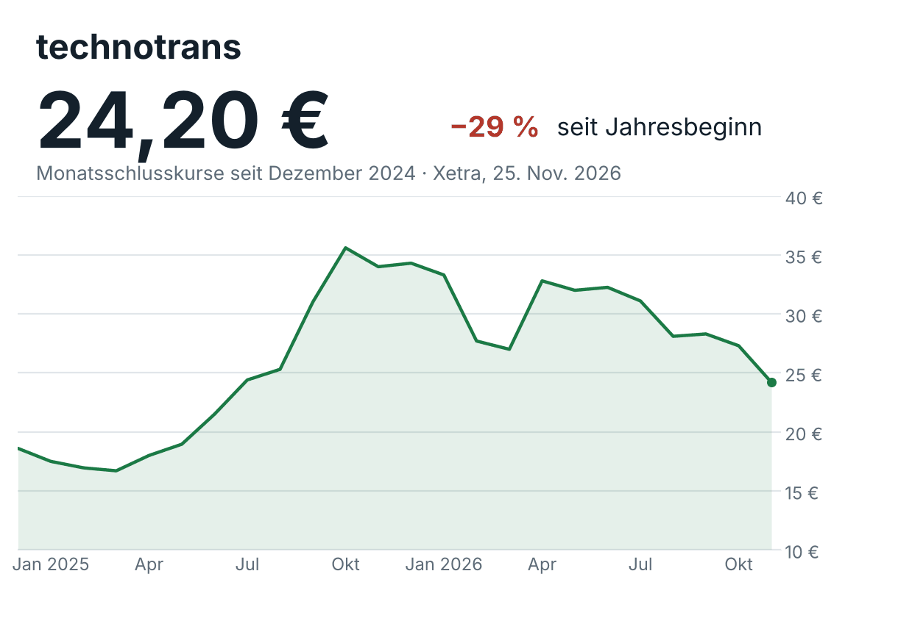

!!! kurz "Kurz gesagt"
    **Auftrag:** größte Serienbestellung für High-End-Laserkühlungen, Volumen im hohen einstelligen Millionenbereich, Umsatz überwiegend 2027

    **Aktie:** 24,20 Euro (25.11.), 29 % unter dem Stand zum Jahresbeginn, Börsenwert rund 165 Millionen Euro

    **Dividende:** 0,83 Euro je Aktie (+57 %), Rendite rund 3,4 %

Wer einen Hochleistungslaser betreibt, hat ein Wärmeproblem. Ein Laser, der Chips belichtet, Gewebe schneidet oder Metall schweißt, verwandelt nur einen Teil des Stroms in Licht, der Rest wird zu Hitze. Damit verdient technotrans aus Sassenberg im Münsterland sein Geld, und am Donnerstag hat der Konzern gemeldet, dass er die bislang größte Bestellung für in Serie gefertigte High-End-Laserkühlungen gewonnen hat. Das Volumen liegt im hohen einstelligen Millionen-Euro-Bereich, was gut drei Prozent eines Jahresumsatzes von 244 Millionen Euro entspricht. Umsatzwirksam wird der Auftrag überwiegend 2027. Wer der Kunde ist, steht nicht in der Mitteilung, sie spricht von einer High-Tech-Schlüsselindustrie.

## Was Laserkühlung leistet

Die Kühlung entscheidet beim Laser über die Qualität des Strahls. Bei Diodenlasern verschiebt sich die Wellenlänge um etwa 0,3 Nanometer je Grad Temperaturänderung, bei Kristallen mit schmaler Absorptionsbreite sinkt dadurch die Ausgangsleistung. Die Kühlgeräte, Chiller genannt, arbeiten wie ein Kühlschrank in Industrieformat: Ein geschlossener Wasserkreislauf nimmt die Wärme am Laser auf und gibt sie über einen Wärmetauscher ab. Die Temperatur des Wassers muss dabei in engen Grenzen konstant bleiben, auch wenn der Laser gepulst arbeitet und die Last in Sekundenbruchteilen wechselt.

Ein Beispiel aus dem eigenen Programm ist die Baureihe PRO300, ein Kühler zum Einbau ins Gerätegestell mit 170 bis 4.200 Watt Kühlleistung. Er arbeitet mit dem natürlichen Kältemittel R290, alle Motoren sind drehzahlgeregelt. Die Geräte kommen in der Laserchirurgie, in Analysegeräten und in der Halbleiterfertigung zum Einsatz, dort etwa bei der Lithografie. Die Kühlung gehört zum Laser wie das Gehäuse, ein Hersteller kauft sie also gleich mit und wechselt den Lieferanten selten.

## Die Geräte und die Konkurrenz

Der PRO300 ist ein Einschub für das 19-Zoll-Gestell, wie man es aus Serverräumen kennt, in Baugrößen von 4 bis 12 Höheneinheiten. Je nach Modell wiegt er 32 bis 70 Kilogramm und kühlt mit 170 bis 4.200 Watt. Die Wassertemperatur bleibt auf etwa ein Zehntel Grad stabil. Der Behälter besteht aus einem Stück Kunststoff und lässt sich vollständig reinigen, Filter und Entionisierungspatronen sitzen vorn und lassen sich im laufenden Betrieb wechseln. Über Modbus und optional Ethernet, OPC UA und Webserver bindet ihn der Laserhersteller in die eigene Steuerung ein. Das Kältemittel R290 (Propan) hat ein sehr geringes Treibhauspotenzial und kommt damit den europäischen F-Gas-Regeln entgegen, die fluorierte Kältemittel schrittweise verteuern. Für Anwendungen, in denen jede Vibration stört, etwa in Messlaboren, gibt es kältemittelfreie Peltier-Kühler, dazu kleine Einheiten mit 24-Volt-Miniaturkompressor, die Hersteller direkt in ihre Geräte einbauen.

Die Laserkühlung stammt aus der Tochter termotek in Baden-Baden, die technotrans 2011 übernahm. Damals erwirtschaftete sie rund 8 Millionen Euro Umsatz, 2016 waren es 19 Millionen Euro. Seitdem ist der Standort erweitert worden, die Entwicklung sitzt in Baden-Baden, in China wird in Serie gefertigt.

Der Markt ist fragmentiert. In Deutschland gehört Hyfra mit kompakten Industriekühlern zu den bekannten Namen. International gibt es Laird Thermal Systems aus den USA, die Zulieferer von Lasersystemen beliefern, dazu große Industriekonzerne wie SMC und Daikin aus Japan und viele chinesische Anbieter, allen voran TEYU, die vor allem den Markt für Faserlaser zum Schneiden und Schweißen bedienen. Die Preisspanne ist groß, in Asien dominieren günstige Geräte.

technotrans spielt in der oberen Klasse. Der Vorteil liegt im Zusammenspiel aus Temperaturstabilität, Wartungsfreundlichkeit, Serienfertigung in Reinraumqualität (ISO-Klasse 7) und globalem Service rund um die Uhr. Diese Punkte zählen vor allem bei Lasern für Medizintechnik und Halbleiterfertigung, wo ein Ausfall teuer ist. Offen bleibt, wie viel Marktanteil technotrans in diesem Segment hält, dazu veröffentlicht das Unternehmen keine Zahl. Für die Kundenbindung spricht, dass ein Laserhersteller das Kühlgerät einmal qualifiziert und dann über Jahre in Serie einbaut. Der jetzt gemeldete Auftrag ist ein Beispiel dafür.

## Ein Mittelständler mit vier Standbeinen

technotrans entwickelt Thermomanagement für anspruchsvolle Anwendungen, beschäftigt rund 1.440 Menschen und produziert an sechs Standorten in Deutschland sowie je einem in China und den USA. Der Konzern ist im Prime Standard gelistet. Er gliedert sich in vier Fokusmärkte: Energy Management mit Elektromobilität, Ladestationen und Rechenzentren, dazu Healthcare & Analytics, Plastics und Print. Das Standard-Lasergeschäft ist seit 2026 dem Bereich Energy Management zugeordnet.

Das Wachstum soll aus der Energie- und Rechenzentrumssparte kommen. Der Umsatz mit Rechenzentren soll sich 2026 gegenüber dem Vorjahr verdreifachen, im Juli kam ein Auftrag für Flüssigkühlsysteme im zweistelligen Millionenbereich dazu. Hinzu kommen Batteriekühlung für Elektrobusse und ein Großserienauftrag für kompakte Temperiergeräte im Plastics-Geschäft, der ab 2027 jährlich einen niedrigen zweistelligen Millionenbetrag bringen kann. Der Auftragsbestand erreichte Ende September mit 103 Millionen Euro einen Höchststand, auf einen Euro Umsatz kamen 1,20 Euro neue Bestellungen. Bis 2030 will technotrans mehr als 350 Millionen Euro Umsatz und eine EBIT-Marge von 9 bis 12 % erreichen, das wären gut 40 % mehr Umsatz als 2025.

## Die ersten neun Monate

| Kennzahl | 2026 | 2025 |
|---|---|---|
| Umsatz | 175,7 Mio. € | 183,5 Mio. € |
| EBIT | 12,6 Mio. € | 12,8 Mio. € |
| EBIT-Marge | 7,2 % | 7,0 % |
| Gewinn je Aktie | 1,12 € | 1,15 € |
| Free Cashflow | 5,2 Mio. € | 8,0 Mio. € |

Der Umsatz sank um 4,2 %, weil Print (56,6 Millionen Euro, −8 %) und Plastics (40,1 Millionen Euro, −15 %) unter der Investitionszurückhaltung der Kunden leiden. Die Marge steigt trotzdem, im dritten Quartal lag sie bei 7,4 %. Für 2026 erwartet der Konzern einen Umsatz am unteren Ende der Spanne von 240 bis 260 Millionen Euro, eine EBIT-Marge von 6,5 bis 8,5 % und einen Free Cashflow von etwas über 10 Millionen Euro.

!!! zitat "Michael Finger, Vorstandsvorsitzender der technotrans SE"
    {: .zitatfoto }

    „Dieser Rekordauftrag ist ein konkreter Beleg für unsere Technologiekompetenz und unsere Stärke in der industriellen Serienfertigung. Er zeigt, dass wir technologisches Know-how erfolgreich in skalierbares Seriengeschäft überführen können.“

    technotrans SE, Pressemitteilung vom 26. November 2026

## Ist die Dividende gedeckt?

Die Hauptversammlung hat im Mai 0,83 Euro je Aktie beschlossen, 57 % mehr als im Vorjahr. Das sind rund 5,7 Millionen Euro, etwa die Hälfte des Jahresüberschusses 2025 von 11,5 Millionen Euro. Der freie Cashflow lag 2025 mit 16,6 Millionen Euro fast dreimal so hoch wie die Ausschüttung. In den ersten neun Monaten 2026 reichen die 5,2 Millionen Euro Cashflow knapp nicht an die Summe heran, das Jahresziel von über 10 Millionen Euro würde die Dividende aber decken. Die Eigenkapitalquote liegt bei 63,1 %, dazu kommen 16,7 Millionen Euro an liquiden Mitteln und ungenutzte Kreditlinien von 20,7 Millionen Euro. Bei einem Kurs von 24,20 Euro ergibt sich eine Dividendenrendite von rund 3,4 %.

## Die Aktie

Die Aktie schloss am Mittwoch bei 24,20 Euro, Ende 2025 waren es 34,30 Euro. Das Hoch der letzten zwei Jahre liegt beim Monatsschluss im Oktober 2025 mit 35,60 Euro. Montega hält an „Kaufen“ mit einem Kursziel von 38 Euro fest, MPCM bleibt bei „Buy“ und hat das Ziel am 11. November von 41 auf 32 Euro gesenkt. Die Aufträge schlagen sich erst ab 2027 im Umsatz nieder, 2026 bleibt ein Jahr mit sinkenden Erlösen.

Wie stark kleine deutsche Technikwerte auf einen einzigen Großkunden reagieren können, zeigte Mitte November Singulus aus Kahl am Main. Der Maschinenbauer meldete einen Liefervertrag mit SpaceX über 60 Millionen Euro für Solartechnik der Starmind-Satelliten, die Aktie sprang zeitweise um bis zu 80 %. Der Börsenwert lag danach bei rund 73 Millionen Euro, bei einem Jahresumsatz von 48,3 Millionen Euro. Eine Übernahme war das nicht, SpaceX ist Kunde. Auch bei technotrans entscheidet der Großkunde über die Zahlen, der Konzern streut sein Risiko aber über vier Märkte, 17 Standorte und einen Auftragsbestand von mehr als einem Drittel des Jahresumsatzes.

## Quellen

- [technotrans SE, Pressemitteilung zum Rekordauftrag, 26.11.2026](https://www.technotrans.de/)
- [technotrans, Q3- und 9-Monats-Mitteilung vom 10.11.2026 (EQS)](https://www.deraktionaer.de/nachricht/eqs-news-technotrans-steigert-umsatz-im-3-quartal-deutlich-und-erzielt-in-den-ersten-9-monaten-des-geschaeftsjahres-2026-eine-ebit-marge-von-72-deutsch-564617.html)
- [technotrans, Halbjahresmitteilung vom 4.8.2026](https://www.laserfocusworld.com/directory/laser-sources/laser-semiconductor/press-release/55396482/technotrans-se-technotrans-improves-earnings-quality-in-the-first-half-of-2026-and-increases-order-backlog-to-96-million)
- [technotrans, Hauptversammlung 2026 (Dividende, Ziele 2030)](https://www.technotrans.de/fileadmin/user_upload/Investor_Relations/HV/2026/20260529_TEC_PM_HV_2026_DE.pdf)
- [stock3: technotrans-Jahreszahlen 2025](https://stock3.com/news/technotrans-wachstumstreiber-bei-rechenzentren-und-halbleitern-16997161)
- [technotrans, Kühler PRO300 für Laser](https://www.laserfocusworld.com/directory/other-sources-accessories-equipment/cooling-equipment/press-release/55354942/technotrans-se-premiere-in-shanghai-technotrans-presents-eco-efficient-precision-cooling-for-the-asian-laser-market)
- [technotrans, PRO300 Datenblatt](https://www.technotrans.de/fileadmin/user_upload/Download/Download/Prospekte/Prospekte-neu/TEC_PRO300_Chiller_Digitalversion_DE.pdf)
- [Reinraum.de: technotrans auf der Laser World 2025](https://www.reinraum.de/en/news/laser-world-2025-technotrans-showcases-future-proof-cooling-systems-with-r290-and-flexible-oem-solutions.html)
- [MarketScreener: technotrans und termotek, 2017](https://ca.marketscreener.com/quote/stock/TECHNOTRANS-SE-4058825/news/technotrans-expands-liquid-cooling-systems-business-area-24766485/)
- [Laird Thermal Systems: Umlaufkühler für Industrielaser](https://lairdthermal.com/sites/default/files/fields/media.file.field_media_file/2023-06/Aspekte-für-OEMs-Umlaufkühler-für-Industrielaser.pdf)
- [TEYU: Überblick Industriekühler-Hersteller](https://www.teyuchiller.com/industrial-chiller-manufacturers-overview.html)
- [RP Photonics: Laser cooling units](https://www.rp-photonics.com/laser_cooling_units.html)
- [goldesel.de: Analysten zu technotrans, 11.11.2026](https://goldesel.de/aktien/news/technotrans-aktie-analysten-senken-kursziele-trotz-rekordauftragsbestand)
- [Euronews: Singulus und SpaceX, 11.11.2026](https://de.euronews.com/2026/11/11/solarzellen-elon-musk-60-millionen-auftrag-deutsches-tech-unternehmen)
- Börsendaten: Xetra-Monatsschlusskurse und Schlusskurs vom 25.11.2026

*Dieser Beitrag fasst Unternehmensangaben und Berichterstattung der genannten Quellen in eigenen Worten zusammen. Keine Anlageberatung, alle Angaben ohne Gewähr.*
