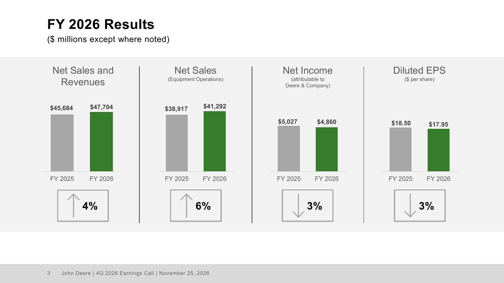
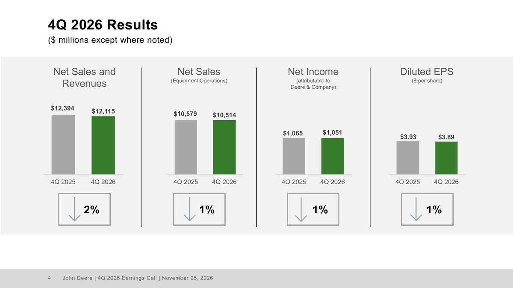
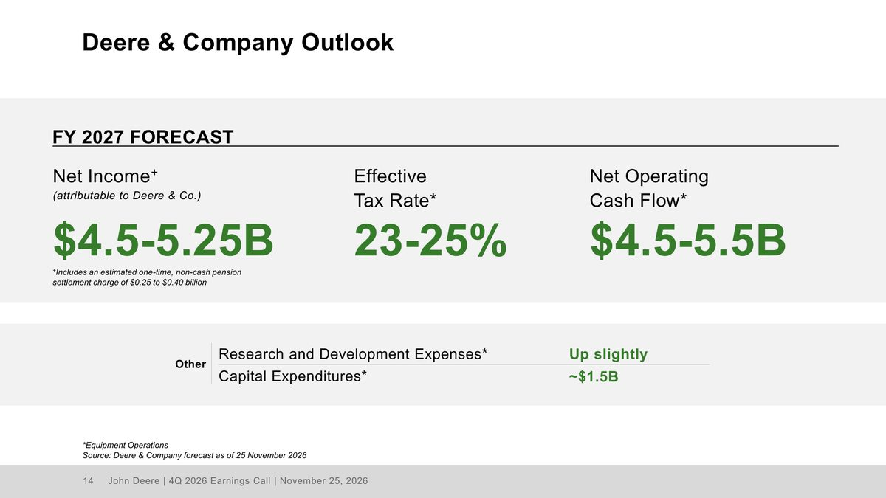
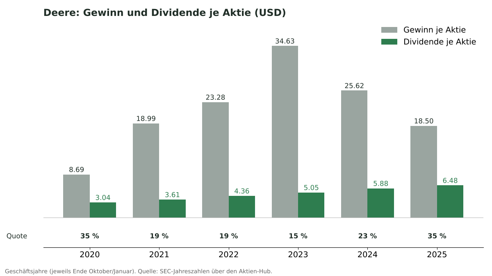
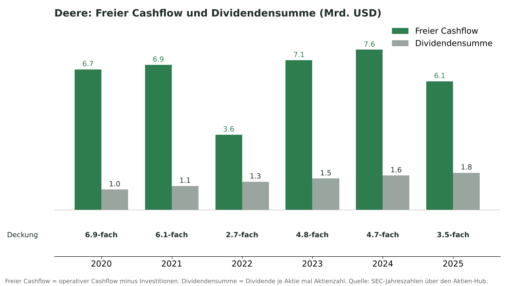

!!! kurz "Kurz gesagt"
    **Umsatz:** 47,7 Mrd. USD im Geschäftsjahr 2026 (+4 %)
    **Gewinn:** 4,86 Mrd. USD (−3 %), je Aktie 17,95 USD

    1. **Segmenttreiber:** Im Schlussquartal wuchsen Construction & Forestry (+12 %) und Small Ag & Turf (+10 %) und fingen den Umsatzrückgang bei großen Landmaschinen (−15 %) teilweise auf.
    2. **Kapitalverwendung:** Die Dividende lag im Hub bei 6,48 USD je Aktie, die Ausschüttungsquote bei 36 %.
    3. **Hoffnung und Haken:** Für 2027 erwartet Deere einen Nettogewinn von 4,5 bis 5,25 Mrd. USD, belastet durch einen einmaligen Pensionsaufwand von 0,25 bis 0,40 Mrd. USD.

Deere hat das Geschäftsjahr 2026 mit einem Umsatz von 47,7 Milliarden Dollar abgeschlossen, 4 Prozent mehr als im Vorjahr. Der Nettogewinn fiel dagegen um 3 Prozent auf 4,86 Milliarden Dollar, der Gewinn je Aktie auf 17,95 Dollar. Für das laufende Jahr 2027 rechnet der Konzern mit einem Nettogewinn zwischen 4,5 und 5,25 Milliarden Dollar. Die Dividende ist gedeckt, die Ausschüttungsquote liegt aber am oberen Ende dessen, was Deere als Ziel nennt.

*Folie 3 aus der Präsentation von John Deere zum 4. Quartal 2026, 25.11.2026.*

## Schlussquartal: Große Landmaschinen schwächeln, Kleingeräte ziehen an

Im vierten Quartal sank der Umsatz um 2 Prozent auf 12,1 Milliarden Dollar, der Gewinn um 1 Prozent auf 1,05 Milliarden Dollar. Das Bild innerhalb des Konzerns ist uneinheitlich. Der größte Geschäftsbereich, Production & Precision Ag mit großen Traktoren, Mähdreschern und Präzisionstechnik, verkaufte 15 Prozent weniger, sein operativer Gewinn fiel von 604 auf 406 Millionen Dollar. Den größten Anteil daran hatte der Mengen- und Mixeffekt mit minus 305 Millionen Dollar.

Der Bereich Small Ag & Turf mit Rasen- und Kommunaltechnik wuchs dagegen um 10 Prozent, sein operativer Gewinn stieg von 25 auf 233 Millionen Dollar. Bei Construction & Forestry legte der Umsatz um 12 Prozent zu, getragen vor allem von höheren Preisen mit einem Effekt von 137 Millionen Dollar. Im Geschäftsjahr erreichte Construction & Forestry einen Umsatz von 13,9 Milliarden Dollar, bei den großen Landmaschinen waren es 15,7 Milliarden.

Die Lage im Handel erklärt, warum das große Agrargeschäft schwächelt. Bei 100-PS-plus-Traktoren in den USA und Kanada hielten die Händler zum Stichtag Ende Oktober Bestände, die 31 Prozent der Verkäufe der vergangenen zwölf Monate entsprachen. Ein Jahr zuvor waren es 23 Prozent. In Europa sanken die Verkäufe von Traktoren im Einzelhandel im niedrigen zweistelligen Bereich, bei Mähdreschern im zweistelligen Bereich.

*Folie 4 aus der Präsentation von John Deere zum 4. Quartal 2026, 25.11.2026.*

## Ausblick 2027: Das Wachstum kommt aus den USA

Deere erwartet für das Agrargeschäft in den USA und Kanada bei großen Maschinen einen Absatzanstieg von 5 bis 15 Prozent, in Europa dagegen einen Rückgang von bis zu 5 Prozent. Für den Bereich Production & Precision Ag stellt der Konzern einen Umsatz von 5 bis 15 Prozent mehr in Aussicht, bei einer operativen Marge von 12,5 bis 14,5 Prozent nach 11,3 Prozent im Vorjahr.

*Folie 14 aus der Präsentation von John Deere zum 4. Quartal 2026, 25.11.2026.*

Im Bereich Small Ag & Turf erwartet Deere einen etwa gleichbleibenden Umsatz, die Marge soll allerdings von 15,1 Prozent auf 12,5 bis 13,5 Prozent sinken. Bei Construction & Forestry liegt der Umsatz zwischen gleichbleibend und plus 10 Prozent, die Marge bei 9,5 bis 11,5 Prozent nach 10,6 Prozent. Der Finanzbereich soll rund 900 Millionen Dollar Gewinn beitragen, nach 885 Millionen im Vorjahr.

Der Cashflow aus dem Geschäft soll zwischen 4,5 und 5,5 Milliarden Dollar liegen, die Investitionen bei rund 1,5 Milliarden Dollar. Ein einmaliger, nicht zahlungswirksamer Pensionsaufwand von 0,25 bis 0,40 Milliarden Dollar drückt den Nettogewinn.

## Dividende: gedeckt, aber nah am oberen Rand

Deere nennt als Ziel für die Dividende eine Ausschüttungsquote von 25 bis 35 Prozent des Gewinns im Mittelzyklus. Im [Aktien-Hub zu Deere](/dividende/deere-und/) liegt die Quote bei 36 Prozent, gerechnet auf den Gewinn der letzten zwölf Monate. Die Dividende beträgt 6,48 Dollar je Aktie, die Rendite 1,06 Prozent. Eine eigene Dividendenzahl für das Geschäftsjahr 2026 ist in den Daten noch nicht erfasst, deshalb steht im Hub der Wert von 2025.

*Eigene Grafik nach SEC-Jahreszahlen über den Aktien-Hub. Quote = Dividende je Aktie geteilt durch Gewinn je Aktie.*

Gemessen am Cashflow ist die Ausschüttung gut gedeckt. Der freie Cashflow der letzten zwölf Monate liegt im Hub bei 6,0 Milliarden Dollar, die Dividendensumme bei 1,75 Milliarden Dollar. Die Ausschüttung beansprucht damit 29 Prozent des freien Cashflows. Für 2027 ergibt der Ausblick von 4,5 bis 5,5 Milliarden Dollar operativem Cashflow abzüglich rund 1,5 Milliarden Investitionen einen freien Cashflow von 3 bis 4 Milliarden Dollar, also grob das Doppelte der Dividendensumme. Deeres eigene Cashflow-Definition für den Bereich Equipment Operations weicht von dieser Rechnung etwas ab.

*Eigene Grafik nach SEC-Jahreszahlen über den Aktien-Hub.*

Die Bilanz trägt die Ausschüttung ebenfalls. Der Hub weist Nettoschulden von minus 1,7 Milliarden Dollar aus, also mehr Cash als Schulden. Die Zinsdeckung liegt bei 3,0.

Die Quote steigt, weil der Gewinn seit drei Jahren sinkt: Der Gewinn je Aktie lag 2023 bei 34,63 Dollar, 2024 bei 25,62 Dollar und 2025 bei 18,50 Dollar. Die Dividende wuchs trotzdem. Im Hub steht ein durchschnittliches jährliches Plus von 11,7 Prozent über zehn Jahre und von 16,3 Prozent über fünf Jahre. Die Ausschüttung soll sich am Mittelzyklus orientieren und einzelne schwache Jahre glätten. Die Reihenfolge der Kapitalverwendung ist klar: Zuerst kommt die Dividende, Aktienrückkäufe folgen aus dem übrig bleibenden Cashflow.

Dies ist eine Einordnung und keine Anlageberatung.

## Quellen

- John Deere: 4Q 2026 Earnings Call, Präsentation vom 25.11.2026
- Deere & Company: Jahresbericht Geschäftsjahr 2026, 25.11.2026
- Aktien-Hub von Dividenden-Rechner.de, Kennzahlen Deere & Co (Stand 24.11.2026), [Seite zu Deere](/dividende/deere-und/)
