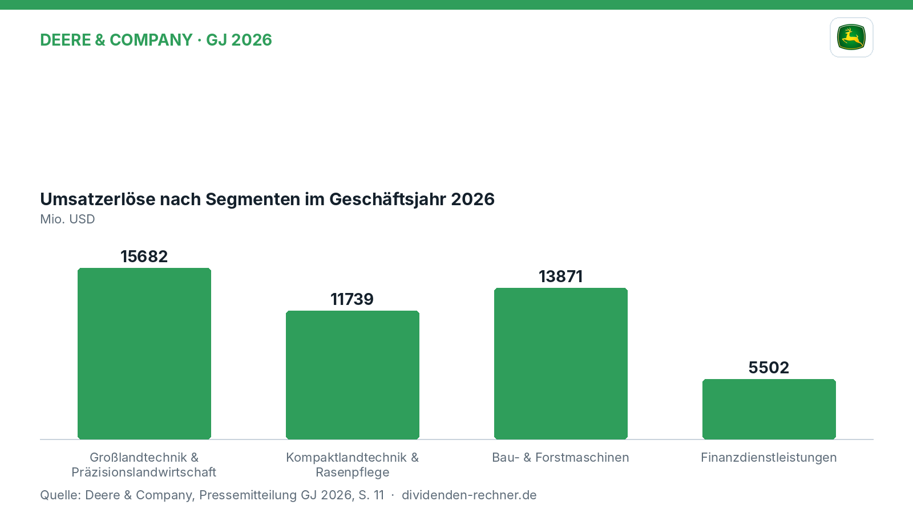
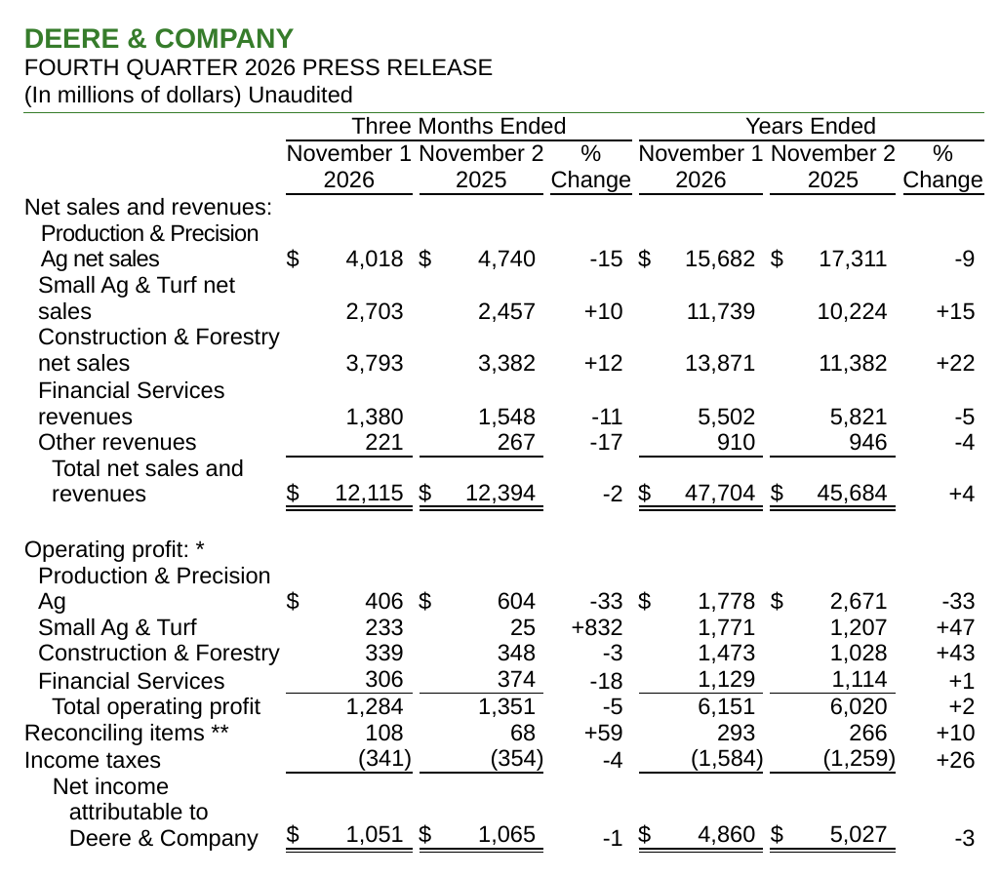
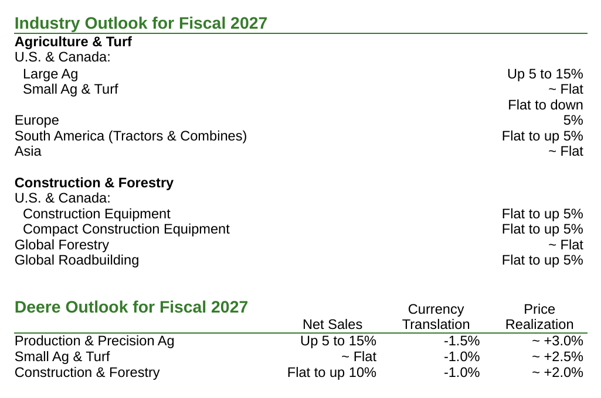

<!-- PRÜFEN: Aufmacherfoto ist automatisch von Unsplash gewaehlt: bitte pruefen, ob es zum Artikel passt (sonst image-Zeilen entfernen, dann entsteht ein Titelbild automatisch). -->
<!-- PRÜFEN: Diese Werte wurden im Berichtstext nicht gefunden: Grafik Großlandtechnik & Präzisionslandwirtschaft: 15682; Grafik Kompaktlandtechnik & Rasenpflege: 11739; Grafik Bau- & Forstmaschinen: 13871; Grafik Finanzdienstleistungen: 5502 -->
<!-- PRÜFEN: Quelle: https://www.sec.gov/Archives/edgar/data/315189/000110465926131741/de-ex99d1.htm -->
<!-- PRÜFEN: Ausschnitte aus dem Bericht im Text (f1, f3): bitte prüfen, ob Zuschnitt und Platz passen. Unpassende Bildzeilen einfach löschen. -->

!!! kurz "Kurz gesagt"
    **Umsatz:** 47,7 Mrd. USD (+4 %)
    **Gewinn:** 4,9 Mrd. USD (−3 %)

    1. **Segmenttreiber:** Das Segment Baumaschinen und Forstwirtschaft legte um 22 % zu und glich den Rückgang in der Großlandtechnik (−9 %) mehr als aus.
    2. **Kapitalverwendung:** Deere überwies **1,8 Mrd. USD** an Dividenden an die Aktionäre und kaufte für 796 Mio. USD eigene Aktien zurück.
    3. **Hoffnung und Haken:** Für 2027 deutet sich in Nordamerika eine Erholung der Landwirtschaft an, jedoch belasten einmalige Pensionskosten das Ergebnis mit bis zu 0,4 Mrd. USD.

## Baumaschinen retten Deeres Jahresbilanz – Ausblick deutet Wende im Agrarsektor an

Der Landmaschinenhersteller Deere & Company schließt ein herausforderndes Geschäftsjahr 2026 ab. Während sinkende Nachfrage in der Großlandwirtschaft auf die Erträge drückte, fingen das Baumaschinengeschäft und die Kompaktlandtechnik den Rückgang auf Konzernebene auf.

*Eigene Darstellung nach Daten aus: Deere & Company, Jahresbericht GJ 2026 vom 2026-11-25 · [Original](https://www.sec.gov/Archives/edgar/data/315189/000110465926131741/de-ex99d1.htm).*

### Baumaschinen kompensieren Schwäche der Großlandtechnik

Im gesamten Geschäftsjahr 2026 erzielte Deere einen Gesamtumsatz von **47,7 Mrd. USD**, was einem Plus von 4 % gegenüber den 45,7 Mrd. USD des Vorjahres entspricht. Der Nettogewinn gab hingegen um 3 % nach und sank von 5,0 Mrd. USD auf **4,9 Mrd. USD**. Das verwässerte Ergebnis je Aktie belief sich auf **17,95 USD** nach 18,50 USD im Geschäftsjahr 2025.

Die einzelnen Unternehmensbereiche entwickelten sich dabei sehr unterschiedlich. In der Großlandtechnik und Präzisionslandwirtschaft fiel der Jahresumsatz um 9 % auf 15,7 Mrd. USD, während der Betriebsgewinn dieser Sparte um 33 % auf 1,8 Mrd. USD einbrach. Demgegenüber wuchsen die Erlöse im Bereich Baumaschinen und Forstwirtschaft um 22 % auf 13,9 Mrd. USD. Der Sparte gelang ein Gewinnplus von 43 % auf 1,5 Mrd. USD. Auch die Kompaktlandtechnik verzeichnete ein Umsatzplus von 15 % auf 11,7 Mrd. USD.

> „Im Geschäftsjahr 2026 hat sich die Stärke unseres Smart-Industrial-Betriebsmodells bewiesen. Selbst auf zyklischen Tiefständen haben wir mit Disziplin gehandelt.“
>
> — John May, Chairman und CEO von Deere & Company

Im vierten Quartal schwächte sich das Geschäft insgesamt leicht ab: Die Umsatzerlöse sanken im Vorjahresvergleich um 2 % auf 12,1 Mrd. USD, während der Nettogewinn knapp unter dem Vorjahreswert bei 1,1 Mrd. USD lag.

*Segmentübersicht für Q4 und das Gesamtjahr 2026. Quelle: Deere & Company, Jahresbericht GJ 2026 vom 2026-11-25 · [Original](https://www.sec.gov/Archives/edgar/data/315189/000110465926131741/de-ex99d1.htm). Ausschnitt nur zugeschnitten, sonst unverändert.*

### Dividenden und Aktienrückkäufe bleiben verlässlich

Deere schüttete im abgelaufenen Geschäftsjahr insgesamt **1,8 Mrd. USD** an Dividenden aus. Je Aktie entsprach dies einer Zahlung von 6,48 USD, womit das Niveau des Vorjahres gehalten wurde. Neben der Dividende setzte der Konzern auf Aktienrückkäufe und erwarb eigene Anteile im Wert von 796 Mio. USD. Im Vorjahr hatten die Rückkäufe noch bei 1,1 Mrd. USD gelegen.

### Cashflow sinkt, Schuldenstand reduziert

Der operative Cashflow ging im Geschäftsjahr 2026 auf **6,0 Mrd. USD** zurück, nachdem er im Vorjahr noch 7,5 Mrd. USD betragen hatte. Ausschlaggebend hierfür waren vor allem Veränderungen beim Working Capital und den Kundenforderungen. Die Investitionen in Sachanlagen (Capex) wurden von 1,4 Mrd. USD auf 1,1 Mrd. USD zurückgefahren.

Bei der Verschuldung zeigt die Bilanz eine leichte Entlastung: Die langfristigen Finanzverbindlichkeiten sanken von 43,5 Mrd. USD im Vorjahr auf **40,6 Mrd. USD** zum Stichtag am 1. November 2026. Zusammen mit den liquiden Mitteln von 7,2 Mrd. USD steht der Konzern bilanziell auf einem soliden Fundament.

### Zyklustief durchschritten: Der Markt bereitet die Wende vor

Für Landmaschinenhersteller verlaufen die Geschäfte traditionell in ausgeprägten Zyklen. Nach den Rekordjahren der jüngsten Vergangenheit befand sich die Agrarbranche 2026 am Tiefpunkt der Nachfrage. Höhere Zinsen, gestiegene Betriebskosten für Landwirte und gefallene Erzeugerpreise bremsten Neuanschaffungen von Traktoren und Mähdreschern.

Dass Deere seine Gesamtgewinne nahezu stabil halten konnte, liegt an der Diversifizierung durch das Bau- und Forstsegment sowie an strukturellen Kostensenkungen. Branchenanalysten werten das abgelaufene Jahr als Talsohle des aktuellen Zyklus, von der aus eine schrittweise Erholung einsetzen dürfte.

### Prognose 2027: Erste Anzeichen für Erholung im Agrarsektor

Für das Geschäftsjahr 2027 prognostiziert Deere einen Nettogewinn zwischen 4,50 und 5,25 Mrd. USD. Dieser Ausblick beinhaltet eine einmalige, nicht zahlungswirksame Vorabbelastung für Pensionsverpflichtungen in Höhe von 0,25 bis 0,40 Mrd. USD.

*Branchen- und Unternehmensprognose für das Geschäftsjahr 2027. Quelle: Deere & Company, Jahresbericht GJ 2026 vom 2026-11-25 · [Original](https://www.sec.gov/Archives/edgar/data/315189/000110465926131741/de-ex99d1.htm). Ausschnitt nur zugeschnitten, sonst unverändert.*

Für den Hauptmarkt in den USA und Kanada erwartet das Management in der Großlandtechnik ein Umsatzwachstum von 5 bis 15 %. In Europa wird der Markt flach bis leicht rückläufig eingeschätzt. Das Segment Baumaschinen soll in Nordamerika um bis zu 5 % zulegen. Mit der erwarteten Stabilisierung der globalen Märkte sieht sich der Konzern gut aufgestellt, um von der steigenden Nachfrage nach Präzisionstechnologie zu profitieren.

Weitere Quellen zum Hintergrund: [Deere & Company’s Earnings: What to Expect](https://finance.yahoo.com/markets/stocks/articles/deere-company-earnings-expect-120336432.html) · [When Will Deere (NYSE:DE) Report Fiscal 2026 Results, and Wh](https://kalkine.com/news/industrials/when-will-deere-nysede-report-fiscal-2026-results-and-what-should-this-sp-500-stock-show) · [Deere & Company (DE) Stock Forecasts](https://finance.yahoo.com/research/reports/MS_0P000001NV_AnalystReport_1795049663000) · [Deere & Company (DE) Stock Forecasts](https://ca.finance.yahoo.com/research/reports/MS_0P000001NV_AnalystReport_1794963268000) · [When Will Deere (NYSE:DE) Share Its Fourth-Quarter 2026 Fina](https://kalkine.com.au/news/industrials/when-will-deere-nysede-share-its-fourth-quarter-2026-financial-results)

*Quelle: Deere & Company, Jahresbericht GJ 2026 vom 2026-11-25. Rechenwege eigene Berechnung. Keine Anlageberatung.*
