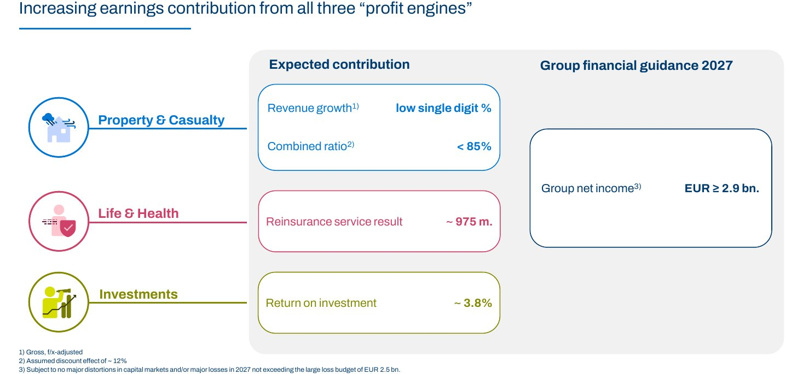
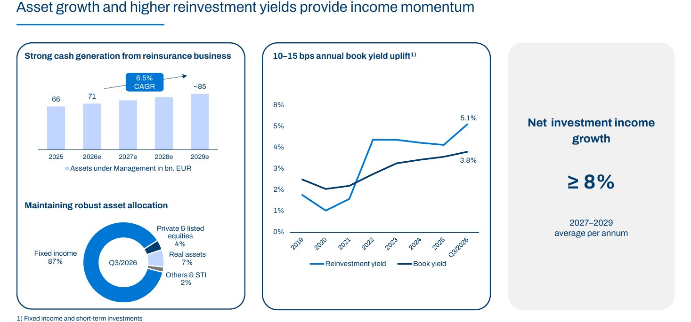

!!! kurz "Kurz gesagt"
    **Gewinnziel 2027:** mindestens 2,9 Mrd. Euro (2026: mindestens 2,7 Mrd. Euro)
    **Eigenkapitalrendite:** mindestens 18 % pro Jahr bis 2029
    **Dividende:** rund 55 % des Gewinns, mindestens so viel wie im Vorjahr

    Der Analystenschnitt hatte für 2027 mit 2,85 Mrd. Euro gerechnet.

Was halte ich von diesem Ausblick? Die Hannover Rück verspricht wenig Überraschendes und liefert es mit Aufschlag: 2,9 Mrd. Euro Gewinn für 2027 liegen rund 2 % über dem, was die Analysten im Schnitt erwartet hatten. Spannender als die Zahl ist die Herkunft. Im Geschäft mit den Schadenversicherungen sinken die Preise, und der Konzern plant mit einem größeren Großschadenbudget. Dass der Gewinn trotzdem um rund 7 % steigen soll, trägt vor allem das Geld, das der Konzern anlegt.

## Die Zielmarken bis 2029

Für die Jahre 2027 bis 2029 gibt der Konzern drei Zielmarken aus. Die Eigenkapitalrendite soll jedes Jahr mindestens 18 % betragen, das Betriebsergebnis (EBIT) im Schnitt um mindestens 5 % pro Jahr wachsen. Dazu kommt die Dividendenpolitik, die bleibt wie bisher: etwa 55 % des Konzerngewinns, mindestens aber so viel je Aktie wie im Vorjahr.

Die 18 % liegen unter den 21,1 %, die der Konzern zuletzt erreicht hat, aber klar über den 14 %, die in der laufenden Periode als Ziel standen. Die Periode 2024 bis 2026 schließt der Konzern damit deutlich über Plan ab: Die Eigenkapitalrendite lag im Schnitt bei 21,2 %, das Betriebsergebnis wuchs 2024 um 68 %, 2025 um 16 % und in den ersten neun Monaten 2026 um 17 %.

## Woher das Wachstum kommen soll

Das Gewinnziel von mindestens 2,9 Mrd. Euro steht unter zwei Bedingungen: keine größeren Verwerfungen an den Kapitalmärkten, und Großschäden bis höchstens 2,5 Mrd. Euro. Für 2026 liegt das Budget bei 2,3 Mrd. Euro. Auf diese Annahmen setzt der Konzern drei Treiber:

- **Kapitalanlagen:** Das Ergebnis aus Kapitalanlagen soll im Schnitt um mindestens 8 % pro Jahr wachsen. Das angelegte Vermögen steigt von 66 Mrd. Euro (2025) über 71 Mrd. Euro (2026) auf rund 85 Mrd. Euro im Jahr 2029, jährlich also um etwa 6,5 %. Frei werdendes Geld bringt derzeit 5,1 %, der Bestand rentiert mit 3,8 %. Diese Lücke füllt sich jedes Jahr um 10 bis 15 Basispunkte. Für 2027 erwartet der Konzern eine Rendite von rund 3,8 % nach 3,7 % in den ersten neun Monaten 2026.
- **Lebens- und Gesundheitsrückversicherung:** Das Serviceergebnis soll auf rund 975 Mio. Euro steigen, nach einem Jahresziel von rund 925 Mio. Euro für 2026. Das sind gut 5 % mehr.
- **Schadenrückversicherung:** Der Umsatz wächst im niedrigen einstelligen Prozentbereich, die Schaden-Kosten-Quote soll unter 85 % liegen (2026: unter 87 %). Der Konzern verweist auf einen Reservepuffer von zuletzt 3,2 Mrd. Euro, den er bei Preisdruck anzapfen kann. Die Kapitalanlagen machen zu 87 % festverzinsliche Papiere aus, deshalb ist dieser Teil des Plans vergleichsweise gut vorhersehbar.

Hinzu kommt ein Effekt von außen. Deutschland senkt die Körperschaftsteuer von 2028 bis 2032 schrittweise. Der Konzern erwartet deshalb, dass der Gewinn ab 2028 schneller wächst als das Betriebsergebnis. Bei den Kosten verweist die Hannover Rück auf einen Umsatz von 6,6 Mio. Euro je Mitarbeiter im Jahr 2025. Bei drei Vergleichsunternehmen (Munich Re, SCOR, Swiss Re) liegt er zwischen 2,3 und 4,3 Mio. Euro.

## Ist die Dividende gedeckt?

Im Frühjahr hat die Hannover Rück 12,50 Euro je Aktie gezahlt, zusammen rund 1,5 Mrd. Euro. Bei rund 120 Mio. Aktien ergeben 55 % von 2,9 Mrd. Euro rechnerisch etwa 13,30 Euro je Aktie für das Jahr 2027, das wären rund 4,5 % auf den Schlusskurs von 297,80 Euro. Für das laufende Jahr ergäben 55 % von 2,7 Mrd. Euro rechnerisch 12,40 Euro. Weil die Dividende mindestens auf Vorjahresniveau liegen soll, gilt dann die Untergrenze von 12,50 Euro, was etwa 4,2 % entspricht.

Die Deckung ist damit rechnerisch breit: Gezahlt wird gut die Hälfte des Gewinns, den Rest behält der Konzern. Die Solvenzquote lag zuletzt bei 242 % nach 269 % Ende 2023, die eigene Untergrenze beträgt 200 %. Sie ist gesunken, in den ersten neun Monaten 2026 von 256 auf 242 %, und parallel sind die nicht realisierten Verluste auf Anleihen auf 3,5 Mrd. Euro gewachsen. Das Polster schrumpft, ist aber noch deutlich.

## Was offen bleibt

Die Preise in der Schadenrückversicherung geben nach, zur Erneuerungsrunde am 1. Januar 2027 hatte der Konzern leicht rückläufige Preise erwartet. Der Plan setzt darauf, dass höhere Kapitalerträge das auffangen. Das funktioniert, solange die Zinsen hoch bleiben und die Großschäden im Rahmen liegen. Ein schweres Katastrophenjahr würde die 2,9 Mrd. Euro dagegen schnell in Frage stellen. Vor dem Investorentag stand die Aktie bei 297,80 Euro, nahe dem Rekordhoch von gut 309 Euro vom Anfang November, mit Kurszielen von 270 Euro (JPMorgan, Underweight) bis 325 Euro (Jefferies, Kaufen).
