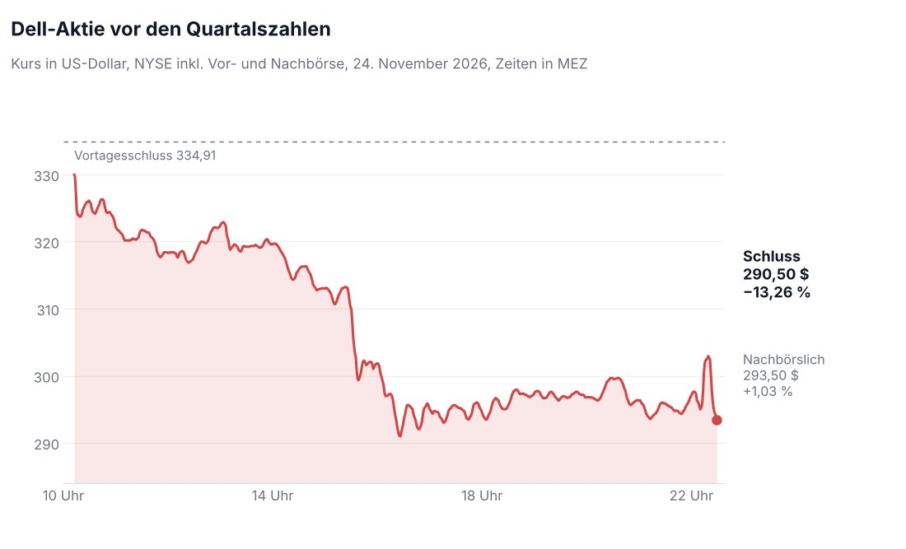
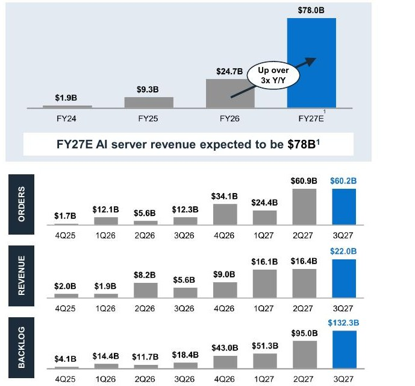
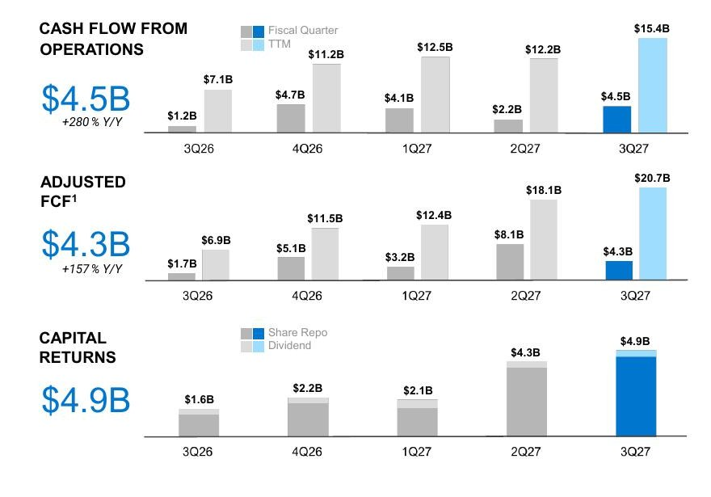

Dell hat am Dienstagabend die Erwartungen weit übertroffen. Im dritten Quartal des Geschäftsjahres 2027 (bis Ende Oktober) stieg der Umsatz um 103 % auf 54,9 Milliarden US-Dollar, Analysten hatten mit rund 49 Milliarden gerechnet. Der bereinigte Gewinn je Aktie lag bei 9,45 US-Dollar nach 2,59 vor einem Jahr, erwartet worden waren etwa 6,60. Für das Gesamtjahr stellt der Konzern jetzt 202 Milliarden US-Dollar Umsatz in Aussicht, 10 Milliarden mehr als zuletzt, und einen bereinigten Gewinn je Aktie von 29,68 US-Dollar.

Die Aktie war schon vor den Zahlen unter Druck. Sie verlor am Dienstag 13,3 % auf 290,50 US-Dollar, nachdem der Kurs in der Vorwoche bereits mit dem Sektor der KI-Server gefallen war. Nachbörslich lag sie nach der Veröffentlichung zunächst gut 1 % im Plus, die Telefonkonferenz stand da noch bevor.

## Der Auftragsbestand wächst weiter

Die Sorge der Anleger galt zuletzt der Frage, ob die KI-Nachfrage ihren Höhepunkt erreicht hat und ob steigende Speicherpreise die Marge drücken. Die Zahlen sprechen zunächst dagegen. Dell nahm im Quartal neue Aufträge für KI-Server über 60,2 Milliarden US-Dollar an, nach 60,9 Milliarden im Vorquartal. Der Bestand stieg von 95,0 auf 132,3 Milliarden. Der Umsatz mit KI-Servern vervierfachte sich fast auf 22,0 Milliarden US-Dollar, für das Gesamtjahr plant Dell mit 78 Milliarden und damit mehr als dem Dreifachen des Vorjahres (24,7 Milliarden).

Auch die klassischen Server zogen an. Ihr Umsatz stieg um 235 % auf 15,0 Milliarden US-Dollar, das Speichergeschäft wuchs um 24 % auf 4,9 Milliarden. Die Infrastruktursparte kommt damit auf 42,0 Milliarden Umsatz (plus 198 %) und eine operative Marge von 17,0 %, 4,6 Prozentpunkte mehr als vor einem Jahr. Der Gewinn der Sparte vervierfachte sich auf 7,1 Milliarden US-Dollar.

Schwächer läuft das PC-Geschäft. Der Umsatz stieg nur um 3 % auf 12,9 Milliarden US-Dollar, das operative Ergebnis fiel um 6 % auf 704 Millionen. Das Geschäft mit Privatkunden brach um 15 % ein, Firmenkunden legten um 6 % zu.

## Ist die Dividende gedeckt?

Sehr gut. Der operative Cashflow erreichte im Quartal mit 4,5 Milliarden US-Dollar einen Rekord, der bereinigte freie Cashflow lag bei 4,3 Milliarden. In den letzten zwölf Monaten waren es 20,7 Milliarden, die Dividendenzahlungen lagen im Geschäftsjahr 2026 bei rund 1,6 Milliarden. Die Dividende für das Geschäftsjahr 2027 beträgt auf Basis der aktuellen Quartalsrate 2,52 US-Dollar je Aktie, 20 % mehr als die 2,10 im Vorjahr. Bei einem Kurs von 290,50 US-Dollar ergibt das eine Rendite von knapp 0,9 %. Dell will die Dividende bis zum Geschäftsjahr 2030 um mindestens 10 % pro Jahr steigern.

Der größere Teil der Rückgabe läuft über Aktienrückkäufe. Insgesamt flossen im Quartal 4,9 Milliarden US-Dollar an die Aktionäre, so viel wie nie zuvor. Der Verwaltungsrat erhöhte die Rückkaufermächtigung um 25 Milliarden US-Dollar. Der Kern-Verschuldungsgrad liegt bei 0,7, die liquiden Mittel bei 16,3 Milliarden.

## Wo das Wachstum herkommen soll

Für das vierte Quartal peilt Dell 56,3 Milliarden US-Dollar Umsatz (plus 69 %) und einen bereinigten Gewinn je Aktie von 8,40 US-Dollar an. Der Umsatz mit KI-Servern soll auf rund 23,5 Milliarden steigen, die Kundenbasis aus Neocloud-Anbietern, Staaten und Unternehmen wuchs auf mehr als 7.500 Kunden. Dell sieht zunehmend Rechenzentren außerhalb der USA entstehen.

Offen bleibt, wie lange die Nachfrage anhält und was die Speicherpreise mit der Marge machen. Der Auftragsbestand muss erst in Umsatz umgewandelt werden, und Analysten wie die von Citi warnen vor vorgezogenen Bestellungen. Der Gewinn je Aktie wächst allerdings schneller als der Umsatz, weil die Betriebskosten kaum steigen und Dell Aktien zurückkauft.
