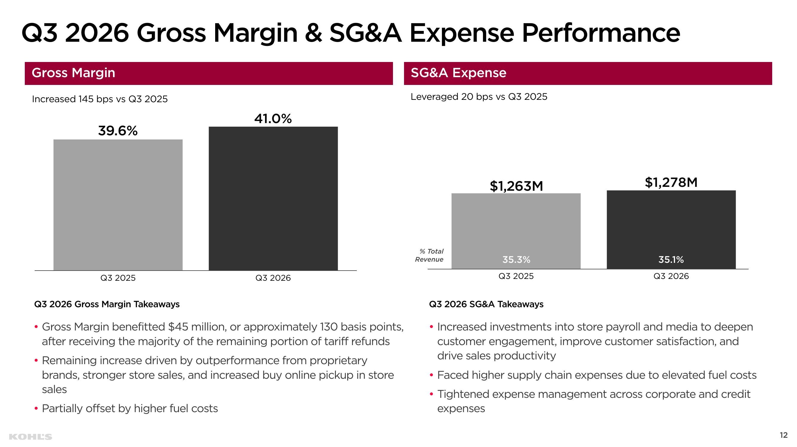
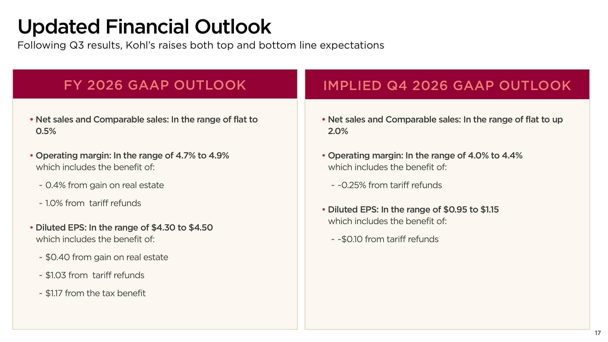

Kohl's ist im dritten Quartal (bis 31. Oktober) nach längerer Durststrecke wieder gewachsen. Der Umsatz stieg um 1,3 % auf 3,45 Milliarden US-Dollar, die vergleichbaren Umsätze legten um 1,2 % zu. Die Anleger honorierten das: Die Aktie sprang am Dienstag um 19,5 % auf 25,34 US-Dollar, bei einem Handelsvolumen von über 10 Millionen Stück. Der Konzern hebt außerdem die Prognose für das Gesamtjahr an. Allerdings steckt in den Gewinnzahlen viel Einmaliges, das die Einordnung erschwert.

## Was die Zahlen tragen

Der operative Gewinn nach US-Rechnungslegung stieg von 73 auf 217 Millionen US-Dollar, bereinigt von 77 auf 156 Millionen. Der bereinigte Gewinn je Aktie lag bei 1,76 US-Dollar nach 0,10 im Vorjahr, nach US-Rechnungslegung bei 2,15 US-Dollar. Die Bruttomarge verbesserte sich um 1,45 Prozentpunkte auf 41,0 %. Rund 1,3 Prozentpunkte davon gehen auf Zollerstattungen von 45 Millionen US-Dollar zurück. Den Rest erklärt Kohl's mit dem Erfolg der Eigenmarken (vergleichbarer Umsatz plus 3,4 %), stärkeren Filialumsätzen und mehr online bestellter Ware zur Abholung im Geschäft. Höhere Spritkosten bremsten.

Die Kosten stiegen mit 1,2 % ungefähr so stark wie der Umsatz, weil Kohl's mehr Personal in den Filialen und mehr Werbung bezahlt. Jede Warengruppe wuchs gegenüber dem zweiten Quartal, auch die Damenmode kehrte zu Wachstum zurück. Bei Schuhen verbesserte sich die Entwicklung um 7 Prozentpunkte, Spielzeug wächst überdurchschnittlich.

## Wie viel Einmaleffekt steckt im Gewinn?

Vieles. Im Quartal flossen ein Steuervorteil von 1,16 US-Dollar je Aktie, ein Immobilienverkauf mit 0,39 und die Zollerstattungen mit 0,28 ein, zusammen 1,83 US-Dollar. Für das Gesamtjahr erwartet Kohl's einen Gewinn je Aktie von 4,30 bis 4,50 US-Dollar (nach US-Rechnungslegung), darin sind 1,17 aus dem Steuervorteil, 1,03 aus Zollerstattungen und 0,40 aus dem Immobilienverkauf enthalten. Ohne diese drei Posten bleiben rechnerisch etwa 1,70 bis 1,90 US-Dollar. Für das vierte Quartal peilt das Unternehmen 0,95 bis 1,15 US-Dollar an, bei einem Umsatz zwischen unverändert und plus 2 %.

## Ist die Dividende gedeckt?

Die Quartalsdividende beträgt unverändert 0,125 US-Dollar je Aktie (0,50 US-Dollar im Jahr), Stichtag ist der 9. Dezember, Zahltag der 23. Dezember. Bei rund 118 Millionen Aktien kostet das gerechnet etwa 60 Millionen US-Dollar im Jahr. Der freie Cashflow der ersten neun Monate lag mit 210 Millionen US-Dollar (Vorjahr 322) deutlich darüber, nach Abzug von Leasingzahlungen waren es 139 Millionen (Vorjahr 270). Der operative Cashflow sank von 630 auf 463 Millionen. Die Dividende ist damit gedeckt, der Spielraum ist aber geringer als vor einem Jahr. Bei dem neuen Kurs liegt die Rendite bei knapp 2,0 %.

Die Bilanz hat sich verbessert. Die Barmittel stiegen von 144 auf 723 Millionen US-Dollar, die langfristigen Schulden sanken von 1,52 auf 1,33 Milliarden, die Kreditlinie ist nicht in Anspruch genommen. Die Nettoverschuldung liegt beim 0,4-Fachen des operativen Ergebnisses vor Abschreibungen. Rechnet man die Mietverpflichtungen mit ein, sind es 3,4, nach Kohl's eigener Anpassung um die tatsächlichen Mietlaufzeiten 1,7. Im dritten Quartal kaufte Kohl's eigene Aktien für 39 Millionen US-Dollar zurück und plant dafür 2026 bis zu 100 Millionen. Anleihen zurückzukaufen, 113 Millionen in diesem Jahr mit 15 Millionen Abschlag, steht in der Prioritätenliste vor den Aktienrückkäufen.

## Wo das Wachstum herkommen soll

Zum Weihnachtsgeschäft setzt Kohl's auf Preiseinstiegsware: Geschenke und Stocking-Stuffer zwischen 5 und 20 US-Dollar, die Mehrzahl der Artikel unter 15 US-Dollar, dazu mehr als 2.000 Sephora-Sets unter 30 US-Dollar. Mit Sephora in allen 1.149 Filialen, den Eigenmarken, einem Einkaufsassistenten im Onlineshop und Lieferpartnern wie DoorDash, Instacart und Uber Eats will Kohl's mehr Kunden in die Läden und auf die Webseite holen. Offen bleibt, ob die Kunden nach dem Weihnachtsquartal weiter ausgeben. Der Umsatz wächst noch kaum, und die höhere Marge verdankt Kohl's zu einem guten Teil den Zollerstattungen, die sich nicht wiederholen.
