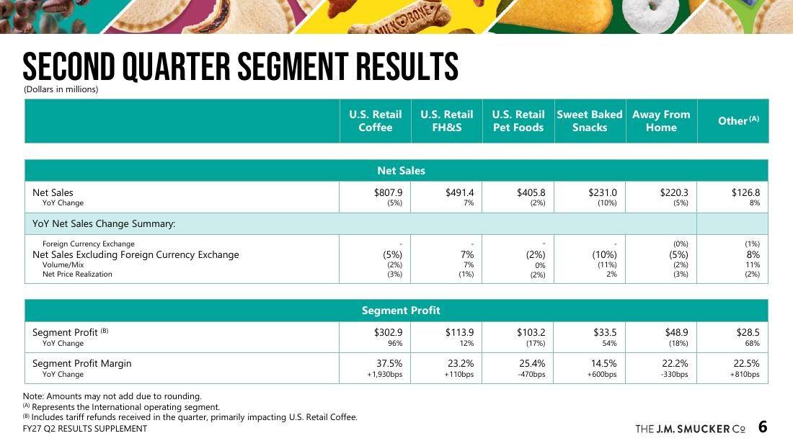
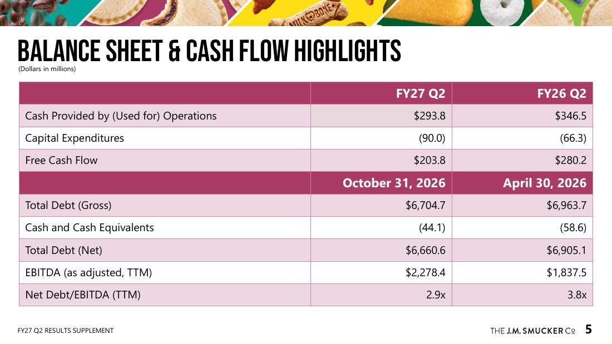

J.M. Smucker verdient im zweiten Quartal des Geschäftsjahres 2027 (bis 31. Oktober) deutlich mehr, verkauft aber weniger. Der Umsatz sank um 2 % auf 2,28 Milliarden US-Dollar, weil die Preise 2 Prozentpunkte niedriger lagen. Absatz und Produktmix blieben unverändert, der Uncrustables-Boom glich Verluste bei Gebäck, Kaffee und Fruchtaufstrichen aus. Der bereinigte Gewinn je Aktie stieg von 2,10 auf 3,20 US-Dollar (plus 52 %), nach US-Rechnungslegung von 2,26 auf 2,32 US-Dollar. Das Management hebt die Prognose an, doch ein großer Teil davon sind Zollerstattungen.

## Die Marge steigt, der Umsatz nicht

Die bereinigte Bruttomarge sprang von 33,9 auf 40,9 %, das bereinigte operative Ergebnis stieg um 36 % auf 535 Millionen US-Dollar. Treiber sind niedrigere Kosten, darunter Zollerstattungen von 30,5 Millionen US-Dollar im Quartal, und weniger Sonderkosten für Projekte. Ohne die Erstattungen wären es 2,98 US-Dollar je Aktie, immer noch gut 40 % mehr als im Vorjahr. Nach US-Rechnungslegung blieb der Betriebsgewinn mit 411 Millionen US-Dollar knapp unter dem Vorjahr (419), weil die Bewertung von Rohstoffgeschäften im Vorjahr einen Sondergewinn brachte. Die Prognose für das Gesamtjahr steigt auf 10,80 bis 11,20 US-Dollar je Aktie nach 10,50 bis 11,00. Darin stecken etwa 0,75 US-Dollar aus Zollerstattungen, nach Abzug geplanter Investitionen. Ohne sie läge die Spanne rechnerisch bei 10,05 bis 10,45 US-Dollar. Der Umsatz soll um 1 bis 2 % sinken, wie bisher.

## Kaffee, Uncrustables und Tierfutter

Im Kaffeegeschäft sank der Umsatz um 5 % auf 808 Millionen US-Dollar, der Segmentgewinn stieg dennoch um 96 % auf 303 Millionen, die Marge liegt bei 37,5 % nach 18,2 % im Vorjahr. Der Gewinn dort stammt aus niedrigeren Kosten und den Zollerstattungen, die vor allem das Kaffeegeschäft betreffen. Beim Absatz verloren Dunkin' und Folgers, Café Bustelo wuchs. Das Geschäft mit tiefgekühlten Sandwiches und Aufstrichen wuchs um 7 % auf 491 Millionen, getrieben von Uncrustables, bei einer Marge von 23,2 %. Beim Tierfutter fiel der Umsatz um 2 % auf 406 Millionen, der Gewinn sank um 17 %, weil Hundesnacks im Preis nachgaben und die Kosten stiegen. Sweet Baked Snacks (Hostess) verlor 10 % Umsatz, steigerte den Gewinn aber um 54 % auf 33,5 Millionen. Das Geschäft für Gastronomie und Kantinen schrumpfte um 5 %, der Gewinn sank um 18 %. Das Auslandsgeschäft wuchs um 8 %, der Gewinn um 68 %.

## Ist die Dividende gedeckt?

Smucker erklärte eine Quartalsdividende von 1,12 US-Dollar je Aktie, nach 1,10 vor einem Jahr (plus 2 %). Das sind 4,48 US-Dollar im Jahr und rund 3,3 % Rendite. Im Quartal zahlte der Konzern 119 Millionen US-Dollar an die Aktionäre. Der freie Cashflow lag mit 204 Millionen (Vorjahr 280) gut 1,7-fach darüber, für das Gesamtjahr plant Smucker 1,1 Milliarden US-Dollar bei etwa 0,48 Milliarden Dividendenzahlungen. Die Quote nach Gewinn je Aktie sieht dank der Prognose gut aus: 4,48 gegen 10,80 bis 11,20 bereinigt ergibt etwa 40 %. Nach US-Rechnungslegung lag die Quote niedriger, weil das Vorjahr Abschreibungen von knapp 1 Milliarde US-Dollar auf Firmenwerte und Marken enthielt, die im Quartal bis Januar zum Nettoverlust von 724 Millionen führten.

Die Schulden sinken weiter. Brutto liegen sie bei 6,70 Milliarden US-Dollar nach 6,96 Milliarden im April, netto bei 6,66 Milliarden. Das Verhältnis von Nettoschulden zum bereinigten operativen Ergebnis vor Abschreibungen fiel von 3,8 auf 2,9. Der Konzern zahlt damit weiter Schulden zurück, der Zinsaufwand sank im Quartal um 15,5 Millionen auf 83 Millionen US-Dollar.

## Wo das Wachstum herkommen soll

Smucker setzt auf Uncrustables, Café Bustelo, Katzenfutter und das Auslandsgeschäft, die in diesem Quartal wuchsen. Die Preise sinken im Gesamtjahr um etwa 1,5 %, das Volumen soll stagnieren, ein Umsatzplus ist deshalb nicht eingeplant. Mark Smucker nennt als Ziele organisches Volumenwachstum in den Kernmarken, höhere Profitabilität und diszipliniertes Kapitalmanagement. Die Zollerstattungen sind eine einmalige Hilfe. Ob die Marge ohne sie auf diesem Niveau bleibt, zeigt das zweite Halbjahr.
