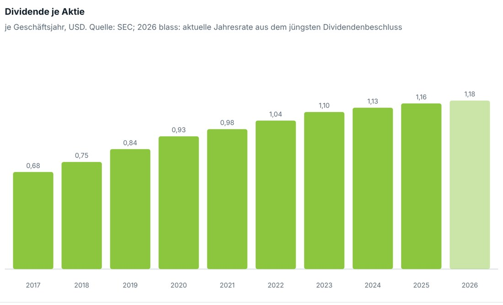
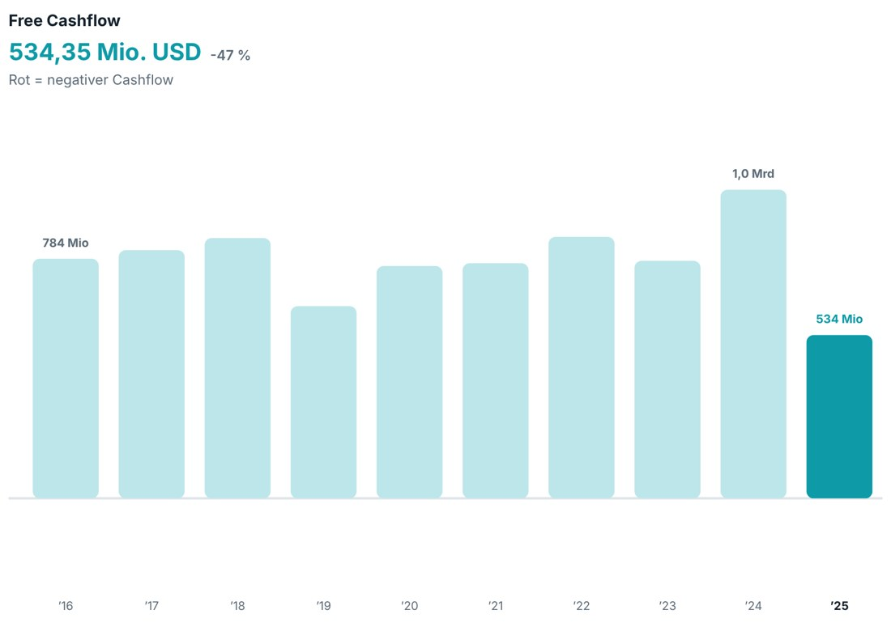

Hormel Foods hebt die Quartalsdividende auf 0,295 US-Dollar je Aktie an, das sind 1,18 US-Dollar im Jahr. Es ist die 61. Erhöhung in Folge, damit bleibt Hormel einer der wenigen Dividendenkönige. Mit rund einem Prozent fällt der Schritt aber klein aus. Vor einem Jahr waren es noch knapp 3 Prozent, im Zehn-Jahres-Schnitt wuchs die Dividende um 8 Prozent pro Jahr.

Stichtag ist der 11. Januar 2027, ausgezahlt wird am 16. Februar. Es ist die 394. Quartalsdividende in Folge seit dem Börsengang 1928.

## Die Dividende wächst langsamer

Seit 2016 hat sich die Dividende je Aktie von 0,58 auf 1,16 US-Dollar verdoppelt. Der Anstieg verflacht sich allerdings: Seit 2023 legt sie nur noch um jeweils etwa drei Cent pro Jahr zu. Der blasse Balken für 2026 zeigt die neue Jahresrate von 1,18 US-Dollar. Bei einem Kurs von gut 21 Euro liegt die Dividendenrendite bei 5,1 %.

## Ist die Dividende gedeckt?

Im Geschäftsjahr 2025 nicht ganz. Der freie Cashflow fiel auf 534 Millionen US-Dollar, fast die Hälfte weniger als im Vorjahr, und deckte die Ausschüttung zu 82 %. Auf den verwässerten Gewinn je Aktie von 0,87 US-Dollar gerechnet liegt die Quote bei 133 %. Auf Basis des bereinigten Gewinns, den Hormel für 2026 mit 1,45 bis 1,51 US-Dollar je Aktie prognostiziert, beträgt sie knapp 80 %.

In den ersten neun Monaten des laufenden Geschäftsjahres sieht es besser aus. Der freie Cashflow lag mit 549 Millionen US-Dollar wieder über den Dividendenzahlungen von 481 Millionen.

## Wo das Wachstum herkommen soll

Die Nachfrage bleibt schwach, der Umsatz sank im dritten Quartal um 2,4 %. Hormel setzt auf Zukäufe und hat am 16. November die Übernahme des Geflügelproduzenten Brakebush angekündigt. Den Kaufpreis hat der Konzern nicht genannt. Ob daraus genug Cashflow entsteht, um die Dividende wieder stärker anzuheben, zeigen die nächsten Quartale.
