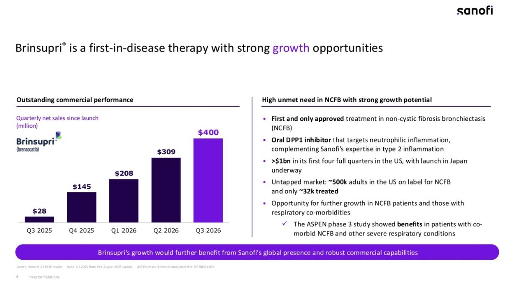

Sanofi übernimmt den US-Biopharmakonzern Insmed für 175 US-Dollar je Aktie in bar. Der Kaufpreis beträgt rund 41,0 Milliarden US-Dollar (37,6 Milliarden Euro) und entspricht gut einem Drittel des Sanofi-Börsenwerts von gut 105 Milliarden Euro. Beide Verwaltungsräte haben zugestimmt, der Abschluss ist für das erste Halbjahr 2027 geplant. Zuvor müssen die Insmed-Aktionäre und die Aufsichtsbehörden zustimmen.

## Was Sanofi bekommt

Insmed bringt zwei zugelassene Medikamente für Lungenerkrankungen mit. Brinsupri (Brensocatib) behandelt die nicht-zystische-Fibrose-Bronchiektasie, eine chronische Lungenerkrankung, und ist das erste zugelassene Mittel dafür. Seit dem US-Start im August 2025 hat es bis Ende September 2026 bereits 1,09 Milliarden US-Dollar Umsatz erzielt, im dritten Quartal 2026 allein 400 Millionen US-Dollar nach 28 Millionen im Startquartal. Arikayce, ein inhaliertes Antibiotikum gegen MAC-Lungeninfektionen, setzte 2025 rund 434 Millionen US-Dollar um (plus 19 %). Dazu kommt TPIP, ein Inhalationspräparat gegen Lungenhochdruck und Lungenfibrose, das in Phase 3 getestet wird. Sanofi sieht darin einen möglichen Wachstumstreiber über 2030 hinaus. Der Spitzenumsatz der zugekauften Medikamente soll über 10 Milliarden US-Dollar liegen.

## Finanzierung und Dividende

Sanofi zahlt mit Schulden und Barmitteln und hat die Finanzierung zugesagt bekommen. Der Konzern will rasch Schulden abbauen, sich ein starkes Kreditrating erhalten und die progressive Dividende fortführen. Der Zukauf soll bis Ende 2028 den bereinigten Gewinn je Aktie steigern, das operative Ergebnis soll ab 2027 positiv beitragen. Sanofi rechnet mit jährlichen Kostensynergien von über 500 Millionen US-Dollar, die Prognose für 2026 bleibt unverändert. Nach den Hub-Daten liegt die Dividendenrendite bei 4,5 % bei einer Ausschüttungsquote von 61 %, die Dividende ist in den vergangenen fünf Jahren im Schnitt um 4,5 % pro Jahr gewachsen.

## Der Hintergrund

Sanofi muss das Wachstum nach dem absehbaren Patentablauf bei Dupixent absichern. Bloomberg hatte am 19. November über die Gespräche berichtet, die Insmed-Aktie sprang damals um rund 18 %. Analysten hatten zuvor bezweifelt, ob Sanofi mit rund 12 Milliarden Euro Nettoschulden einen Zukauf in dieser Größe tragen kann. Weitere Details zur Strategie will Sanofi am 9. Dezember 2026 vorstellen. Konzernchefin Belén Garijo spricht von einem „großen strategischen Schritt“, der die Wachstumskurve für die mittlere und lange Frist anhebe.
