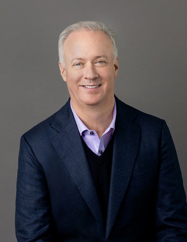

<!-- PRÜFEN: Aufmacher (Gebäude mit Coca-Cola-Logo, header-picture-2.jpg) und Porträt von David Elkins (aus der Coca-Cola-Pressemitteilung vom 23.11.2026, Bildunterschrift dort: "David Elkins, incoming EVP and CFO at The Coca-Cola Company") sind von Divi gelieferte Pressebilder, markierte Ausnahme, Rechte bestätigen. Standort des Gebäudes nicht geprüft, daher nicht im Alt-Text. Porträt liegt nur in 371x480 px vor. -->
<!-- PRÜFEN: Porträt John Murphy (john-murphy.jpg) von Divi geliefert, Herkunft Coca-Cola, Pressebild, markierte Ausnahme, Rechte bestätigen. -->
<!-- PRÜFEN: Fakten aus beiden Pressemitteilungen vom 23.11.2026 (Coca-Cola 16:30 Uhr EST, BMS 16:15 Uhr EST, Screenshots von Divi). Keine weitere Berichterstattung zum Wechsel gefunden, die Websuche lieferte nur ältere Meldungen. -->
<!-- PRÜFEN: Hub-Daten (SEC, Geschäftsjahr 2025): Coca-Cola operativer Cashflow 7,41 Mrd. $, Investitionen 2,11 Mrd. $, freier Cashflow 5,30 Mrd. $, gezahlte Dividenden 8,78 Mrd. $, Nettogewinn 13,11 Mrd. $. 2024: 4,74 Mrd. $ FCF, 8,36 Mrd. $ Dividenden. 2023: 9,75 und 7,95. 2022: 9,54 und 7,62. BMS 2025: operativer Cashflow 14,16 Mrd. $, Investitionen 1,31 Mrd. $, FCF 12,85 Mrd. $, Dividenden 5,04 Mrd. $. Ursache für den Cashflow-Einbruch von Coca-Cola 2024 nicht geprüft, daher nicht im Text. -->

Zwei Pressemitteilungen binnen einer Viertelstunde, ein abgestimmter Wechsel: Coca-Cola holt David Elkins, Finanzchef von Bristol Myers Squibb (BMS), als neuen Finanzchef. Er übernimmt am 2. April 2027 von John Murphy, der seit 2019 im Amt ist. Für Coca-Cola ist es die Ablösung eines Konzernveteranen, für BMS der Verlust des Finanzchefs, der seit dem Zukauf von Celgene für die Zahlen verantwortlich war.

*David Elkins wird am 2. April 2027 Finanzchef von Coca-Cola. Foto: The Coca-Cola Company*

## Murphy bleibt Präsident, Elkins übernimmt auch die Strategie

Murphy ist 64 Jahre alt und will 2027 in den Ruhestand gehen, den Zeitpunkt legt Coca-Cola später fest. Bis dahin bleibt er Präsident des Konzerns, kümmert sich um zentrale Vorhaben und begleitet den Übergang im Finanzressort. Elkins und Murphy berichten beide an Vorstandschef Henrique Braun. Murphy arbeitet seit 1988 bei Coca-Cola und war zuvor Asien-Chef.

*John Murphy ist seit 2019 Finanzchef und seit 2022 Präsident von Coca-Cola. Foto: The Coca-Cola Company*

Elkins verantwortet neben den Finanzen auch die globale Strategie und die Konzerndienste. Er kommt von außen und aus einer anderen Branche: Elkins, 58, war zuvor Finanzchef der Verbrauchs- und Medizintechniksparte von Johnson & Johnson, arbeitete bei Becton Dickinson und AstraZeneca und begann seine Laufbahn bei Boeing. Bei BMS führte er neben den Finanzen auch Unternehmensentwicklung, Beschaffung und Investor Relations.

## Was die Zahlen von Coca-Cola von ihm verlangen

Eine Aufgabe liegt im Hub offen auf dem Tisch: Coca-Colas Dividende ist durch den Gewinn gedeckt, durch den freien Cashflow aber nicht.

| Jahr | Freier Cashflow | Gezahlte Dividenden |
|---|---|---|
| 2022 | 9,5 Mrd. $ | 7,6 Mrd. $ |
| 2023 | 9,8 Mrd. $ | 8,0 Mrd. $ |
| 2024 | 4,7 Mrd. $ | 8,4 Mrd. $ |
| 2025 | 5,3 Mrd. $ | 8,8 Mrd. $ |

Im Geschäftsjahr 2025 lag der freie Cashflow bei 5,3 Mrd. Dollar, die Dividenden kosteten 8,8 Mrd. Dollar. Der Nettogewinn von 13,1 Mrd. Dollar deckt die Ausschüttung zu 67 %.

Elkins bringt Erfahrung aus der Celgene-Übernahme und aus Konzernen mit hohem Kapitalbedarf mit. Das passt zu einem Konzern, der laufend Marken und Abfüllbetriebe zukauft.

## Bei BMS steht der Nachfolger bereit

Bristol Myers Squibb hat die Lücke schon geschlossen. Kevin Dillon, bisher Leiter von Corporate Finance und Business Operations, wird am 1. März 2027 Finanzchef. Er kam 2021 zu BMS und arbeitete zuvor bei Pfizer. Elkins gibt das Amt zum 1. März ab, bleibt bis Ende März im Unternehmen, um den Übergang zu begleiten, und verlässt dann die Pharmabranche. Sein Start bei Coca-Cola folgt wenige Tage später.

BMS bekräftigt zugleich alle Teile der Jahresprognose 2026, die der Konzern am 29. Oktober vorgelegt hatte. Das nimmt dem Wechsel die Spannung: Der Pharmakonzern erwirtschaftete 2025 einen freien Cashflow von 12,9 Mrd. Dollar und zahlte 5,0 Mrd. Dollar Dividende, die Ausschüttung ist hier klar gedeckt.

## Einordnung

Der Wechsel selbst ist geordnet und frühzeitig angekündigt, beide Konzerne haben einen Nachfolger und einen Zeitplan. Für Anleger von Coca-Cola ist die Frage, ob Elkins dem Konzern Kapitaldisziplin und mehr Klarheit bei der Mittelverwendung bringt. Für BMS-Anleger bleibt ein internes Nachfolgemodell, das Kontinuität verspricht. Beide Mitteilungen kamen nach Börsenschluss, eine Kursreaktion steht noch aus.

## Quellen

<ul>
<li>Pressemitteilung The Coca-Cola Company: "The Coca-Cola Company Names David Elkins as Incoming Chief Financial Officer", 23.11.2026</li>
<li>Pressemitteilung Bristol Myers Squibb: "Bristol Myers Squibb Announces Planned Chief Financial Officer Transition", 23.11.2026</li>
<li>Aktien-Hub von dividenden-rechner.de, Daten der SEC</li>
</ul>
