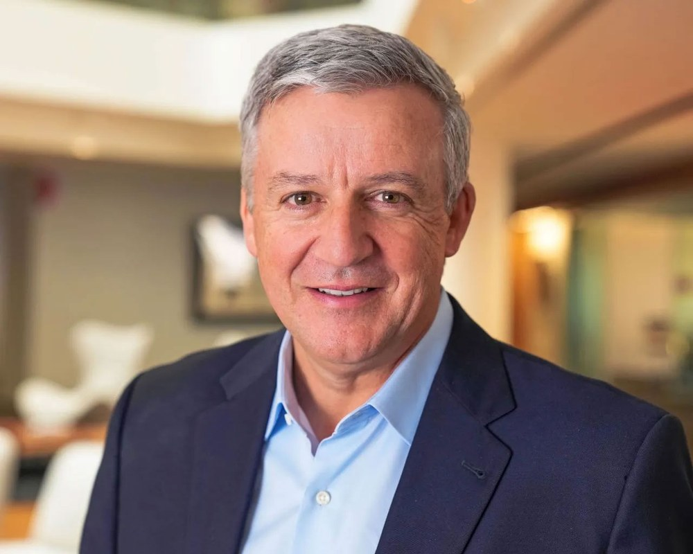

<!-- PRÜFEN: Aufmacher (Gebäude mit Coca-Cola-Logo, header-picture-2.jpg) und Porträt von David Elkins (aus der Coca-Cola-Pressemitteilung vom 23.11.2026, Bildunterschrift dort: "David Elkins, incoming EVP and CFO at The Coca-Cola Company") sind von Divi gelieferte Pressebilder, markierte Ausnahme, Rechte bestätigen. Standort des Gebäudes nicht geprüft, daher nicht im Alt-Text. Porträt liegt nur in 371x480 px vor. -->
<!-- PRÜFEN: Porträt John Murphy (john-murphy.jpg) von Divi geliefert, Herkunft Coca-Cola, Pressebild, markierte Ausnahme, Rechte bestätigen. -->
<!-- PRÜFEN: Fakten aus beiden Pressemitteilungen vom 23.11.2026 (Coca-Cola 16:30 Uhr EST, BMS 16:15 Uhr EST, Screenshots von Divi). Keine weitere Berichterstattung zum Wechsel gefunden, die Websuche lieferte nur ältere Meldungen. -->
<!-- PRÜFEN: Hub-Daten (SEC, Geschäftsjahr 2025): Coca-Cola operativer Cashflow 7,41 Mrd. $, Investitionen 2,11 Mrd. $, freier Cashflow 5,30 Mrd. $, gezahlte Dividenden 8,78 Mrd. $, Nettogewinn 13,11 Mrd. $. 2024: 4,74 Mrd. $ FCF, 8,36 Mrd. $ Dividenden. 2023: 9,75 und 7,95. 2022: 9,54 und 7,62. BMS 2025: operativer Cashflow 14,16 Mrd. $, Investitionen 1,31 Mrd. $, FCF 12,85 Mrd. $, Dividenden 5,04 Mrd. $. Hub-FCF enthält die Sonderzahlungen (IRS-Hinterlegung 6 Mrd. $, Fairlife-Kaufpreiszahlung 2025). -->
<!-- PRÜFEN: Murphy-Lebenslauf: Coca-Cola-Leadership-Seite (Price Waterhouse Dublin, Japan-CFO 2000, Latin Center 2008-2012, South Latin 2013-2016, Asien-Pazifik 2016-2018, CFO 2019, Präsident 2022). IRS-Streit: Bloomberg Tax vom 24.09.2025 (6 Mrd. $ hinterlegt, maximales Risiko 18 Mrd. $ bis 30.06.2025, Rückstellung 493 Mio. $, Berufung seit 22.10.2024, Stand der Entscheidung Anfang 2026 laut Q4-2025-Call: abwartend). Q4-2025-Call (10.02.2026): Dividenden 73 % des bereinigten FCF, Ziel 75 %, Dividende seit 63 Jahren gesteigert, Refranchising kurz vor Abschluss, Afrika und Indien noch im Eigenbesitz. Murphys Anteil an einzelnen Erfolgen (Margen, Preisanpassungen, Portfolio) nicht belegt, daher nicht im Text. -->

Zwei Pressemitteilungen binnen einer Viertelstunde, ein abgestimmter Wechsel: Coca-Cola holt David Elkins, Finanzchef von Bristol Myers Squibb (BMS), als neuen Finanzchef. Er übernimmt am 2. April 2027 von John Murphy, der seit 2019 im Amt ist. Für Coca-Cola ist es die Ablösung eines Konzernveteranen, für BMS der Verlust des Finanzchefs, der seit dem Zukauf von Celgene für die Zahlen verantwortlich war.

*David Elkins wird am 2. April 2027 Finanzchef von Coca-Cola. Foto: The Coca-Cola Company*

## Murphy bleibt Präsident, Elkins übernimmt auch die Strategie

Murphy ist 64 Jahre alt und will 2027 in den Ruhestand gehen, den Zeitpunkt legt Coca-Cola später fest. Bis dahin bleibt er Präsident des Konzerns, kümmert sich um zentrale Vorhaben und begleitet den Übergang im Finanzressort. Elkins und Murphy berichten beide an Vorstandschef Henrique Braun.

*John Murphy ist seit 2019 Finanzchef und seit 2022 Präsident von Coca-Cola. Foto: The Coca-Cola Company*

Murphy kennt den Konzern aus fast allen Perspektiven. Er kam 1988 nach vier Jahren als Prüfer bei Price Waterhouse in Dublin zu Coca-Cola, wurde 2000 Finanzchef von Coca-Cola Japan, leitete von 2008 bis 2016 die Geschäfte in Lateinamerika und von 2016 bis 2018 die Region Asien-Pazifik. 2019 wurde er Finanzchef, 2022 zusätzlich Präsident.

In seine Zeit als Finanzchef fallen der Einbruch des Außer-Haus-Geschäfts in der Pandemie, die Inflationsjahre und der Umbau zu einem Konzern mit weniger eigenen Abfüllbetrieben. Diese Neuordnung will Coca-Cola bald abschließen, in Afrika und Indien hält der Konzern noch Betriebe. Die Dividende hat Coca-Cola seit mehr als 60 Jahren jedes Jahr erhöht.

Offen ist der Steuerstreit mit der US-Behörde IRS um die Gewinnverteilung mit ausländischen Tochtergesellschaften in den Steuerjahren 2007 bis 2009. Das US-Steuergericht gab der IRS recht, Coca-Cola legte Berufung ein und hinterlegte 6 Mrd. Dollar beim US-Finanzministerium, damit keine weiteren Zinsen anfallen. Das maximale Risiko beziffert der Konzern bis Mitte 2025 auf 18 Mrd. Dollar, zurückgestellt sind 0,5 Mrd. Dollar. Anfang 2026 wartete Coca-Cola noch auf die Entscheidung des Berufungsgerichts.

Elkins verantwortet neben den Finanzen auch die globale Strategie und die Konzerndienste. Er kommt von außen und aus einer anderen Branche: Elkins, 58, war zuvor Finanzchef der Verbrauchs- und Medizintechniksparte von Johnson & Johnson, arbeitete bei Becton Dickinson und AstraZeneca und begann seine Laufbahn bei Boeing. Bei BMS führte er neben den Finanzen auch Unternehmensentwicklung, Beschaffung und Investor Relations.

## Der freie Cashflow trägt die Dividende

Im Aktien-Hub liegt der freie Cashflow von Coca-Cola 2024 und 2025 deutlich unter den Dividendenzahlungen.

| Jahr | Freier Cashflow (Hub) | Gezahlte Dividenden |
|---|---|---|
| 2022 | 9,5 Mrd. $ | 7,6 Mrd. $ |
| 2023 | 9,8 Mrd. $ | 8,0 Mrd. $ |
| 2024 | 4,7 Mrd. $ | 8,4 Mrd. $ |
| 2025 | 5,3 Mrd. $ | 8,8 Mrd. $ |

Der Vergleich täuscht, denn in den beiden Jahren belasten Sonderzahlungen: die Hinterlegung im Steuerstreit und 2025 eine bedingte Kaufpreiszahlung für Fairlife. Bereinigt um diese Posten entsprechen die Dividenden nach Angaben des Konzerns 73 % des freien Cashflows, das langfristige Ziel liegt bei 75 %. Auch der Nettogewinn von 13,1 Mrd. Dollar deckt die Ausschüttung 2025 zu 67 %.

Elkins bringt Erfahrung aus der Celgene-Übernahme mit, bei der er Finanzchef von Celgene war.

## Bei BMS steht der Nachfolger bereit

Bristol Myers Squibb hat die Lücke schon geschlossen. Kevin Dillon, bisher Leiter von Corporate Finance und Business Operations, wird am 1. März 2027 Finanzchef. Er kam 2021 zu BMS und arbeitete zuvor bei Pfizer. Elkins gibt das Amt zum 1. März ab, bleibt bis Ende März im Unternehmen, um den Übergang zu begleiten, und verlässt dann die Pharmabranche. Sein Start bei Coca-Cola folgt wenige Tage später.

BMS bekräftigt zugleich alle Teile der Jahresprognose 2026, die der Konzern am 29. Oktober vorgelegt hatte. Das nimmt dem Wechsel die Spannung: Der Pharmakonzern erwirtschaftete 2025 einen freien Cashflow von 12,9 Mrd. Dollar und zahlte 5,0 Mrd. Dollar Dividende, die Ausschüttung ist hier klar gedeckt.

## Einordnung

Der Wechsel selbst ist geordnet und frühzeitig angekündigt, beide Konzerne haben einen Nachfolger und einen Zeitplan. Für Anleger von Coca-Cola bleiben die Dividendenserie von mehr als 60 Jahren und der offene Steuerstreit mit der IRS die Messlatte für den neuen Finanzchef. Für BMS-Anleger bleibt ein internes Nachfolgemodell, das Kontinuität verspricht. Beide Mitteilungen kamen nach Börsenschluss, eine Kursreaktion steht noch aus.

## Quellen

<ul>
<li>Pressemitteilung The Coca-Cola Company: "The Coca-Cola Company Names David Elkins as Incoming Chief Financial Officer", 23.11.2026</li>
<li>Pressemitteilung Bristol Myers Squibb: "Bristol Myers Squibb Announces Planned Chief Financial Officer Transition", 23.11.2026</li>
<li>The Coca-Cola Company: Leadership-Seite John Murphy</li>
<li>Bloomberg Tax: Do Investors Understand the Stakes of Coca-Cola's $18B Tax Case?, 24.09.2025</li>
<li>The Coca-Cola Company: Telefonkonferenz zum vierten Quartal 2025, 10.02.2026</li>
<li>Aktien-Hub von dividenden-rechner.de, Daten der SEC</li>
</ul>
