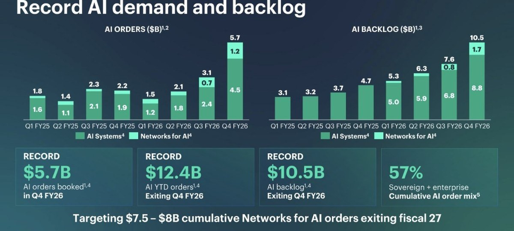
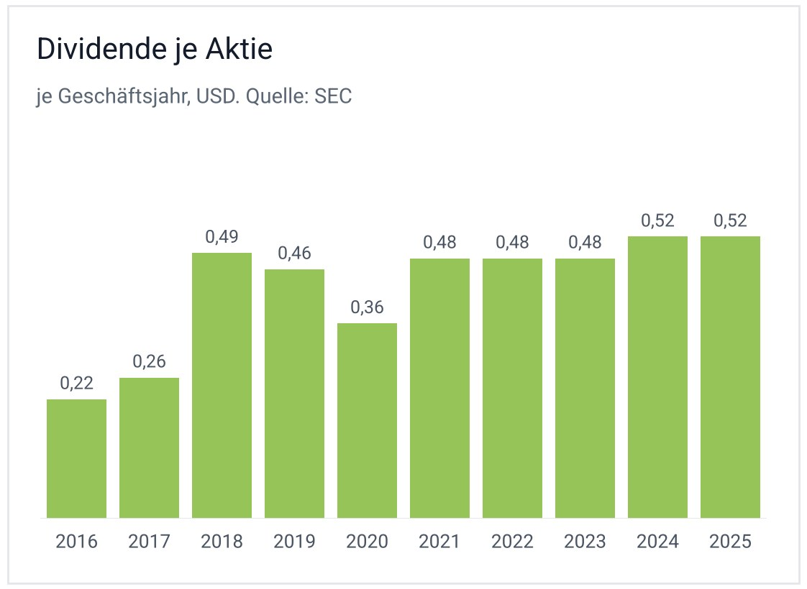
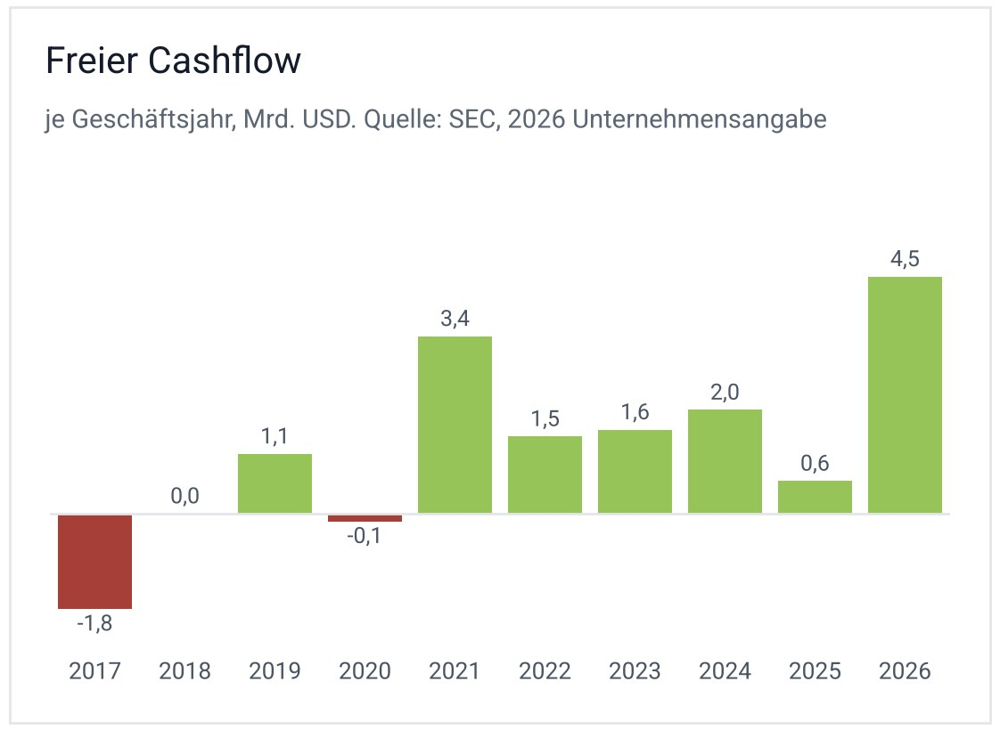
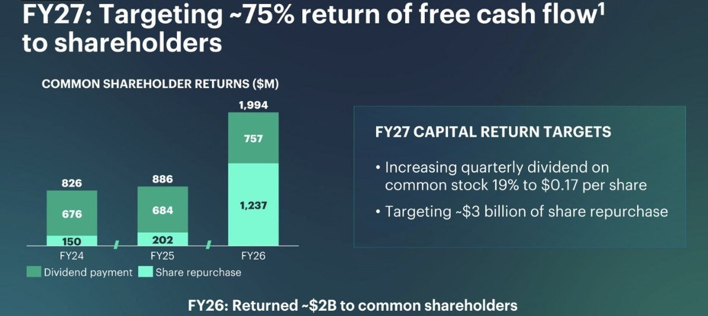

<!-- PRÜFEN: Aufmacherfoto von Divi geliefert (portfolio-super-compute.jpg, HPE-Produktbild, flüssiggekühlter Supercomputer-Schrank). Pressebild von HPE, Nutzungsrechte als markierte Ausnahme bestätigen. -->
<!-- PRÜFEN: Quartalszahlen aus den Quartr-Screenshots der HPE-Präsentation Q4 FY26 (Folien 4, 8, 9, 11 bis 16): Umsatz 46,7 Mrd. $ (+36 %, normalisiert +23 %), bereinigter operativer Gewinn 7,0 Mrd. $ (+110 %), bereinigtes EPS 3,97 $ (+105 %), GAAP-EPS 3,07 $, freier Cashflow 4,5 Mrd. $ (+356 %), Aufträge 57,2 Mrd. $ (+72 %). Q4: Umsatz 14,5 Mrd. $ (+50 %), operativer Gewinn 2,5 Mrd. $ (+108 %). Cloud & AI Q4: Umsatz 11,3 Mrd. $ (+69 %), Marge 18,4 %; Server 8,8 Mrd. $ (+95 %). Netzwerk GJ: 11,3 Mrd. $ (+74 %, normalisiert +10 %). KI-Backlog 10,5 Mrd. $, KI-Aufträge Q4 5,7 Mrd. $. Nettoverschuldungsquote 1,4x (Vorjahr 2,7x normalisiert). Prognose GJ27: Umsatz 59,4 bis 63,1 Mrd. $, op. Gewinn 8,7 bis 9,2 Mrd. $, bereinigtes EPS 5,05 bis 5,35 $, FCF mindestens 5,5 Mrd. $. Ausschüttungen GJ26: 757 Mio. $ Dividende, 1.237 Mio. $ Rückkäufe; GJ27: Quartalsdividende +19 % auf 0,17 $, Rückkäufe rund 3 Mrd. $. -->
<!-- PRÜFEN: Eigene Rechnung: 0,17 $ x 4 = 0,68 $ je Aktie, bei rund 1.430 Mio. Aktien knapp 1,0 Mrd. $ Dividende, das sind etwa 18 % des Mindest-FCF von 5,5 Mrd. $; Rendite 0,68 / 48,02 = 1,4 %; Prognose-KGV 48,02 / 5,20 (Mitte der EPS-Spanne) = 9,2. Kurs: Schluss 4:00 PM EST 48,02 $ (+17,38 %), nachbörslich 4:15 PM EST 46,78 $ (-2,59 %), Finanzportal-Screenshot von Divi. Anlass der Rally: Hoffnung auf höhere Serverpreise (invezz, Seeking Alpha vom 23.11.). Hub-Daten: Dividende je Aktie 0,52 $ (GJ24 und GJ25), GJ25 Nettogewinn 57 Mio. $, freier Cashflow 0,63 Mrd. $ (-68 %); Hub-Wert Dividende je Aktie aus Screenshot übernommen, Grafik nachgebaut. Kein HPE-Logo im Repo (assets/logos), daher kein logo_file. -->

HPE galt lange als Konzern, dessen bestes Geschäft hinter ihm liegt: Server, Speicher, Netzwerk, wenig Wachstum, schwankende Gewinne. Das Geschäftsjahr 2026 liest sich anders. Die KI-Nachfrage füllt die Bücher, der operative Gewinn hat sich verdoppelt, und der Vorstand hebt die Dividende um 19 %. Die Aktie hat das vorweggenommen und schloss vor den Zahlen 17,4 % höher bei 48,02 Dollar. Nachbörslich gab sie um 2,6 % auf 46,78 Dollar nach.

!!! kurz "Kurz gesagt"
    **Umsatz:** 46,7 Mrd. Dollar (+36 %, bereinigt um Zukäufe und Währung +23 %)
    **Bereinigter operativer Gewinn:** 7,0 Mrd. Dollar (+110 %)
    **Freier Cashflow:** 4,5 Mrd. Dollar (+356 %)
    **Ausblick 2027:** Umsatz 59,4 bis 63,1 Mrd. Dollar (+27 bis 35 %), freier Cashflow mindestens 5,5 Mrd. Dollar
    **Dividende:** Quartalsdividende steigt um 19 % auf 0,17 Dollar, dazu rund 3 Mrd. Dollar Aktienrückkäufe

## KI-Server liefern das Wachstum

Das Geschäft mit KI-Systemen liefert fast das gesamte Wachstum. Im vierten Quartal stieg der Umsatz der Sparte Cloud & AI um 69 % auf 11,3 Mrd. Dollar, die Server allein legten um 95 % auf 8,8 Mrd. Dollar zu. Die Aufträge für KI-Systeme erreichten mit 5,7 Mrd. Dollar einen Rekord, der Auftragsbestand wuchs auf 10,5 Mrd. Dollar.

*HPE-Präsentation zum vierten Quartal des Geschäftsjahres 2026 (Folie 12): KI-Aufträge (links) und KI-Auftragsbestand (rechts) in Milliarden Dollar, aufgeteilt in KI-Systeme und Netzwerke für KI.*

Das Netzwerkgeschäft wuchs im Gesamtjahr um 74 % auf 11,3 Mrd. Dollar. Ein großer Teil davon stammt aus dem zugekauften Geschäft. Bereinigt um diesen Effekt bleibt ein Plus von 10 %. Wer das Wachstum bewerten will, sollte also zwischen gekauftem und eigenem Wachstum unterscheiden. Für 2027 erwartet HPE in der Netzwerksparte ein Plus im hohen Zehner- bis niedrigen Zwanzigerbereich, in der KI-Sparte 30 bis 40 %.

## Der Gewinn verdoppelt sich, die Marge bleibt dünn

Der bereinigte operative Gewinn stieg auf 7,0 Mrd. Dollar, die Marge auf 15,1 %. Das Wachstum kommt jedoch zu einem großen Teil aus Servern, und die verdienen weniger als Netzwerktechnik. Die Sparte Cloud & AI erreichte im Gesamtjahr 15,2 % Marge, im vierten Quartal 18,4 %. Für 2027 plant HPE dort mit rund 14 %. Das Netzwerkgeschäft soll Margen im mittleren bis hohen Zwanzigerbereich liefern. Je größer der Serveranteil, desto stärker drückt er den Konzernschnitt.

Ein zweiter Punkt: Der Gewinn je Aktie liegt nach US-Rechnungslegung mit 3,07 Dollar deutlich unter den bereinigten 3,97 Dollar. Die Differenz entsteht vor allem aus Kosten für Zukäufe und Umbau.

## Dividende: klein, gut gedeckt und wachsend

*Dividende je Aktie nach Geschäftsjahr. Aktien-Hub von dividenden-rechner.de, Daten aus den Jahresberichten bei der SEC.*

HPE zahlt seit 2024 unverändert 0,52 Dollar je Aktie. Mit der Erhöhung um 19 % auf 0,17 Dollar je Quartal sind es künftig 0,68 Dollar im Jahr, das entspricht bei 48 Dollar einer Rendite von 1,4 %. Für die Dividende sind das Kleingeld: Bei rund 1,43 Mrd. Aktien kostet sie etwa 1 Mrd. Dollar, das sind rund 18 % des erwarteten freien Cashflows von mindestens 5,5 Mrd. Dollar.

*Freier Cashflow nach Geschäftsjahr. Aktien-Hub von dividenden-rechner.de, 2026 nach Angaben von HPE.*

Wichtiger als die Quote ist die Richtung. Der freie Cashflow schwankte in den vergangenen zehn Jahren zwischen minus 1,8 und plus 3,4 Mrd. Dollar, 2025 waren es nur 0,6 Mrd. Dollar. Mit 4,5 Mrd. Dollar im Geschäftsjahr 2026 ist er auf einem Höchststand. Der Konzern will 2027 rund 75 % davon an die Aktionäre zurückgeben, den größeren Teil über Aktienrückkäufe.

*HPE-Präsentation (Folie 14): Ausschüttungen an Stammaktionäre in Millionen Dollar, getrennt nach Dividende und Aktienrückkauf, und die Ziele für das Geschäftsjahr 2027.*

Im vergangenen Jahr flossen 757 Mio. Dollar als Dividende und 1.237 Mio. Dollar in Rückkäufe, zusammen knapp 2 Mrd. Dollar. Wer HPE wegen der Dividende kauft, bekommt vor allem einen Wert, der seine Aktienzahl schrumpft.

## Einordnung

Die Zahlen sind stark und die Prognose liegt über dem Vorjahr: Der Umsatz soll 2027 um 27 bis 35 % wachsen, das bereinigte Ergebnis je Aktie auf 5,05 bis 5,35 Dollar steigen. Auf der Mitte dieser Spanne liegt das Kurs-Gewinn-Verhältnis bei gut 9. Das ist niedrig, ein Teil davon ist mit dem Kurssprung vom Montag aber bereits eingepreist.

Dagegen stehen drei Punkte. Der Serveranteil drückt die Marge. Das Wachstum hängt daran, dass die Lieferketten bei den KI-Servern mithalten. Und die Hoffnung auf höhere Serverpreise, die den Kurs vor den Zahlen getrieben hat, kann sich ebenso schnell drehen. Die Verschuldung ist dagegen weniger belastend: Die Nettoverschuldungsquote sank von 2,7 auf 1,4. Das schafft Spielraum für Rückkäufe und weitere Dividendenerhöhungen.

## Quellen

<ul>
<li>HPE-Präsentation zum vierten Quartal des Geschäftsjahres 2026, 23.11.2026</li>
<li><a href="https://invezz.com/news/2026/11/23/hpe-stock-jumps-17-as-server-price-hikes-lift-sentiment-ahead-of-results/">Invezz: HPE stock jumps 17% as server price hikes lift sentiment ahead of results, 23.11.2026</a></li>
<li><a href="https://seekingalpha.com/news/4675768-hewlett-packard-enterprise-surges-18-as-tech-stocks-rally-earnings-on-tap">Seeking Alpha: Hewlett Packard Enterprise surges 18% as tech stocks rally, earnings on tap</a></li>
<li><a href="https://investors.hpe.com/?lang=en">HPE Investor Relations</a></li>
<li>Aktien-Hub von dividenden-rechner.de, Daten der SEC</li>
</ul>
