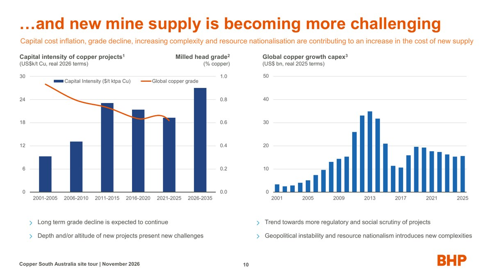
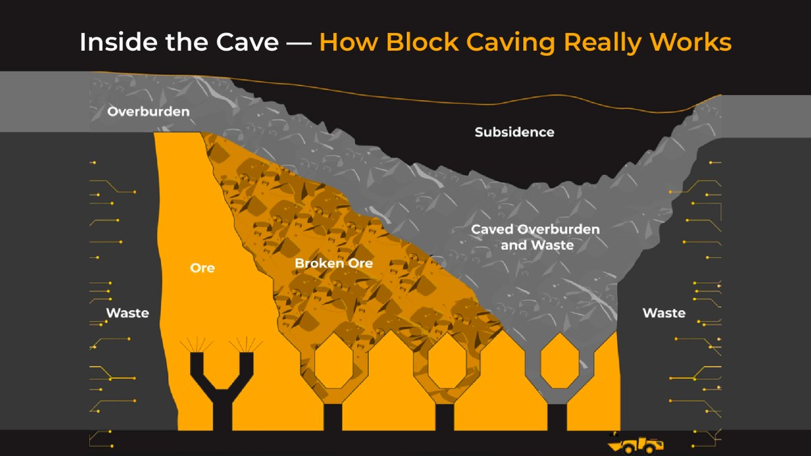
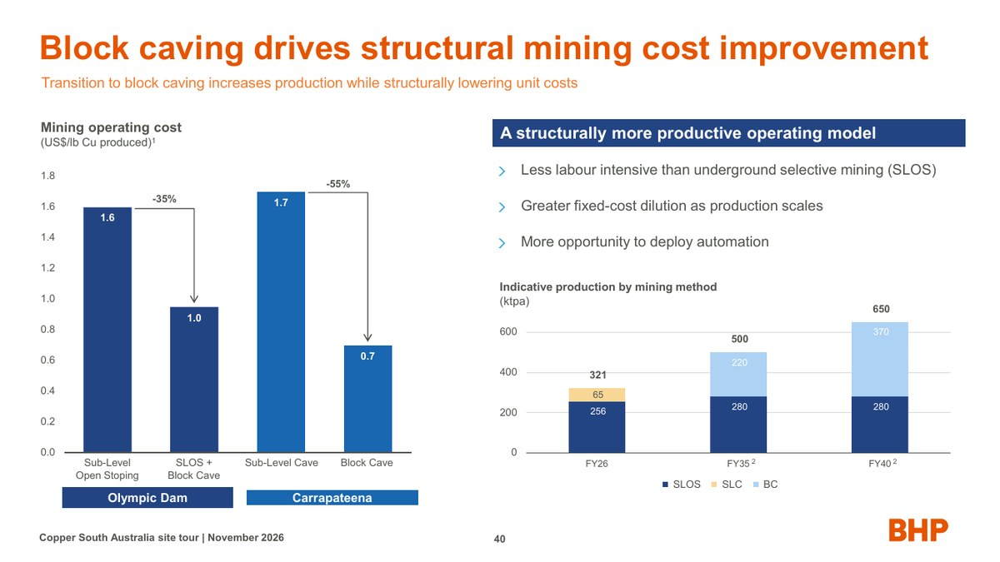
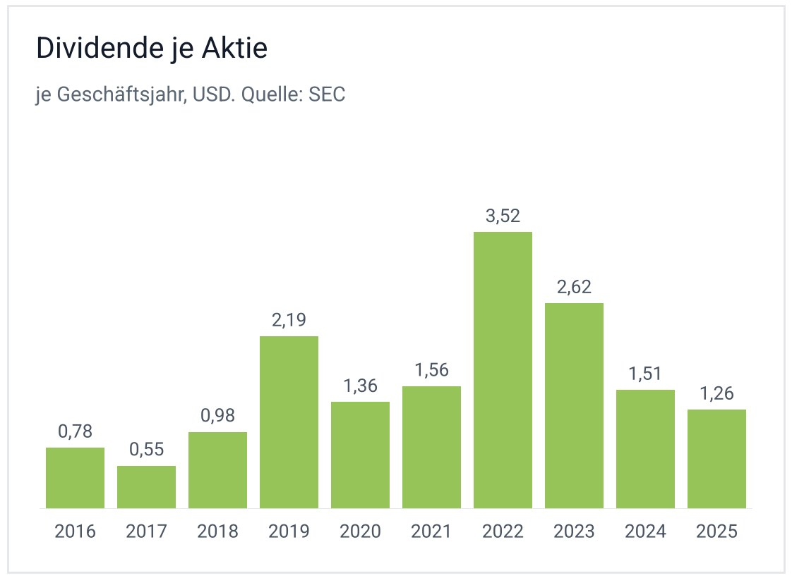
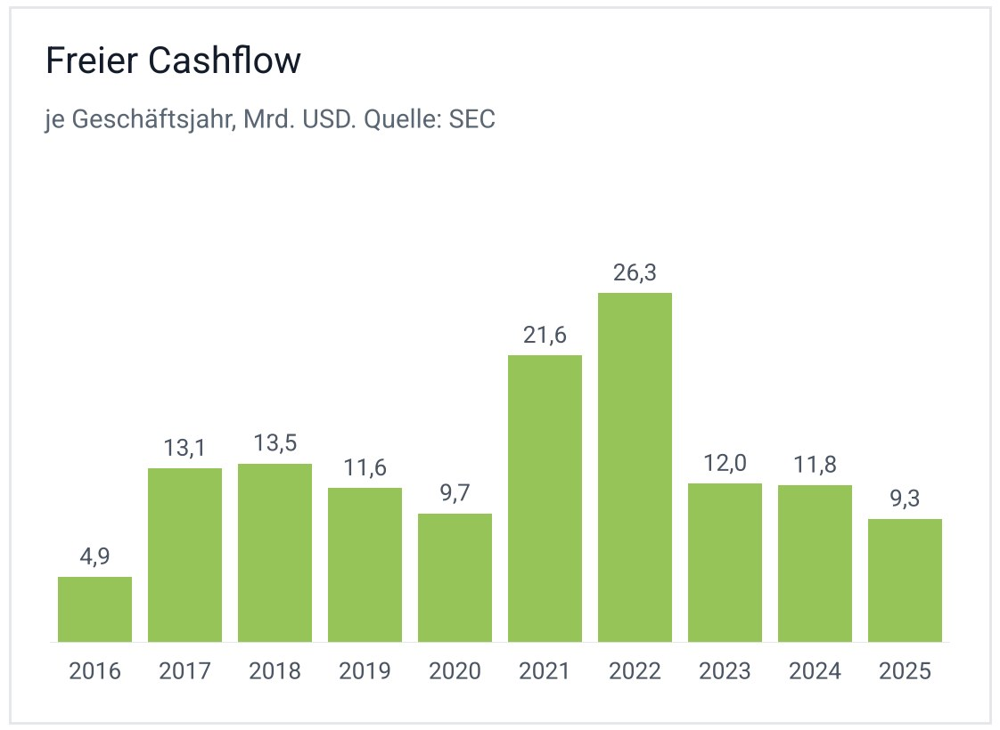

<!-- PRÜFEN: Foto von Divi geliefert (jimblebar_2020_108_lowres.jpg), Herkunft BHP-Pressematerial. Pressefoto, Nutzungsrechte vor Veröffentlichung bestätigen. Das Bild zeigt den Eisenerzbetrieb Jimblebar in Westaustralien, KEINE Kupfermine. Bildunterschrift ist entsprechend formuliert. -->
<!-- PRÜFEN: Grafik Block Caving (Schema "Inside the Cave") von Divi geschickt, Herkunft: GroundHog, LinkedIn-Newsletter "Mine Digitization & Automation", Ausgabe "Week 1: Inside the Cave - How Block Caving Really Works" vom 08.07.2025. Fremde Grafik, Nutzungsrecht nicht geklärt, von Divi ausdrücklich gewünscht, Quelle in Bildunterschrift und Quellenliste genannt. Bei Bedarf Genehmigung bei GroundHog einholen. -->
<!-- PRÜFEN: Alle Folienzahlen: BHP-Präsentation "Copper South Australia: Unlocking a world-class copper province", Standortbesichtigung, November 2026 (Datum 23.11.2026, 84 Seiten). Folie 9 (Nachfrage), 10 (Erzgehalt, Kapitalintensität, Investitionen), 40 (Block Caving), weitere Angaben zu Smelter, Nebenprodukten, Break-even und Free Cashflow aus den Folien 13 bis 41, bitte stichprobenartig gegen das PDF prüfen. -->
<!-- PRÜFEN: Hub-Daten (Aktien-Hub, Stand 20.11.2026, Geschäftsjahr bis 30.06.2025): Umsatz 51,3 Mrd. $ (-7,9 %), Nettogewinn 9,0 Mrd. $ (+14,2 %), freier Cashflow 9,3 Mrd. $, Dividenden 6,4 Mrd. $, Dividende je Aktie 1,26 $ (-16,7 %), Ausschüttungsquote 71 %, 69 % des freien Cashflows ausgeschüttet, Rendite 3,75 %, KGV 18,9, Kurs 30,55 € (Tradegate). Geschäftsjahr 2026 (bis 30.06.2026): bereinigter Gewinn +30 % auf 13 Mrd. $ laut BHP-Meldung, siehe Artikel vom 12.11.2026 zum Finanzchef. Mindestausschüttung 50 % des bereinigten Gewinns: Folie 30. -->
<!-- PRÜFEN: Aufgrund der Websuche kein neuer Pressebericht zur Standortbesichtigung gefunden, Einordnung beruht auf den Folien. Kupferpreis ca. 5,5 bis 5,6 $/lb im GJ26 (Folie 28). -->

!!! kurz "Kurz gesagt"
    **Das Problem:** Der durchschnittliche Kupfergehalt im Erz fällt weltweit von 0,93 auf 0,62 %. Eine neue Mine kostet je Tonne Jahreskapazität rund dreimal so viel wie noch vor 20 Jahren.
    **Die Antwort:** BHP will die Kupferproduktion bis 2035 um 40 % auf rund 2 Mio. Tonnen im Jahr steigern. In Südaustralien soll sie von 321.000 auf etwa 500.000 Tonnen wachsen.
    **Die Dividende:** Das Kupfergeschäft erzeugte im Geschäftsjahr 2026 rund 5 Mrd. Dollar freien Cashflow und soll sein Wachstum nach BHPs Planung selbst bezahlen. Zuletzt zahlte BHP 6,4 Mrd. Dollar aus, gedeckt von 9,3 Mrd. Dollar freiem Cashflow.
    **Das Risiko:** Die Planung hängt an Großprojekten im Untergrund und an einer neuen Schmelze. Verzögerungen und Kostenüberschreitungen gehören zum Geschäft.

## Ein Rohstoff, der schneller knapp wird als gedacht

Kupfer ist der Rohstoff hinter Stromnetzen, Elektroautos und Rechenzentren. Die weltweite Nachfrage dürfte von rund 35 Millionen Tonnen in diesem Jahr auf etwa 47 Millionen Tonnen im Jahr 2040 steigen. Gleichzeitig schrumpft die Förderung der bestehenden Minen. Bis Ende der 2030er Jahre fehlen demnach bis zu 10 Millionen Tonnen neues Primärkupfer im Jahr.

Das ist die eine Hälfte der Geschichte. Die andere ist der sinkende Erzgehalt, und er verändert die Kosten jeder neuen Mine.

## Erzgehalt auf Talfahrt, Kosten im Aufwind

*Folie 10 der BHP-Präsentation vom November 2026: Kapitalintensität neuer Kupferprojekte (blau, links) und weltweiter Erzgehalt (orange). Rechts die weltweiten Wachstumsinvestitionen in Milliarden Dollar.*

Der durchschnittliche Gehalt des verarbeiteten Erzes lag Anfang der 2000er Jahre bei rund 0,93 % Kupfer und ist heute auf etwa 0,62 % gefallen. Wer dieselbe Tonne Metall will, muss also deutlich mehr Gestein bewegen, mahlen und aufbereiten. Dazu kommen tiefere und abgelegenere Lagerstätten, strengere Genehmigungen und politische Risiken in den Förderländern.

Die Rechnung dazu liefert die blaue Säule: Für 2001 bis 2005 setzt BHP rund 9.000 Dollar Investition je Tonne Jahreskapazität an. Für Projekte der Jahre 2026 bis 2035 sind es rund 27.000 Dollar, das Dreifache. Zugleich investiert die Branche weniger in Wachstum. Die weltweiten Ausgaben liegen mit 15 bis 16 Mrd. Dollar nur noch bei weniger als der Hälfte des Höchststands von rund 35 Mrd. Dollar im Jahr 2013. Wenn die Nachfrage steigt und das Angebot teurer wird, hilft das den Förderern, die bereits Zugriff auf große Vorkommen haben.

## BHPs Plan: weniger Gehalt, aber viel niedrigere Kosten

BHP sitzt auf einem solchen Vorkommen. Olympic Dam in Südaustralien enthält nach Unternehmensangaben 88,1 Mio. Tonnen Kupfer (+2 %) und soll rund 80 Jahre produzieren. Auch hier sinkt der Gehalt: Beim Übergang auf Block Caving fällt er im Olympic-Dam-Erz von 2,0 auf 1,6 %. Bei Carrapateena geht er von 1,2 auf 1,1 % zurück.

Block Caving ist ein Abbauverfahren für große, vergleichsweise arme Erzkörper. Statt jede Tonne einzeln herauszusprengen, schneidet der Betrieb den Erzkörper am unteren Ende an und unterhöhlt ihn. Das Gestein darüber bricht unter seinem eigenen Gewicht in Brocken. Sie rutschen in trichterförmige Entnahmepunkte am Boden des Berges und werden dort von Radladern abtransportiert. Nach oben setzt sich das Gebirge nach, an der Oberfläche entsteht eine Senke.

*So funktioniert ein Block Cave: Der Erzkörper (orange) wird unterhöhlt, bricht und läuft in die Entnahmepunkte am Boden. Darüber sackt das Gebirge ab. Grafik: GroundHog, aus dem LinkedIn-Newsletter „Mine Digitization & Automation“ vom 8. Juli 2025.*

Der Reiz liegt in den Kosten: Das Verfahren erlaubt große Mengen bei niedrigen Stückkosten, weil die Schwerkraft einen Teil der Arbeit übernimmt. Es braucht weniger Personal als der gezielte Abbau im Untergrund, die Fixkosten verteilen sich auf mehr Tonnen und Maschinen lassen sich leichter automatisieren. Der Preis dafür ist hohe Betriebsdisziplin. Wie das Gestein bricht und wo es abfließt, lässt sich nur begrenzt steuern, und genau deshalb gilt die Kontrolle des laufenden Betriebs als die Schwachstelle des Verfahrens.

*Folie 40 der BHP-Präsentation: Betriebskosten der Förderung in Dollar je Pfund Kupfer (links) und geplante Produktion nach Abbauverfahren in Kilotonnen (rechts).*

Das Ergebnis überzeugt: In Olympic Dam fallen die Förderkosten von 1,6 auf 1,0 Dollar je Pfund (-35 %), in Carrapateena von 1,7 auf 0,7 Dollar (-55 %). Der geringere Gehalt kostet also weniger, als die neue Methode spart. Die Produktion soll damit von 321.000 Tonnen im Geschäftsjahr 2026 auf rund 500.000 Tonnen 2035 und bis zu 650.000 Tonnen 2040 steigen. Den Zuwachs liefert fast vollständig das Block Caving: 220.000 Tonnen 2035, 370.000 Tonnen 2040.

## Die Schmelze und die Nebenprodukte

Ärmeres Erz hat eine zweite Folge. Das Verhältnis von Kupfer zu Schwefel fällt unter 1,5, und das stellt die bestehende Schmelze vor ein Problem. BHP plant deshalb eine zweistufige Anlage. Sie kostet 3,2 bis 4,1 Mrd. Dollar, die Investitionsentscheidung soll im zweiten Halbjahr 2027 fallen, die erste Produktion für 2032 anvisiert ist.

Ein Teil der Kosten holt BHP über Nebenprodukte herein. Im Geschäftsjahr 2026 brachten sie in Südaustralien 2,3 Mrd. Dollar ein. Die Stückkosten des Standorts lagen dadurch bei nur 0,32 Dollar je Pfund Kupfer. Bis 2035 soll die Menge der Nebenprodukte um die Hälfte auf rund 300.000 Tonnen Kupferäquivalent steigen. Der Standort erzielte zuletzt ein Rekord-EBITDA von 3,2 Mrd. Dollar und rund 1,0 Mrd. Dollar freien Cashflow.

## Ist die Dividende gedeckt?

BHP schüttet nach der Dividendenpolitik mindestens 50 % des bereinigten Gewinns aus. Die Dividende folgt damit dem Rohstoffzyklus.

*Dividende je Aktie nach Geschäftsjahr (endet jeweils am 30. Juni). Aktien-Hub von dividenden-rechner.de, Daten aus den Jahresberichten bei der SEC.*

Auf den Spitzenwert von 3,52 Dollar im Geschäftsjahr 2022 folgten drei Rückgänge auf zuletzt 1,26 Dollar (-16,7 % zum Vorjahr). Wer BHP wegen der Dividende hält, kauft einen Wert mit schwankender Ausschüttung. Die Rendite liegt beim Kurs von 30,55 Euro bei 3,75 %.

*Freier Cashflow nach Geschäftsjahr. Aktien-Hub von dividenden-rechner.de.*

Gedeckt ist die Zahlung klar: Im Geschäftsjahr 2025 flossen 6,4 Mrd. Dollar an die Aktionäre, das sind 69 % des freien Cashflows von 9,3 Mrd. Dollar. Die Ausschüttungsquote auf den Gewinn lag bei 71 %. Für das Geschäftsjahr 2026 meldete BHP einen um 30 % höheren bereinigten Gewinn von 13 Mrd. Dollar. Das spricht für eine höhere Dividende im nächsten Zyklus, auch wenn der freie Cashflow seit dem Rekord von 26,3 Mrd. Dollar 2022 gesunken ist.

Wie teuer das Kupferwachstum wird, zeigt die Phase 1 der Planung: Die Minen kosten 5,8 bis 7,5 Mrd. Dollar, die Spitze liegt bei rund 3 Mrd. Dollar im Jahr. Dagegen stehen rund 35 Mrd. Dollar freier Cashflow aus Kupfer bis 2035. BHP kalkuliert mit einer Rendite von 14 bis 17 % je Projekt und einem Break-even von 1,70 Dollar je Pfund. Bei Wettbewerbern sind es im Schnitt 3,10 Dollar. Der Kupferpreis lag im Geschäftsjahr 2026 bei rund 5,5 bis 5,6 Dollar.

## Einordnung

BHP macht aus einem Branchenproblem ein Argument. Sinkende Gehalte treiben die Preise, und wer die Kosten pro Pfund in dieser Lage senkt, verdient doppelt. Für Olympic Dam und Carrapateena sind die Zahlen glaubwürdig. Für Dividendenanleger ist wichtig, dass der Konzern Kupfer aus eigener Kraft finanzieren will und die Ausschüttung nicht dafür kürzen muss.

Offene Punkte bleiben: Die Größe des geplanten Block Caves ist noch in der Studie, die Schmelzen-Entscheidung fällt erst 2027, die Wasser- und Stromversorgung muss mitwachsen. Und BHP hat mit dem Kaliprojekt Jansen gerade gezeigt, dass Großprojekte teurer werden können als geplant. Nach eigener Angabe liefen seit 2016 immerhin 80 % der Projekte im Zeit- und Kostenrahmen. Die Dividende bleibt von den Rohstoffpreisen abhängig, das gilt für Kupfer wie für Eisenerz. Der Kupferanteil im Konzern wächst dabei weiter.

## Quellen

<ul>
<li><a href="https://www.bhp.com/what-we-do/global-locations/australia/south-australia/olympic-dam">BHP: Olympic Dam, South Australia</a></li>
<li><a href="https://www.miningweekly.com/article/olympic-dam-growth-projects-australia-update-2026-09-11">Mining Weekly: Olympic Dam growth projects, Update vom 11.09.2026</a></li>
<li><a href="https://www.indailysa.com.au/news/business/2026/10/20/truly-enormous-australias-biggest-copper-mine-even-bigger">InDaily: Australia's biggest copper mine even bigger, 20.10.2026</a></li>
<li>GroundHog: „Week 1: Inside the Cave - How Block Caving Really Works“, LinkedIn-Newsletter Mine Digitization &amp; Automation, 08.07.2025</li>
<li>BHP-Präsentation "Copper South Australia: Unlocking a world-class copper province", Standortbesichtigung, November 2026</li>
<li>Aktien-Hub von dividenden-rechner.de, Daten der SEC, Stand 20.11.2026</li>
</ul>
