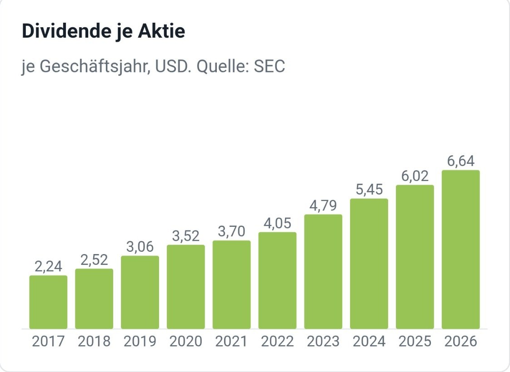
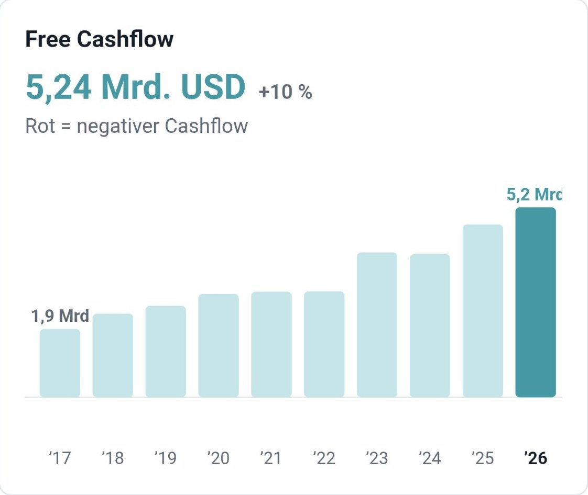
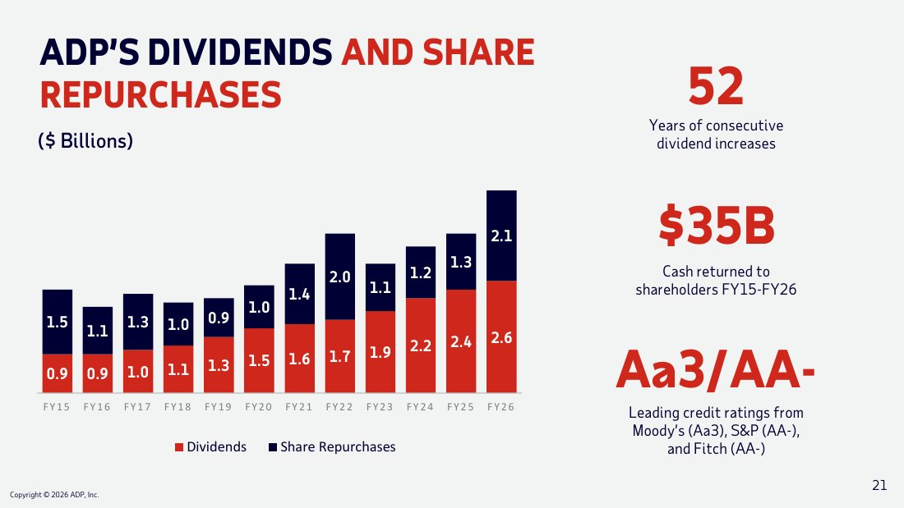
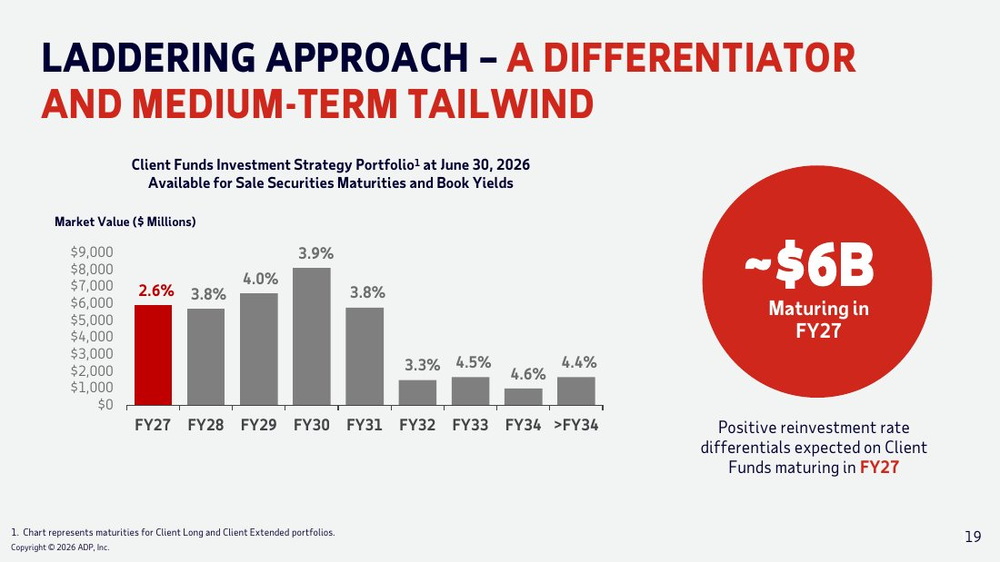
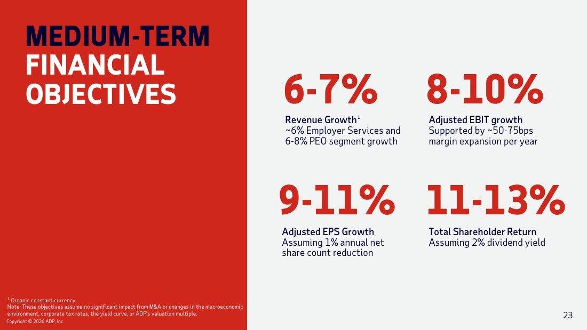

<!-- PRÜFEN: Dividende 1,70 → 1,90 $ je Quartal (+12 %), 52. Erhöhung in Folge, Stichtag 11.12.2026, Zahlung 01.01.2027, Zitat Maria Black: ADP-Mitteilung vom 11.11.2026 (finviz). Q1 FY27 und Prognose: 8-K Exhibit 99.1 vom 28.10.2026 (SEC). Folien 17, 19, 21, 23: ADP Investor Overview November 2026, von Divi geschickt. -->
<!-- PRÜFEN: Hub-Daten (Screenshots von Divi, dividenden-rechner.de Aktien-Hub): Dividende je Aktie GJ 2017 bis 2026 2,24 → 6,64 $, Ausschüttungsquote 61 %, freier Cashflow 5,24 Mrd. $ (+10 %), vom freien Cashflow 50 % ausgeschüttet, Umsatz 21,95 Mrd. $ (+7 %), Nettogewinn 4,41 Mrd. $, Gewinn je Aktie 10,94 $ (+10 %), operative Marge 28 %, KGV 27,3, Nettoschulden 0,1× EBITDA, Rückkäufe 2,08 Mrd. $ (+63 %), Kurs Xetra 279,70 € am 20.11.2026 (+2,25 %). Selbst gerechnet: Dividendenwachstum 2017–2026 (9 Jahre) 12,8 % p. a.; Rendite mit neuer Jahresdividende 7,60 $ bei 279,70 € × 1,0968 (EZB 18.11.) = 306,77 $ → 2,5 %; Nasdaq −5 % am 20.11. aus unserem Nvidia-Artikel. -->

!!! kurz "Kurz gesagt"
    **Die Erhöhung:** ADP zahlt künftig 1,90 Dollar je Quartal, 12 % mehr als bisher. Es ist die 52. Anhebung in Folge.
    **Die Deckung:** Die Hälfte des freien Cashflows reicht für die Dividende. Der Rest fließt in Rückkäufe und Wachstum.
    **Der Ausblick:** Mittelfristig peilt ADP 6 bis 7 % mehr Umsatz und 9 bis 11 % mehr Gewinn je Aktie an. Rückenwind kommt aus den Zinsen auf die Kundengelder.
    **Der Unterschied:** ADP verdient am Lohnlauf, nicht an Softwarelizenzen je Arbeitsplatz. Das macht den Konzern weniger anfällig für die Sorgen, die gerade Softwarewerte belasten.

## Ein ruhiger Wert in unruhigen Wochen

Am Freitag fiel die Nasdaq um 5 %, Software- und KI-Werte gaben reihenweise nach. Die ADP-Aktie legte auf Xetra 2,25 % zu. Das sagt viel über ein Unternehmen, das an der Börse oft unter Software einsortiert wird und doch nach anderen Regeln funktioniert.

Automatic Data Processing rechnet für mehr als 1,1 Millionen Firmen die Löhne ab und zahlt weltweit über 42 Millionen Beschäftigten ihr Gehalt aus. Elf Tage vor dem Kursrutsch hatte der Konzern die Dividende kräftig erhöht: von 1,70 auf 1,90 Dollar je Quartal, ein Plus von 12 %. Es ist die 52. Anhebung in Folge. Vorstandschefin Maria Black sieht darin das „Vertrauen des Verwaltungsrats in die finanzielle Stärke von ADP“. Die neue Dividende wird am 1. Januar ausgezahlt, berechtigt ist, wer die Aktie am 11. Dezember im Depot hat.

## Die Dividende wächst schneller als das Geschäft

*Dividende je Aktie nach Geschäftsjahr (endet jeweils am 30. Juni). Aktien-Hub von dividenden-rechner.de, Daten aus den Jahresberichten bei der SEC.*

Seit 2017 hat sich die Ausschüttung fast verdreifacht, von 2,24 auf 6,64 Dollar je Aktie. Das entspricht knapp 13 % Wachstum pro Jahr. Mit der neuen Quartalsdividende kommt die Jahresrate auf 7,60 Dollar. Beim Kurs vom Freitag sind das rund 2,5 % Rendite. Das ist keine Hochdividende, aber eine, die verlässlich und zweistellig wächst.

Bemerkenswert ist, dass die Ausschüttungsquote dabei kaum steigt. Sie liegt seit zehn Jahren zwischen 56 und 62 % des Gewinns. ADP erhöht die Dividende also im Gleichschritt mit dem Gewinn je Aktie, ohne die Substanz anzugreifen.

## Woher das Geld kommt

*Freier Cashflow nach Geschäftsjahr. Aktien-Hub von dividenden-rechner.de.*

Die Antwort auf die Frage, ob die Dividende gedeckt ist, fällt eindeutig aus. Im Geschäftsjahr 2026 erwirtschaftete ADP 5,24 Milliarden Dollar freien Cashflow, 10 % mehr als im Vorjahr. Davon flossen 2,6 Milliarden an die Aktionäre als Dividende, also die Hälfte. Das Geschäft braucht wenig Kapital, jeder zusätzliche Kunde läuft über dieselben Plattformen.

*Folie 21 der ADP-Investorenpräsentation vom November 2026: Dividenden (rot) und Aktienrückkäufe (blau) in Milliarden Dollar.*

Was übrig bleibt, geht großteils in Aktienrückkäufe. 2026 waren es 2,1 Milliarden Dollar, so viel wie nie. Seit 2015 hat ADP 35 Milliarden Dollar an seine Aktionäre zurückgegeben. Die Bilanz trägt das ohne Mühe: Die Nettoschulden liegen bei einem Zehntel des operativen Gewinns vor Abschreibungen, die Ratingagenturen vergeben sehr gute Noten, Aa3 bei Moody's und AA- bei S&P und Fitch.

## Der unterschätzte Hebel: Zinsen auf Kundengelder

Ein Teil des Geschäftsmodells bleibt oft unbemerkt. Bevor ADP die Löhne auszahlt, liegen die Gelder der Kunden bis zur Auszahlung auf ADP-Konten. Im Schnitt sind das gut 36 Milliarden Dollar. ADP legt sie in Anleihen an und behält die Zinsen.

*Folie 19 der ADP-Investorenpräsentation: Fälligkeiten der angelegten Kundengelder nach Geschäftsjahr und deren Buchrendite.*

Die Folie zeigt, warum dieser Teil in den nächsten Jahren eher mehr abwirft. Im laufenden Geschäftsjahr werden rund 6 Milliarden Dollar fällig, die nur 2,6 % Rendite bringen. Sie stammen aus Jahren mit niedrigen Zinsen. Neu angelegt bringt das Geld heute deutlich mehr. Im ersten Quartal stiegen die Zinserträge aus Kundengeldern bereits um 15 %. Solange die Zinsen hoch bleiben, wächst dieser Vorteil weiter.

## Die Ziele: Was ADP verspricht

*Folie 23 der ADP-Investorenpräsentation: mittelfristige Ziele, ohne Übernahmen und bei gleichbleibendem Umfeld.*

Mittelfristig peilt ADP 6 bis 7 % Umsatzwachstum aus eigener Kraft an. Die Marge soll jedes Jahr um einen halben bis drei viertel Prozentpunkt steigen, der Gewinn je Aktie um 9 bis 11 % zulegen. Zusammen mit rund 2 % Dividende und Rückkäufen ergibt das nach ADP-Rechnung 11 bis 13 % Gesamtrendite für Aktionäre pro Jahr.

Das erste Quartal des Geschäftsjahres 2027 lag im Plan. Der Umsatz stieg um 6 % auf 5,5 Milliarden Dollar, der bereinigte Gewinn je Aktie um 13 %. ADP hob daraufhin die Jahresprognose an: Der Umsatz soll nun um rund 6 % wachsen, der bereinigte Gewinn je Aktie um 10 bis 12 %. Die Zahlen bestätigen das Muster der vergangenen zehn Jahre. Der Umsatz ist seit 2015 von 10,9 auf 21,9 Milliarden Dollar gestiegen, um 6,5 % pro Jahr.

## Software unter Druck, ADP weniger

Softwareaktien haben zuletzt gelitten. Anleger fürchten, dass KI-Assistenten viele Programme überflüssig machen und Firmen weniger Lizenzen je Mitarbeiter kaufen. ADP trifft diese Sorge weniger direkt. Der Konzern verdient am Lohnlauf selbst, an der Steuerabführung, an Sozialabgaben und Personalverwaltung. Das sind Pflichtaufgaben mit hohen gesetzlichen Anforderungen in 140 Ländern, die Firmen ungern selbst übernehmen. Von den Umsätzen mit bestehenden Kunden bleiben jedes Jahr rund 92 % erhalten.

ADP nutzt KI selbst, um effizienter zu werden. Der digitale Assistent führte im vergangenen Geschäftsjahr rund 12 Millionen Gespräche mit Kunden, alle Entwickler arbeiten mit KI-Werkzeugen. Das dürfte sich in den Margen zeigen, die seit Jahren steigen: Die operative Marge liegt inzwischen bei 28 %.

Risiken gibt es trotzdem. ADP hängt an der Beschäftigung: Die Zahl der Lohnabrechnungen je Kunde wächst derzeit nur um rund 1 %. Eine Rezession mit Stellenabbau würde das Wachstum bremsen. Sinkende Zinsen würden den Rückenwind aus den Kundengeldern schwächen. Und günstig ist die Aktie nicht: Mit einem Kurs-Gewinn-Verhältnis von 27 bezahlen Anleger die Verlässlichkeit bereits mit.

## Einordnung

ADP ist kein Wert für schnelle Kursgewinne. Er ist ein Beispiel dafür, wie Dividendenwachstum aus einem stetig wachsenden, kapitalarmen Geschäft entsteht. Die Dividende ist zur Hälfte aus dem freien Cashflow gedeckt, das Wachstum kommt aus neuen Kunden, höheren Margen und Zinsen auf die Kundengelder. Hält ADP die Ausschüttungsquote stabil und erreicht seine Ziele, dürfte die Dividende auch künftig etwa im Tempo des Gewinns je Aktie steigen, also um rund 9 bis 11 % pro Jahr. Die Schwäche der Softwarewerte hat das Geschäft bislang nicht erreicht.
