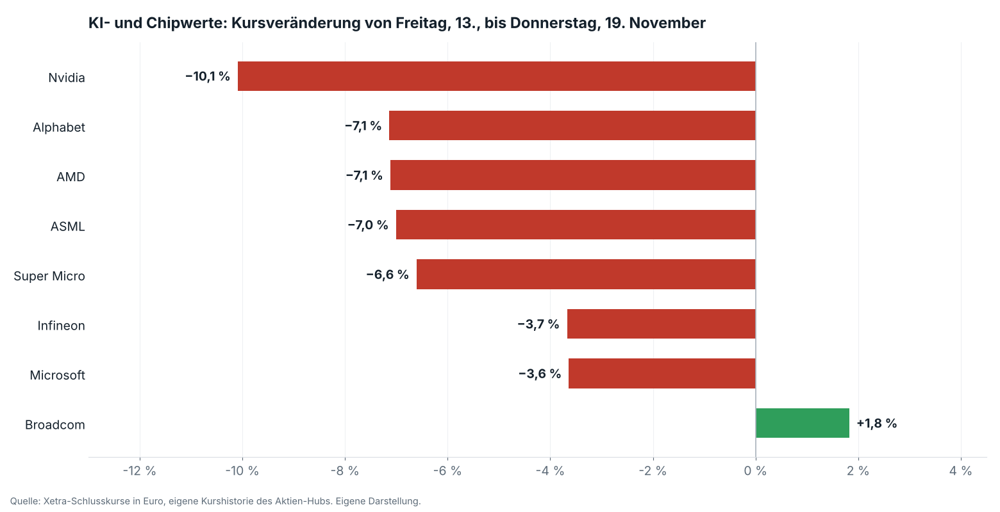

<!-- PRÜFEN: Anthropic: Ausgabepreis 83 $, 980 Mio. Aktien, rund 81 Mrd. $ Erlös, größter Börsengang der Geschichte, Eröffnung 111,50 $, am Nachmittag 95,69 $, Nvidia-Beteiligungen von zusammen 20 Mrd. $: Al Jazeera/Reuters vom 19.11.2026. Bewertung zum Ausgabepreis rund 1,5 Bio. $: Fortune vom 18.11.2026. Schlusskurs des ersten Handelstags vor Veröffentlichung nachtragen. Umsatz neun Monate 33,2 Mrd. $ aus dem Prospekt laut docs/newsletter-notizen.md. -->
<!-- PRÜFEN: Nvidia: Rücktritt Huang am 12.11., Begründung Verhaltenskodex, Interimschefin Colette Kress, Zitat Harvey Jones, Huangs Beitrag auf X: TechCrunch vom 17.11.2026. Lieferstopp Hopper/H200 nach China und neuer Ausschuss für nationale Sicherheit: SCMP. Quartalszahlen aus unserem Nvidia-Artikel vom 17.11. Vorwürfe gegen Alice Huang nur als Berichte, umstritten (Fortune). -->
<!-- PRÜFEN: Exportregel: Interim Final Rule des Handelsministeriums vom 16.11., gültig mit Veröffentlichung im Federal Register am 19.11.; Lizenzpflicht für Indonesien, Malaysia, Singapur, Thailand, Brasilien; Fernzugriff für Firmen mit Sitz in China; 90 Tage Übergang; Ausnahme für US-Firmen bei der Exportlizenz: Fortune vom 16.11. und techi.com vom 17.11. (höchstens 1,3 % des Nvidia-Umsatzes nach Kundensitz, Quartal bis 26.07.2026). Ausweitung auf Fertigungstechnik ab 14/16 Nanometer, TSMC hält Lieferungen zurück, Xiaomi betroffen: Nikkei Asia vom 20.11.2026 (Cheng Ting-Fang), von Divi als Archivkopie geschickt; FT berichtete zuerst über TSMC und Samsung. -->
<!-- PRÜFEN: Kursveränderungen aus den Xetra-Schlusskursen 13.11. und 19.11.2026 (data/kurse/xetra), Freitag 20.11. noch nicht enthalten, vor Versand eventuell auf den Wochenschluss aktualisieren. Nasdaq −2 % am 18.11.: CNBC-Schlagzeile vom 18.11.2026. -->
<!-- PRÜFEN: AMD-Zahlen aus unserem Artikel vom 19.11. (−8,8 % auf 483,59 $, Stand 18:10 Uhr MEZ). -->

!!! kurz "Kurz gesagt"
    **Anthropic:** Der Claude-Entwickler sammelt beim Börsengang rund 81 Mrd. Dollar ein, so viel wie kein Unternehmen zuvor. Die Aktie startet mit einem Plus von 34 %.
    **Nvidia:** Der Verwaltungsrat schließt eine Rückkehr von Jensen Huang aus. Das Geschäft wächst trotzdem: Der Umsatz hat sich im Quartal mehr als verdoppelt.
    **Chipregeln:** Washington verlangt Lizenzen für KI-Chips in fünf Ländern und sperrt den Fernzugriff chinesischer Firmen. Die Folgen reichen bis zu Smartphone- und Autochips.
    **Börse:** Fast alle KI- und Chipwerte geben deutlich nach. Nvidia verliert auf Xetra binnen einer Woche gut 10 %, AMD, Alphabet und ASML jeweils rund 7 %.

## Eine Woche, drei Signale

Selten hat eine einzige Woche so viel über den Zustand der KI-Branche verraten. Am Donnerstag ging Anthropic an die Nasdaq und sammelte so viel Geld ein wie kein Börsenneuling vor ihm. Zwei Tage zuvor hatte Nvidia seine ersten Zahlen ohne Gründer Jensen Huang vorgelegt und klargestellt, dass er nicht zurückkehrt. Und am selben Donnerstag traten in Washington Exportregeln in Kraft, die weit über das hinausgehen, was die Branche erwartet hatte.

Zusammen ergibt das ein klares Bild: Die Nachfrage nach KI ist ungebrochen, das Geld der Anleger fließt weiter in großen Mengen. Gleichzeitig wächst das Risiko, das nichts mit Technik zu tun hat. Es geht um Führung, um Politik und um die Frage, wer welche Chips wohin liefern darf.

## Die Woche an der Börse: Rot für fast alle KI-Werte

An der Börse hat die Woche Spuren hinterlassen. Von Freitag bis Donnerstag verlor Nvidia auf Xetra gut 10 %, AMD, Alphabet und ASML büßten jeweils rund 7 % ein, Super Micro 6,6 %. Selbst Microsoft und Infineon gaben knapp 4 % nach. Einzig Broadcom, das eigene KI-Chips für die großen Cloudkonzerne entwickelt, legte leicht zu. Am Mittwoch fiel der Nasdaq-Index um 2 %, obwohl der Börsengang von Anthropic eigentlich für Rückenwind sorgen sollte.

Die Auslöser überlagern sich: die Führungskrise bei Nvidia, die neuen Exportregeln, der Leerverkäuferbericht zu AMD und Gewinnmitnahmen nach einem starken Jahr. Dazu kommt die Frage, ob die Bewertungen der Branche die vielen Unsicherheiten noch abbilden.

## Anthropic: Der größte Börsengang der Geschichte

Anthropic hat seine Aktien zu 83 Dollar ausgegeben, über der ursprünglich angepeilten Spanne von 70 bis 78 Dollar. Statt 825 Millionen wurden 980 Millionen Aktien verkauft, der Erlös liegt bei rund 81 Milliarden Dollar. Damit übertrifft Anthropic den Börsengang von SpaceX aus dem Juni. Zum Ausgabepreis wurde das Unternehmen mit rund 1,5 Billionen Dollar bewertet.

Der erste Kurs lag bei 111,50 Dollar, ein Plus von 34 %. Im Verlauf bröckelte der Aufschlag, am Nachmittag notierte die Aktie noch rund 15 % über dem Ausgabepreis. Die Nachfrage ist durch das Wachstum gedeckt: In den ersten neun Monaten des Jahres setzte Anthropic 33,2 Milliarden Dollar um, mehr als das Zwölffache des Vorjahres. Profitabel ist das Unternehmen noch nicht, die Kosten für Rechenleistung bleiben der größte Posten. Mehr zu Geschäft und Bewertung steht in unserer [Analyse zum Börsengang](/news/anthropic-boersengang-ueberzeichnet-zeichnen/).

Interessant für Nvidia-Aktionäre: Der Chipkonzern ist mit insgesamt 20 Milliarden Dollar an Anthropic beteiligt, die Hälfte davon kam direkt beim Börsengang dazu.

## Nvidia: Rekordzahlen ohne den Gründer

Jensen Huang war am 12. November zurückgetreten, nachdem persönliches Fehlverhalten bekannt geworden war, das gegen den Verhaltenskodex des Konzerns verstieß. Im Mittelpunkt steht eine Affäre mit einer früheren Managerin des Unternehmens Megaspeed, die US-Dienste Berichten zufolge für eine chinesische Agentin halten. Diese Einschätzung ist umstritten, ein unabhängiger Ausschuss untersucht den Fall. Mehr dazu in unserer [Wochenend-Analyse zum Rücktritt](/news/nvidia-huang-ruecktritt-wochenend-analyse/).

Auf X erklärte Huang, er würde gern zurückkehren, wenn der Verwaltungsrat das für richtig hält. Dessen Vorsitzender Harvey Jones machte in der Telefonkonferenz am Dienstag deutlich, dass das nicht geplant ist. Finanzchefin Colette Kress führt den Konzern vorerst, die Suche nach einem dauerhaften Chef läuft.

Das Geschäft selbst zeigt keine Schwäche. Der Umsatz stieg im dritten Quartal um 103 % auf 115,8 Milliarden Dollar, für das laufende Quartal stellt Nvidia rund 130 Milliarden Dollar in Aussicht. Gleichzeitig hat der Konzern die Lieferung älterer Hopper-Chips wie des H200 nach China gestoppt und einen Ausschuss für nationale Sicherheit eingerichtet. Die Details stehen in unserem [Artikel zu den Quartalszahlen](/news/nvidia-q3-2026/).

## Washington zieht die Schrauben an

Die neuen Regeln des US-Handelsministeriums gelten seit Donnerstag. Wer künftig KI-Chips an Rechenzentren in Indonesien, Malaysia, Singapur, Thailand oder Brasilien liefern will, braucht eine Lizenz. Ebenso brauchen große Rechenzentren weltweit eine Genehmigung, wenn sie Firmen mit Sitz in China Zugang zu ihrer Rechenleistung geben. Damit schließt Washington eine Lücke, über die chinesische Unternehmen gesperrte Chips aus der Ferne nutzen konnten. Bestehende Kunden haben 90 Tage Zeit. Amerikanische Unternehmen sind von der Lizenzpflicht für die Ausfuhr ausgenommen.

Für Nvidia selbst ist der direkte Effekt überschaubar. Kunden mit Sitz außerhalb der USA, Taiwans und Chinas standen im Sommerquartal für höchstens 1,3 % des Umsatzes. Allerdings weist Nvidia den Umsatz nach dem Sitz der Kunden aus, wohin die Chips am Ende gehen, zeigt diese Zahl nicht.

Deutlich breiter treffen die Regeln die Auftragsfertiger. Wie Nikkei Asia am Freitag berichtete, müssen Chipfabriken nun davon ausgehen, dass alle Chips aus Fertigungstechnik ab 14 oder 16 Nanometer der Exportkontrolle unterliegen, es sei denn, der Entwickler steht auf einer Liste der US-Regierung. Das betrifft neben Prozessoren für Rechenzentren auch Chips für Smartphones, autonomes Fahren und Unterhaltungselektronik. TSMC hat Lieferungen an mehrere chinesische und nichtchinesische Kunden vorerst gestoppt, um sie zu prüfen. Betroffen ist unter anderem Xiaomi, das eigene Smartphone-Prozessoren entwickelt. Auch aufstrebende Chipdesign-Standorte wie Vietnam und Malaysia geraten unter Druck.

Warum Washington so weit geht, zeigt ein zweites Thema der Woche: Chinesische Labore nutzen die Antworten amerikanischer KI-Modelle, um eigene Systeme zu trainieren, und holen so trotz fehlender Spitzenchips auf. Wie diese Destillation funktioniert, erklären wir in einer [eigenen Analyse](/news/china-destillation-us-ki-modelle/).

## AMD: Vom sicheren Hafen zur Zielscheibe

Nach Huangs Rücktritt hatten viele Anleger in AMD umgeschichtet. Am Donnerstag bekam dieses Bild einen Riss. Der Leerverkäufer Hunterbrook will AMD-Software bei einem von den USA gesperrten chinesischen Serverhersteller gefunden haben. Die Aktie fiel zeitweise um mehr als 10 %. Einen Verstoß gegen Exportregeln belegt der Bericht nicht, AMD hatte sich zunächst nicht geäußert. Die Einzelheiten stehen in unserem [Artikel zum Hunterbrook-Bericht](/news/amd-hunterbrook-shortseller-china/).

## Was das für Anleger heißt

Die Woche lässt zwei Lesarten zu. Für die optimistische spricht, dass die Nachfrage alle Störungen überdeckt. Nvidia wächst trotz Führungskrise mit dreistelligen Raten, und Anleger haben Anthropic mehr Geld anvertraut als jedem Börsenneuling zuvor. Die direkten Umsatzeinbußen durch die neuen Regeln sind für die großen US-Konzerne bisher klein.

Die vorsichtige Lesart verweist auf das, was sich nicht in Quartalszahlen messen lässt. Nvidia sucht einen Nachfolger für einen Gründer, der den Konzern drei Jahrzehnte geprägt hat. Die Exportregeln betreffen inzwischen große Teile der Chipindustrie und können Lieferketten in ganz Asien verzögern. Wer in KI-Werte investiert, trägt damit zunehmend politisches Risiko.

## Quellen

- [Nikkei Asia: Chip supply chain warns of broader disruption from new US export controls (20.11.2026)](https://asia.nikkei.com/business/tech/semiconductors/chip-supply-chain-warns-of-broader-disruption-from-new-us-export-controls)
- [Fortune: The Nvidia scandal fuels tougher China chip rules as Commerce targets Singapore and Malaysia (16.11.2026)](https://fortune.com/2026/11/16/new-commerce-rule-nvidia-chip-singapore-malaysia-china/)
- [techi: US chip rule names five countries; customers based there are at most 1.3% of Nvidia revenue](https://www.techi.com/us-ai-chip-export-rule-nvidia-revenue-exposure/)
- [Al Jazeera: Anthropic starts trading in the US after blockbuster IPO (19.11.2026)](https://www.aljazeera.com/economy/2026/11/19/anthropic-starts-trading-in-the-us-after-blockbuster-ipo)
- [Fortune: Anthropic prices IPO at $83 per share (18.11.2026)](https://fortune.com/2026/11/18/anthropic-prices-ipo-83-per-share-1-5-trillion/)
- [TechCrunch: Nvidia says it doesn't plan to reappoint Jensen Huang as CEO (17.11.2026)](https://techcrunch.com/2026/11/17/nvidia-says-it-doesnt-plan-to-reappoint-jensen-huang-as-ceo/)
- [South China Morning Post: Nvidia board rules out Jensen Huang return](https://www.scmp.com/tech/article/3374812/nvidia-board-says-it-has-no-plans-reinstate-jensen-huang-ceo)
