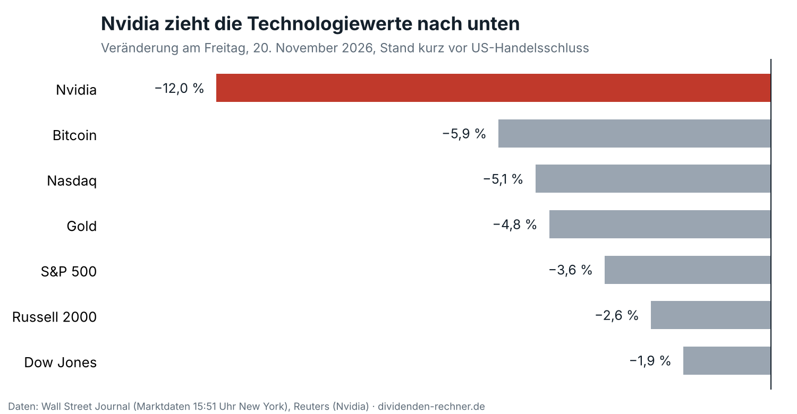

<!-- PRÜFEN: SEC-Ermittlungen zum Rechnungswesen: Reuters (zwei mit der Sache vertraute Personen) vom 20.11.2026, zuerst WSJ am Dienstag (Grund damals unbekannt); weder SEC noch Nvidia äußerten sich. Kurs −12 % auf 128 $, tiefster Stand seit Mai 2025, Rekord rund 243 $ Anfang Oktober; Fragenkatalog von Generalstaatsanwalt Rob Bonta (Kalifornien); Senatsanhörung Huang laut Mitarbeiter von Senator Tim Scott; Petition 190.000; Anthropic −14,5 %, rund 10 Cent über dem Ausgabepreis von 83 $ (Mittag Ortszeit): SPIEGEL/Reuters/dpa vom 20.11.2026, 21:34 Uhr, von Divi als Text geschickt. -->
<!-- PRÜFEN: Marktdaten 15:51 Uhr New York (Nasdaq −5,1 %, S&P 500 −3,6 %, Dow −1,9 %, Russell 2000 −2,6 %, VIX 37,5 und Jahreshoch, Gold −4,8 %, Bitcoin −5,9 %, zehnjährige US-Rendite 4,93 %), Nasdaq mehr als 17 % unter dem Oktober-Hoch, fast −10 % in der Woche, Basiskonsumgüter +1 %, S&P 500 und Dow in der Korrektur: WSJ-Liveblog vom 20.11.2026. Schlusskurse vor Veröffentlichung nachtragen. -->
<!-- PRÜFEN: Trump zu Rechenzentren im Ausland („tremendous penalties“, „tremendous tax“), Huang-Rückkehr, gemeinsame Leitplanken mit Xi: WSJ (Natalie Andrews, Philip Wegmann) vom 20.11.2026. Zinssignale der Fed mit Robin Brooks und Volker Pfirsching: Divis Zusammenfassung, Originalquelle nachtragen. -->
<!-- PRÜFEN: Singapur und Megaspeed, Offenlegung 2025 gestrichen, Kress Finanzchefin seit 2013, Umsatz Q3 115,8 Mrd. $: aus unseren Nvidia-Artikeln vom 10.11. und 17.11.2026. Ein Zusammenhang zwischen Singapur und den SEC-Ermittlungen ist nicht berichtet, nur als offene Frage formuliert. -->

!!! kurz "Kurz gesagt"
    **Die Ermittlung:** Die US-Börsenaufsicht SEC prüft offenbar die Buchführung von Nvidia. Was genau, ist offen. Weder die Behörde noch der Konzern äußern sich.
    **Die Börse:** Nvidia verliert 12 % und notiert nur noch knapp halb so hoch wie Anfang Oktober. Die Nasdaq fällt um 5 %, S&P 500 und Dow rutschen in die Korrektur.
    **Die Gründe:** Neben Nvidia belasten Zinssorgen, Trumps Drohung gegen Rechenzentren im Ausland und Zweifel an den riesigen KI-Investitionen.
    **Für Dividendenanleger:** Konsumgüter, Energie und Gesundheit legen als einzige Bereiche zu.

## Vom Börsenliebling zum Ermittlungsfall

Vor sieben Wochen war Nvidia das wertvollste Unternehmen der Welt, die Aktie kostete rund 243 Dollar. Am Freitag fiel sie auf 128 Dollar. Dazwischen liegen der Rücktritt von Gründer Jensen Huang, eine mutmaßliche Spionageaffäre und nun eine Nachricht, die Anleger mehr beunruhigt als alles zuvor: Die US-Börsenaufsicht SEC nimmt das Rechnungswesen des Konzerns unter die Lupe.

Dass die SEC ermittelt, war seit Dienstag bekannt. Neu ist, worum es gehen soll. Zwei mit der Sache vertraute Personen nennen die Buchhaltungspraktiken von Nvidia. Welche Vorgänge die Behörde prüft, sagen sie nicht. Die SEC lehnte eine Stellungnahme ab, Nvidia schweigt. Für die Aktie reichte das für ein Minus von 12 %, den tiefsten Stand seit Mai 2025.

## Die offene Frage: Singapur

Was die SEC sucht, ist offen. Eine Spur drängt sich trotzdem auf. Nvidia hat 2025 aufgehört, die Umsätze mit Kunden in Singapur gesondert auszuweisen. Seitdem zeigt der Konzern seine Regionen nach dem Sitz der direkten Kunden, und Singapur taucht nicht mehr auf. In Singapur saß Megaspeed, ein Betreiber von Rechenzentren, der Nvidia-Chips in Südostasien einsetzte und seit Ende 2024 im Verdacht stand, Chips nach China umzuleiten. Bei Megaspeed arbeitete auch Alice Huang, jene Managerin, die US-Behörden für eine Agentin des chinesischen Geheimdienstes halten.

Ob die Ermittlungen damit zu tun haben, ist nicht berichtet. Die Frage liegt aber auf dem Tisch, seit Nvidia Mitte November seine Quartalszahlen vorgelegt hat: Wo landen die Chips, die über Singapur verkauft werden, und wie sauber sind diese Umsätze verbucht? Wir haben darauf im Quartalsbericht keine Antwort gefunden. Auch der Generalstaatsanwalt von Kalifornien, Rob Bonta, will wissen, ob Chips oder vertrauliche Informationen nach China geflossen sind und ob Nvidia seine Anleger falsch informiert hat. Er hat dem Konzern einen Fragenkatalog geschickt.

## Kress verantwortet genau den Bereich, um den es geht

Die Ermittlungen treffen eine Person besonders: Colette Kress. Sie führt Nvidia seit Huangs Rücktritt kommissarisch und ist seit 2013 Finanzchefin. Damit verantwortet sie seit vielen Jahren genau den Bereich, den die SEC nun prüft, auch die Entscheidung, Singapur nicht mehr auszuweisen. Bislang galt Kress als stabilisierende Kraft in der Krise. Sollte sich herausstellen, dass bei der Buchführung etwas nicht stimmt, wäre ihre Position kaum zu halten, und Nvidia stünde ohne Führung da.

Dazu gehört die Einordnung: Eine SEC-Untersuchung ist zunächst ein zivilrechtliches Verfahren. Viele enden ohne Anklage, manche mit einer Korrektur der Offenlegung. Am Geschäft selbst hat sich bisher nichts geändert. Im dritten Quartal hat Nvidia den Umsatz mehr als verdoppelt, auf 115,8 Milliarden Dollar. Die Nachfrage nach KI-Chips ist ungebrochen.

Die politische Seite bleibt laut. Jensen Huang soll vor dem US-Senat aussagen, Präsident Trump fordert erneut seine Rückkehr. „Wenn das Unternehmen klug wäre, würde es eine Entschuldigung annehmen und diesen brillanten Mann zurückholen“, sagte Trump am Freitag. Nvidia lehnt das ab.

## Nicht nur Nvidia: Was die Börse sonst belastet

Der Ausverkauf reichte weit über Nvidia hinaus. Die Nasdaq verlor rund 5 % und liegt mehr als 17 % unter ihrem Hoch vom Oktober, auf die Woche gerechnet fast 10 %. S&P 500 und Dow Jones rutschten in die Korrektur, also mehr als 10 % unter ihren Rekord. Der Angstindex VIX stieg auf den höchsten Stand des Jahres. Besonders getroffen wurden Chip- und KI-Werte wie Micron, AMD, Broadcom, Nebius und CoreWeave. Selbst Anthropic, am Donnerstag noch mit einem Rekord-Börsengang gefeiert, fiel um rund 14 % und notierte nur noch knapp über dem Ausgabepreis von 83 Dollar.

Dahinter stehen mehrere Sorgen gleichzeitig. Die US-Notenbank deutet schnellere und kräftigere Zinserhöhungen an, die Rendite zehnjähriger Staatsanleihen liegt bei gut 4,9 %. Das verteuert genau die Milliardenkredite, mit denen Rechenzentren gebaut werden. Am Freitag kündigte Trump zudem an, Unternehmen mit hohen Strafen zu belegen, wenn sie Rechenzentren im Ausland bauen. Das trifft die großen Cloudkonzerne, die weltweit investieren. Und im Inland wächst der Widerstand gegen neue Rechenzentren, weil Anwohner höhere Strompreise fürchten.

Auffällig: Auch Gold und Bitcoin fielen kräftig. Das spricht dafür, dass viele Anleger verkauften, was sich verkaufen ließ, um Verluste an anderer Stelle auszugleichen. Solche Tage übertreiben oft in beide Richtungen.

## Was das für Dividendenanleger heißt

Während Technologiewerte fielen, legten Basiskonsumgüter im S&P 500 um 1 % zu, Energie und Gesundheit hielten sich leicht im Plus. Das ist das bekannte Muster: Wenn Wachstumsfantasien wanken, suchen Anleger Firmen mit stetigen Einnahmen und verlässlichen Ausschüttungen. Wie belastbar die Dividenden einzelner Konsumwerte wirklich sind, haben wir diese Woche bei [Kraft Heinz](/news/kraft-heinz-nyse-prognose-dividende-2029/) sowie bei [Target und TJX](/news/target-tjx-zollrueckerstattung-dividende-vergleich/) durchgerechnet.

Für Nvidia selbst spielt die Dividende keine Rolle, die Ausschüttung ist winzig. Entscheidend wird, was die SEC findet und wann Nvidia sein ausführliches Quartalsdokument, das 10-Q, vorlegt. Erst dort lässt sich prüfen, wie die Umsätze nach Regionen tatsächlich verbucht sind. Bis dahin handelt die Aktie mit einem Abschlag für das Ungewisse, und der dürfte so schnell nicht verschwinden.
