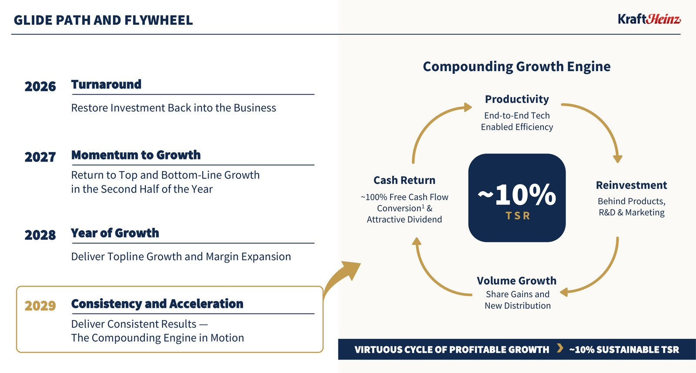
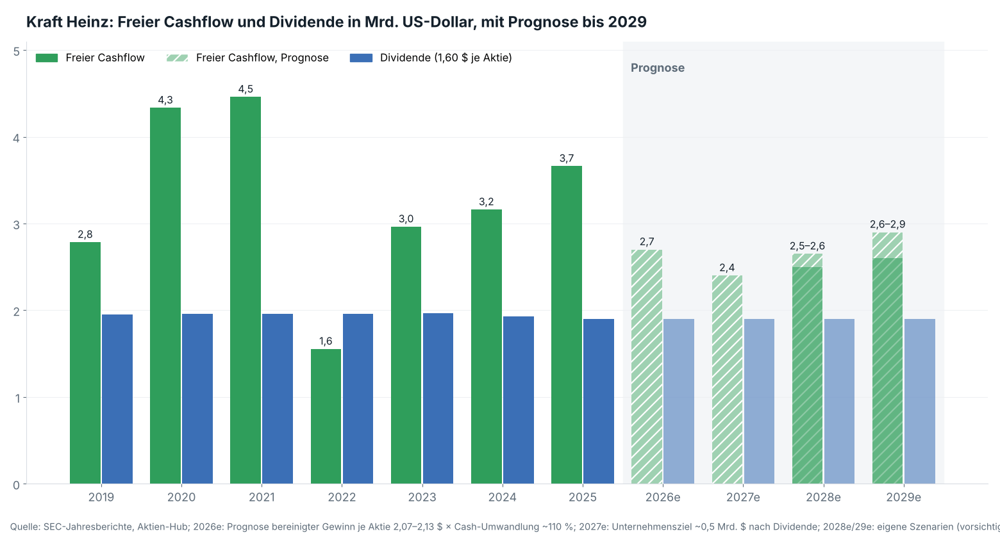
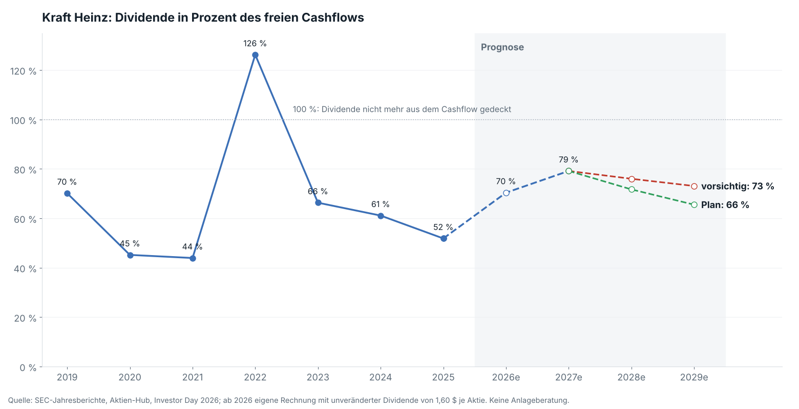
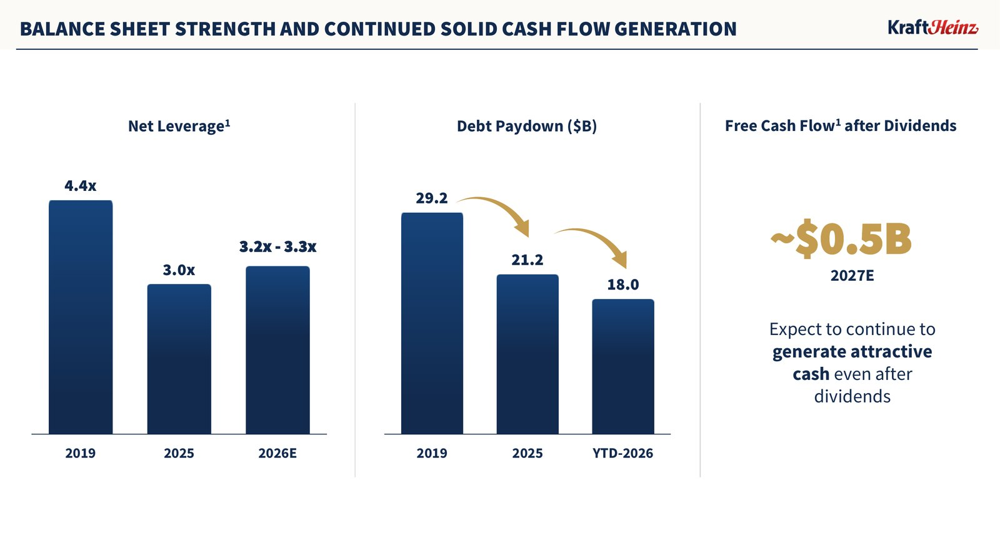

<!-- PRÜFEN: Folien und Ziele aus der Investor-Day-Präsentation (Kraft_Heinz_Investor_Day_Combined_FINAL2.pdf, von Divi geliefert): Fahrplan 2026 bis 2029 (S. 25), Ausblick 2027 organisch etwa flach inkl. 50 Basispunkte Belastung aus Ausstiegen und Kaffeeverkauf, bereinigter Betriebsgewinn niedrig einstellig rückläufig, Cash-Umwandlung ~100 % (S. 158/159), Verschuldung 3,0x (2025), 3,2–3,3x (2026e), Ziel ~3,0x, Schulden 29,2 → 21,2 → 18,0 Mrd. $, freier Cashflow nach Dividende ~0,5 Mrd. $ 2027e (S. 160), Kapitalverwendung (S. 161), Portfolio Win Big 56 %, Win 21 %, Hold 23 %, 700 Mio. $ Investitionen 2026, Innovationsanteil 2 % → ~5 %, Produktivität mind. 4 % der Herstellkosten 2027, ~10 % Aktionärsrendite. -->
<!-- PRÜFEN: Zehnjahreszahlen aus data/sec/fundamentals.json, Kurs und Rendite aus data/kennzahlen.json (Xetra 19.11.2026, 24,94 $). 2026-Werte (bereinigter Gewinn je Aktie 2,07–2,13 $, Cash-Umwandlung ~110 %, freier Cashflow neun Monate 2,4 Mrd. $, Zinsen ~890 Mio. $, Kaffeeverkauf 650 Mio. $) aus unserem Investor-Day-Artikel vom 12.11.2026. NYSE-Wechsel: Glocke am 12.11.2026, angekündigt per 8-K vom 25.08.2026. -->
<!-- PRÜFEN: Eigene Prognose: freier Cashflow 2026e = 2,10 $ × ~1,185 Mrd. Aktien × 110 % ≈ 2,7 Mrd. $; 2027e = 1,9 Mrd. $ Dividende + 0,5 Mrd. $ ≈ 2,4 Mrd. $; 2028e/2029e vorsichtig +4 % pro Jahr (2,5/2,6), Plan rund +10 % pro Jahr (2,65/2,9). Umsatz 2026e mit −0,9 % organisch (Mitte der Spanne), ohne Währung; 2027e organisch flach, Kaffeeverkauf nicht herausgerechnet; 2028e/29e vorsichtig +1 %, Plan +2 % / +3 %. Dividende konstant 1,90 Mrd. $. Rückgang Cashflow 2025 → 2027e: 3,66 → 2,4 = −34 %. -->

!!! kurz "Kurz gesagt"
    **Anlass:** Kraft Heinz ist von der Nasdaq an die New York Stock Exchange gewechselt und hat beim Investor Day seinen Fahrplan bis 2029 vorgestellt.
    **Dividende:** Die 1,60 Dollar je Aktie sind gedeckt, 2027 aber nur noch knapp: Nach unserer Rechnung fließen rund vier Fünftel des freien Cashflows an die Aktionäre.
    **Erhöhung:** Läuft der Plan, entsteht ab 2029 genug Spielraum für eine erste Anhebung seit 2019. Vorher hat der Schuldenabbau Vorrang.

## Die Glocke läutet, die Rechnung bleibt

Als die Führung von Kraft Heinz am 12. November auf dem Balkon über dem Börsenparkett die Eröffnungsglocke läutete, war das mehr als ein Ortswechsel. Kraft Heinz hat seine Aktie von der Nasdaq an die New York Stock Exchange geholt, im Saal stand ein riesiger Becher Mac & Cheese. Die Botschaft des Tages lautete: Der Konzern ist zurück auf Wachstumskurs.

Wer die Präsentation des Investor Days Seite für Seite durchgeht, findet eine nüchterne Rechnung. 2026 ist das Jahr der Investitionen, 2027 soll die Wende in der zweiten Jahreshälfte bringen, erst 2028 ist das Jahr des Wachstums. Für Dividendenanleger heißt das: Die Ausschüttung ist sicher, doch auf mehr müssen sie warten. Die Einzelheiten zum Fahrplan und zur gestoppten Aufspaltung stehen in unserem [Artikel zum Investor Day](/news/kraft-heinz-investor-day-2026-ziele-2029-dividende/).

## Woher das Wachstum kommen soll

Kraft Heinz hat sein Geschäft in drei Gruppen sortiert. Mehr als die Hälfte des Umsatzes, 56 %, entfällt auf die Bereiche, in denen der Konzern gewinnen will: Saucen und Gewürze rund um Heinz, Fertiggerichte und Getränkepulver. Weitere 21 % stammen aus Desserts, Snacks und Käse. Den Rest, Kaffee, Fleisch und Tiefkühlware, führt das Management nur noch auf Halten. Das nordamerikanische Kaffeegeschäft wird Mitte 2027 verkauft.

Die Hoffnung ruht auf drei Hebeln. In den Schwellenländern, die bereits mehr als ein Zehntel des Umsatzes liefern, soll der Umsatz 2027 zweistellig wachsen. Im Geschäft mit Restaurants und Kantinen, wo Heinz-Ketchup auf den Tischen steht, ist ein niedriges einstelliges Plus geplant. Und neue Produkte sollen 2027 rund 5 % des US-Umsatzes ausmachen, nach 2 % im vergangenen Jahr. Bezahlt wird das aus Effizienz: Mindestens 4 % der Herstellkosten will der Konzern 2027 einsparen.

## Unsere Prognose: Umsatz, Cashflow und Dividende bis 2029

Kraft Heinz nennt für 2028 und 2029 keine konkreten Zahlen. Wir haben deshalb aus den Unternehmenszielen und den Daten des Aktien-Hubs zwei Szenarien gerechnet: ein vorsichtiges, in dem der Umsatz nur um 1 % im Jahr zulegt, und eines, in dem der Plan aufgeht.

| Jahr | Umsatz | Freier Cashflow | Dividende | Quote | Cashflow nach Dividende |
|---|---:|---:|---:|---:|---:|
| 2025 (Ist) | 24,9 Mrd. $ | 3,7 Mrd. $ | 1,9 Mrd. $ | 52 % | 1,8 Mrd. $ |
| 2026e | 24,7 Mrd. $ | 2,7 Mrd. $ | 1,9 Mrd. $ | 70 % | 0,8 Mrd. $ |
| 2027e | 24,7 Mrd. $ | 2,4 Mrd. $ | 1,9 Mrd. $ | 79 % | 0,5 Mrd. $ |
| 2028e vorsichtig / Plan | 24,9 / 25,2 Mrd. $ | 2,5 / 2,65 Mrd. $ | 1,9 Mrd. $ | 76 / 72 % | 0,6 / 0,75 Mrd. $ |
| 2029e vorsichtig / Plan | 25,2 / 25,9 Mrd. $ | 2,6 / 2,9 Mrd. $ | 1,9 Mrd. $ | 73 / 66 % | 0,7 / 1,0 Mrd. $ |

Der Umsatz ist dabei die geringere Sorge. Die Dividende kostet Kraft Heinz knapp 8 % des Umsatzes, und selbst im vorsichtigen Fall wächst er wieder leicht. Entscheidend ist der Cashflow. Er sinkt von 3,7 Milliarden Dollar im Jahr 2025 auf rund 2,4 Milliarden im Jahr 2027, ein Minus von gut einem Drittel. Die zusätzlichen Investitionen von 700 Millionen Dollar in Marketing, Rezepturen und Preise sind dauerhaft eingeplant, dazu kommen höhere Rohstoffkosten und der Wegfall des Kaffeegeschäfts.

## Ist die Dividende gedeckt?

Ja, in beiden Szenarien und in jedem Jahr. Selbst 2027, im schwächsten Jahr der Prognose, bleiben nach der Ausschüttung rund 500 Millionen Dollar übrig, das hat das Management selbst so beziffert. Die Bilanz ist zudem deutlich gesünder als vor einigen Jahren: Die Schulden sind seit 2019 von 29,2 auf 18,0 Milliarden Dollar gesunken, die Nettoverschuldung liegt beim 3,2- bis 3,3-Fachen des bereinigten operativen Ergebnisses vor Abschreibungen.

Das Polster ist allerdings dünner geworden. 2025 floss rund die Hälfte des freien Cashflows an die Aktionäre, 2027 werden es nach unserer Rechnung knapp 80 % sein. Ein schwaches Jahr wie 2022, als die Dividende den Cashflow überstieg, könnte sich Kraft Heinz in dieser Phase schlecht leisten. Die Präsentation spricht deshalb von einer „unerschütterlichen Verpflichtung" zur Dividende, verspricht aber kein Wachstum der Ausschüttung.

## Wann könnte die Dividende wieder steigen?

Seit der Kürzung von 2,50 auf 1,60 Dollar im Jahr 2019 liegt die Dividende unverändert. Die Reihenfolge der Kapitalverwendung ist in der Präsentation klar festgelegt: zuerst Investitionen ins Geschäft, dann eine Nettoverschuldung von rund dem Dreifachen des operativen Ergebnisses vor Abschreibungen, dann Zukäufe und Verkäufe, und erst was danach übrig bleibt, geht zusätzlich an die Aktionäre.

Daraus ergeben sich zwei Bedingungen. Erstens muss die Verschuldung von heute 3,2 bis 3,3 wieder auf 3,0 fallen, der Erlös aus dem Kaffeeverkauf hilft dabei. Zweitens braucht es dauerhaft deutlich mehr Cashflow nach Dividende als die erwarteten 0,5 Milliarden Dollar. Eine Erhöhung um 5 % würde jährlich knapp 100 Millionen Dollar kosten.

Im Plan-Szenario sind beide Bedingungen 2029 erfüllt: Die Quote sinkt auf zwei Drittel, nach der Dividende bleibt rund eine Milliarde Dollar. Eine erste, eher symbolische Anhebung wäre dann denkbar, realistisch mit den Zahlen für 2028 oder im Laufe des Jahres 2029. Im vorsichtigen Szenario bleibt das Polster zu dünn, eine Erhöhung vor 2030 wäre dann kaum vertretbar. Das ist unsere Rechnung, keine Zusage des Unternehmens.

## Was die Aktie heute bietet

Die Rendite ist der eigentliche Grund, warum Anleger die Wartezeit in Kauf nehmen. Bei einem Kurs von knapp 25 Dollar liegt sie bei 6,4 %, der freie Cashflow entspricht fast 12 % des Börsenwerts. Das Management verspricht eine dauerhafte Aktionärsrendite von rund 10 % im Jahr. Bei 6,4 % Dividende müssten dafür Gewinn und Kurs nur um gut 3 % pro Jahr zulegen.

Dagegen steht die Geschichte. Der Umsatz liegt heute niedriger als 2016, die Dividende ist im Zehnjahresschnitt um 4 % pro Jahr geschrumpft, und die Wende hängt an einer zweiten Jahreshälfte 2027, die noch weit entfernt ist. Wer einsteigt, kauft eine hohe, gut gedeckte Ausschüttung, aber keine Dividendenwachstumsaktie. Ob sich das ändert, zeigt die formale Prognose für 2027, die Kraft Heinz mit den Zahlen zum vierten Quartal im Februar vorlegt.

## Quellen

- The Kraft Heinz Company: Investor-Day-Präsentation 2026
- The Kraft Heinz Company: SEC-Jahresberichte (10-K), ausgewertet im Aktien-Hub
- [Kraft Heinz Casts Spotlight on its NYSE Listing (12.11.2026)](https://www.nasdaq.com/press-release/kraft-heinz-casts-spotlight-its-nyse-listing-nyse-content-update-2026-11-12)
- [Kraft Heinz: Form 8-K zum Börsenwechsel (25.08.2026)](https://www.sec.gov/Archives/edgar/data/0001637459/000163745926000057/khc-20260824.htm)
- Unser Artikel: [Kraft Heinz verspricht Wachstum ab 2027](/news/kraft-heinz-investor-day-2026-ziele-2029-dividende/)
