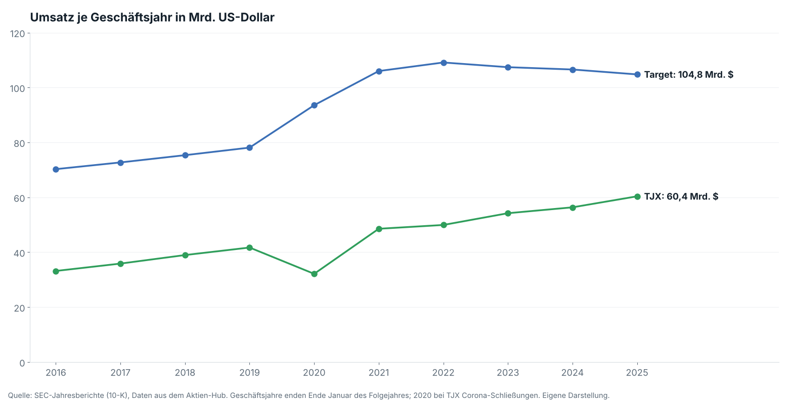
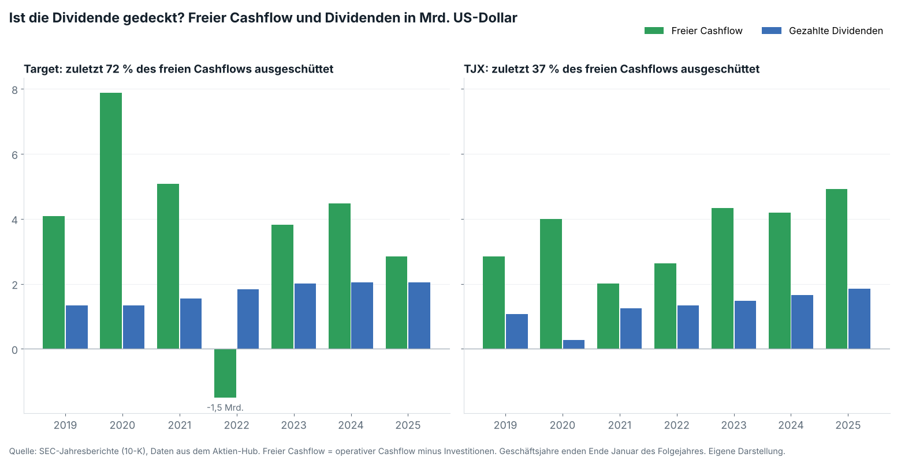
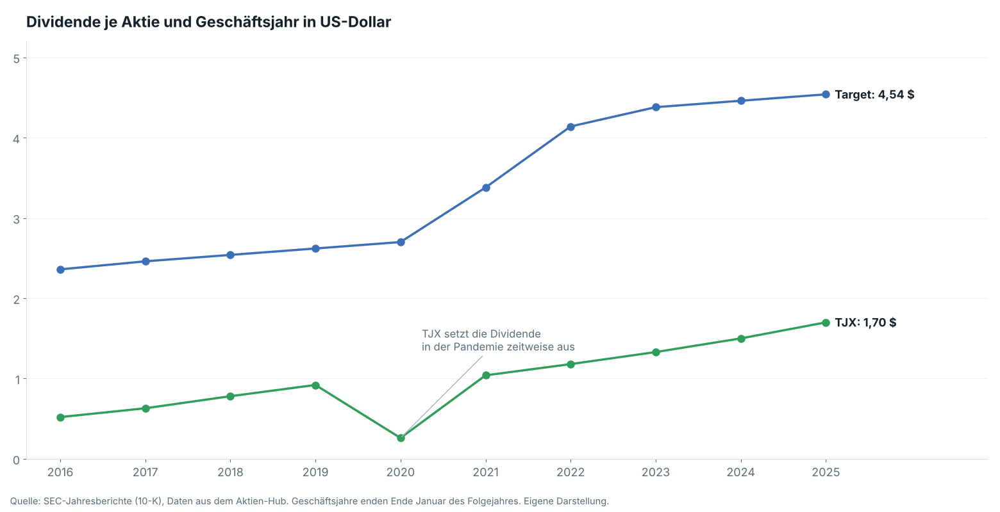

<!-- PRÜFEN: Quartalszahlen aus unseren Artikeln zu Target (target-q3-2026) und TJX (tjx-q3-fy27) vom 18.11.2026, beide auf Basis der Pressemitteilungen. Zehnjahreszahlen (Umsatz, Dividende je Aktie, operativer Cashflow, Investitionen, gezahlte Dividenden) aus data/sec/fundamentals.json, Kennzahlen-Tabelle aus data/kennzahlen.json (Xetra-Kurse vom 19.11.2026, Umrechnung in USD). Diagramme selbst gebaut. -->
<!-- PRÜFEN: Selbst gerechnet: Zollerstattung je Aktie Target 0,50 $ zu TJX 0,05 $ = zehnfach; Anteil am Gewinn je Aktie Target 0,50/2,65 = 19 % (Quartal), Jahresprognose 2,14 / 11,03 (Mitte) = 19 %, also knapp ein Fünftel; TJX 0,05/1,39 = 4 %. Freier Cashflow GJ 2025: Target 6,56 − 3,73 = 2,83 Mrd. $ gegen 2,05 Mrd. $ Dividenden = 72 %; TJX 6,87 − 1,96 = 4,91 gegen 1,84 = 37 %. Umsatz GJ 2021 bis 2025: Target 106,0 → 104,8 Mrd. $ (−1 %); TJX 48,5 → 60,4 Mrd. $ (+24 %). Rechnerischer Blick auf 2027: operativer Cashflow in der Größenordnung der Vorjahre (6,5 bis 8,7 Mrd. $) minus Investitionen 5 bis 6 Mrd. $ gegen rund 2,1 Mrd. $ Dividende. -->
<!-- PRÜFEN: Hintergrund Zollerstattungen: Urteil des Supreme Court vom 20.02.2026 zu den IEEPA-Zöllen (NPR, Fortune). 55. Dividendenerhöhung in Folge bei Target im Juni 2026 bitte gegenprüfen, im Text daher nur "seit mehr als einem halben Jahrhundert". -->
<!-- PRÜFEN: Aufmacher fehlt, Unsplash-Anfrage liegt in tools/asset.request. -->

!!! kurz "Kurz gesagt"
    **Gemeinsam:** Beide Händler bekommen Zölle zurück, die der Supreme Court im Februar gekippt hat, und beide haben ihre Jahresprognose angehoben.
    **Der Unterschied:** Bei Target machen die Erstattungen knapp ein Fünftel des Gewinns aus, bei TJX gerade 4 %. TJX wächst seit Jahren aus eigener Kraft, Target tritt beim Umsatz seit 2021 auf der Stelle.
    **Dividende:** Beide Ausschüttungen sind gedeckt. TJX zahlt nur gut ein Drittel des freien Cashflows aus und erhöht zweistellig, Target zahlt knapp drei Viertel und bald steigende Investitionen.

## Zwei Händler, ein Stichtag

Wer an diesem Mittwoch durch eine amerikanische Einkaufsstraße lief, kam an beiden vorbei: an der roten Zielscheibe von Target und an den Schildern von TJ Maxx und Marshalls, die zu TJX gehören. Beide Konzerne haben am selben Morgen ihre Zahlen vorgelegt, beide haben besser abgeschnitten als erwartet, und beide verdanken einen Teil davon einem Geldsegen aus Washington.

Hinter der Ähnlichkeit verbergen sich zwei verschiedene Geschichten. Target ist ein Sanierungsfall, der gerade wieder Tritt fasst. TJX ist eine Wachstumsmaschine, die sich durch Zölle, Pandemie und Konsumflaute kaum aus dem Takt bringen ließ. Für Dividendenanleger heißt das: Die höhere Rendite gibt es bei Target, das stabilere Fundament bei TJX.

## Das Geld aus Washington

Im Februar hat der Supreme Court entschieden, dass die auf das Notstandsgesetz IEEPA gestützten Zölle unrechtmäßig waren. Seit dem Spätsommer fließen die Erstattungen an die Importeure zurück, und kaum eine Branche hat so viel importiert wie der Einzelhandel.

Target hat im dritten Quartal 301 Millionen Dollar vor Steuern verbucht, das sind 0,50 Dollar je Aktie. Ohne diesen Betrag hätte das Plus beim Gewinn je Aktie bei 42 % gelegen, nach ausgewiesenen 76 %. Auch das ist noch ein kräftiger Anstieg. In der Jahresprognose stecken bereits 2,14 Dollar je Aktie aus Erstattungen, knapp ein Fünftel des erwarteten Gewinns.

Bei TJX fällt der Betrag deutlich kleiner aus. 132 Millionen Dollar kamen zurück, nach zusätzlichen Vergütungen für die Belegschaft blieben 77 Millionen. Das sind 0,05 Dollar je Aktie, ein Zehntel des Effekts bei Target. Der Grund liegt im Geschäftsmodell: TJX kauft Restposten und Überhänge oft innerhalb der USA oder über Lieferanten ein, die die Zölle selbst getragen haben. Target importiert dagegen viele Eigenmarken direkt.

## Wer aus eigener Kraft wächst

Der lange Blick zeigt den eigentlichen Unterschied. Target hat in der Pandemie einen gewaltigen Sprung gemacht, als die Menschen Haushaltswaren und Elektronik horteten. Seitdem stagniert der Umsatz: Im Geschäftsjahr 2025 waren es 104,8 Milliarden Dollar, etwas weniger als vier Jahre zuvor. Erst in diesem Herbst kommen die Kunden zurück. Die vergleichbaren Verkäufe stiegen um 5,6 %, getragen von 5 % mehr Einkäufen.

TJX hat dagegen jedes Jahr zugelegt, abgesehen vom Corona-Jahr, in dem die Filialen wochenlang geschlossen waren. Seit 2021 ist der Umsatz um rund ein Viertel auf 60,4 Milliarden Dollar gestiegen. Das Konzept, Markenware günstig anzubieten, funktioniert in guten wie in schwachen Konsumzeiten. Einziger Schönheitsfehler im Quartal: Das große US-Geschäft Marmaxx wuchs nur um 2 %, getragen hat das Ausland mit plus 8 %.

## Ist die Dividende gedeckt?

Beide Konzerne verdienen ihre Ausschüttung, allerdings mit sehr unterschiedlichem Polster. TJX hat im letzten Geschäftsjahr 4,9 Milliarden Dollar freien Cashflow erwirtschaftet und 1,8 Milliarden davon als Dividende ausgezahlt, gut ein Drittel. Für Aktienrückkäufe blieb mehr übrig als für die Dividende.

Bei Target war es enger: 2,8 Milliarden Dollar freier Cashflow standen 2,1 Milliarden Dollar Dividende gegenüber, eine Quote von 72 %. Im Krisenjahr 2022, als volle Lager zu Rabattschlachten zwangen, reichte der Cashflow nicht einmal für die Ausschüttung. Und für 2027 plant Target Investitionen von 5 bis 6 Milliarden Dollar in Filialen und Logistik. Bleibt der operative Cashflow in der Größenordnung der Vorjahre, wird die Dividende rechnerisch knapp oder gar nicht aus dem freien Cashflow gedeckt. Die Bilanz trägt das eine Weile, ein Dauerzustand sollte es nicht werden.

Das zeigt sich auch beim Tempo der Erhöhungen. Target hebt die Dividende seit mehr als einem halben Jahrhundert jedes Jahr an, zuletzt aber nur noch um 1,8 %. TJX hat die Zahlung in der Pandemie zeitweise ausgesetzt und hält deshalb keine lange Serie, steigert sie seitdem aber zweistellig. Im Zehnjahresschnitt wuchs die TJX-Dividende um 14 % jährlich, die von Target um 7,5 %.

## Die Kennzahlen im Vergleich

| Kennzahl | Target | TJX |
|---|---:|---:|
| Kurs (19.11.2026) | 165,76 $ | 140,70 $ |
| Börsenwert | 75,5 Mrd. $ | 158,7 Mrd. $ |
| Kurs-Gewinn-Verhältnis | 17,2 | 26,1 |
| Dividende je Aktie (letztes Geschäftsjahr) | 4,54 $ | 1,70 $ |
| Dividendenrendite | 2,7 % | 1,3 % |
| Ausschüttungsquote (Gewinn) | 47 % | 34 % |
| Freier Cashflow in % des Börsenwerts | 5,9 % | 3,7 % |
| Dividendenwachstum pro Jahr, 10 Jahre | 7,5 % | 14,1 % |

## Was Anleger daraus machen können

Die Tabelle fasst das Dilemma zusammen. Target kostet weniger, rund das 17-Fache des Gewinns, und bietet die doppelte Rendite. Dafür kauft man eine Erholung, die erst ein Quartal alt ist, einen Gewinn, der zu einem guten Teil aus einmaligen Erstattungen besteht, und eine Dividende, die in den kommenden Jahren kaum schneller wachsen dürfte als bisher.

TJX ist teurer, die Rendite liegt bei 1,3 %. Dafür wächst das Geschäft verlässlich, die Ausschüttung ist großzügig gedeckt, und die Erhöhungen gleichen die niedrige Startrendite über die Jahre aus. Wer heute kauft und die Wachstumsrate der vergangenen zehn Jahre fortschreibt, läge nach gut sieben Jahren auf seinen Einstand gerechnet bei gut 3 %.

Entscheidend für beide ist das Weihnachtsgeschäft. Target meldet, der November laufe im Rahmen der Erwartungen. TJX rechnet für das Schlussquartal mit 2 bis 3 % mehr vergleichbaren Verkäufen und klagt über ungewöhnlich warmes Wetter, das den Verkauf von Wintermode bremst.

## Quellen

- Target Corporation: Pressemitteilung zum dritten Quartal 2026 (18.11.2026), Details in unserem Artikel [Target Q3](/news/target-q3-2026/)
- The TJX Companies: Pressemitteilung zum dritten Quartal des Geschäftsjahres 2027 (18.11.2026), Details in unserem Artikel [TJX Q3](/news/tjx-q3-fy27/)
- SEC-Jahresberichte (10-K) beider Unternehmen, ausgewertet im Aktien-Hub
- [NPR: After the Supreme Court's ruling on tariffs, companies line up for refunds](https://npr.org/2026/02/21/g-s1-110987/supreme-court-tariffs-refunds)
