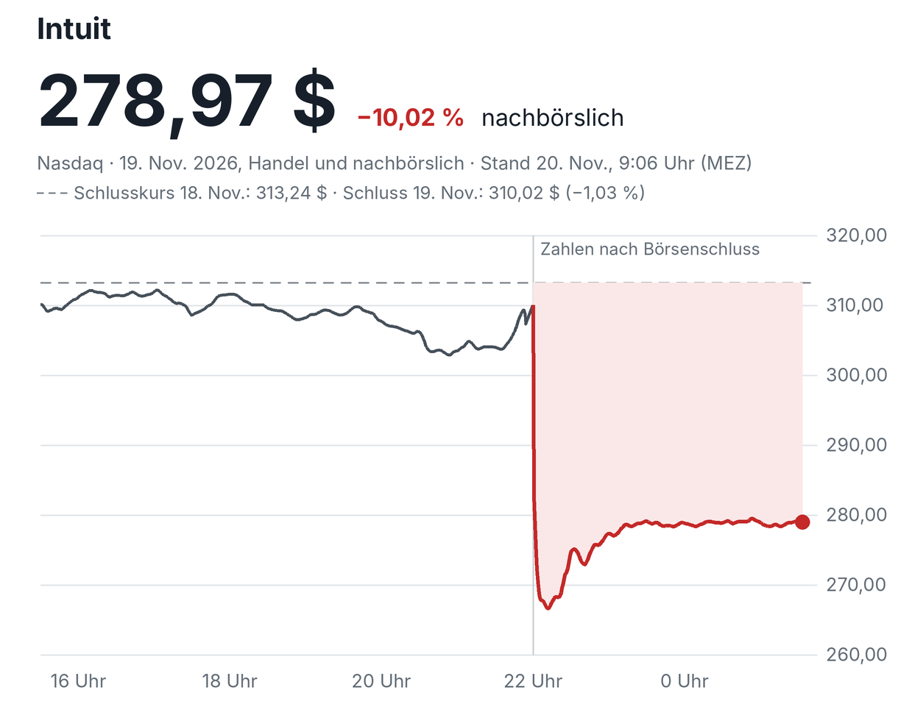
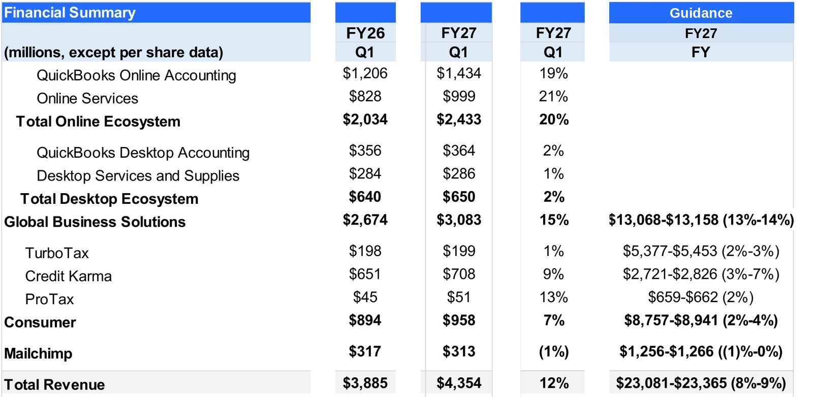

<!-- PRÜFEN: Unternehmenszahlen aus dem Form 10-Q für das erste Quartal des Geschäftsjahres 2027 (Quartal bis 31.10.2026) und dem Fact Sheet vom 19.11.2026, beides von Divi geliefert. Mailchimp-Verkauf (3,68 Mrd. $, davon 3,31 Mrd. bar und 368 Mio. in Bending-Spoons-Aktien, Erlös für Rückkäufe) und verbleibende Rückkaufermächtigung 6,4 Mrd. $ aus dem 10-Q. Kaufpreis 2021 (rund 12 Mrd. $) ist allgemein bekannt, bitte bei Bedarf gegenprüfen. -->
<!-- PRÜFEN: Konsens bereinigter Gewinn je Aktie Q1 2,46 $ (FactSet), Konsens Q2 Umsatz 5,11 Mrd. $ und Gewinn je Aktie 3,73 $, nachbörslich zeitweise −13 %: Finimize. Aussagen aus der Telefonkonferenz (Credit Karma Tax, Zinsen und KI als Bremse bei Credit Karma, Rückgang im Consumer-Segment im zweiten Quartal, rund 30 Mio. $ Verschiebung ins dritte Quartal, KI-Anbindungen): MarketBeat über Yahoo Finance vom 19.11.2026. Bisherige Jahresprognose 23,28 bis 23,51 Mrd. $: Yahoo Finance vom 25./26.08.2026. Minus rund 50 % in zwölf Monaten und 52-Wochen-Spanne: Motley Fool vom 17.11.2026. -->
<!-- PRÜFEN: Kurse aus Divis Yahoo-Screenshot: Schluss 18.11. 313,24 $, Schluss 19.11. 310,02 $ (−1,03 %), außerbörslich 20.11. 3:06 Uhr New York / 9:06 Uhr MEZ 278,97 $ (−10,02 %). Kursbild daraus nachgezeichnet, Zwischenwerte nur ungefähr. Selbst gerechnet: Dividendenrendite 4 × 1,38 / 278,97 = rund 2,0 %; Ausschüttungsquote auf den bereinigten Jahresgewinn (Mitte 23,00 $) rund 24 %; KGV auf bereinigten Jahresgewinn rund 12, auf GAAP-Gewinn (Mitte 20,24 $) rund 14; Dividendenerhöhung 1,20 → 1,38 = +15 %; Schulden 500 + 6.422 = 6,9 Mrd. $. -->
<!-- PRÜFEN: Aufmacher und CEO-Foto (Sasan Goodarzi) von Divi geliefert, als Pressebild markiert; dauerhaft abgelegt unter medien/aufmacher/intu/ und medien/ceo/intu.png. -->

!!! kurz "Kurz gesagt (erstes Quartal 2027, bis 31. Oktober)"
    **Umsatz:** 4,4 Mrd. $ (+12 %)
    **Gewinn:** 695 Mio. $ (+56 %)

    1. **Starkes Quartal:** Umsatz, operativer Gewinn und Gewinn je Aktie liegen über der eigenen Prognose, der bereinigte Gewinn je Aktie mit 2,91 Dollar weit über der Schätzung von 2,46 Dollar.
    2. **Schwacher Ausblick:** Für das zweite Quartal erwartet Intuit 4,93 bis 4,95 Mrd. Dollar Umsatz, die Analysten hatten 5,11 Mrd. erwartet. Die Jahresprognose für den Umsatz sinkt wegen Credit Karma.
    3. **Kapital:** Mailchimp wird für 3,7 Mrd. Dollar verkauft, der Erlös geht in Aktienrückkäufe. Die Dividende steigt um 15 % auf 1,38 Dollar je Quartal.

## Ein gutes Quartal, das an der Börse nicht zählt

Sasan Goodarzi konnte am Donnerstagabend ein Quartal vorlegen, das in jeder Kennzahl über den eigenen Zielen lag. Der Umsatz stieg um 12 % auf 4,35 Milliarden Dollar, der operative Gewinn um 63 % auf 868 Millionen, der Überschuss um 56 % auf 695 Millionen Dollar. Den bereinigten Gewinn je Aktie hatten Analysten im Schnitt auf 2,46 Dollar geschätzt, Intuit kam auf 2,91 Dollar.

Gehandelt wird die Aktie trotzdem nach dem Ausblick. Im außerbörslichen Handel fiel sie am Freitagmorgen um rund 10 % auf 279 Dollar, zeitweise lag das Minus bei 13 %. Für einen Wert, der in den vergangenen zwölf Monaten bereits die Hälfte seines Kurses verloren hat, ist das ein weiterer Rückschlag.

## Warum der Ausblick enttäuscht

Der Kern liegt in der Steuersaison, die für Intuit von Januar bis April das Jahr entscheidet. Für das zweite Geschäftsquartal bis Ende Januar rechnet der Konzern mit 4,93 bis 4,95 Milliarden Dollar Umsatz und einem bereinigten Gewinn je Aktie von 3,17 bis 3,22 Dollar. Die Analysten hatten 5,11 Milliarden Dollar und 3,73 Dollar erwartet. Im Verbrauchergeschäft mit TurboTax und Credit Karma soll der Umsatz in diesem Quartal sogar leicht sinken.

Das ist zu einem Teil gewollt. Intuit hat in den vergangenen Jahren Marktanteile bei den Steuererklärungen verloren und will sie mit günstigeren Angeboten zurückholen. Über Credit Karma Tax ist die Bundessteuererklärung kostenlos, die Erklärung für den Bundesstaat kostet 15 Dollar. In einem Test im Herbst waren 70 % dieser Kunden neu bei Intuit. Ein zweites Angebot lässt die Erklärung von KI vorbereiten und von einem TurboTax-Experten prüfen. Zum Saisonstart drücken diese Angebote den Umsatz je Kunde, etwa 30 Millionen Dollar verschieben sich zudem ins dritte Quartal.

Weniger gewollt ist die Entwicklung bei Credit Karma. Die Plattform, die Kredite, Kreditkarten und Versicherungen vermittelt, wuchs nur noch um 9 %, nach 27 % vor einem Jahr. Finanzchef Sandeep Aujla nennt höhere Zinsen als erwartet und eine schnellere Verlagerung der Produktsuche hin zu KI-Assistenten. Für das Gesamtjahr erwartet Intuit bei Credit Karma nur noch 3 bis 7 % Wachstum. Deshalb sinkt die Umsatzprognose für das Geschäftsjahr auf 23,08 bis 23,37 Milliarden Dollar, im August lag sie bei 23,28 bis 23,51 Milliarden.

## Die Zahlen im Überblick

| Kennzahl | Q1 2027 | Q1 2026 | Veränderung |
|---|---:|---:|---:|
| Umsatz | 4,35 Mrd. $ | 3,89 Mrd. $ | +12 % |
| Global Business Solutions (QuickBooks) | 3,08 Mrd. $ | 2,67 Mrd. $ | +15 % |
| davon Online-Ökosystem | 2,43 Mrd. $ | 2,03 Mrd. $ | +20 % |
| Consumer (TurboTax, Credit Karma, ProTax) | 958 Mio. $ | 894 Mio. $ | +7 % |
| davon Credit Karma | 708 Mio. $ | 651 Mio. $ | +9 % |
| Mailchimp | 313 Mio. $ | 317 Mio. $ | −1 % |
| Operativer Gewinn | 868 Mio. $ | 534 Mio. $ | +63 % |
| Nettogewinn | 695 Mio. $ | 446 Mio. $ | +56 % |
| Gewinn je Aktie (verwässert) | 2,59 $ | 1,59 $ | +63 % |
| Operativer Cashflow | 1,06 Mrd. $ | 0,64 Mrd. $ | +67 % |

Der Motor bleibt QuickBooks. Das Online-Geschäft mit Buchhaltung, Lohnabrechnung und Zahlungen für kleine und mittlere Firmen wuchs um 20 % und liefert inzwischen mehr als die Hälfte des Konzernumsatzes. Das Segment arbeitet mit einer operativen Marge von 76 %. Die Desktop-Programme wachsen dagegen kaum noch, ebenso TurboTax, das im Herbst saisonbedingt wenig umsetzt.

Ein Teil des Gewinnsprungs kommt von der Kostenseite. Die Ausgaben für Forschung und Verwaltung sanken nach dem Konzernumbau in diesem Jahr, die aktienbasierte Vergütung fiel von 543 auf 495 Millionen Dollar. Seit diesem Geschäftsjahr rechnet Intuit diese Vergütung auch beim bereinigten Gewinn als Kosten mit, das macht die Kennzahl strenger und besser vergleichbar.

## Mailchimp geht, das Geld fließt an die Aktionäre

Mit den Zahlen hat Intuit den Verkauf von Mailchimp an das italienische Softwarehaus Bending Spoons angekündigt. Der Kaufpreis liegt bei rund 3,7 Milliarden Dollar, davon 3,3 Milliarden in bar und knapp 0,4 Milliarden in Aktien von Bending Spoons. 2021 hatte Intuit für den E-Mail-Marketing-Dienst rund 12 Milliarden Dollar bezahlt. Mailchimp schrumpft seit Monaten leicht, der Abschluss wird Anfang 2027 erwartet.

Den Barerlös will Intuit vollständig in Aktienrückkäufe stecken. Schon im abgelaufenen Quartal kaufte der Konzern für 1,5 Milliarden Dollar 4,6 Millionen eigene Aktien zurück, die Zahl der Aktien sank im Jahresvergleich um gut 4 %. Die Ermächtigung reicht für weitere 6,4 Milliarden Dollar. Die Quartalsdividende steigt um 15 % auf 1,38 Dollar und wird am 15. Januar gezahlt. Bei Barmitteln und Anlagen von 5,3 Milliarden Dollar und Schulden von 6,9 Milliarden bleibt die Bilanz solide.

## Was für die Aktie spricht und was dagegen

**Dafür:** Intuit verdient mit QuickBooks hohe und wiederkehrende Umsätze, die Prognose für den operativen Gewinn und den Gewinn je Aktie im Gesamtjahr bleibt unverändert. Mit dem Kursrückgang liegt die Aktie bei rund dem 12-Fachen des erwarteten bereinigten Jahresgewinns, auf Basis des ausgewiesenen Gewinns beim 14-Fachen. Die Dividendenrendite steigt auf rund 2 %, bei einer Ausschüttungsquote von rund einem Viertel des bereinigten Gewinns. Dazu kommen die Rückkäufe aus dem Mailchimp-Erlös. Bei der KI setzt Intuit eigene Akzente: QuickBooks lässt sich in Claude, ChatGPT und Perplexity nutzen, mehr als 30 % der Kunden mit einer solchen Verbindung nutzen sie jede Woche.

**Dagegen:** Das Wachstum verlangsamt sich, von 14 % im vergangenen Geschäftsjahr auf nun 8 bis 9 %. Die günstigeren Steuerangebote müssen erst beweisen, dass sie über mehr Kunden auch mehr Umsatz bringen. Credit Karma hängt an Zinsen und Kreditnachfrage, und die Frage, ob KI-Assistenten Steuer- und Finanzsoftware auf Dauer ersetzen, belastet die ganze Branche. Erst am Dienstag hatte die Aktie bei einem breiten Ausverkauf im Technologiesektor rund 7 % verloren.

## Was als Nächstes ansteht

Die Antwort liefert die Steuersaison ab Januar. Entscheidend ist, ob Intuit mit Credit Karma Tax und den KI-Angeboten genügend neue Kunden gewinnt, um den niedrigeren Preis je Kunde auszugleichen. Den Rahmen dafür setzt das dritte Quartal bis Ende April, in dem Intuit traditionell mehr als ein Drittel seines Jahresumsatzes erzielt. Nach Abschluss des Mailchimp-Verkaufs will der Konzern seine Prognose neu fassen.

## Quellen

- Intuit: Form 10-Q, erstes Quartal Geschäftsjahr 2027 (19.11.2026)
- Intuit: Fact Sheet Q1 FY27 (19.11.2026)
- [Intuit: Intuit Reports First-Quarter Results and Enters Agreement to Sell Mailchimp to Bending Spoons](https://www.businesswire.com/news/home/20261119334005/en/Intuit-Reports-First-Quarter-Results-and-Enters-Agreement-to-Sell-Mailchimp-to-Bending-Spoons)
- [Yahoo Finance: What Intuit (INTU) Said on Its Q1 Earnings Call](https://finance.yahoo.com/markets/stocks/articles/intuit-intu-said-q1-earnings-001407071.html)
- [Finimize: Intuit Beat Q1 Estimates, But Its Q2 Outlook Fell Short](https://finimize.com/content/intuit-beat-q1-estimates-but-its-q2-outlook-fell-short)
- [Yahoo Finance: Intuit shares plunge as cautious fiscal 2027 guidance falls short of forecasts](https://finance.yahoo.com/markets/stocks/articles/intuit-shares-plunge-cautious-fiscal-104320782.html)
- [The Motley Fool: Why Intuit Stock Is Falling Fast Today](https://fool.com/investing/2026/11/17/why-intuit-stock-is-falling-fast-today)
