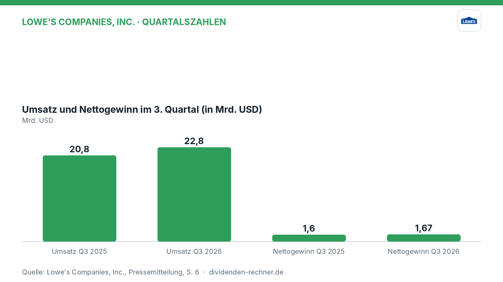
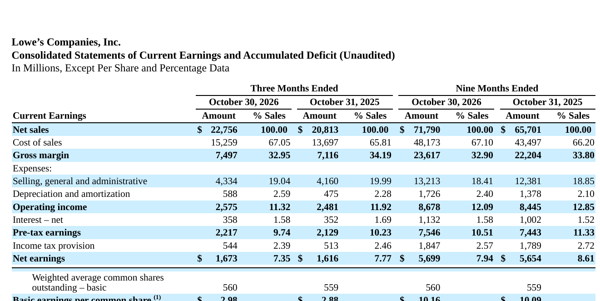
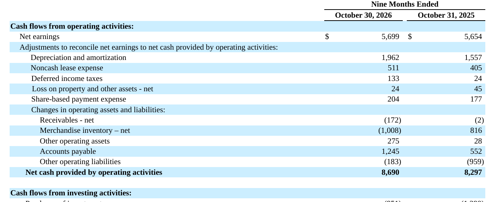

<!-- PRÜFEN: Aufmacherfoto ist automatisch von Wikimedia Commons gewaehlt: bitte pruefen, ob es zum Artikel passt (sonst image-Zeilen entfernen, dann entsteht ein Titelbild automatisch). -->
<!-- PRÜFEN: Quelle: https://www.sec.gov/Archives/edgar/data/60667/000006066726000126/exhibit991-10302026.htm -->
<!-- PRÜFEN: Ausschnitte aus dem Bericht im Text (f1, f3): bitte prüfen, ob Zuschnitt und Platz passen. Unpassende Bildzeilen einfach löschen. -->

!!! kurz "Kurz gesagt"
    **Umsatz:** 22,8 Mrd. USD (+9,6 %)
    **Gewinn:** 1,7 Mrd. USD (+4,4 %)

    1. **Treiber:** Das Onlinegeschäft wächst stark um 17,4 %, während der Gesamtumsatz auf 22,8 Mrd. USD klettert.
    2. **Kapitalverwendung:** Lowe's schüttet im Quartal 701 Mio. USD an Dividenden aus und hält am Status als Dividendenkönig fest.
    3. **Ausblick:** Das Unternehmen hebt die Umsatzprognose für das Gesamtjahr 2026 auf rund 92,5 Mrd. USD an.

## Lowe's wächst im dritten Quartal dank starkem Onlinegeschäft

Lowe's Companies hat die Geschäftszahlen für das am 30. Oktober 2026 beendete dritte Quartal vorgelegt und blickt auf ein erfolgreiches Jahresendgeschäft. Der Baumarktkonzern profitierte vor allem von einer hohen Nachfrage im Onlinebereich sowie Zuwächsen bei professionellen Handwerkern.

*Eigene Darstellung nach Daten aus: Lowe's Companies, Inc., Quartalszahlen vom 2026-11-18 · [Original](https://www.sec.gov/Archives/edgar/data/60667/000006066726000126/exhibit991-10302026.htm).*

Im abgelaufenen Quartal steigerte Lowe's den Nettoumsatz auf **22,8 Mrd. USD**, nach 20,8 Mrd. USD im Vorjahreszeitraum. Das entspricht einem Plus von 9,6 %. Die vergleichbaren Umsätze (Comparable Sales) kletterten um 1,8 %, getragen von einem Anstieg der Onlineverkäufe um 17,4 %. Der Nettogewinn belief sich auf **1,7 Mrd. USD** (nach 1,6 Mrd. USD im Vorjahr), was einer Nettomarge von 7,3 % entspricht. Das verwässerte Ergebnis je Aktie (EPS) lag bei **2,98 USD** nach 2,88 USD im Vorjahr. Darin enthalten ist ein positiver Steuereffekt aus Zollrückerstattungen (IEEPA) in Höhe von 0,34 USD je Aktie. Bereinigt um Akquisitionskosten lag das bereinigte verwässerte EPS bei 3,10 USD.

*Gewinn- und Verlustrechnung Q3 2026. Quelle: Lowe's Companies, Inc., Quartalszahlen vom 2026-11-18 · [Original](https://www.sec.gov/Archives/edgar/data/60667/000006066726000126/exhibit991-10302026.htm). Ausschnitt nur zugeschnitten, sonst unverändert.*

> „Wir haben unser sechstes Quartal in Folge mit positivem flächenbereinigten Wachstum geliefert, angetrieben durch den Ausbau im Pro-, Online- und Dienstleistungsbereich.“
>
— Marvin R. Ellison, Chairman und CEO (aus dem Englischen übersetzt)

### Dividende und Kapitalrückführung

Als verlässlicher Dividendenzahler hielt Lowe's im dritten Quartal an seiner Ausschüttungspolitik fest. Das Unternehmen zahlte im Quartal **701 Mio. USD** an Dividenden an seine Aktionäre aus. Die Cashdividende je Aktie lag bei **1,25 USD** (nach 1,20 USD im Vorjahr). Lowe's untermauert damit seinen Status als langjähriger Dividendenzahler.

### Bilanz, Schulden und Cashflow

Der Blick auf die Bilanz zum Stichtag 30. Oktober 2026 zeigt liquide Mittel in Höhe von **3,4 Mrd. USD** bei kurzfristigen Investitionen von 307 Mio. USD. Die langfristigen Schulden ohne fällige Anteile belaufen sich auf **34,5 Mrd. USD**. Der operative Cashflow in den ersten neun Monaten des Geschäftsjahres lag bei **8,7 Mrd. USD** (nach 8,3 Mrd. USD im Vorjahr). Die Investitionen (Capital Expenditures) beliefen sich im selben Zeitraum auf 1,7 Mrd. USD.

*Kapitalflussrechnung. Quelle: Lowe's Companies, Inc., Quartalszahlen vom 2026-11-18 · [Original](https://www.sec.gov/Archives/edgar/data/60667/000006066726000126/exhibit991-10302026.htm). Ausschnitt nur zugeschnitten, sonst unverändert.*

### Angehobene Jahresprognose

Gestützt auf die operative Entwicklung in den ersten drei Quartalen hat das Management die Prognose für das Geschäftsjahr 2026 angepasst. Der Konzern rechnet nun mit einem Gesamtumsatz von rund 92,5 Mrd. USD (zuvor 92,0 Mrd. USD). Das vergleichbare Umsatzwachstum wird bei etwa +0,5 % gesehen. Beim verwässerten Ergebnis je Aktie peilt das Management nun einen Wert von etwa 11,75 USD an, während das bereinigte EPS bei rund 12,25 USD liegen soll. Die Investitionen sollen bis zu 2,5 Mrd. USD erreichen.

Weitere Quellen zum Hintergrund: [Lowe's Aktie: Aktienkurs, News & Analyse](https://aktiencheck.de/aktien/lowes-aktie) · [Ausblick: Lowes Companies gewährt Anlegern Blick in die Büch](https://www.finanzen.ch/nachrichten/aktien/ausblick-lowes-companies-gewahrt-anlegern-blick-in-die-buecher-1036772457) · [LOWES COMPANIES AKTIE Schätzungen](https://www.finanzen.net/schaetzungen/lowes_companies) · [Walmart Quartalszahlen, Home Depot Zahlen, Target: Termine](https://admiralmarkets.com/de/analysen/traders-blog/walmart-quartalszahlen-home-depot-zahlen-target-termine) · [Die Quartalsergebnisse von Lowe's Companies mit Optionen und](https://www.lynxbroker.de/boerse/boerse-kurse/optionen/optionen-in-der-praxis/die-quartalsergebnisse-von-lowes-companies-mit-optionen-und-mit-statistischem-vorteil-handeln-20261110)

*Quelle: Lowe's Companies, Inc., Quartalszahlen vom 2026-11-18. Rechenwege eigene Berechnung. Keine Anlageberatung.*
