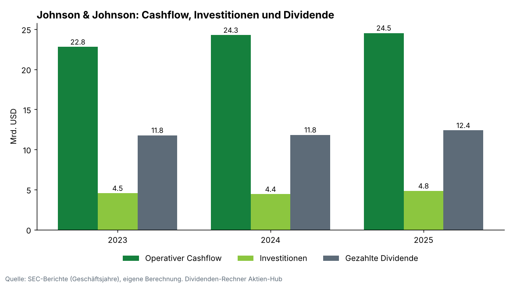

<!-- PRÜFEN: Aufmacherfoto ist von Divi geliefert (Unsplash). Unsplash-Link und Fotografen-Profil fehlen noch, bitte in image_source und image_artist_url nachtragen. -->
<!-- PRÜFEN: Quellen: Financial Times vom 15.11.2026 (über MarketScreener/MT Newswires vom 16.11.2026), Biopharma Dive zu Ollin Biosciences (September 2025). -->

Johnson & Johnson steht offenbar vor dem Kauf von Ollin Biosciences. Die Financial Times berichtete am Sonntag, der Konzern könne den Deal schon am Montag bekanntgeben. Bestätigt ist noch nichts. Die Gespräche könnten scheitern, und beide Seiten hatten zunächst nicht geantwortet.

## Der Kaufpreis im Verhältnis zur Finanzkraft

Im Gespräch sind bis zu 3,4 Mrd. USD. Davon wären 2,2 Mrd. USD sofort in bar fällig. Die übrigen 1,2 Mrd. USD sind Meilensteinzahlungen, die von Erfolgen in Studien und Zulassungen abhängen.

Am Börsenwert von rund 697 Mrd. USD gemessen ist das klein. Am freien Cashflow gemessen ist es spürbar. Der lag in den vergangenen zwölf Monaten bei 20,6 Mrd. USD. Die Barzahlung entspräche rechnerisch 10,7 % davon, die volle Summe rechnerisch 16,5 %.

## Was Ollin entwickelt

Ollin ist ein privates Unternehmen und ging im September 2025 mit 100 Mio. USD Startkapital an den Markt. Es sichert sich Wirkstoffe über Lizenzen, statt selbst im großen Stil zu forschen.

Im Mittelpunkt stehen zwei Kandidaten. OLN324 ist ein Antikörper, der zwei Wachstumsfaktoren gleichzeitig blockiert. Er soll Vabysmo von Roche bei feuchter Makuladegeneration angreifen. Vabysmo hat dem Konkurrenten Eylea bereits Marktanteile abgenommen. OLN102 richtet sich gegen die Schilddrüsenaugen-Erkrankung und ist als Konkurrent zu Tepezza von Amgen gedacht. Ollin hofft auf eine Gabe unter die Haut statt per Infusion.

## Warum Augenmedizin für J&J wichtig ist

J&J hat sein Netzhaut-Portfolio in den vergangenen Jahren Stück für Stück ausgebaut. Ein Kauf von Ollin würde die Reihe um Kandidaten erweitern, die bereits in der Entwicklung sind.

## Finanzkraft und Dividende

Der Konzern kann den Kauf aus dem laufenden Geschäft bezahlen. Im Geschäftsjahr 2025 stand einem operativen Cashflow von 24,5 Mrd. USD eine Investition von 4,8 Mrd. USD in Sachanlagen gegenüber. Der Umsatz stieg im selben Jahr um 6,1 % auf 94,2 Mrd. USD.

Die Dividende liegt bei 5,28 USD je Aktie. Beim Kurs im Aktien-Hub ergibt das eine Rendite von 1,84 %. Rechnerisch verwendet J&J 62 % des freien Cashflows für die Ausschüttung. Der Deal ändert an dieser Quote nichts, solange er aus dem Cashflow bezahlt wird.

Die Grafik zeigt die Jahre 2023 bis 2025 aus den Geschäftsberichten. Die Dividende ist dort die tatsächlich gezahlte Summe.

## Risiken

Der Deal ist noch nicht unterschrieben. Die Meilensteine knüpfen einen Teil des Preises an Studien und Zulassungen, und die Wirkstoffe stehen noch früh in der Entwicklung. Der harte Vergleich ist Vabysmo, das längst am Markt ist. OLN324 muss zeigen, dass es besser wirkt oder länger hält.

Die Aktie hat seit Jahresbeginn rund 38 % zugelegt. Im vorbörslichen Handel am Montag lag sie 1 % höher.

Für Anleger ist der Kauf vor allem ein Signal: J&J nutzt seinen Cashflow, um in der Augenmedizin Lücken zu schließen.

*Quellen: Financial Times (über MarketScreener und MT Newswires, 16.11.2026); Biopharma Dive zu Ollin Biosciences (September 2025); Dividenden-Rechner Aktien-Hub (SEC-Daten, Kurse der Deutschen Börse). Rechenwege eigene Berechnung. Keine Anlageberatung.*
