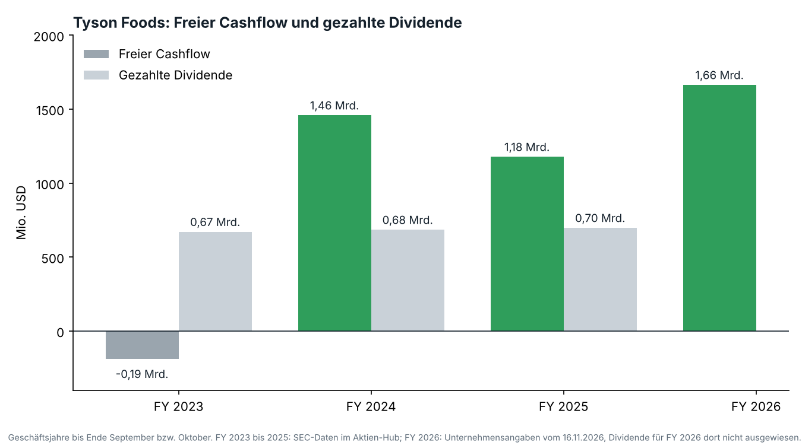

<!-- PRÜFEN: Hub-Daten (SEC) stehen noch auf dem Stand 27.06.2026. Nach Einlesen des Geschäftsberichts FY 2026 Kennzahlen und Grafik neu prüfen. -->
<!-- PRÜFEN: Quellen-Screenshots stammen aus der Präsentation über Quartr (Supplemental Information, 16.11.2026). -->
<!-- PRÜFEN: Hub-Daten (SEC) stehen noch auf dem Stand 27.06.2026. Nach Einlesen des Geschäftsberichts FY 2026 Kennzahlen und Grafik neu prüfen. -->
<!-- PRÜFEN: Quellen-Screenshots stammen aus der Präsentation über Quartr (Supplemental Information, 16.11.2026). -->

!!! kurz "Kurz gesagt"
    **Umsatz 2026:** 55,4 Mrd. USD auf vergleichbarer 52-Wochen-Basis (+1,7 %), mit der 53. Woche 56,4 Mrd. USD
    **Bereinigtes operatives Ergebnis:** 1,98 Mrd. USD (−13,6 %), Marge 3,5 %
    **Freier Cashflow:** 1,66 Mrd. USD (Vorjahr 1,18 Mrd. USD)
    **Ausblick 2027:** Umsatz −5,5 % bis −3,5 %, operatives Ergebnis 1,7 bis 2,15 Mrd. USD

Der Fleischkonzern hat ein schwaches Jahr hinter sich. Das Rindfleischgeschäft verlor 654 Mio. USD im operativen Ergebnis, nach 275 Mio. USD im Vorjahr. Geflügel und Fertiggerichte konnten den Verlust nicht auffangen. Gleichzeitig hat Tyson mehr Geld aus dem Geschäft erwirtschaftet, weil die Investitionen gesunken sind. Das ist die eigentliche Geschichte des Quartals: Der Gewinn fällt, der Cashflow steigt.

## Der Gewinn sinkt, der Cashflow steigt

Das bereinigte operative Ergebnis fiel im Geschäftsjahr 2026 auf 1,98 Mrd. USD, ein Minus von 13,6 %. Das bereinigte Ergebnis je Aktie sank um 16,5 % auf 3,44 USD. Nach den GAAP-Zahlen liegt der Gewinn je Aktie bei 1,28 USD, nach 1,33 USD im Vorjahr. Der Unterschied kommt vor allem von Rückstellungen für Rechtsstreitigkeiten und von Restrukturierungskosten, die Tyson aus dem bereinigten Ergebnis herausrechnet.

Beim Umsatz kommt es auf die Vergleichsbasis an. Das Geschäftsjahr 2026 hatte 53 Wochen. Auf vergleichbarer 52-Wochen-Basis stieg der Umsatz um 1,7 % auf 55,4 Mrd. USD. Tyson hat außerdem Rückstellungen für Rechtsstreitigkeiten vom Umsatz abgezogen. Ohne diese Abzüge läge das Wachstum bei 1,1 %.

## Rindfleisch belastet den Konzern

Die Sparte mit den größten Problemen ist Rindfleisch. Der Umsatz sank leicht auf 21,3 Mrd. USD, doch die Verkaufsmenge sank um 12,2 %. Der Preis stieg um 10 %, was die Verluste nicht ausgleichen konnte. Tyson nennt als Grund knappes Vieh und damit hohe Einkaufskosten. Das operative Ergebnis der Sparte lag bei minus 654 Mio. USD.

Geflügel blieb stabil. Der Umsatz stieg um 2,3 % auf 17,2 Mrd. USD, das operative Ergebnis sank um 33 Mio. USD auf 1,86 Mrd. USD. Der Umsatz mit verarbeiteten Produkten wie Wurst, Frühstücksfleisch und Snacks kletterte um 3,7 % auf 10,3 Mrd. USD. Das operative Ergebnis der Sparte stieg um 5,5 % auf 1,33 Mrd. USD und ist damit die stärkste Säule. Die Schweinesparte verlor leicht, das operative Ergebnis sank von 239 auf 228 Mio. USD.

## Cashflow und Ausschüttung

Der freie Cashflow kletterte auf 1,66 Mrd. USD, nach 1,18 Mrd. USD im Vorjahr. Entscheidend war der niedrigere Investitionsbedarf: Die Investitionen sanken von 978 auf 770 Mio. USD. Tyson zahlte im Geschäftsjahr insgesamt 1,13 Mrd. USD an Aktionäre, Dividende und Aktienrückkäufe zusammen, nach 893 Mio. USD im Vorjahr. Die Nettoverschuldung im Verhältnis zum bereinigten EBITDA liegt bei 2,1x.

Die Dividende wurde um 2 % erhöht. Im Aktien-Hub steht für 2025 eine Dividende von 1,95 USD je Aktie. Bei einem Kurs von 60,50 USD (Stand 13.11.) ergibt das eine Rendite von 3,2 %. Auf das bereinigte Ergebnis von 3,44 USD bezogen liegt das KGV bei rund 17,6 (eigene Berechnung). Der Hub weist ein KGV von 37,3 aus, weil er den GAAP-Gewinn zugrunde legt. Auf den GAAP-Gewinn bezogen liegt die Ausschüttungsquote bei 121 %. Die Dividende beansprucht im Hub rund 60 % des freien Cashflows, berechnet auf die letzten vier Quartale bis Juni 2026.

Die Zahlen aus dem Hub und die Unternehmenszahlen für das Gesamtjahr passen nicht vollständig zusammen. Der Hub arbeitet noch mit dem Stand bis Juni 2026. Deshalb weicht sein Cashflow vom Geschäftsjahr ab, das bis Oktober 2026 reicht.

Die Grafik zeigt den freien Cashflow und die gezahlte Dividende. Für 2023 war der Cashflow negativ, weil die Investitionen den operativen Cashflow übertrafen. Seitdem steigt er wieder.

## Ausblick 2027

Für das Geschäftsjahr 2027 erwartet Tyson einen Umsatzrückgang zwischen 5,5 % und 3,5 %. Das bereinigte operative Ergebnis soll zwischen 1,7 und 2,15 Mrd. USD liegen. Der Freie Cashflow soll 0,8 bis 1,3 Mrd. USD erreichen, die Investitionen 1,1 bis 1,4 Mrd. USD.

Die Erwartung für Rindfleisch liegt zwischen minus 300 Mio. und plus 100 Mio. USD im operativen Ergebnis. Das wäre eine deutliche Verbesserung gegenüber dem Vorjahr, wenn der Ausblick hält. Geflügel soll zwischen 1,3 und 1,6 Mrd. USD im operativen Ergebnis beitragen, Fertiggerichte zwischen 1,25 und 1,4 Mrd. USD.

## Risiken

Die größte Unsicherheit bleibt der Rindfleischmarkt. Der Konzern hat zu wenig Vieh und zahlt entsprechend hohe Preise. Ob die Maßnahmen zur Kostensenkung greifen, zeigt sich erst in den kommenden Quartalen.

Dazu kommen Rechtsstreitigkeiten. Tyson hat dafür im Geschäftsjahr 2026 weitere Rückstellungen von rund 393 Mio. USD gebildet. Solche Kosten sind schwer planbar und können die Gewinne weiter drücken.

Für Dividendenanleger ist der Cashflow der wichtigere Maßstab. Der Gewinn nach GAAP reicht für die Ausschüttung nicht, der freie Cashflow schon. Wenn der Ausblick für 2027 stimmt, bleibt die Dividende gedeckt, und der Spielraum für Aktienrückkäufe wächst.

*Quellen: Tyson Foods, Supplemental Information zum vierten Quartal des Geschäftsjahrs 2026 (16.11.2026, über Quartr); Dividenden-Rechner Aktien-Hub (SEC-Daten bis 27.06.2026, Kurs Tradegate 13.11.2026). Rechenwege eigene Berechnung. Keine Anlageberatung.*
