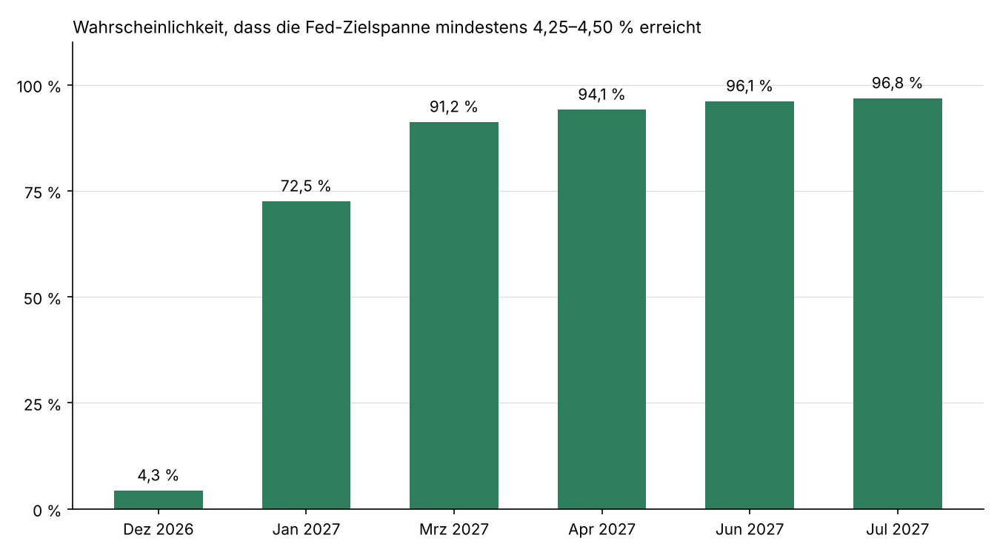

<!-- PRÜFEN: Bildquelle. Das Foto stammt aus dem Pressebereich der Federal Reserve Bank of Cleveland (Pressemitteilung vom 16.11.2026, von Divi geliefert). Link zur Presseseite prüfen und ggf. ersetzen. -->
<!-- PRÜFEN: Hammack-Zitat ist die Übersetzung der Reuters-Meldung (MarketScreener, 16.11.2026) zum Bloomberg-TV-Interview. -->

!!! kurz "Kurz gesagt"
    **Terminmärkte:** Für die Dezember-Sitzung rechnen die Märkte mit einem Schritt von 0,25 Prozentpunkten (95,7 %).
    **Juli 2027:** Die Chance auf mindestens 0,5 Prozentpunkte mehr liegt bei 97 %. Vor einem Monat waren es 90 %, vor einer Woche 68 %.
    **Gegenspieler:** Cleveland-Fed-Präsidentin Beth Hammack will Zinsen in kleinen Schritten anheben.

Die Zielspanne der US-Notenbank liegt derzeit bei 3,75 bis 4,00 %. Die Terminmärkte erwarten inzwischen mehrere Zinsschritte nach oben, und der Zinspfad ist im Vergleich zum Stand vor einem Monat steiler geworden. Öffentlich bleiben die Notenbanker vorsichtig.

## Was die Terminmärkte einpreisen

Die Wahrscheinlichkeiten stammen aus den Zinsterminkontrakten, die das CME FedWatch Tool auswertet. Für die Sitzung im Dezember 2026 liegt die Zielspanne mit 95,7 % Wahrscheinlichkeit bei 4,00 bis 4,25 %. Im Januar 2027 hat sich der Schwerpunkt auf 4,25 bis 4,50 % verschoben, mit 69,4 %. Zur Sitzung im Juli 2027 verteilen sich die Chancen auf 4,50 bis 4,75 % (37,8 %), 4,75 bis 5,00 % (29,2 %) und höhere Spannen.

Die Grafik zeigt die Summe aller Spannen ab 4,25 bis 4,50 %. Im Dezember liegt sie bei 4,3 %, weil der Markt dort nur einen Schritt erwartet. Ab Januar steigt sie stark an. Im April 2027 liegt sie bei 94,1 %, im Juli bei 96,8 %.

## Hammack: kleine Schritte

Hammack sieht zunehmenden Inflationsdruck, will aber noch keinen aggressiveren Kurs. In einem Interview mit Bloomberg TV sagte sie: „Ich bevorzuge Zinsschritte in kleineren Schritten.“ Berechenbarkeit helfe Unternehmen und Haushalten bei der Planung. Falls die Fed hinter die Kurve gerate, seien auch größere Schritte möglich.

Kleine Schritte und ein Gesamtpfad von einem halben Prozentpunkt schließen sich allerdings nicht aus. Wenn die Fed über mehrere Sitzungen jeweils 0,25 Prozentpunkte anhebt, ist das Ergebnis am Ende dasselbe. Genau diesen Pfad bilden die Terminmärkte ab.

## Inflation aus Sicht der Unternehmen

Die Federal Reserve Bank of Cleveland hat am Montag ihre vierteljährliche Umfrage zu den Inflationserwartungen von Unternehmen veröffentlicht. Die Vorstandschefs rechnen im Oktober mit einem Anstieg des Verbraucherpreisindex um 3,5 % in den kommenden zwölf Monaten, nach 3,3 % im Juli. Für die nächsten fünf Jahre erwarten sie im Schnitt rund 3,3 % jährlich.

Das ist relevant, weil Unternehmen ihre Erwartungen in Preise übersetzen. Wer glaubt, dass die Kosten weiter steigen, gibt sie eher an Kunden weiter. Die Zahlen stützen damit die Sicht der Märkte, dass die Inflation nicht von allein zurückkehrt.

## Gegenargumente

Terminpreise sind keine Prognose. Sie enthalten Risikoaufschläge und reagieren stark auf neue Daten. Die Märkte haben sich in der Vergangenheit schon oft verschätzt, in beide Richtungen. Ein schwächerer Arbeitsmarkt oder niedrigere Inflationsdaten können den Pfad schnell drehen.

Hammack ist außerdem eine Stimme im Offenmarktausschuss, nicht die gesamte Fed. Entscheidend ist, wie sich der Ausschuss insgesamt positioniert. Ob die Märkte mit 97 % richtig liegen, lässt sich erst nach den Sitzungen beurteilen.

## Was das für Dividendenanleger heißt

Steigende Zinsen machen Anleihen attraktiver und setzen zinssensible Werte unter Druck. Immobilien-REITs und Versorger zählen dazu, weil sich ihre Finanzierung verteuert und Anleger zu Renditen am Rentenmarkt wechseln können. Banken können dagegen profitieren, wenn die Zinsmarge steigt. Bremsend wirken höhere Zinsen auf die Kreditnachfrage und auf die Bewertung von Kreditrisiken.

Für die Dividendenstrategie bedeutet das vor allem, dass die Rendite einzelner Sektoren nicht isoliert betrachtet werden sollte. Eine hohe Ausschüttung ist weniger attraktiv, wenn der Kurs unter steigenden Zinsen nachgibt.

*Quellen: CME FedWatch Tool, Rate probabilities: CME FedWatch Tool, Stand 16.11.2026, 01:44 CT; MarketScreener (Reuters), Hammack im Interview mit Bloomberg TV, 16.11.2026; Federal Reserve Bank of Cleveland, Pressemitteilung zur SoFIE-Umfrage, 16.11.2026. Grafik und Rechenwege eigene Berechnung. Keine Anlageberatung.*
