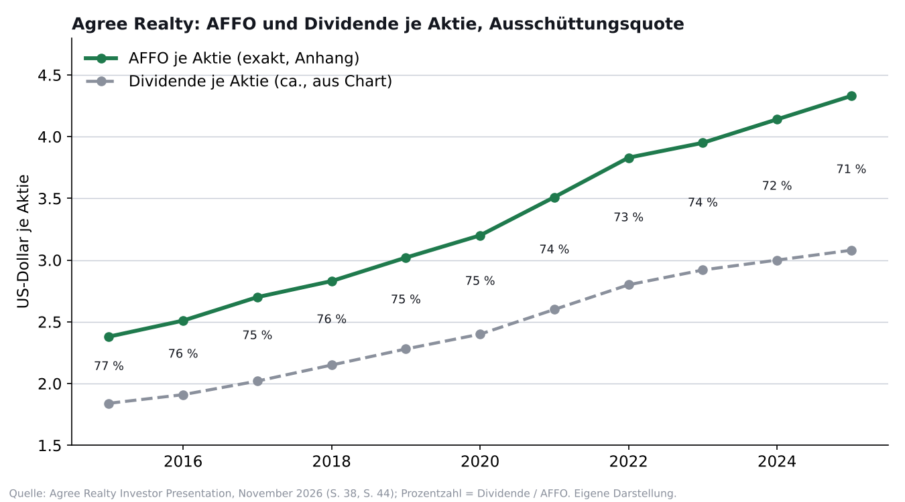
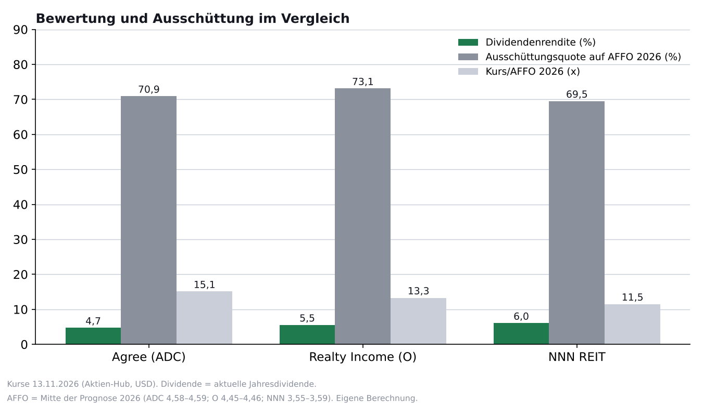
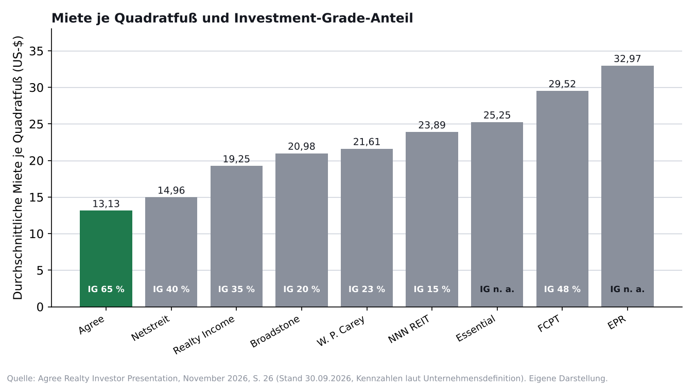

<!-- PRÜFEN: Aufmacher ist ein KI-generiertes Symbolbild (Gemini, von Divi geliefert, abgelegt unter medien/aufmacher/adc/); das Schild "Agree Realty" im Bild ist erfunden, Bild ist im Nachweis als KI-generiert gekennzeichnet. -->
<!-- PRÜFEN: Aufmacherfoto fehlt. Über die Unsplash-Anfrage ein Foto zu US-Einzelhandelsimmobilien suchen lassen und image, image_alt, image_credit, image_source, image_lizenz ergänzen. -->
<!-- PRÜFEN: Realty Income 9M-Werte und Investitionsvolumen stammen aus dem Abruf der 8-K-Mitteilung über last10k.com. Vor Veröffentlichung gegen die SEC-Datei prüfen. -->
<!-- PRÜFEN: Hub-Kennzahlen für Agree: Dividende 3,174 USD (gj 2025) gegenüber 3,25 USD annualisiert (0,271 USD/Monat); FFO je Aktie 3,99 USD im Hub gegenüber 3,95 USD in der Präsentation; Börsenwert 7,7 Mrd. USD im Hub gegenüber 8,7 Mrd. USD in der Präsentation (Stand unterschiedlich). -->
<!-- PRÜFEN: Ratings von NNN und Realty Income sind nicht belegt. Im Text nur Agree-Ratings genannt. -->

!!! kurz "Kurz gesagt"
    **Dividende:** Agree zahlt monatlich 0,271 Dollar, annualisiert rund 3,25 Dollar. Bei 69,19 Dollar ergibt das eine Rendite von 4,7 %. Realty Income liegt bei 5,5 %, NNN REIT bei 6,0 %.
    **AFFO:** Die Prognose für 2026 steigt auf 4,58 bis 4,59 Dollar je Aktie. Das sind knapp 6 % mehr als 2025 (4,33 Dollar).
    **Ausschüttung:** Auf die Prognose bezogen liegt die Quote bei rund 71 %. Realty Income kommt auf etwa 73 %, NNN auf rund 70 %.
    **Verschuldung:** Agree liegt bei 3,9-mal Nettoschulden zu wiederkehrendem EBITDA (pro forma). Realty Income und NNN liegen beide bei rund 5,3- bis 5,4-mal.

Agree Realty (NYSE: ADC) ist ein Net-Lease-REIT, der sich auf Einzelhandelsimmobilien mit langfristigen Mietverträgen spezialisiert hat. 2.888 Objekte in allen 50 US-Bundesstaaten stehen im Bestand, zu 99,8 % vermietet. Größter Mieter ist Walmart mit 5,6 % der Jahresmiete, danach folgen Tractor Supply mit 4,6 % und Dollar General mit 3,7 %.

Die Frage für Dividendenanleger ist, ob die Ausschüttung mit dem Wachstum mithalten kann. Dazu vergleichen wir Agree mit den zwei größten Konkurrenten im US-Net-Lease-Segment, Realty Income und NNN REIT.

## Gewinn: AFFO statt Nettogewinn

Bei REITs ist der Nettogewinn wenig aussagekräftig, weil Abschreibungen auf Immobilien das Ergebnis stark drücken. Maßgeblich sind FFO (Funds from Operations) und AFFO (Adjusted Funds from Operations), das um Mietglättungen, Aktienvergütung und Finanzierungskosten bereinigt ist.

Agree erzielte 2025 einen AFFO von 4,33 Dollar je Aktie, nach 4,14 Dollar im Vorjahr. Das ist ein Plus von 4,6 %. Die Prognose für 2026 liegt bei 4,58 bis 4,59 Dollar, das Unternehmen hat sie im Oktober angehoben.

Realty Income meldete für die ersten neun Monate 2026 einen AFFO von 3,35 Dollar je Aktie (Vorjahr 3,19 Dollar). Die Prognose für das Gesamtjahr liegt bei 4,45 bis 4,46 Dollar.

NNN REIT kommt nach neun Monaten auf 2,68 Dollar AFFO je Aktie (Vorjahr 2,57 Dollar). Die Prognose von 3,55 bis 3,59 Dollar hat das Unternehmen bestätigt.

Die Grafik zeigt die Entwicklung seit 2015. Der AFFO ist von 2,38 Dollar auf 4,33 Dollar gestiegen, die Dividende von rund 1,84 auf rund 3,08 Dollar. Die Quote ist dabei von rund 77 % auf rund 71 % gesunken. Die Dividende wächst also langsamer als der AFFO, was einen Puffer schafft.

## Dividende und Ausschüttungsquote

Agree hat 176 Dividenden in Folge gezahlt. Die Ausschüttung wird seit 2015 jedes Jahr erhöht. Das Unternehmen nennt ein durchschnittliches Wachstum von mehr als 5 % pro Jahr über zehn Jahre. Die Monatsdividende für November beträgt 0,271 Dollar, 3,4 % mehr als ein Jahr zuvor.

Die Quote auf den AFFO liegt im Schnitt der vergangenen zehn Jahre bei rund 74 %. Die aktuelle Rechnung ergibt für Agree rund 71 %, für Realty Income im dritten Quartal 72,6 % und für NNN im Schnitt der ersten neun Monate 68 %.

Ein Hinweis zur Methode: Die Definitionen von AFFO unterscheiden sich zwischen den Unternehmen. Agree zieht zum Beispiel die Mietglättung (Straight-Line-Miete) ab. Der Vergleich zeigt die Richtung, eine exakte Rangfolge sollte man daraus nicht ableiten.

Im Aktien-Hub weist der freie Cashflow für Agree einen negativen Wert aus, weil die Investitionen in Immobilien über dem operativen Cashflow liegen. Das ist bei Wachstums-REITs der Normalfall. Die Präsentation nennt daher den freien Cashflow nach Dividenden. Für 2027 erwartet das Unternehmen dafür rund 160 Millionen Dollar.

Die Bewertung zeigt ein gemischtes Bild. Agree wird mit dem 15,1-fachen der AFFO-Prognose gehandelt, Realty Income mit dem 13,3-fachen und NNN mit dem 11,5-fachen. Agree hat damit den höchsten Preis je Dollar AFFO und zugleich die niedrigste Rendite der drei.

## Vermietung und Mieter

Die Belegung ist bei allen drei Unternehmen hoch. Agree ist zu 99,8 % vermietet, NNN zu 99,2 %, Realty Income zu 98,8 %.

Die Mieten liegen bei Agree deutlich niedriger. Agree nimmt im Schnitt 13,13 Dollar pro Quadratfuß Jahresmiete ein. Realty Income kommt auf 19,25 Dollar, NNN auf 23,89 Dollar. Die Präsentation zeigt diesen Unterschied auch bei den Vergleichsunternehmen (Grafik unten). Niedrige Mieten pro Quadratfuß bedeuten günstigere Objekte, oft mit einfacheren Gebäuden. Das senkt das Risiko eines Mieterwechsels, begrenzt aber auch die Mietsteigerung je Objekt.

Bei der Bonität ist Agree am stärksten aufgestellt. 65 % der Jahresmiete stammt von Mietern mit Investment-Grade-Rating. Bei NNN sind es 15 %, bei Realty Income 35 %. Die Konzentration auf wenige Branchen ist bei NNN am höchsten: Die drei größten Sektoren machen dort 42 % aus, bei Agree 27 % und bei Realty Income 26 %.

Agree hat den Anteil von Mietern aus Private-Equity-Besitz gering gehalten. Bei den zehn größten Mietern sind es null Prozent. Bei Realty Income sind es 28 %, bei NNN 30 %. Das Unternehmen hat außerdem seine Abhängigkeit von Walgreens abgebaut. Der Anteil lag 2012 bei 30 % und liegt heute bei unter 1 %, in einer Phase, in der die Ratingagenturen den Drogerieriesen mehrfach herabstuften.

## Pläne für die kommenden Jahre

Agree plant 2026 Investitionen von rund 1,6 Milliarden Dollar. Die Prognose wurde im Oktober angehoben. Gleichzeitig steigen die Renditen auf neue Objekte. Das Unternehmen erwartet für das vierte Quartal eine Anfangsrendite von 7,6 % oder mehr, nach 7,0 % im zweiten Quartal. Grund ist, dass Verkäufer ihre Preise senken mussten: 18 Projekte wurden um insgesamt mehr als 4 % billiger neu verhandelt.

Für 2027 peilt Agree ein AFFO-Wachstum im mittleren einstelligen Bereich an, etwa 5 %. Das Unternehmen rechnet mit rund 1,5 Prozentpunkten aus Mietsteigerungen im Bestand, weiteren 1,5 Punkten aus den Investitionen des laufenden Jahres und jeweils rund einem Prozentpunkt aus Free Cashflow und Investitionen des nächsten Jahres. Das ist eine Modellrechnung, keine Prognose.

NNN hat die Investitionsprognose für 2026 bei 700 bis 800 Millionen Dollar belassen und die Verkäufe auf 160 bis 180 Millionen Dollar angehoben. Realty Income plant mit rund 10 Milliarden Dollar Investitionen und ist damit deutlich größer als die beiden anderen.

## Kapitalkosten und Verschuldung

Agree finanziert sich zu einem großen Teil über Eigenkapital, das später ausgegeben wird (Forward Equity). Seit 2023 stammen rund 96 % der Eigenkapitalausgaben im Net-Lease-Segment von Agree. Das senkt kurzfristig die Verwässerung, weil die Aktien erst bei Ausgabe gezählt werden. Mittelfristig steigt die Zahl der Aktien. Die gewichtete Anzahl der Aktien ist 2025 auf 111,5 Millionen gestiegen, nach 102,2 Millionen im Vorjahr.

Die gewichteten Kapitalkosten nennt Agree mit 6,0 % (Eigenkapital 6,3 %, Fremdkapital 5,4 %). Zu den aktuellen Kursen liegen sie bei 6,5 %. Das Unternehmen warnt außerdem, dass kurzfristige Schulden die Kapitalkosten rechnerisch um rund 90 Basispunkte senken würden, und rechnet damit nicht.

Die Nettoverschuldung liegt bei Agree bei 4,8-mal EBITDA, pro forma nach Abschluss der bereits vereinbarten Eigenkapitalausgaben bei 3,9-mal. Realty Income meldet 5,4-mal, NNN 5,3-mal pro forma. Agree hat keine größeren Schuldenfälligkeiten bis 2028 und rund 2 Milliarden Dollar Liquidität.

## Bewertung und Einordnung

Im Aktien-Hub liegt das KGV auf die AFFO-Prognose 2026 bei Agree bei 15,1, bei Realty Income bei 13,3 und bei NNN bei 11,5. Auf den Kurs-FFO bezogen liegen die Werte bei 17,3 (Agree), 15,0 (Realty Income) und 11,7 (NNN).

| Kennzahl | Agree (ADC) | Realty Income (O) | NNN REIT |
|---|---|---|---|
| Kurs (USD, 13.11.2026) | 69,19 | 59,07 | 41,05 |
| Dividende annualisiert (USD) | 3,25 | 3,26 | 2,48 |
| Dividendenrendite | 4,7 % | 5,5 % | 6,0 % |
| AFFO 2026, Prognose (USD) | 4,58–4,59 | 4,45–4,46 | 3,55–3,59 |
| Ausschüttungsquote auf AFFO-Prognose | 71 % | 73 % | 70 % |
| Kurs/AFFO 2026 (Mitte) | 15,1 | 13,3 | 11,5 |
| Vermietung | 99,8 % | 98,8 % | 99,2 % |
| Nettoverschuldung/EBITDA (pro forma) | 3,9x | 5,4x | 5,3x |
| Investment-Grade-Anteil Miete | 65 % | 35 % | 15 % |

Der Aktien-Hub weist für Agree außerdem ein Modell aus Dividendenabzinsung und FFO-Multiplikator aus. Der Mittelwert liegt bei 72,75 Dollar, rund 5 % über dem Kurs. Dieses Modell hängt stark von der angenommenen Wachstumsrate ab und ist kein Kursziel.

Die Analyse dieser Zahlen lässt eine klare Tendenz erkennen: Agree zahlt die geringste Rendite in der Gruppe bei gleichzeitig höchster Bonität und niedrigster Verschuldung. Realty Income ist mit rund 10 Milliarden Dollar Investitionsvolumen das größte der drei und hat eine ähnlich geringe Sektorkonzentration wie Agree. NNN bietet die höchste Rendite, aber die geringste Bewertung und die stärkste Konzentration auf wenige Branchen.

## Gegenargumente und Risiken

Der Vorteil von Agree bei Bonität und Verschuldung hat einen Preis: Wachstum muss über den Kapitalkosten liegen. Der Abstand zwischen Anfangsrendite (7,6 %) und Kapitalkosten (6,5 %) liegt bei rund 110 Basispunkten. Sinkt die Anfangsrendite weiter, schrumpft dieser Spielraum und das Wachstum je Aktie wird schwächer.

Steigende Zinsen treffen alle drei Unternehmen. Für Dividendenanleger heißt das: Der Kurs kann fallen, auch wenn die Ausschüttung steigt. Die Erwartung weiterer Zinserhöhungen in den USA hat diesen Druck zuletzt verstärkt, wie unser [Artikel zu den Fed-Erwartungen](/magazin/fed-zinsen-erhoehung-chance/) beschreibt.

Die Mieter sind bei allen drei Unternehmen überwiegend etablierte Ketten. Ein Teil hat aber keine Bonitätsnote oder liegt unter Investment Grade, bei NNN zum Beispiel 15 % der Miete. Eine Rezession könnte Umsätze drücken und Mietausfälle verursachen. Agree hat sich von Walgreens getrennt und Sparten wie Kinos und Autowaschanlagen gemieden.

Die Zahlen aus der Präsentation stammen vom Unternehmen selbst. Die Prognose ist ausdrücklich unverbindlich. Für eine eigene Einschätzung lohnt sich ein Blick in die Quartalsberichte und die Prüfung der Definitionen.

## Wo du weiter vergleichen kannst

Die [REIT-Liste auf Dividenden-Rechner.de](/fortgeschrittene/reits-bewerten/) zeigt Kurs, FFO-Rendite und Marktkapitalisierung für weitere Unternehmen. Wer Business Development Companies vergleichen möchte, findet die [BDC-Liste](/fortgeschrittene/bdcs-bewerten/) mit Kurs-NAV-Verhältnis und Ausschüttung.

*Quellen: Agree Realty, Investor Presentation November 2026 (Stand 30.09.2026, Prognose vom 20.10.2026); NNN REIT, Inc., Pressemitteilung zum dritten Quartal 2026 (SEC Form 8-K, 04.11.2026); Realty Income, Pressemitteilung zum dritten Quartal 2026 (SEC Form 8-K, 02.11.2026); Dividenden-Rechner Aktien-Hub, Kennzahlen Stand 13.11.2026. Grafiken und Berechnungen eigene Darstellung. Keine Anlageberatung.*
