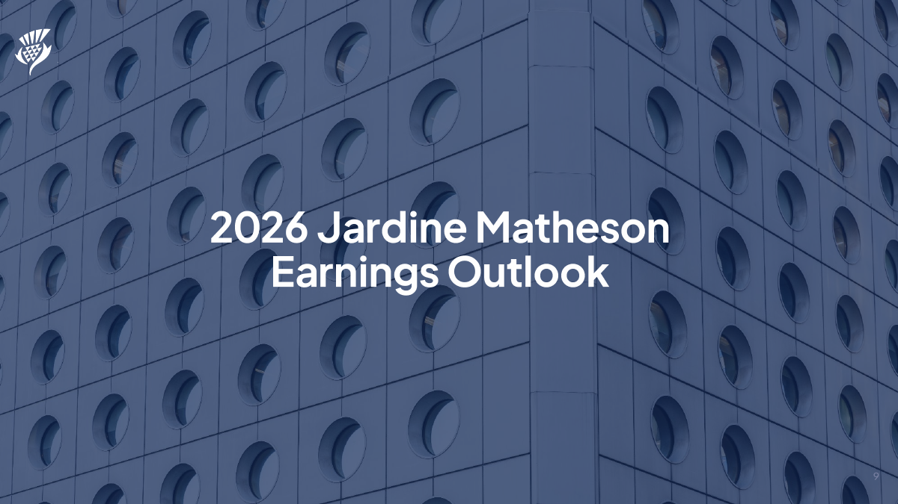
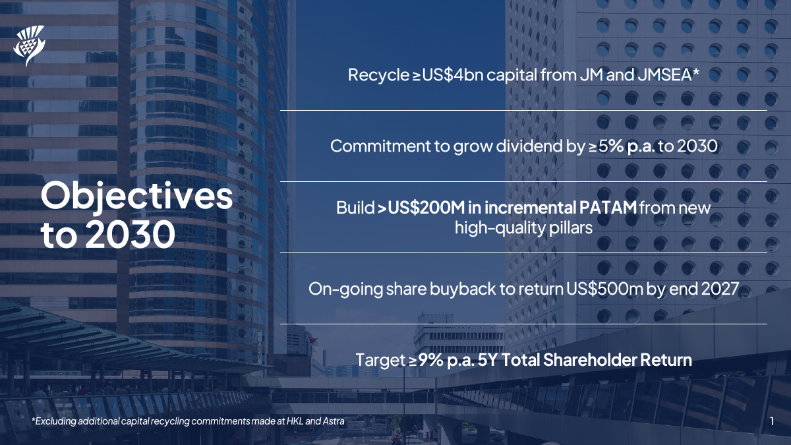
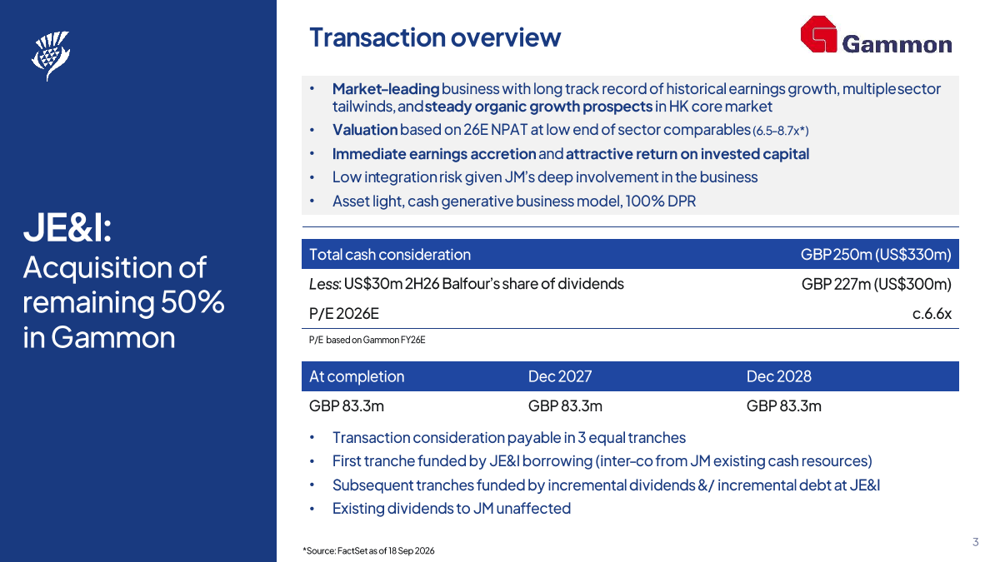

<!-- PRÜFEN: Bereinigter Vorjahreswert 5,33 $ ist die Basis der 3–6 %-Steigerung (laut Mitteilung, bereinigt um Veräußerungen). Der berichtete Wert 2025 lag bei 5,72 $. -->
<!-- PRÜFEN: Dividendenrendite fehlt, weil der Aktienkurs in den Unterlagen nicht steht. Kurs und Dividendenhistorie nachtragen. -->
<!-- PRÜFEN: Aufmacherfoto fehlt (Unsplash-Suche steht aus). -->

!!! kurz "Kurz gesagt"
    **Die Dividende:** Für 2026 sollen es mindestens 2,50 $ je Aktie sein, rund 6 % mehr als im Vorjahr.
    **Der Gewinn:** Der bereinigte Gewinn je Aktie soll zwischen 5,50 und 5,65 $ liegen, 3 bis 6 % über dem um Veräußerungen bereinigten Vorjahreswert von 5,33 $.
    **Der Wechsel:** Finanzchef Graham Baker geht im zweiten Quartal 2027. Der Nachfolger ist ein externer Kandidat und kommt im ersten Halbjahr 2027.

Jardine Matheson (JMH, Notierung in London und Singapur) hat seine Zwischenmitteilung zum dritten Quartal 2026 vorgelegt. Die Zahlen sind ein Update, keine vollständige Bilanz. Der Konzern verbindet dort drei Botschaften: eine höhere Gewinnprognose, mehr Dividende und einen geplanten Führungswechsel im Finanzbereich.

## Gewinn: Prognose angehoben, Vergleichsbasis bereinigt

Im Oktober hatte Jardine die Gewinnprognose schon einmal angehoben, auf 5,50 bis 5,65 $ je Aktie. Vorher lag sie bei 5,33 $. Die jetzige Mitteilung bestätigt diese Spanne.

*Folie aus der Präsentation „Delivering progress“ von Jardine Matheson vom 15.10.2026, S. 10.*

Der Vergleich mit dem Vorjahr wirkt auf den ersten Blick schwächer, als er ist. Der berichtete Gewinn je Aktie 2025 lag bei 5,72 $. Darin stecken aber Ergebnisse aus Beteiligungen, die inzwischen verkauft oder anders verbucht werden, etwa die VNM-Beteiligung, Verkäufe bei DFI Retail und die Neuzuordnung von Zhongsheng. Ohne diese Effekte kommt die Basis auf 5,33 $. Die Prognose von 5,50 bis 5,65 $ enthält rund 0,05 $ Ergebnisbeitrag aus den jüngsten Zukäufen.

## Dividende: mindestens 2,50 $

Das Management erwartet für das Gesamtjahr 2026 eine Jardine-Matheson-Dividende von mindestens 2,50 $ je Aktie. Das sind 6 % mehr als im Vorjahr. Auf die Prognosemitte von 5,58 $ gerechnet liegt die Ausschüttungsquote bei rund 45 %. Bei dieser Quote bleibt Spielraum für Investitionen und Rückkäufe.

Im Oktober hatte der Konzern einen Ausblick bis 2030 genannt: Die Dividende soll jährlich um mindestens 5 % steigen. Außerdem sind Rückkäufe von 500 Mio. $ bis Ende 2027 vorgesehen. Der Rückkauf für JMH-Aktien ist inzwischen zu 36 % umgesetzt.

*Folie aus der Präsentation „Delivering progress“ von Jardine Matheson vom 15.10.2026, S. 1.*

## Umbau: Gammon, Kapitalrückflüsse und Zukäufe

Der größte Schritt der letzten Wochen betrifft den Bau- und Infrastrukturbereich. Jardine hat im Oktober die restlichen 50 % an Gammon Construction übernommen. Der Kaufpreis beträgt 250 Mio. Pfund (rund 330 Mio. $). Gemessen am erwarteten Gewinn 2026 entspricht das einem KGV von rund 6,6. Die Zahlung verteilt sich auf drei gleich große Raten, die erste wird über Kredite der Engineering-Sparte finanziert. Die Gewinne aus Gammon fließen jetzt komplett in die Konzernzahlen.

*Folie aus der Präsentation „Delivering progress“ von Jardine Matheson vom 15.10.2026, S. 4.*

Die Engineering- und Infrastruktursparte (JE&I) meldete für das dritte Quartal einen um 15 % höheren bereinigten Gewinn. Der Auftragsbestand der beiden Tochtergesellschaften Gammon und Jardine Engineering Corporation liegt bei mehr als 7 Mrd. $. Das Ziel bis 2030 ist eine Verdopplung des Gewinns.

Beim Kapital läuft der Umbau nach Plan. Jardine hat bisher 1,4 Mrd. $ durch Verkäufe und Umschichtungen freigesetzt, ohne die Beteiligungen an Hongkong Land und Astra. Das Ziel liegt bei mindestens 4 Mrd. $ bis 2030. Die Verkäufe betreffen unter anderem Luxuswohnungen im Portfolio. Die Sparte Jardine Matheson Southeast Asia hat außerdem das Geschäft mit Cycle & Carriage in Singapur und Malaysia verkauft. Die Aktionäre haben eine Sonderdividende von 37 US-Cent je Aktie und die Ausschüttung der verbleibenden Toyota-Anteile gebilligt.

## Beteiligungen im Überblick

- **Astra International:** Der bereinigte Nettogewinn stieg im dritten Quartal um 11 %. Astra hat zwischen November 2025 und September 2026 Aktien für rund 583 Mio. $ zurückgekauft und will seine Beteiligung an Astra Otoparts auf 84,95 % erhöhen.
- **Hongkong Land:** Die Nettoerlöse aus dem Kapitalrecycling haben 4,2 Mrd. $ erreicht und liegen damit über dem Zwischenziel. Das Rückkaufprogramm wurde auf 750 Mio. $ aufgestockt.
- **DFI Retail:** Der bereinigte Gewinn stieg um 10 %. Für das Gesamtjahr erhöht DFI die Prognose auf 295 bis 305 Mio. $.
- **Mandarin Oriental:** Der bereinigte Gewinn fiel im dritten Quartal um 60 %, vor allem wegen der Schließung des Hotels in Hongkong zur Renovierung. Das Haus ist seit dem 1. Oktober wieder geöffnet.

## Führungswechsel: Finanzchef geht 2027

Graham Baker tritt im zweiten Quartal 2027 als Finanzchef zurück. Der Wechsel ist als geplante Nachfolge angelegt. Der Nachfolger, ein externer Kandidat, soll im ersten Halbjahr 2027 anfangen. Name und Lebenslauf sollen Anfang 2027 veröffentlicht werden. Baker arbeitet bis dahin eng mit dem Nachfolger zusammen.

Zusätzlich hat Jardine zwei weitere Personalien bekannt gegeben: Sid Khotkar wurde zum Geschäftsführer für Investments ernannt (seit 1. Oktober), Erika Leung Rodriguez übernimmt die Leitung für Portfolio-Resilienz und Nachhaltigkeit (seit 2. November).

Für Anleger ist vor allem der Zeitplan interessant. Der neue Finanzchef kommt in einer Phase, in der die Gammon-Raten, der Rückkauf bis Ende 2027 und die Kapitalrückflüsse zusammenlaufen.

## Einordnung für Anleger

Jardine Matheson gibt 2026 mehr Gewinn und mehr Dividende aus, während das Unternehmen weiter Kapital aus Beteiligungen freisetzt. Die Mindestdividende wirkt bei der Prognose gut gedeckt, und die Rückkäufe laufen. Offen bleibt, wie sich die Gewinne aus den verkauften Geschäften im Vergleich zu den neuen Zukäufen entwickeln. Auch der Wechsel im Finanzbereich bringt eine Unbekannte mit, weil der Nachfolger erst 2027 bekannt wird.

Die Mitteilung enthält keine vollständige Bilanz. Wer die Aktie bewerten will, braucht die Zahlen zum Gesamtjahr. Dieser Artikel ist keine Anlageberatung.

*Quellen: Jardine Matheson Holdings Limited, Interim Management Statement Q3 2026 (17.11.2026); Präsentation „Delivering progress“ vom 15.10.2026.*
