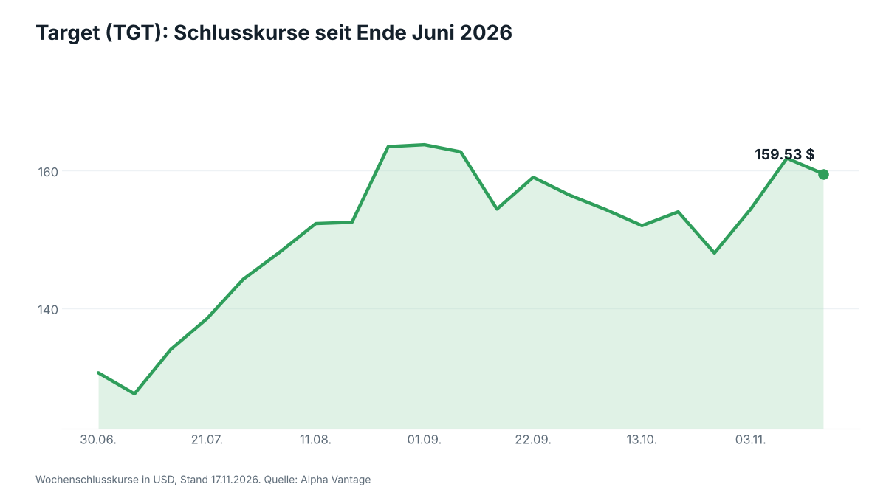

!!! kurz "Kurz gesagt"
    **Umsatz:** 27,1 Mrd. $, plus 7,1 % zum Vorjahresquartal. Vergleichbare Verkäufe stiegen um 5,6 %, getragen von 5,0 % mehr Kundenbesuchen.
    **Gewinn:** 2,65 $ je Aktie nach 1,51 $ im Vorjahr. Ohne Zollrückerstattungen von 0,50 $ je Aktie wären es 2,15 $, plus 42 %.
    **Ausblick:** Umsatzwachstum rund 6 % für 2026, bisher rund 5 %. Gewinn je Aktie 10,65 bis 11,40 $, darin rund 2,14 $ Zollrückerstattungen.
    **Führung:** Michael Fiddelke ist Chief Executive Officer.
    **Dividende:** 1,16 $ je Aktie im Quartal, plus 1,8 %.

Target hat im dritten Quartal des Geschäftsjahres 2026 mehr verkauft und deutlich mehr verdient. Der Gewinnsprung ist allerdings nicht allein operativ begründet. Ein Großteil der Verbesserung der Marge kommt aus Zollrückerstattungen, und die lassen sich nicht wiederholen.

Die Aktie hat seit Ende Juni rund 22 % gewonnen. Am 17. November schloss sie bei 159,53 $, nach einem Schlusshoch von 169,89 $ am 24. August. Die Quartalszahlen kommen am 18. November.

## Umsatz: Die Kunden kommen zurück

Der Umsatz stieg um 7,1 % auf 27,1 Mrd. $. Die vergleichbaren Verkäufe legten um 5,6 % zu, nach einem Minus von 2,7 % im Vorjahresquartal. Dabei kamen mehr Kunden: Die Zahl der Transaktionen stieg um 5,0 %, die Durchschnittsbestellung um 0,6 %.

Die Online-Verkäufe wuchsen mit 9,8 % schneller als die Filialen mit 4,6 %. Der größte Sprung kam aus den Nichtwarenerlösen, also Werbung über Roundel, Kreditkarten-Gewinnbeteiligung und Mitgliedschaften. Sie stiegen um rund 19 %. Warengeschäft allein legte um 6,9 % zu.

Bei den Warengruppen fiel vor allem Fun 101 auf, das um fast 27 % zulegte. Beauty stieg um mehr als 9 %, Lebensmittel um knapp 7 %. Nach Unternehmensangaben liegt der Umsatz im November im Rahmen der Erwartungen und beschleunigt sich gegenüber Oktober.

## Gewinn: Zollrückerstattungen machen einen Teil aus

Der Gewinn je Aktie lag bei 2,65 $ nach 1,51 $ im Vorjahr, der bereinigte Wert bei 2,65 $ nach 1,78 $. Den Unterschied machen Zollrückerstattungen aus, die das Unternehmen im Quartal mit 301 Mio. $ vor Steuern im Wareneinsatz verbucht hat.

Rechnet man sie heraus, ergibt sich ein anderes Bild: Der Gewinn je Aktie stiege um 42 % auf 2,15 $, der bereinigte um 21 %. Dieser Wert beschreibt den operativen Fortschritt besser.

Die Bruttomarge stieg auf 30,5 % nach 28,2 %. Ohne Rückerstattungen läge die Verbesserung bei rund 1,2 Prozentpunkten, mit ihnen bei 2,3. Die Verwaltungskosten lagen bei 21,9 % des Umsatzes, bereinigt waren es im Vorjahr 21,3 %. Höhere Vergütungen und mehr Personalstunden in den Filialen belasteten.

## Bilanz: Lager wächst schneller als der Umsatz

Die Vorräte stiegen auf 16,1 Mrd. $ und lagen damit 8 % über dem Vorjahr. Der Umsatz wuchs um 7 %. Ein Lageraufbau vor dem Weihnachtsgeschäft ist üblich, trotzdem lohnt der Blick, falls die Verkäufe im Dezember nachlassen.

Die Kapitalrendite (ROIC) lag für die letzten zwölf Monate bei 16,5 % nach 13,4 %. Die Rückerstattungen erklären 3,0 Prozentpunkte davon, ohne sie läge sie rechnerisch bei rund 13,5 %.

Für die Aktionäre gab es 1,16 $ Dividende je Aktie im Quartal, 1,8 % mehr als im Vorjahr. Zusätzlich kaufte Target Aktien für 251 Mio. $ zurück, im Schnitt zu 155,49 $. Das Programm hat noch rund 8,0 Mrd. $ Restvolumen.

## Ausblick: Umsatz hoch, Gewinn an Zölle gebunden

Für 2026 erhöht Target das Umsatzwachstum auf rund 6 %, bisher rund 5 %. Die Betriebsmarge soll bei rund 6,2 % liegen, davon rund 1,1 Prozentpunkte aus Zollrückerstattungen.

Der Gewinn je Aktie wird auf 10,65 bis 11,40 $ beziffert, darin sind rund 2,14 $ Rückerstattungen bis heute enthalten. Ohne sie blieben rechnerisch rund 8,51 bis 9,26 $. Zukünftige Rückerstattungen sind im Ausblick nicht berücksichtigt.

Für 2027 plant Target Investitionen von 5 bis 6 Mrd. $, nach 3,8 Mrd. $ in den ersten neun Monaten 2026.

## Einordnung

Die operative Lage hat sich verbessert: mehr Kunden, bessere Mengen in Online und Nichtwarenerlösen, stabile Dividende. Gleichzeitig bestimmen Zollrückerstattungen die Gewinnzahlen. Für die Einordnung lohnt es, den Gewinn ohne diese Sonderposten zu betrachten.

Der CEO Michael Fiddelke ordnet das Ergebnis übersetzt so ein: „Unsere Ergebnisse im dritten Quartal zeigen weiteren Fortschritt bei unseren strategischen Prioritäten, im Mittelpunkt steht, berufstätige Familien mit unserer Mischung aus Stil, Design und Wert zu bedienen.“

*Quellen: Target Corporation, Pressemitteilung „Target Corporation Reports Third Quarter Earnings“ vom 18. November 2026 mit Konzern-Gewinn- und Verlustrechnung, Bilanz, Kapitalflussrechnung und Überleitungen zu bereinigten Kennzahlen. Die Zahlen aus dem Quartalsbericht (Form 10-Q) sind noch nicht eingearbeitet.*
