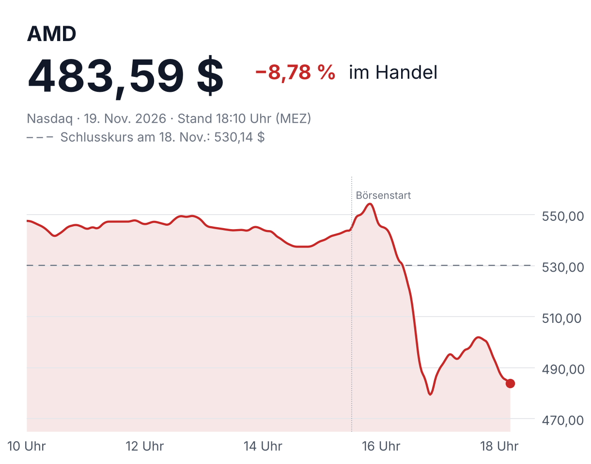
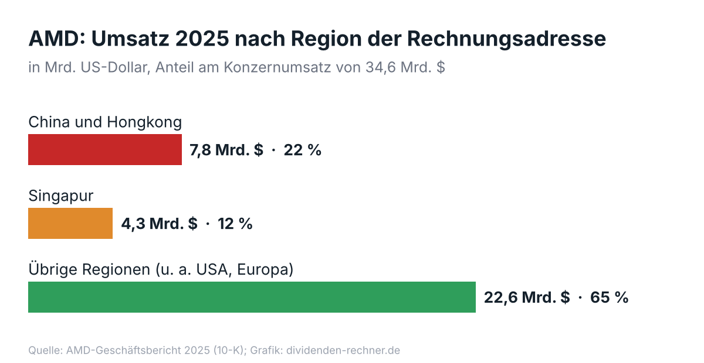

<!-- PRÜFEN: Kurs 483,59 $ (−8,78 %) um 12:10 Uhr New Yorker Zeit (18:10 Uhr MEZ) aus dem Yahoo-Screenshot, Schlusskurs 18.11.: 530,14 $. Kursbild nachgebaut aus dem Screenshot (Verlauf angenähert). Regionen-Umsätze aus dem AMD-10-K 2025 (China/Hongkong 7,75 Mrd. $, Singapur 4,28 Mrd. $), Konzernumsatz 34,6 Mrd. $ aus den Hub-Daten. -->
!!! kurz "Kurz gesagt"
    **Kurs:** Minus 8,8 % auf 483,59 $ am Donnerstag um 18:10 Uhr (MEZ), zeitweise mehr als 10 % im Minus.
    **Auslöser:** Der Leerverkäufer Hunterbrook findet AMD-Software bei einem von den USA gesperrten chinesischen Serverhersteller.
    **Einordnung:** Einen Verstoß gegen Exportregeln belegt der Bericht nicht. AMD hat sich noch nicht geäußert.

Eine Woche lang galt AMD als der sichere Hafen unter den KI-Chipwerten. Seit dem [Rücktritt von Nvidia-Chef Jensen Huang](/news/nvidia-huang-ruecktritt-wochenend-analyse/) schichteten viele Anleger in den kleineren Rivalen um. Am Donnerstag hat dieses Bild einen Riss bekommen. Der Leerverkäufer Hunterbrook Capital hat eine Wette auf fallende Kurse offengelegt und wirft AMD vor, ein eigenes China-Problem zu haben. Die Aktie drehte kurz nach Handelsbeginn in New York von einem Plus von gut 4 % in ein Minus von mehr als 10 %.

## Was Hunterbrook gefunden hat

Im Zentrum steht IEIT Systems, ein chinesischer Serverhersteller. Das US-Handelsministerium hat ihn im März 2025 auf die sogenannte Entity List gesetzt. Wer IEIT beliefern will, braucht eine Lizenz, und die verweigert die Behörde in der Regel. Das gilt auch für Software. Hunterbrooks Rechercheabteilung hat Software-Updates von IEIT-Servern zerlegt und darin die Startsoftware gefunden, die AMD für seine Serverprozessoren schreibt. Seit der Sperre hat IEIT mindestens sechs neuere Versionen davon eingebaut, zuletzt im Oktober eine Version, die AMD erst im Juli veröffentlicht hatte. Die Updates folgten den AMD-Veröffentlichungen jeweils nach 25 bis 61 Tagen.

Brisanter als der Fund selbst ist das Umfeld. Drei Firmen, die nicht auf der Liste stehen, bieten nahezu identische Software an: Maginfra in China, Kaytus in Singapur und Aivres in Kalifornien. Kaytus nennt IEIT in seinen geprüften Abschlüssen als Konzernmutter. Aivres hieß bis 2023 Inspur Systems und taucht im IEIT-Geschäftsbericht für 2022 als Tochter auf. AMD führt Aivres auf der eigenen Website als Partner für Server mit seinen Instinct-KI-Chips. Hunterbrook schließt daraus, dass über diese Firmen Server verkauft werden könnten, die IEIT entworfen hat.

Dazu kommen kleinere Punkte. AMD meldete für 2025 Lizenzeinnahmen von 67 Mio. $, die Hunterbrook zwei chinesischen Gemeinschaftsfirmen zuordnet, die seit 2019 sanktioniert sind. Und im Produktkatalog vom Februar 2026 steht ein Server der Firma Cancon, die als Deckname einer weiteren gesperrten Firma gilt.

## Was der Bericht nicht zeigt

Hunterbrook belegt keinen Gesetzesverstoß, und das räumt der Leerverkäufer selbst ein. Wer IEIT die Software geliefert hat, ist unklar. Firmware für Serverprozessoren verbreitet sich über viele Wege, über Mainboard-Hersteller, Softwarefirmen und Händler. Ob eine Lizenz vorlag, weiß ebenfalls niemand außerhalb der Behörden. AMD hat die Fragen von Hunterbrook unbeantwortet gelassen und sich auch am Donnerstag zunächst nicht öffentlich geäußert.

Hinzu kommt das Eigeninteresse. Hunterbrook verdient am Kursrückgang, die Rechercheabteilung und der Fonds gehören zusammen. Das macht die Funde nicht falsch, aber es erklärt, warum der Bericht auf den maximalen Effekt am Markt zielt. Auffällig ist auch der Kontrast zur Konkurrenz: Intel lag am Donnerstag rund 5 % im Plus, der Chipsektor insgesamt war fest in den Tag gestartet.

## Warum der Zeitpunkt heikel ist

Washington zieht die Regeln gerade an. Seit diesem Donnerstag brauchen Hersteller eine Lizenz, um fortschrittliche KI-Chips nach Singapur, Malaysia, Indonesien, Thailand und Brasilien zu liefern. Die Behörde will verhindern, dass Chips über Drittstaaten nach China gelangen. Am 10. Januar 2027 läuft zudem eine Aussetzung aus: Danach gelten die Beschränkungen der Entity List auch für Tochterfirmen, die mindestens zur Hälfte einem gelisteten Unternehmen gehören. Kaytus könnte darunter fallen.

Für AMD geht es um viel Geld. Die Grafik zeigt, wie stark der Konzern an Asien hängt.

Kunden in Singapur hat AMD 2025 rund 4,3 Mrd. $ in Rechnung gestellt, gut 12 % des Umsatzes. Auf China und Hongkong entfielen 7,8 Mrd. $ oder 22 %. Ein Teil davon sind PC- und Spielechips, die von den KI-Exportregeln nicht erfasst werden. Wie groß der Anteil der KI- und Serverchips ist, weist AMD nicht getrennt aus. Seit Längerem bekannt ist außerdem, dass zwei Gemeinschaftsfirmen, die zu 85 % dem chinesischen Konzern Tongfu Microelectronics gehören, den Großteil der Montage und Prüfung der AMD-Chips übernehmen.

## Was die Zahlen aus dem Aktienhub zeigen

Gegen die Vorwürfe steht ein Geschäft, das gerade sehr gut läuft. Im [dritten Quartal](/news/amd-q3-2026-quartalszahlen/) stieg der Umsatz um 45 %, das Rechenzentrumsgeschäft verdoppelte sich fast, und für das vierte Quartal peilt AMD rund 17 Mrd. $ an. Die Bewertung lässt allerdings wenig Raum für Rückschläge.

- **KGV:** 112, auf Basis des Gewinns von 2025 und des Kurses vom 18. November
- **Dividende:** AMD zahlt keine Dividende
- **Freier Cashflow:** 6,7 Mrd. $ im Jahr 2025, das entspricht einer Rendite von 0,8 % auf den Börsenwert
- **Bilanz:** Die Barmittel übersteigen die Schulden um rund 3,2 Mrd. $

Die Werte stammen aus einer maschinellen Auswertung des Geschäftsberichts 2025 und sind noch nicht geprüft.

## Einordnung

Der Kursrückgang preist ein Risiko ein, das bisher niemand beziffern kann. Im schlimmsten Fall drohen AMD Ermittlungen, Strafen und strengere Auflagen im Asiengeschäft. Im besten Fall erklärt AMD, dass die Software über Dritte zu IEIT gelangt ist, ohne eigenes Zutun. Entscheidend wird sein, wie schnell und wie konkret der Konzern antwortet und ob sich das Handelsministerium zu Wort meldet. Nach dem Fall Nvidia ist Washington bei diesem Thema empfindlich, und bei einem KGV von über 100 reagiert die Aktie auf jede Unsicherheit heftig.

Das ist eine Einordnung der Meldung und keine Anlageempfehlung.

Quellen:
- [Hunterbrook Media: AMD's China ties complicate its appeal as Nvidia's rival](https://hntrbrk.com/investigations/amd-china)
- Handelsblatt: AMD-Aktie verliert nach Shortseller-Bericht deutlich (19.11.2026)
- Investing.com-Meldung zu Hunterbrook und AMD (sinngemäß zusammengefasst)
- [CNBC: AMD falls on short-seller report of alleged China exposure](https://www.cnbc.com/2026/11/19/amd-falls-on-short-seller-report-of-alleged-china-exposure.html)
- [24/7 Wall St.: AMD Is Down 8% After Short Seller Hunterbrook Ties AMD's Firmware to Blacklisted Chinese Server Maker](https://247wallst.com/investing/2026/11/19/amd-is-down-8-after-short-seller-hunterbrook-ties-its-firmware-to-blacklisted-chinese-server-maker-resilient-intel-remains-up-5/)
- AMD, Geschäftsbericht 2025 (10-K); Kurs: Nasdaq, 19.11.2026, 18:10 Uhr (MEZ)
- Aktienhub, Kennzahlen zu AMD, Stand 18.11.2026
