<!-- PRÜFEN: Aufmacherfoto ist über tools/asset.request angefragt (Gasturbine/Gaskraftwerk). Nach dem Mergen läuft der Foto-Bot und trägt image-Felder ein. Passt das Foto nicht, mit anderen Suchbegriffen neu anfragen. -->
<!-- PRÜFEN: Bewertungen (Kurs, Börsenwert, KGV) sind gerundete eigene Berechnungen, Stand 10./11.11.2026: GE Vernova Schlusskurs 10.11. 797,04 $ (Alpha Vantage), erwartetes KGV aus TIKR (rund 42 bei knapp 940 $, auf 797 $ umgerechnet). Siemens Energy rund 126 € am 11.11. vormittags, Börsenwert mit rund 785 Mio. Aktien geschätzt, KGV auf Nettogewinn-Ausblick ~5 Mrd. € abzüglich Minderheiten. Mitsubishi Heavy Börsenwert rund 66,7 Mrd. $ (companiesmarketcap), KGV auf Prognose 440 Mrd. Yen. Falls Divi eigene Bewertungsdaten schickt: Tabelle im Abschnitt "Was der Markt bezahlt" ersetzen. -->
<!-- PRÜFEN: Halbjahr Siemens Energy (April bis September) = Q3 + Q4 GJ 2026. Q3-Werte aus der Ergebnismitteilung Q3 GJ 2026 (Gewinn vor Sondereffekten 1.623 Mio. €, Vorjahr 497 Mio.; Nettogewinn 1.188 Mio., Vorjahr 697 Mio.; Umsatz 11,4 Mrd., vergleichbar +18,5 %). Umsatzwachstum Halbjahr daher als vergleichbar "rund 20 %" angegeben. Marge Halbjahr Vorjahr mit Vorjahresumsatz ~20,1 Mrd. € geschätzt. -->
<!-- PRÜFEN: Trench Group gehörte bis 2024 zu Siemens Energy (Verkauf an Triton) – aus Erinnerung, vor Veröffentlichung kurz prüfen. Bürgschaften des Bundes 2023 und Kurs unter 10 € (Okt. 2023) ebenfalls aus Erinnerung. -->
<!-- PRÜFEN: Dividendenrendite GE Vernova ("unter 0,5 %") nicht aus aktueller Quelle, bitte gegenprüfen. -->
<!-- PRÜFEN: Umrechnung mit Halbjahresdurchschnitt aus der MHI-Präsentation: 158,1 Yen/USD und 183,7 Yen/EUR, daraus 1,16 USD/EUR. -->

!!! kurz "Kurz gesagt"
    **Die Lage:** Alle drei Konzerne wachsen beim Umsatz um rund ein Fünftel, und bei allen steigt die Marge. Der Gewinn von Siemens Energy hat sich im Halbjahr mehr als verdreifacht, GE Vernova hat die Aufträge verdoppelt, Mitsubishi Heavy wächst mit Gasturbinen am schnellsten.

    **Gasturbinen:** GE Vernova verdient in dem Geschäft am meisten und bucht die meisten Turbinen. Siemens Energy holt bei der Marge am stärksten auf, Mitsubishi Heavy ist bei den großen Maschinen ausgebucht.

    **Ausblick:** Alle drei heben ihre Ziele an. Siemens Energy will die Marge bis 2030 auf 20 bis 22 % treiben und die Industriesparte abspalten, GE Vernova kauft für 9 Mrd. Dollar zu, Mitsubishi Heavy verdoppelt die Fertigung.

Vor drei Jahren galt die Gasturbine als Auslaufmodell. Banken wollten keine fossilen Kraftwerke mehr finanzieren, Siemens Energy kämpfte mit den Verlusten seiner Windsparte und brauchte Bürgschaften des Bundes, die Aktie fiel unter 10 Euro. Heute sind Gasturbinen so begehrt, dass Kunden sich Lieferplätze für das Ende des Jahrzehnts reservieren, und das zu Preisen, die vor Kurzem niemand für möglich gehalten hätte.

Der Grund heißt Strom. Rechenzentren für künstliche Intelligenz, Wärmepumpen, Elektroautos, Klimaanlagen und die Rückverlagerung von Industrie treiben den Verbrauch. Die Energieberater von DNV rechnen damit, dass die weltweite Stromerzeugung bis 2040 um gut 60 % steigt. Wind und Sonne decken einen großen Teil davon, aber wer ein Rechenzentrum rund um die Uhr versorgen oder ein Netz stabil halten will, braucht Kraftwerke, die auf Knopfdruck liefern. Genau die bauen drei Konzerne, die sich den Weltmarkt für große Gasturbinen weitgehend teilen: GE Vernova aus den USA, Siemens Energy aus München und Mitsubishi Heavy Industries aus Tokio.

Alle drei haben in den vergangenen zwei Wochen Zahlen vorgelegt. Wir haben sie nebeneinandergelegt, auf den gleichen Zeitraum gebracht und in Euro umgerechnet, soweit das sinnvoll ist. Das Ergebnis ist ein Bild von drei Gewinnern, die sehr unterschiedlich gewinnen.

## Drei Geschäftsjahre, ein Vergleichszeitraum

Wer die drei vergleicht, stößt zuerst auf ein praktisches Problem. Siemens Energy schließt sein Geschäftsjahr Ende September ab und hat gerade das Gesamtjahr 2025/26 gemeldet. GE Vernova rechnet im Kalenderjahr und hat das dritte Quartal vorgelegt. Mitsubishi Heavy beginnt das Jahr im April und berichtet über das erste Halbjahr.

Der gemeinsame Nenner ist das Halbjahr von April bis September 2026. Bei Siemens Energy sind das das dritte und vierte Geschäftsquartal, bei GE Vernova das zweite und dritte Quartal, bei Mitsubishi Heavy das erste Halbjahr. Für die einzelnen Sparten nutzen wir das jüngste Quartal von Juli bis September, das bei allen in den Berichten steht. Ein zweites Problem bleibt: Jeder Konzern misst seinen operativen Gewinn anders. Siemens Energy rechnet vor Sondereffekten, aber nach Abschreibungen auf Anlagen. GE Vernova weist das EBITDA aus, also den Gewinn vor allen Abschreibungen, was die Marge um einige Prozentpunkte höher aussehen lässt. Mitsubishi Heavy nennt seinen Geschäftsgewinn, der dem Betriebsergebnis nahekommt. Wir vergleichen deshalb vor allem die Veränderung, und die ist bei allen drei sauber messbar.

Die Einzelanalysen zu den Zahlen stehen hier: [Siemens Energy](/news/siemens-energy-q4-2026-gewinn-verdreifacht-ziele-2030/), [GE Vernova](/news/ge-vernova-q3-2026-ergebnisse/) und [Mitsubishi Heavy](/news/mitsubishi-heavy-industries-halbjahr-fy2026-gasturbinen/).

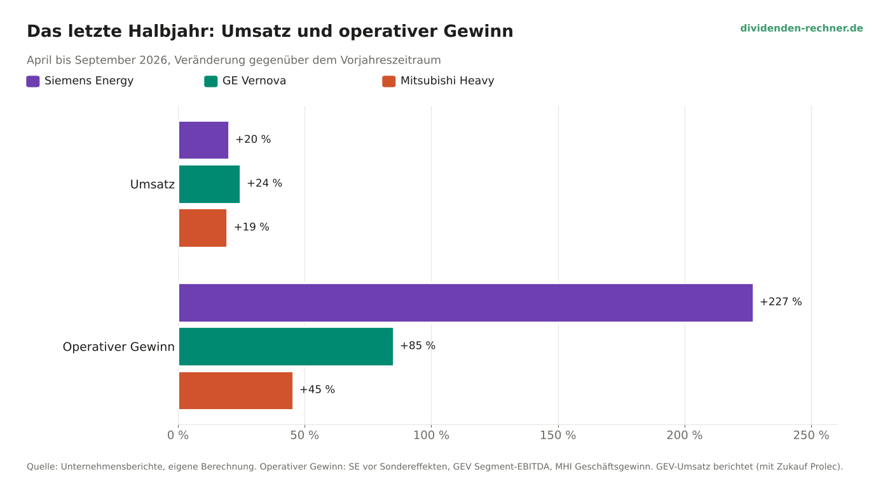

Beim Umsatz liegen die drei erstaunlich nah beieinander. Siemens Energy wächst vergleichbar um rund 20 %, GE Vernova um 24 %, wobei hier der Zukauf des Transformatorenherstellers Prolec mitzählt, Mitsubishi Heavy um 19 %. In Euro umgerechnet setzt Siemens Energy im Halbjahr 24,2 Mrd. Euro um, GE Vernova 20,4 Mrd. Euro und Mitsubishi Heavy 13,7 Mrd. Euro.

Beim Gewinn gehen die Wege auseinander. Siemens Energy steigert den Gewinn vor Sondereffekten von 1,0 auf 3,2 Mrd. Euro, ein Plus von 227 %. Bei GE Vernova steigt das Segment-EBITDA um 85 % auf 3,5 Mrd. Dollar, bei Mitsubishi Heavy der Geschäftsgewinn um 45 % auf 249 Mrd. Yen. Der Sprung bei Siemens Energy hat eine einfache Erklärung: Er beginnt von der niedrigsten Basis. Vor einem Jahr belastete die Windsparte Siemens Gamesa das Ergebnis noch mit hohen Verlusten, inzwischen schreibt sie eine schwarze Null.

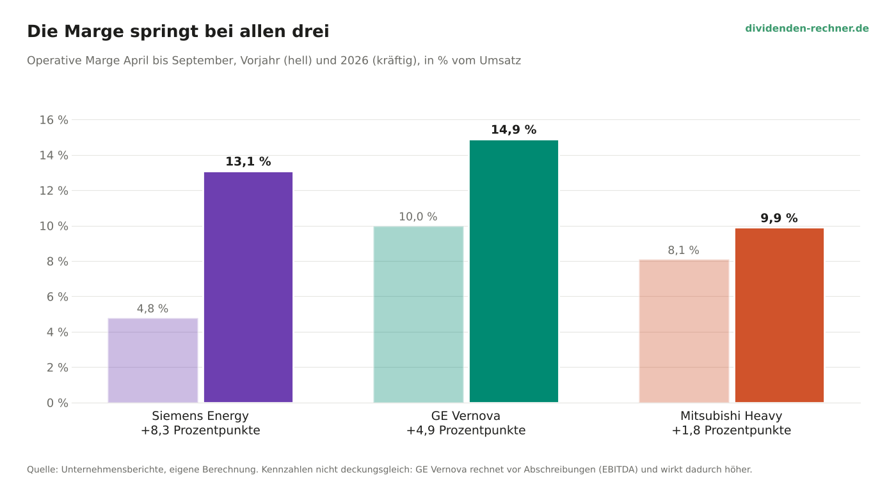

Die Margen zeigen, wie stark sich das Geschäft verändert hat. Bei Siemens Energy steigt sie im Halbjahr von 4,8 auf 13,1 %, bei GE Vernova von 10,0 auf 14,9 % (vor Abschreibungen), bei Mitsubishi Heavy von 8,1 auf 9,9 %. Alle drei profitieren von denselben drei Kräften: mehr Volumen in den Fabriken, deutlich höhere Preise für neue Turbinen und Aufträge aus früheren Jahren, die mit schlechteren Konditionen nach und nach aus den Büchern laufen.

## Das Herzstück: Gasturbinen

Im Gasturbinen-Geschäft stehen sich die drei am direktesten gegenüber, und hier liegt GE Vernova vorn. Die Amerikaner haben im dritten Quartal Aufträge für 112 Gasturbinen mit zusammen 16,6 Gigawatt gebucht, mehr als doppelt so viel Leistung wie im Vorjahresquartal mit 7,4 Gigawatt. In den ersten neun Monaten sind es 36,7 Gigawatt. Der Auftragseingang der Sparte Power stieg im Quartal von 7,8 auf 21,8 Mrd. Dollar, der Bestand an Ausrüstungsaufträgen hat sich fast verdreifacht.

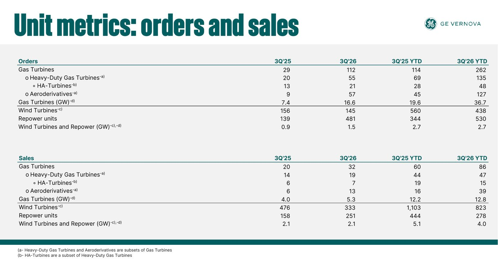
*Folie: GE Vernova, Webcast-Präsentation zum 3. Quartal 2026*

Auffällig ist die Zusammensetzung. Gut die Hälfte der bestellten Turbinen sind sogenannte Aeroderivate, abgeleitet von Flugzeugtriebwerken, kleiner, schneller aufzustellen und gefragt bei Kunden, die rasch Strom für ein Rechenzentrum brauchen. 57 davon wurden im Quartal bestellt, nach neun im Vorjahr. Dazu kommen 55 große Turbinen für Kraftwerke.

Beim Umsatz liegen GE Vernova und Siemens Energy fast gleichauf. Die Gas-Sparte von GE Vernova setzte im Quartal 5,1 Mrd. Dollar um, umgerechnet 4,4 Mrd. Euro und 30 % mehr als im Vorjahr. Siemens Energy kommt mit Gas Services auf 4,2 Mrd. Euro, vergleichbar 31 % mehr. Mitsubishi Heavy setzte mit Gas-Kombikraftwerken im Halbjahr 587 Mrd. Yen um, rund 3,2 Mrd. Euro, und wächst mit 37 % am schnellsten.

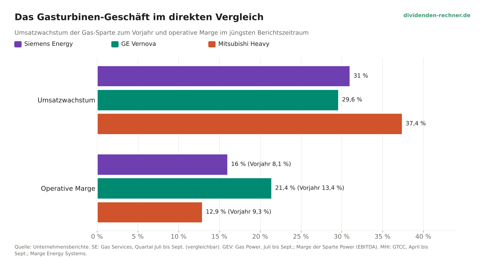

Bei der Marge zeigt sich der Unterschied. Die Sparte Power von GE Vernova erreicht 21,4 % (vor Abschreibungen, Vorjahr 13,4 %), Gas Services bei Siemens Energy 16,0 % (Vorjahr 8,1 %), das Energiegeschäft von Mitsubishi Heavy 12,9 % (Vorjahr 9,3 %). Selbst wenn man bei GE Vernova die Abschreibungen grob abzieht, bleibt ein Vorsprung. Siemens Energy macht dafür den größten Sprung und hat seine Marge in einem Jahr verdoppelt.

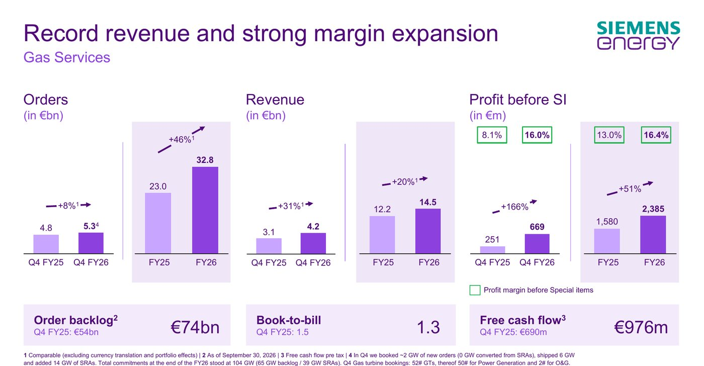
*Folie: Siemens Energy, Analystenpräsentation Q4 GJ 2026*

Siemens Energy hat im Gesamtjahr Neuaufträge für Gasturbinen mit 42 Gigawatt gebucht. Der Auftragsbestand liegt bei 65 Gigawatt, dazu kommen 39 Gigawatt an Reservierungen, die im kommenden Geschäftsjahr zu festen Aufträgen werden sollen. Zusammen sind das 104 Gigawatt. Die Münchner sehen sich mit rund 30 % Weltmarktanteil in jeder Region auf Platz eins oder zwei und schätzen den Markt bis 2030 auf 140 bis 150 Gigawatt im Jahr. Die gesamte Fertigung aller Hersteller liegt nach eigener Rechnung bei rund 130 Gigawatt. Daraus erklärt sich die Preismacht: Es gibt mehr Nachfrage als Fabriken.

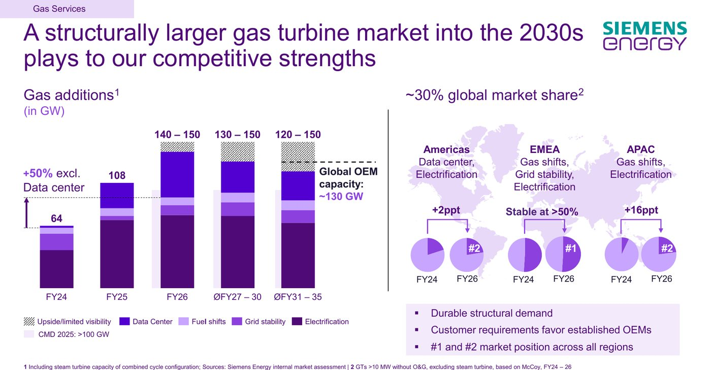
*Folie: Siemens Energy, Analystenpräsentation Q4 GJ 2026*

Ein Schönheitsfehler: Im vierten Quartal hat Siemens Energy nur rund 2 Gigawatt fest gebucht, ausschließlich kleine und mittlere Turbinen, keine einzige große. Stattdessen kamen 14 Gigawatt an Reservierungen hinzu. Der Konzernauftragseingang von 14,8 Mrd. Euro blieb unter den Erwartungen der Analysten von rund 15,5 Mrd. Euro. Siemens Energy verweist auf normale Schwankungen im Großanlagengeschäft, und die Reservierungen sprechen dafür. Ein Quartal mit 2 Gigawatt neben einem bei GE Vernova mit 16,6 Gigawatt fällt aber auf.

Mitsubishi Heavy ist bei den großen Maschinen der Spezialist. Im ersten Halbjahr kamen Aufträge für 19 große Gasturbinen mit 8 Gigawatt herein, etwas weniger als im Vorjahr mit 23 Turbinen und 10 Gigawatt. Der Bestand stieg dennoch auf 83 Turbinen mit 37 Gigawatt, ein Viertel mehr als vor einem Jahr. Gut die Hälfte der neuen Aufträge kam aus Nord- und Südamerika.

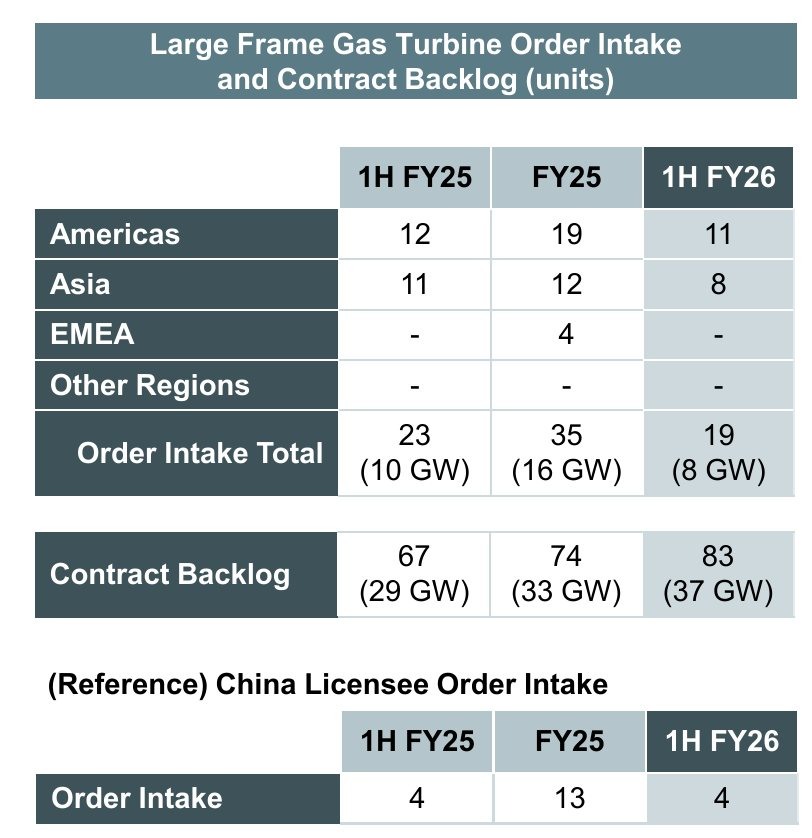
*Folie: Mitsubishi Heavy Industries, Präsentation zum 1. Halbjahr FY2026*

Dass die Japaner weniger große Turbinen gebucht haben, hat mit der Kapazität zu tun: Die Fabriken sind auf Jahre ausgelastet, und Mitsubishi Heavy hat seine Prognose für den Auftragseingang bei Gas-Kombikraftwerken im Geschäftsjahr gerade von 2,4 auf 3,0 Billionen Yen angehoben. Rund 500 Mrd. Yen will der Konzern in die Fertigung stecken, auch in die Herstellung der Heißteile, und die Produktion neuer Anlagen verdoppeln. Ein Indiz für den Boom im Neubau: Der Anteil des Servicegeschäfts am Gasturbinen-Umsatz sank binnen eines Jahres von 51 auf 42 %.

## Das Netz: Wo Siemens Energy vorne liegt

Wer Strom erzeugt, muss ihn auch transportieren. Hier vergleichen sich nur zwei der drei, denn Mitsubishi Heavy hat kein eigenes Netzgeschäft dieser Größe. Siemens Energy liegt in diesem Feld klar vor GE Vernova.

Grid Technologies, die Netzsparte von Siemens Energy, setzte im vierten Quartal 4,4 Mrd. Euro um, vergleichbar 36 % mehr als im Vorjahr, und erreichte erstmals mehr als 20 % Marge. Im Gesamtjahr waren es 14,1 Mrd. Euro Umsatz bei 18,9 % Marge, der Auftragsbestand liegt bei 52 Mrd. Euro. Die Sparte Electrification von GE Vernova kam im dritten Quartal auf 3,9 Mrd. Dollar Umsatz, umgerechnet 3,3 Mrd. Euro. Ohne den Zukauf Prolec waren es organisch 16 % mehr, die Marge vor Abschreibungen lag bei 19,1 %, der Auftragsbestand bei 46 Mrd. Dollar.

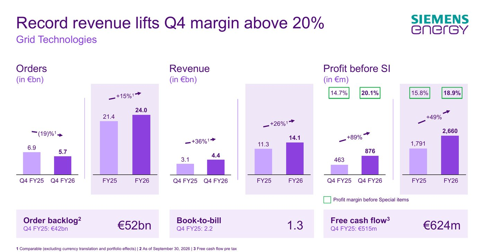
*Folie: Siemens Energy, Analystenpräsentation Q4 GJ 2026*

Bei beiden ließ der Auftragseingang im Quartal nach, bei Siemens Energy um 19 %, bei GE Vernova organisch um 9 %. Das ist nach zwei Rekordjahren keine Überraschung, große Projekte für Gleichstromleitungen kommen in Schüben. GE Vernova will die Lücke mit Geld schließen: Für 9,0 Mrd. Dollar kauft der Konzern die Trench Group, einen Hersteller von Durchführungen, Messwandlern und Drosselspulen für Hochspannungsnetze, der bis 2024 zu Siemens Energy gehörte. Der Abschluss ist für Ende 2027 geplant, der Preis entspricht dem 13-Fachen des für 2028 erwarteten Ergebnisses vor Abschreibungen.

## Wind: Zwei Sorgenkinder werden gesund

Beide westlichen Konzerne schleppen eine Windsparte mit sich, und bei beiden wird sie langsam gesund. Siemens Gamesa schrieb im vierten Quartal mit 23 Mio. Euro das zweite Mal in Folge einen kleinen Gewinn, über das Gesamtjahr steht eine schwarze Null nach 1,4 Mrd. Euro Verlust im Vorjahr. Verbrannt hat die Sparte aber noch 1,6 Mrd. Euro an Barmitteln. Das Windgeschäft von GE Vernova kam im dritten Quartal auf 72 Mio. Dollar EBITDA, für das Gesamtjahr erwartet der Konzern weiter 400 bis 500 Mio. Dollar Verlust.

Für die Anleger ist das wichtiger, als es auf den ersten Blick scheint. Bei Siemens Energy war Gamesa der Grund für den Kursabsturz 2023 und die Staatsbürgschaften. Jede Milliarde, die dort nicht mehr verloren geht, landet direkt im Konzerngewinn. Bis 2030 soll Gamesa rund 1 Mrd. Euro Gewinn beisteuern, für das kommende Jahr peilt der Konzern aber nur 0 bis 2 % Marge an, weniger als Analysten erwartet hatten.

## Der Auftragsbestand: Arbeit für Jahre

Die beeindruckendste Zahl in allen drei Berichten ist der Auftragsbestand. Bei GE Vernova liegt er bei 196,7 Mrd. Dollar, 45 % mehr als vor einem Jahr. Siemens Energy kommt auf den Rekordwert von 164 Mrd. Euro, ein Plus von 19 %. Mitsubishi Heavy meldet 14,2 Billionen Yen, gut 7 % mehr als im März.

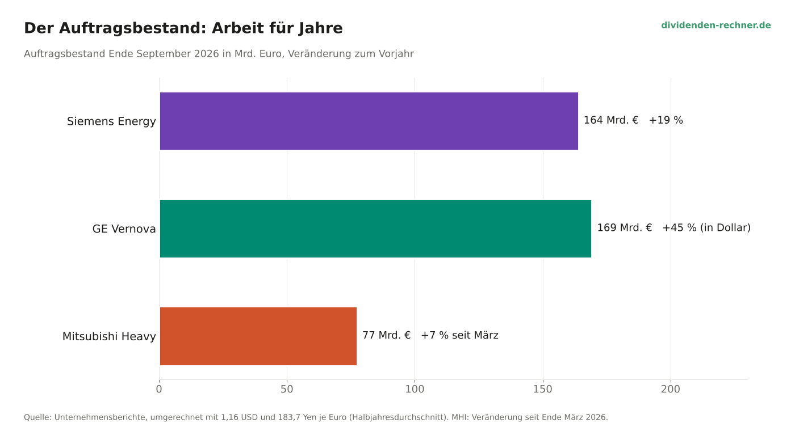

In Euro umgerechnet liegen GE Vernova mit 169 Mrd. Euro und Siemens Energy fast gleichauf, Mitsubishi Heavy kommt auf 77 Mrd. Euro, wobei dort auch Rüstung, Raumfahrt und Kernkraft drinstecken. Siemens Energy hat damit nach eigenen Angaben schon 85 % des Umsatzes für das kommende Geschäftsjahr gebucht. Dazu kommen hohe Anzahlungen der Kunden. Bei GE Vernova stiegen die erhaltenen Vorauszahlungen allein im dritten Quartal um 5,8 Mrd. Dollar, bei Mitsubishi Heavy liegen sie bei 2,6 Billionen Yen. Wer eine Turbine für 2029 reserviert, zahlt heute.

Das verändert auch die Qualität der Aufträge. Siemens Energy schreibt, die Marge im Bestand neuer Gasturbinen sei seit 2022 um 26 Prozentpunkte gestiegen. Was heute in den Büchern steht, wird also in den kommenden Jahren zu deutlich besseren Konditionen abgearbeitet als das, was gerade ausgeliefert wird.

## Der Ausblick: Alle drei heben an

Alle drei Konzerne haben ihre Ziele erhöht, und alle drei wollen weiter zweistellig wachsen.

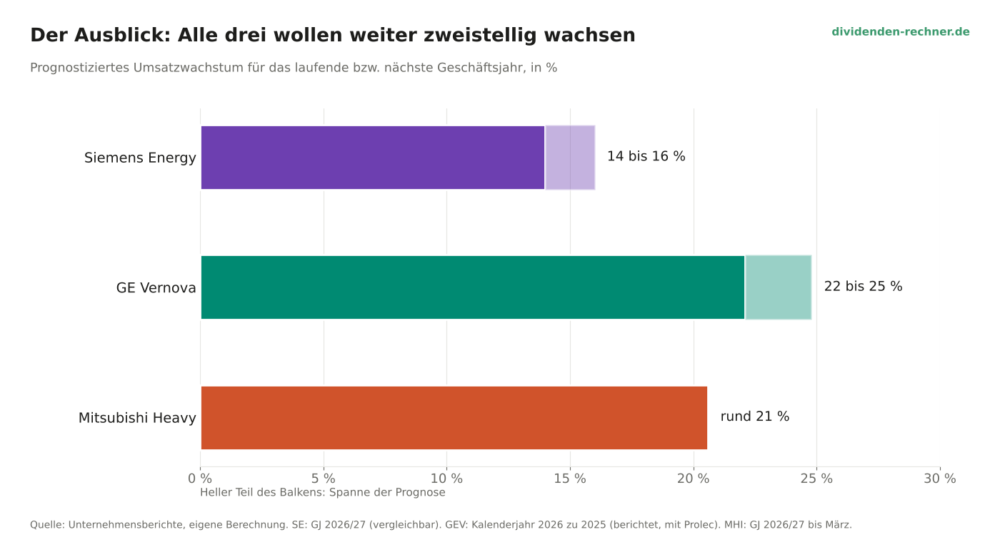

GE Vernova erwartet für 2026 jetzt 46,5 bis 47,5 Mrd. Dollar Umsatz, das sind 22 bis 25 % mehr als 2025. Die bereinigte EBITDA-Marge soll bei 13,5 bis 14,5 % liegen statt bei 12 bis 14 %. Der freie Cashflow soll 16 bis 17 Mrd. Dollar erreichen, gut 4 Mrd. mehr als bisher geplant, wobei ein großer Teil davon Anzahlungen sind. Das Aktienrückkaufprogramm hat der Konzern von 10 auf 20 Mrd. Dollar verdoppelt.

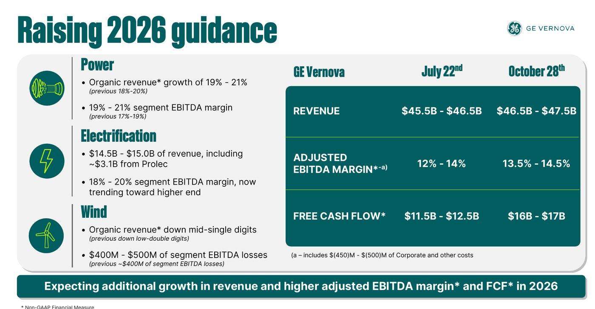
*Folie: GE Vernova, Webcast-Präsentation zum 3. Quartal 2026*

Mitsubishi Heavy hob die Prognose für das bis März laufende Geschäftsjahr deutlich an: 6,0 Billionen Yen Umsatz statt 5,4 Billionen, ein Plus von 21 %, und 600 Mrd. Yen Geschäftsgewinn, 39 % mehr als im Vorjahr. Der Nettogewinn soll um ein Drittel auf 440 Mrd. Yen steigen. Die Dividende steigt um 4 auf 29 Yen, dazu kommt ein Aktienrückkauf über bis zu 300 Mrd. Yen. Die Folgen der Lage im Nahen Osten sind in der Prognose ausdrücklich nicht enthalten.

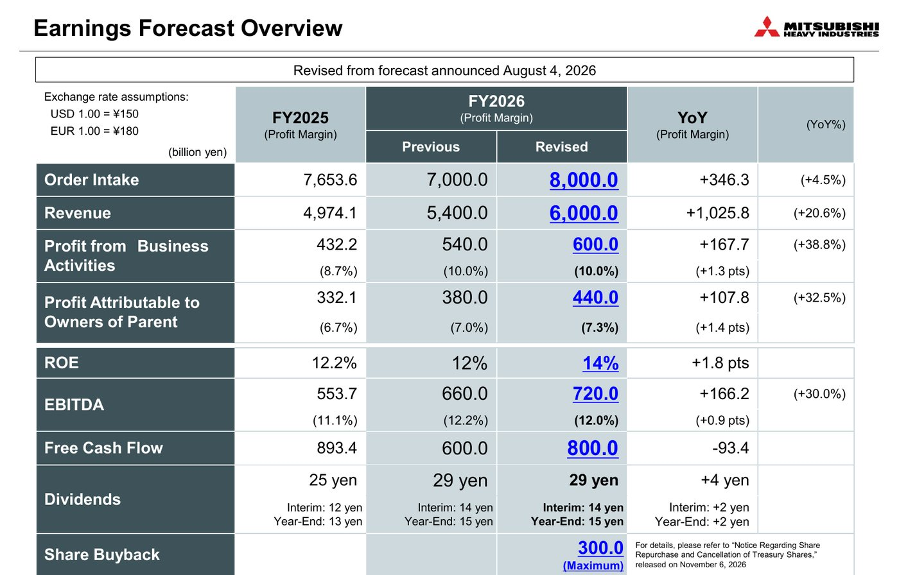
*Folie: Mitsubishi Heavy Industries, Präsentation zum 1. Halbjahr FY2026*

Siemens Energy rechnet für 2026/27 mit 14 bis 16 % Umsatzwachstum, einer Marge von 14 bis 16 % und rund 5 Mrd. Euro Nettogewinn nach 4,1 Mrd. Euro im abgelaufenen Jahr. Das klingt stark, liegt aber unter den 5,5 Mrd. Euro, die Analysten erwartet hatten. Ehrgeiziger ist das Ziel für 2030: mehr als 70 Mrd. Euro Umsatz und eine Marge von 20 bis 22 %. Die Gassparte soll dann 25 bis 27 % erreichen, das Netzgeschäft 24 bis 26 %. Den Gewinn beider Sparten will der Konzern bis dahin etwa verdreifachen beziehungsweise um das 2,5-Fache steigern. Bis 2030 sollen mehr als 25 Mrd. Euro an die Aktionäre fließen, die Dividende steigt schon jetzt von 0,70 auf 2,30 Euro.

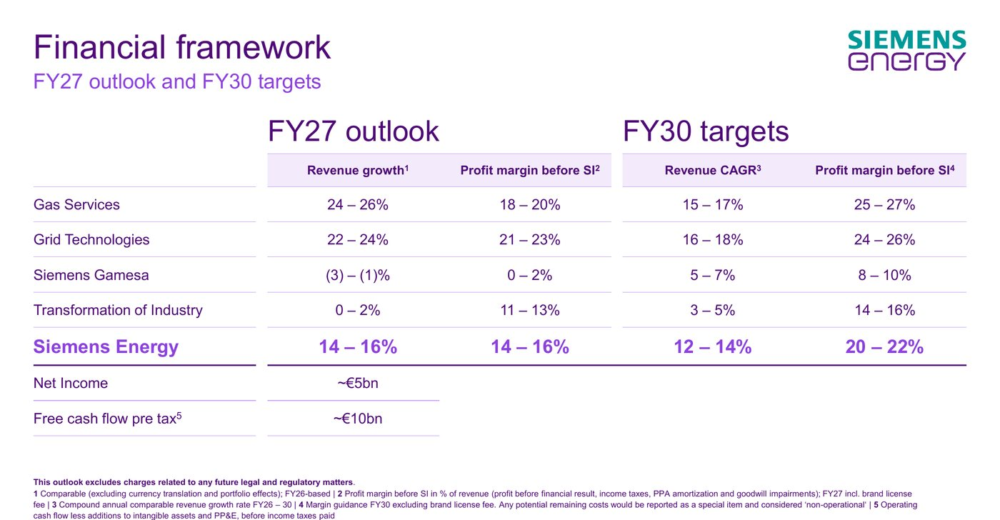
*Folie: Siemens Energy, Analystenpräsentation Q4 GJ 2026*

## Siemens Energy spaltet sich auf

Bei Siemens Energy kommt neben den Zahlen ein Umbau hinzu, der den Konzern in den nächsten Jahren verändern wird. Die Sparte Transformation of Industry, mit 5,8 Mrd. Euro Umsatz und 12,1 % Marge die kleinste der vier, soll eigenständig werden. Dazu gehören Dampfturbinen für die Industrie, Kompressoren, Elektrolyseure für Wasserstoff und Antriebe für Schiffe.

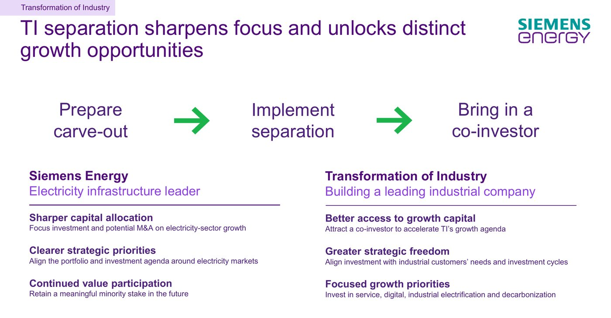
*Folie: Siemens Energy, Analystenpräsentation Q4 GJ 2026*

Der Plan hat drei Schritte: die Abtrennung vorbereiten, umsetzen und einen Mitinvestor an Bord holen. Siemens Energy will eine nennenswerte Minderheitsbeteiligung behalten. Der Rest des Konzerns konzentriert sich danach ganz auf Stromerzeugung und Netze. Für Anleger hat das zwei Seiten. Siemens Energy wird damit fokussierter und, gemessen an der Marge, profitabler, denn die Industriesparte liegt unter den Zielwerten der Gas- und Netzsparte. Gleichzeitig verliert der Konzern ein Geschäft, das weniger vom Zyklus der Kraftwerke abhängt.

Parallel bereitet Siemens Energy den Abschied vom Namen Siemens vor. In der Präsentation taucht der neue Name schon auf: Für die Umbenennung in Omterra und die Abtrennung der Industriesparte rechnet der Konzern im kommenden Jahr mit rund 0,7 Mrd. Euro an Sonderbelastungen. Auf Dauer spart der Konzern die Lizenzgebühr an die Siemens AG, die die Welt auf rund 320 Mio. Euro im Jahr beziffert hat. In der Zielmarge für 2030 ist diese Gebühr schon nicht mehr enthalten.

## Wie viel davon ist KI?

Die Börse behandelt alle drei als Wetten auf künstliche Intelligenz, und das erklärt die Kursbewegungen der letzten Wochen. Ende Oktober gerieten die Aktien der Stromversorger für Rechenzentren unter Druck: Höhere Inflationsdaten aus den USA weckten Zinssorgen, beim Cloud-Anbieter CoreWeave kamen Zweifel an der Finanzierung des KI-Ausbaus auf, und der Ölpreis stieg über 110 Dollar. Siemens Energy verlor an einem Tag 6 %, GE Vernova liegt trotz starker Zahlen rund 13 % unter dem Kurs am Tag der Veröffentlichung.

Die Berichte zeigen aber, dass die Nachfrage breiter ist, als die Börse sie zuletzt behandelt hat. Bei Siemens Energy hängen rund 15 Mrd. Euro des Auftragsbestands mit Rechenzentren zusammen, weniger als ein Zehntel. Die Münchner nennen als Treiber für Gasturbinen neben Rechenzentren den Ersatz von Kohlekraftwerken, die Stabilität der Netze und die Elektrifizierung, im Nahen Osten und in Asien vor allem die letzten beiden. GE Vernova-Chef Scott Strazik sagte vor den Zahlen, der Anteil der Rechenzentren an den Netzaufträgen werde im dritten Quartal eher bei 20 % liegen. Mitsubishi Heavy bucht den Großteil seiner Turbinen für klassische Kraftwerke in Amerika und Asien.

Das Risiko verschwindet damit nicht. Sollten die großen Technologiekonzerne ihre Investitionen deutlich kürzen, würden zuerst die Reservierungen wackeln, bei Siemens Energy immerhin 39 Gigawatt. Bisher spricht wenig dafür: Die Anzahlungen fließen, und die Preise steigen weiter. Ein Teil der Aufträge kommt zudem von Versorgern, die ihre Netze ohnehin ausbauen müssen, unabhängig davon, wie gut sich KI-Anwendungen verkaufen.

## Was der Markt bezahlt

Am Ende entscheidet für Anleger auch der Preis. Und hier zeigt sich ein deutlicher Unterschied.

| | Siemens Energy | GE Vernova | Mitsubishi Heavy |
|---|---|---|---|
| Börsenwert | knapp 100 Mrd. € | rund 185 Mrd. € | rund 57 Mrd. € |
| KGV auf erwarteten Gewinn | etwa 21 | etwa 35 bis 40 | etwa 23 |
| Dividendenrendite | 1,8 % | unter 0,5 % | rund 1 % |
| Aktienrückkauf | rund 3 Mrd. € pro Jahr | Programm auf 20 Mrd. $ erhöht | bis 300 Mrd. Yen |
| Marge zuletzt (Halbjahr) | 13,1 % | 14,9 % (vor Abschr.) | 9,9 % |
| Umsatzwachstum Ausblick | 14 bis 16 % | 22 bis 25 % | rund 21 % |

*Stand 10./11. November 2026, gerundet. KGV: Siemens Energy auf den Ausblick 2026/27, GE Vernova auf die Analystenschätzung der nächsten zwölf Monate, Mitsubishi Heavy auf die Prognose bis März 2027.*

GE Vernova ist mit Abstand am teuersten. Der Markt bezahlt dort das schnellste Wachstum, den größten Auftragsbestand und die höchste Marge im Gasgeschäft. Im April lag das erwartete KGV noch bei fast 70, der Rückschlag der letzten Wochen hat die Bewertung also schon deutlich gedrückt. Siemens Energy und Mitsubishi Heavy kosten gemessen am Gewinn etwa gleich viel. Mitsubishi Heavy steigert den Nettogewinn im laufenden Jahr sogar etwas stärker, Siemens Energy schüttet dafür deutlich mehr aus und hat das stärkere Netzgeschäft.

## Wer ist für die Zukunft am besten aufgestellt?

Eine eindeutige Antwort gibt es nicht, weil die drei unterschiedliche Stärken haben.

**GE Vernova** ist operativ der Taktgeber. Kein Konzern bucht so viele Turbinen, keiner hat einen so großen Auftragsbestand, und die Marge im Gasgeschäft ist die höchste. Dazu kommt der Heimvorteil in den USA, wo die meisten neuen Rechenzentren entstehen. Mit Trench kauft GE Vernova im Netzgeschäft zu, wo der Konzern hinter Siemens Energy liegt. Die Schwächen: die Windsparte, die noch Geld verliert, und eine Bewertung, die wenig Raum für Enttäuschungen lässt.

**Siemens Energy** hat die größte Aufholjagd hinter sich und noch die meiste Strecke vor sich. Die Marge ist binnen eines Jahres von 6 auf 12 % gestiegen, und der Weg zu 20 bis 22 % ist mit dem Auftragsbestand zu einem guten Teil schon vorgezeichnet. Im Netzgeschäft ist Siemens Energy der stärkste der drei, bei der Ausschüttung der großzügigste. Die Abtrennung der Industriesparte und der neue Name schärfen das Profil. Die Schwächen: ein schwaches Quartal bei festen Gasturbinen-Aufträgen, ein Ausblick für 2026/27 unter den Erwartungen und Siemens Gamesa, das zwar Gewinn macht, aber noch Geld verbrennt.

**Mitsubishi Heavy** ist der Vorsichtige unter den dreien. Mit großen Gasturbinen wächst der Konzern am schnellsten, und er investiert, um die Fertigung zu verdoppeln. Gleichzeitig hängt er weniger am Strommarkt, weil Rüstung, Raumfahrt und Kernkraft ebenfalls wachsen. Das macht ihn stabiler, aber auch weniger zugespitzt auf das Gasturbinen-Thema. Die Marge ist die niedrigste der drei, und Altlasten wie die Verluste aus zwei Kohlevergasungs-Kraftwerken in Japan drücken das Ergebnis.

Wer auf das reine Wachstum im Gasturbinen-Markt setzt, findet es bei GE Vernova am deutlichsten, zahlt dafür aber den höchsten Preis. Siemens Energy bietet die stärkste Mischung aus Gewinnanstieg, Netzgeschäft und Bewertung, mit dem Risiko, dass Wind und Umbau Geduld verlangen. Mitsubishi Heavy ist die breitere Wette auf Infrastruktur und Verteidigung. Für alle drei gilt: Ihr Auftragsbuch reicht bis weit ins nächste Jahrzehnt. Die größte Gefahr für die Aktien ist die Stimmung an der Börse: ob sie dem Strombedarf der KI weiter so viel zutraut wie in diesem Frühjahr.

## Häufige Fragen

### Welcher Konzern hat den größten Marktanteil bei Gasturbinen?

GE Vernova, Siemens Energy und Mitsubishi Heavy teilen sich den Großteil des Weltmarkts. Siemens Energy beziffert seinen eigenen Anteil auf rund 30 %. Bei den gebuchten Gigawatt lag GE Vernova im dritten Quartal mit 16,6 Gigawatt klar vorn.

### Warum sind die Margen nicht direkt vergleichbar?

GE Vernova misst den Gewinn vor allen Abschreibungen (EBITDA), Siemens Energy nach Abschreibungen auf Anlagen und vor Sondereffekten, Mitsubishi Heavy als Geschäftsgewinn nahe am Betriebsergebnis. Die Marge von GE Vernova fällt dadurch rechnerisch höher aus. Die Veränderung zum Vorjahr lässt sich aber bei allen dreien gut vergleichen.

### Was passiert mit der Industriesparte von Siemens Energy?

Transformation of Industry soll eigenständig werden, ein Mitinvestor soll einsteigen. Siemens Energy will eine nennenswerte Minderheitsbeteiligung behalten und sich selbst auf Stromerzeugung und Netze konzentrieren.

## Quellen

- Siemens Energy, Analystenpräsentation Q4 und Geschäftsjahr 2025/26 (11.11.2026)
- Siemens Energy, Ergebnismitteilung Q3 GJ 2026 (05.08.2026)
- GE Vernova, Webcast-Präsentation zum 3. Quartal 2026 (28.10.2026)
- Mitsubishi Heavy Industries, Präsentation und Finanzbericht zum 1. Halbjahr FY2026 (06.11.2026)
- Investing.com, Siemens Energy: verhaltener Ausblick auf 2027 (11.11.2026)
- dpa-AFX über onvista, Siemens Energy will nach Rekordjahr Tempo hoch halten (11.11.2026)
- Börsen-Zeitung, Siemens Energy hängt GE Vernova ab (05.08.2026)
- Stock World unter Berufung auf Welt, Omterra löst Siemens-Marke ab (06.08.2026)
- Börse Express, Siemens Energy: KI-Zweifel erwischen sie heftig (01.11.2026)
- TIKR, GE Vernova, Vertiv und Bloom Energy im Abwärtssog (22.10.2026)
- Edgex, GE Vernova nach den Zahlen zum 3. Quartal (28.10.2026)
- Kursdaten: Alpha Vantage, companiesmarketcap.com, Investing.com (Stand 10./11.11.2026)

*Eigene Berechnungen und Umrechnungen mit 1,16 US-Dollar und 183,7 Yen je Euro (Durchschnitt April bis September 2026). Keine Anlageberatung.*
