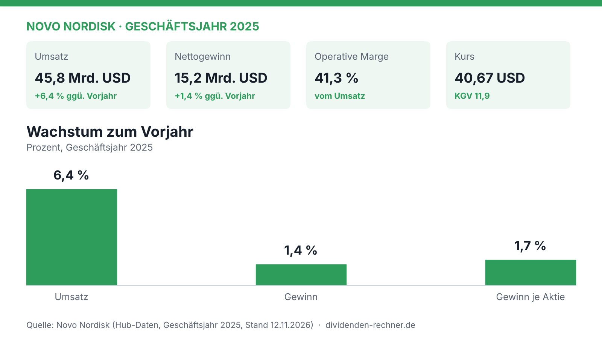

Die Europäische Kommission hat Frehemgo von Novo Nordisk zugelassen. Der Wirkstoff Denecimig soll Erwachsenen und Kindern mit angeborener Hämophilie A vorbeugend helfen, Blutungen zu verhindern oder seltener zu machen. Die Zulassung gilt mit und ohne Hemmkörper. Grundlage ist eine positive Empfehlung des EU-Arzneimittelausschusses CHMP vom September 2026.

Frehemgo ist ein Antikörper, der unter die Haut gespritzt wird und die Funktion des fehlenden Gerinnungsfaktors VIII nachahmt. Patienten und Ärzte können zwischen einer monatlichen, einer zweiwöchentlichen und einer wöchentlichen Gabe wählen. Novo nennt das Präparat die erste Option dieser Art mit drei Dosierungsintervallen in einem einzigen Fertigpen. Den Marktstart in den ersten europäischen Ländern plant das Unternehmen für das kommende Jahr.

Für den Konzern ist das eine Ergänzung in einem Bereich, der nicht im Mittelpunkt der Diskussion steht. Im Geschäftsjahr 2025 stieg der Umsatz um 6,4 Prozent, der Nettogewinn aber nur um 1,4 Prozent. Die Gewinnentwicklung ist damit deutlich schwächer als der Umsatz. Ob Frehemgo daran etwas ändert, lässt sich erst an späteren Verkaufszahlen ablesen. Preise und erwartete Umsätze nennt Novo noch nicht.

