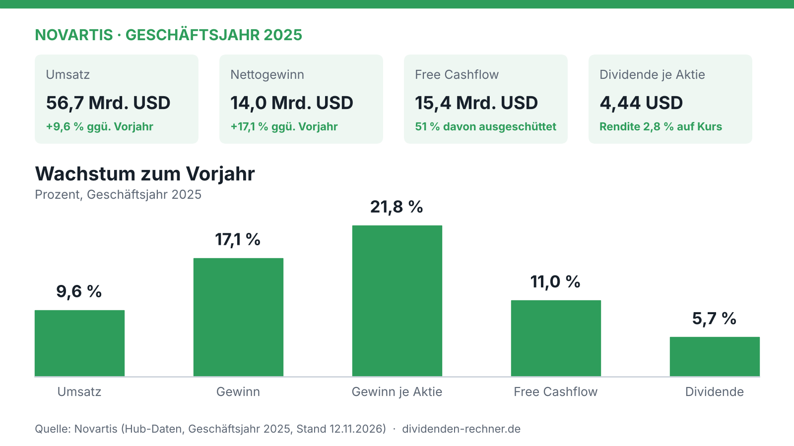

Der Ausschuss für Humanarzneimittel (CHMP) der Europäischen Arzneimittelagentur hat eine positive Empfehlung für Cosentyx von Novartis ausgesprochen. Der Wirkstoff Secukinumab soll Jugendlichen ab zwölf Jahren mit mittelschwerer bis schwerer Hidradenitis suppurativa helfen, einer chronischen, schmerzhaften Hautentzündung. Die Patienten müssen dafür bisher Standardtherapien erhalten haben, die nicht ausreichend gewirkt haben. Die endgültige Entscheidung trifft die EU-Kommission, sie wird in rund zwei Monaten erwartet.

Für die Behandlung junger Patienten wäre Cosentyx der einzige Interleukin-17A-Hemmer in der EU. Novartis argumentiert, dass die Krankheit oft in der Pubertät beginnt und in dieser Phase unbehandelt zu dauerhaften Narben führen kann. Die Zulassung stützt sich vor allem auf Studien mit Erwachsenen und auf Daten aus anderen Anwendungen bei Kindern. Wie groß der Umsatzbeitrag dieser Indikation wird, nennt Novartis nicht.

Der Konzern selbst wächst derzeit solide. Im Geschäftsjahr 2025 stieg der Umsatz um 9,6 Prozent, der Gewinn um 17,1 Prozent. Die Dividende je Aktie liegt bei 4,44 US-Dollar. Die Ausschüttung beansprucht davon rund die Hälfte des Free Cashflows. Die Zulassung in einer kleinen Patientengruppe wirkt damit eher wie ein Baustein in einem breiten Portfolio als wie ein Kurstreiber.

