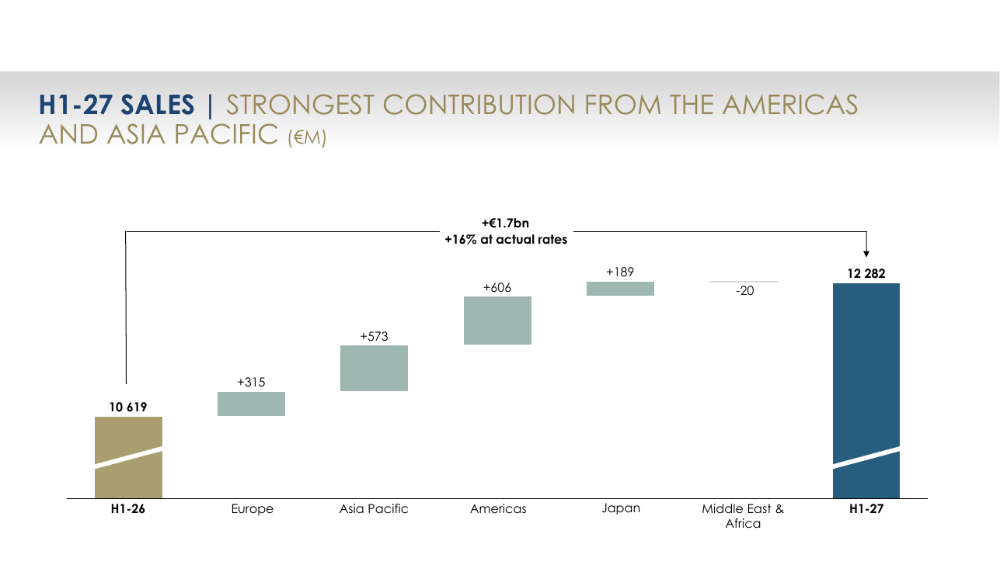
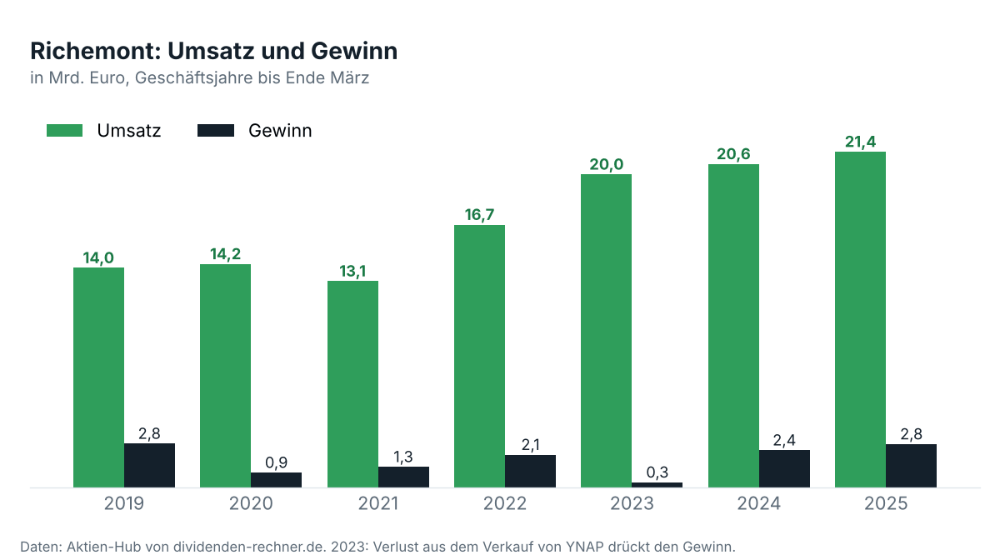
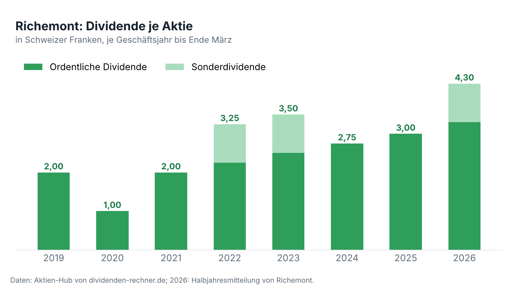

<!-- PRÜFEN: Aufmacherfoto fehlt noch. Die Anfrage (Schmuck, Luxusuhr, Boutique; Unsplash) steht in tools/asset.request. Divi wählt das Foto auf Unsplash aus. -->
<!-- PRÜFEN: Kursangaben (Zürich 167,55 CHF um 11:20 Uhr, –4,9 % gegenüber 176,15 CHF Vortagesschluss; Tradegate zeitweise fast –8 %; AWP-Konsens Betriebsgewinn 2,89 Mrd. Euro; KGV rund 25,5; UBS-Kursziel 210 CHF) stammen aus Marktberichten vom 13.11.2026 und sind nicht aus der Mitteilung. -->
<!-- PRÜFEN: Dividendenrendite ist eigene Rechnung mit dem Zürcher Kurs von 167,55 CHF. -->
<!-- PRÜFEN: Die Grafiken „Umsatz und Gewinn" und „Dividende je Aktie" stammen aus den Hub-Daten (Quelle dort: boerse.de, nicht gegen die Geschäftsberichte geprüft). Die Dividende für 2026 (3,30 CHF plus 1,00 CHF Sonderdividende) ist aus der Halbjahresmitteilung ergänzt. -->
<!-- PRÜFEN: Folie f1 (Umsatzbrücke nach Regionen) ist nur zugeschnitten. Passt der Zuschnitt? Sonst Bildzeilen löschen. -->
<!-- PRÜFEN: Kein Porträt von Johann Rupert oder Nicolas Bos im Archiv, die Story läuft deshalb ohne Person. -->

!!! kurz "Kurz gesagt"
    **Umsatz:** 12,3 Mrd. Euro (+16 %)
    **Gewinn:** 2,5 Mrd. Euro (+39 %)

    1. **Treiber:** Die Schmuckhäuser um Cartier und Van Cleef & Arpels wachsen um 18 % und liefern fast den gesamten Betriebsgewinn. Amerika (+23 %) und Japan tragen am stärksten.
    2. **Der Haken:** Im Betriebsgewinn stecken 229 Mio. Euro aus erstatteten Zöllen. Ohne sie liegt die Marge bei 23,6 %, die Bruttomarge sinkt wegen des teuren Goldes.
    3. **Kapital:** Im September flossen 2,7 Mrd. Euro Dividende an die Aktionäre, 3,30 Franken je Aktie plus 1,00 Franken Sonderdividende. Die Nettoliquidität liegt bei 7,7 Mrd. Euro.

## Ein starkes Halbjahr, das der Börse nicht reicht

Wer in diesem Sommer in New York, Tokio oder Paris ein Armband von Cartier kaufen wollte, musste in vielen Boutiquen warten. Die Zahlen von Richemont zeigen, wie gut dieses Geschäft läuft: Der Umsatz steigt im ersten Halbjahr des Geschäftsjahres 2027 (April bis September) um **16 Prozent auf 12,3 Mrd. Euro**, der Betriebsgewinn um **33 Prozent auf 3,1 Mrd. Euro**. Unter dem Strich bleiben 2,5 Mrd. Euro, 39 Prozent mehr als im Vorjahr.

Die Aktie verliert am Freitag in Zürich trotzdem rund fünf Prozent auf 167,55 Franken. Drei Punkte erklären das. Der Betriebsgewinn enthält einen Einmaleffekt von 229 Mio. Euro aus Zollerstattungen in den USA. Ohne ihn bleiben 2,9 Mrd. Euro, das entspricht ziemlich genau der Schätzung der Analysten von 2,89 Mrd. Euro. Zweitens hat sich das Wachstum verlangsamt: Im ersten Quartal lag es währungsbereinigt bei 20 Prozent, im zweiten bei 13 Prozent. Drittens gibt Richemont keinen Ausblick auf das Gesamtjahr, und die Aktie war mit dem rund 25-Fachen des erwarteten Jahresgewinns hoch bewertet in die Zahlen gegangen.

*Woher das Umsatzplus von 1,7 Mrd. Euro kommt: Amerika und Asien-Pazifik liefern den größten Teil, der Nahe Osten schrumpft. Quelle: Richemont, Präsentation zum ersten Halbjahr. Ausschnitt nur zugeschnitten, sonst unverändert.*

## Schmuck verdient das Geld, die Uhren erholen sich

Richemont ist im Kern ein Schmuckkonzern. Die vier Häuser Cartier, Van Cleef & Arpels, Buccellati und Vhernier setzen **9,1 Mrd. Euro** um und erwirtschaften ein Betriebsergebnis von 3,2 Mrd. Euro. Die Marge liegt bei 35,3 Prozent, ohne den Einmaleffekt bei 33,4 Prozent. Das ist mehr als der gesamte Konzerngewinn, weil die Zentrale und das Modegeschäft Geld kosten.

Die Uhrenhersteller, darunter IWC, Jaeger-LeCoultre, Vacheron Constantin und A. Lange & Söhne, kommen aus einer langen Flaute. Ihr Umsatz steigt um 9 Prozent auf 1,7 Mrd. Euro, das Betriebsergebnis verdreifacht sich von 50 auf 150 Mio. Euro. Die Marge bleibt mit 8,8 Prozent weit unter dem Niveau des Schmucks, und in China ist die Nachfrage nach teuren Uhren weiter schwach. Das Modegeschäft mit Marken wie Chloé, Alaïa und Montblanc wächst um 9 Prozent und schreibt einen kleinen Verlust von 12 Mio. Euro.

| Sparte | Umsatz | Veränderung | Betriebsergebnis | Marge |
|---|---|---|---|---|
| Schmuck | 9,1 Mrd. Euro | +18 % | 3,2 Mrd. Euro | 35,3 % |
| Uhren | 1,7 Mrd. Euro | +9 % | 150 Mio. Euro | 8,8 % |
| Mode und Sonstiges | 1,4 Mrd. Euro | +9 % | –12 Mio. Euro | –0,8 % |

## Amerika und Japan ziehen, China und der Nahe Osten bremsen

Regional verschiebt sich das Gewicht. **Amerika** wächst um 23 Prozent und meldet das elfte Quartal in Folge mit zweistelligem Plus. **Japan** legt währungsbereinigt um 30 Prozent zu, getragen von Einheimischen und Touristen. Europa kommt auf 13 Prozent, vor allem dank Frankreich und Großbritannien.

Die Schwachstellen liegen dort, wo Luxus lange am schnellsten wuchs. In China, Hongkong und Macau steigt der Umsatz zusammen nur um 7 Prozent, auf dem chinesischen Festland bleibt die Nachfrage gedämpft. Im Nahen Osten und Afrika sinkt der Umsatz um 2 Prozent, im zweiten Quartal um 7 Prozent. Der Konflikt in der Region hält seit März die Touristen fern, besonders in den Vereinigten Arabischen Emiraten.

## Der Goldpreis frisst an der Marge

Die Bruttomarge steigt auf dem Papier um 1,2 Punkte auf 66,5 Prozent. Rechnet man die Zollerstattung heraus, sinkt sie um 0,7 Punkte auf 64,6 Prozent. Gold ist der wichtigste Rohstoff des Konzerns und hat sich stark verteuert. Preiserhöhungen und ein günstigerer Produktmix gleichen das nur zum größten Teil aus, dazu kommen Belastungen aus dem schwachen Yen und dem koreanischen Won.

Dass die operative Marge auch bereinigt um 1,4 Punkte auf 23,6 Prozent steigt, liegt an den Kosten. Sie wachsen mit 10 Prozent langsamer als der Umsatz. Richemont verdient also mehr, weil mehr verkauft wird, und weniger, weil jedes Stück teurer herzustellen ist. Solange der Umsatz zweistellig wächst, geht diese Rechnung auf.

*Der Umsatz ist seit 2021 um mehr als 60 Prozent gestiegen. Das Halbjahr bis September 2026 bringt mit 12,3 Mrd. Euro bereits mehr als die Hälfte des Jahreswerts von 2025. Daten: Aktien-Hub.*

## Dividende: 4,30 Franken und eine volle Kasse

Für Dividendenanleger zählt die Bilanz. Richemont hat im September **3,30 Franken** ordentliche Dividende und **1,00 Franken** Sonderdividende je Aktie gezahlt, zusammen 2,7 Mrd. Euro und damit 0,8 Mrd. Euro mehr als im Vorjahr. Der freie Cashflow des Halbjahres liegt bei 2,0 Mrd. Euro, doppelt so hoch wie vor einem Jahr. Darin stecken 0,4 Mrd. Euro aus dem Verkauf der Beteiligung an Avolta.

Nach der Ausschüttung bleiben 7,7 Mrd. Euro Nettoliquidität. Der Konzern hat also mehr Geld auf dem Konto als Schulden und kann die Dividende auch in einem schwächeren Jahr halten. Die ordentliche Dividende ist seit dem Corona-Jahr 2020 von 1,00 auf 3,30 Franken gestiegen.

*Die ordentliche Dividende steigt seit 2020 jedes Jahr, dreimal kam eine Sonderdividende von 1,00 Franken dazu. Daten: Aktien-Hub; 2026 aus der Halbjahresmitteilung.*

| Kennzahl | Wert | Rechenweg |
|---|---|---|
| Dividendenrendite (ordentlich) | 2,0 % | 3,30 CHF ÷ 167,55 CHF |
| Dividendenrendite (mit Sonderdividende) | 2,6 % | 4,30 CHF ÷ 167,55 CHF |
| KGV (erwarteter Gewinn, laufendes Geschäftsjahr) | rund 25 | Schätzung aus Marktberichten |
| Gewinn je Aktie im Halbjahr | 4,29 Euro | Vorjahr 3,08 Euro, +39 % |
| Nettoliquidität | 7,7 Mrd. Euro | Stand 30. September 2026 |

## Was offen bleibt

Die Zahlen sind gut, und sie sind es auf breiter Basis. Offen ist, wie lange das Tempo hält. Die Vergleichswerte werden höher, China erholt sich nicht, und ein dauerhaft teurer Goldpreis zwingt Cartier zu weiteren Preiserhöhungen, die irgendwann auf die Nachfrage drücken. Verwaltungsratspräsident Johann Rupert bleibt vorsichtig: „Wir erwarten, dass das makroökonomische und geopolitische Umfeld auf absehbare Zeit volatil bleibt."

Auch an der Spitze stellt der Konzern die Weichen. Ruperts Sohn Anton wurde im September zum stellvertretenden Präsidenten des Verwaltungsrats ernannt, neben Bram Schot. Richemont nennt das einen Schritt in der langfristigen Nachfolgeplanung.

*Quelle: Richemont, Ad-hoc-Mitteilung und Präsentation zum ersten Halbjahr des Geschäftsjahres 2027 vom 13. November 2026; Kurse und Analystenschätzungen aus Marktberichten vom selben Tag; Rechenwege eigene Berechnung. Dieser Beitrag ist keine Anlageberatung.*
