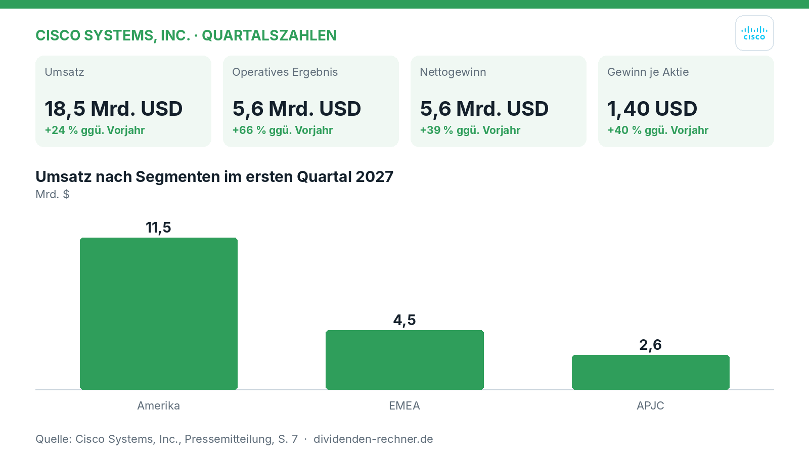
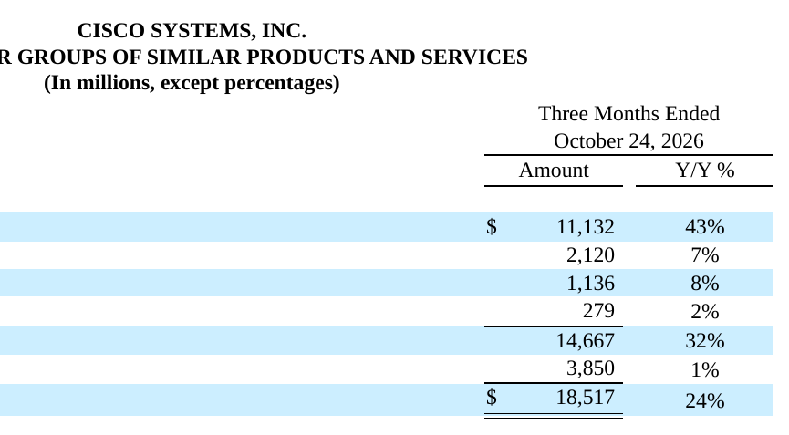

<!-- PRÜFEN: Aufmacherfoto ist automatisch von Unsplash gewaehlt: bitte pruefen, ob es zum Artikel passt (sonst image-Zeilen entfernen, dann entsteht ein Titelbild automatisch). -->
<!-- PRÜFEN: Quelle: https://www.sec.gov/Archives/edgar/data/858877/000085887726000170/exhibit991pressrelease-q1f.htm -->
<!-- PRÜFEN: Ausschnitte aus dem Bericht im Text (f3): bitte prüfen, ob Zuschnitt und Platz passen. Unpassende Bildzeilen einfach löschen. -->

!!! kurz "Kurz gesagt"
    **Umsatz:** 18,5 Mrd. USD (+24 %)
    **Gewinn:** 5,6 Mrd. USD (+39 %)

    1. **Treiber:** Das Networking-Geschäft kurbelt das Wachstum an und legt um 43 % zu, während auch alle Regionen zweistellig wachsen.
    2. **Kapitalverwendung:** Cisco schüttet eine Dividende von 0,42 USD je Aktie aus und kauft Aktien im Wert von 2,0 Mrd. USD zurück.
    3. **Ausblick:** Das Management hebt die Prognose für das Gesamtjahr sowie für die KI-Infrastrukturerlöse aus dem Cloud-Geschäft an.

## Cisco überrascht mit Rekordwachstum im Networking und hebt den Ausblick an

Cisco Systems startet mit einem massiven Wachstumsschub in das Fiskaljahr 2027. Im ersten Quartal, das am 24. Oktober 2026 endete, kletterte der **Umsatz** um **24 %** auf **18,5 Mrd. USD** nach **14,9 Mrd. USD** im Vorjahreszeitraum. Getrieben wird diese Entwicklung von einer breiten Nachfrage nach Netzwerklösungen für den Beginn der künstlichen Intelligenz. Das Management zeigt sich zuversichtlich, dass dieser mehrjährige Superzyklus anhält.

*Eigene Darstellung nach Daten aus: Cisco Systems, Inc., Quartalszahlen vom 2026-11-12 · [Original](https://www.sec.gov/Archives/edgar/data/858877/000085887726000170/exhibit991pressrelease-q1f.htm).*

### Starkes Networking-Geschäft und höhere Margen

*Umsatz nach Produkt- und Servicegruppen. Quelle: Cisco Systems, Inc., Quartalszahlen vom 2026-11-12 · [Original](https://www.sec.gov/Archives/edgar/data/858877/000085887726000170/exhibit991pressrelease-q1f.htm). Ausschnitt nur zugeschnitten, sonst unverändert.*

Das Kerngeschäft wächst auf breiter Front. Wie die Übersicht der Produktgruppen zeigt, stiegen die Erlöse im Bereich Networking um **43 %**. Auch die Regionen tragen das Plus: In Amerika kletterten die Umsätze um **28 %**, in EMEA um **18 %** und in APJC um **21 %**. Auf Non-GAAP-Basis stieg der Nettogewinn um **39 %** auf **5,6 Mrd. USD** (nach **4,0 Mrd. USD** im Vorjahr), während der **Gewinn je Aktie** um **40 %** auf **1,40 USD** zulegte (nach **1,00 USD**). Der GAAP-Nettogewinn lag bei **4,5 Mrd. USD** (nach **2,8 Mrd. USD**).

> „In Q1 haben wir die stärksten Umsatz- und Non-GAAP-Ergebniswachstumsraten seit über 15 Jahren erzielt.“
>
> — Chuck Robbins, CEO und Vorsitzender von Cisco (aus dem Englischen übersetzt)

### Dividende und verlässliche Ausschüttungen

Cisco schüttet für das Quartal eine Dividende von **0,42 USD** je Aktie aus. Die annualisierte Dividende liegt hochgerechnet bei **1,68 USD** je Aktie. Bezogen auf den Aktienkurs von **102,01 USD** ergibt das eine Dividendenrendite von **1,6 %**. Das Ergebnis je Aktie der letzten vier Quartale beläuft sich auf **3,75 USD**, womit die Ausschüttungsquote bei **45 %** liegt. Im Durchschnitt der letzten vier Quartale stützte ein Free Cashflow von **13,7 Mrd. USD** die Zahlungen, wovon **6,5 Mrd. USD** für Dividenden aufgewendet wurden (ein Anteil von **47 %**).

### Schuldensituation und freier Cashflow

Der operative Cashflow erreichte im ersten Quartal **4,4 Mrd. USD**, ein Plus von **36 %** gegenüber den **3,2 Mrd. USD** des Vorjahres. Historisch betrachtet bewegte sich der Free Cashflow in den vergangenen Geschäftsjahren zwischen **10,2 Mrd. USD** und **19,0 Mrd. USD** (zuletzt **12,8 Mrd. USD** im Jahr 2026), bei Investitionen (Capex) von **1,4 Mrd. USD** im Jahr 2026. Die Nettoverschuldung lag zum Ende des Geschäftsjahres 2026 bei **22,3 Mrd. USD** (nach **19,7 Mrd. USD** im Vorjahr), was dem **1,1**-fachen des EBITDA entspricht.

### Bewertung und Markteinordnung

Mit einem Kurs-Gewinn-Verhältnis (**KGV**) von **27,2** ist die Aktie moderat bewertet. In den letzten Jahren hat das Unternehmen die Dividende 14 Jahre in Folge angehoben, bei einem jährlichen Dividendenwachstum von **2,7 %** im Zeitraum von 2020 bis 2025. Das Rückkaufprogramm lief im ersten Quartal mit einem Volumen von **2,0 Mrd. USD** für rund 18 Millionen Aktien weiter.

### Ausblick und offene Punkte

Für das zweite Quartal des Fiskaljahres 2027 prognostiziert Cisco einen Umsatz von **18,0 Mrd. USD bis 18,2 Mrd. USD** sowie einen Non-GAAP-Gewinn je Aktie von **1,34 USD bis 1,36 USD**. Für das gesamte Geschäftsjahr 2027 wurde die Umsatzprognose auf **74,8 Mrd. USD bis 75,8 Mrd. USD** angehoben. Gleichzeitig erwartet das Management nun KI-Infrastrukturerlöse von Hyperscalern in Höhe von **9 Mrd. USD** im Jahr 2027. Skeptische Analysten, darunter Institute wie Morgan Stanley, blicken jedoch weiterhin vorsichtig auf die Margenentwicklung und die Nachhaltigkeit des rasanten KI-Wachstums im Verhältnis zu steigenden Investitionen.

Weitere Quellen zum Hintergrund: [Cisco Systems-Aktie: Morgan Stanley senkt Kursziel auf 120 D](https://www.ad-hoc-news.de/boerse/news/corporate-news/cisco-systems-aktie-morgan-stanley-senkt-kursziel-auf-120-dollar/70487832) · [Cisco Systems-Aktie: Morgan Stanley senkt Ziel vor Zahlen](https://www.ad-hoc-news.de/boerse/news/corporate-news/cisco-systems-aktie-morgan-stanley-senkt-ziel-vor-zahlen/70482863) · [Wochenausblick: CPI- und PPI-Daten für Oktober stehen an, wä](https://www.tradingkey.com/de/analysis/stocks/us-stocks/262294767-week-ahead-october-cpi-ppi-coreweave-cisco-applied-materials-tradingkey)

## Die wichtigsten Zahlen im Überblick

| Kennzahl | Wert | Veränderung zum Vorjahr | Quelle |
|---|---|---|---|
| Umsatz | 18,5 Mrd. USD | +24 % | S. 1 |
| Operatives Ergebnis | 5,6 Mrd. USD | +66 % | S. 4 |
| Nettogewinn | 5,6 Mrd. USD | +39 % | S. 3 |
| Gewinn je Aktie | 1,40 USD | +40 % | S. 3 |
| Operativer Cashflow | 4,4 Mrd. USD | +36 % | S. 4 |
| Dividende je Aktie | 0,42 USD | – | S. 3 |

## Dividendenkennzahlen im Überblick (eigene Berechnung)

| Kennzahl | Wert | Rechenweg |
|---|---|---|
| Dividendenrendite | 1,6 % | 1,68 USD ÷ Kurs 102,01 USD |
| Ausschüttungsquote (Ergebnis je Aktie) | 45 % | 1,68 USD ÷ 3,75 USD (4 Quartale) |
| KGV | 27,2 | Kurs ÷ 3,75 USD |
| Dividenden / Free Cashflow (12 Monate) | 47 % | 6.504 ÷ 13.733 Mio. USD |
| Free Cashflow, Geschäftsjahre (Mrd. USD) | 2022: 12,7; 2023: 19,0; 2024: 10,2; 2025: 13,3; 2026: 12,8 | Kapitalflussrechnung laut FMP |
| Nettoverschuldung / EBITDA, Jahresende | 2022: 0,2; 2024: 1,5; 2025: 1,3; 2026: 1,1 | Bilanz und Gewinn- und Verlustrechnung laut FMP |
| Dividendenerhöhungen in Folge | 14 Jahre | Kalenderjahressummen bis 2025 |
| Dividendenwachstum 2020–2025 | 2,7 % p. a. | Kalenderjahressummen |

*Quelle: Cisco Systems, Inc., Quartalszahlen vom 2026-11-12; Kurs- und Dividendendaten: Financial Modeling Prep. Rechenwege eigene Berechnung. Keine Anlageberatung.*
