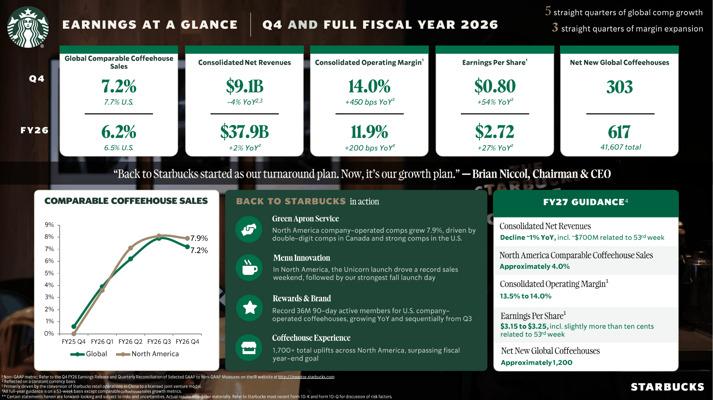

<!-- PRÜFEN: Aufmacherfoto ist das Foto des früheren Geschäftsberichts-Artikels (Kolforn, CC BY-SA 4.0). Eine neue Fotoanfrage (Coffeehouse, Außenansicht oder Theke) ist in tools/asset.request angelegt, der Bot ergänzt sie. -->
<!-- PRÜFEN: Veröffentlicht wurden die Zahlen am 29. Oktober 2026. Der Artikel ist auf den 12.11.2026 datiert, weil Kursbild und Dividendenstichtag (13.11.) von diesem Tag stammen. Datum bitte bestätigen. -->
<!-- PRÜFEN: Kursangaben (97,03 EUR, –2,10 %, Stand 12.11.2026, 22:15 Uhr) stammen aus dem Screenshot von aktien.guide. Der USD-Kurs von 109,89 USD in der Kennzahlentabelle ist aus den Hub-Daten übernommen und nicht belegt. -->
<!-- PRÜFEN: Foto von Brian Niccol (assets/magazin/brian-niccol-starbucks.png, aus medien/ceo): Nutzungsrecht prüfen. -->
<!-- PRÜFEN: Der Text trennt GAAP und bereinigt (non-GAAP). Die Quote von 113 % (GAAP) und 92 % (bereinigt) ist eigene Rechnung: 2,49 USD Dividende je Aktie im Geschäftsjahr 2026 geteilt durch 2,21 USD beziehungsweise 2,72 USD Gewinn je Aktie. -->
<!-- PRÜFEN: Folie f1 ("Earnings at a Glance") ist nur zugeschnitten. Passt der Zuschnitt? Sonst Bildzeilen löschen. -->

!!! kurz "Kurz gesagt"
    **Umsatz:** 9,1 Mrd. USD (–4 %)
    **Gewinn je Aktie (bereinigt):** 0,80 USD (+54 %)

    1. **Treiber:** Die vergleichbaren Umsätze in den Filialen wachsen um 7,2 %, getragen von höheren Bons (+5,2 %) und mehr Kunden (+1,8 %). Der Umsatz sinkt, weil China seit dem dritten Quartal als Joint Venture geführt wird.
    2. **Ausblick:** Für das Geschäftsjahr 2027 plant Starbucks mit 3,15 bis 3,25 USD bereinigtem Gewinn je Aktie, nach 2,72 USD im Jahr 2026. Aktienrückkäufe sollen wieder starten.
    3. **Dividende:** 0,63 USD je Aktie, Stichtag 13. November, Zahlung am 27. November. Es ist die 66. Quartalszahlung in Folge.

## Mehr Gewinn bei weniger Umsatz

Starbucks erlöst im vierten Quartal des Geschäftsjahres 2026 (Juli bis September) **9,1 Mrd. USD**, vier Prozent weniger als im Vorjahr. Der Rückgang geht auf die Umstellung des China-Geschäfts auf ein Joint Venture mit Lizenzmodell zurück. Die vergleichbaren Umsätze der Filialen steigen dagegen um **7,2 Prozent**, in den USA um 7,7 Prozent. Der durchschnittliche Bon wächst um 5,2 Prozent, die Zahl der Transaktionen um 1,8 Prozent.

Der Gewinn springt. Der operative Gewinn nach US-Rechnungslegung (GAAP) steigt von 278 Mio. auf **992 Mio. USD**, die Marge von 2,9 auf 10,8 Prozent. Im Vorjahr hatten Restrukturierungskosten von 755 Mio. USD das Ergebnis belastet, jetzt sind es 273 Mio. USD. Je Aktie verdient Starbucks nach GAAP 0,59 USD nach 0,12 USD. **Bereinigt** (non-GAAP) sind es **0,80 USD**, ein Plus von 54 Prozent, bei einer operativen Marge von 14,0 Prozent (+4,5 Prozentpunkte).

*Zusammenfassung des vierten Quartals und des Geschäftsjahres 2026. Quelle: Starbucks, Earnings at a Glance Q4 FY26. Ausschnitt nur zugeschnitten, sonst unverändert.*

## Nordamerika trägt den Gewinn

In **Nordamerika** steigt der Umsatz um 6 Prozent auf 7,3 Mrd. USD. Der operative Gewinn verdreifacht sich fast von 309 Mio. auf 898 Mio. USD, die Marge liegt bei 12,3 Prozent nach 4,5 Prozent. Starbucks nennt niedrigere Restrukturierungskosten und höhere Umsätze bei gleichzeitig steigender Effizienz als Gründe. Im September schloss der Konzern rund 250 Filialen in Nordamerika, die den erwarteten Standard nicht erreichten. Die Zahl der Filialen sinkt dort auf 18.176.

Das **internationale Geschäft** setzt 1,3 Mrd. USD um, 37 Prozent weniger, weil die China-Läden nicht mehr im Umsatz stehen. Der operative Gewinn steigt trotzdem um 15 Prozent auf 257 Mio. USD, die Marge von 10,8 auf 19,7 Prozent. Die vergleichbaren Umsätze legen nur um 0,9 Prozent zu, die Zahl der Transaktionen sinkt um 2,8 Prozent. Das Segment **Channel Development** (Handelsprodukte, Kooperationen) erlöst 494 Mio. USD (–9 Prozent) bei unverändert 264 Mio. USD operativem Gewinn.

Weltweit betreibt Starbucks jetzt 41.607 Filialen, 303 mehr als im Vorquartal. 68 Prozent davon führen Lizenznehmer.

## Das Geschäftsjahr: Gewinn je Aktie +28 %

Im gesamten Geschäftsjahr 2026 wächst der Umsatz um 2 Prozent auf **37,9 Mrd. USD**. Der Nettogewinn steigt um 36 Prozent auf 2,53 Mrd. USD, das sind **2,21 USD je Aktie** nach 1,63 USD. Darin steckt ein Gewinn von 536 Mio. USD aus dem Verkauf der China-Läden an das Joint Venture. Bereinigt liegt das Ergebnis je Aktie bei **2,72 USD (+28 Prozent)**, die bereinigte operative Marge bei 11,9 Prozent (+2,0 Prozentpunkte).

Die Bilanz hat sich verbessert. Die langfristigen Schulden sinken von 14,6 auf 11,8 Mrd. USD, die liquiden Mittel steigen von 3,2 auf 3,7 Mrd. USD. Die Investitionen in Filialen und Anlagen fallen von 2,3 auf 1,3 Mrd. USD. Das Eigenkapital bleibt mit minus 7,7 Mrd. USD negativ.

## Dividende und Ausblick

Der Verwaltungsrat beschließt für das Quartal **0,63 USD je Aktie**, nach 0,62 USD ein Jahr zuvor. Stichtag ist der 13. November, gezahlt wird am 27. November. Im Geschäftsjahr 2026 erklärt Starbucks 2,49 USD je Aktie (Vorjahr 2,45 USD) und zahlt dafür 2,82 Mrd. USD aus. Die Dividende wächst seit 66 Quartalen, im Schnitt um 16,6 Prozent im Jahr. Die Finanzchefin Cathy Smith kündigt an, im Geschäftsjahr 2027 wieder Aktien zurückzukaufen.

Für das Geschäftsjahr 2027 gibt Starbucks diese Ziele aus:

- **Umsatz:** rund 1 Prozent weniger, darin rund 700 Mio. USD aus einer 53. Woche. Der Rückgang geht auf die China-Umstellung zurück.
- **Vergleichbare Umsätze Nordamerika:** rund 4,0 Prozent Wachstum.
- **Operative Marge (bereinigt):** 13,5 bis 14,0 Prozent.
- **Gewinn je Aktie (bereinigt):** 3,15 bis 3,25 USD, darin gut 0,10 USD aus der 53. Woche.
- **Neue Filialen:** rund 1.200 netto, vor allem international.

CEO Brian Niccol sagt: „Back to Starbucks started as our turnaround plan. Now, it's our growth plan.“

## Einordnung

Die Aktie schloss am Donnerstag bei 97,03 Euro (–2,10 Prozent). Bei einem Kurs von 109,89 USD und dem bereinigten Gewinn von 2,72 USD liegt das KGV bei 40, auf Basis des Gewinns nach GAAP bei 50. Mit dem Zielwert für 2027 sinkt es rechnerisch auf 34. Die Dividendenrendite beträgt 2,3 Prozent. Die Ausschüttung von 2,49 USD je Aktie liegt über dem GAAP-Gewinn von 2,21 USD, und selbst bereinigt ist sie mit 92 Prozent hoch. Der Spielraum für Erhöhungen hängt damit am Gewinnwachstum, das das Management für 2027 mit rund 18 Prozent ansetzt (Mitte der Spanne gegenüber 2,72 USD). Offen bleibt, ob die Zahl der Transaktionen in den USA ihr Plus von 2,4 Prozent hält und ob die Marge nach den Investitionen in mehr Personal weiter steigt.

| Kennzahl | Wert | Rechenweg |
|---|---|---|
| KGV (bereinigt, Geschäftsjahr 2026) | 40,4 | 109,89 USD ÷ 2,72 USD |
| KGV (GAAP, Geschäftsjahr 2026) | 49,7 | 109,89 USD ÷ 2,21 USD |
| KGV auf Basis Ziel 2027 (Mitte) | 34,3 | 109,89 USD ÷ 3,20 USD |
| Dividendenrendite | 2,3 % | 2,52 USD (4 × 0,63 USD) ÷ 109,89 USD |
| Ausschüttungsquote (GAAP) | 113 % | 2,49 USD ÷ 2,21 USD |
| Ausschüttungsquote (bereinigt) | 92 % | 2,49 USD ÷ 2,72 USD |

*Quelle: Starbucks, Pressemitteilung zum vierten Quartal und Geschäftsjahr 2026 vom 29. Oktober 2026; Kurs aus Hub-Daten, Rechenwege eigene Berechnung. Dieser Beitrag ist keine Anlageberatung.*
