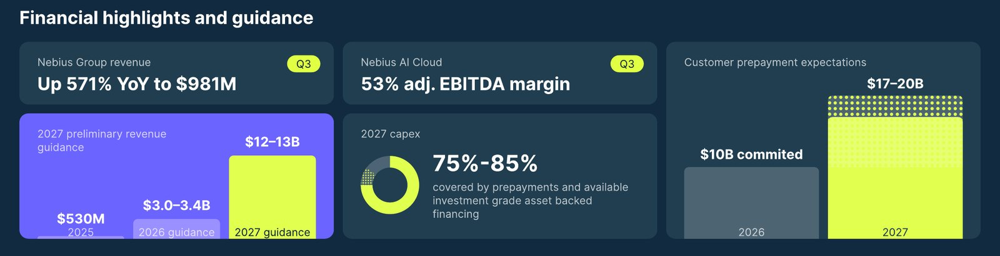
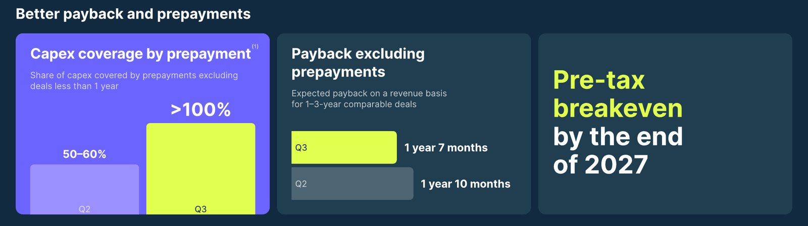

<!-- PRÜFEN: Alle Unternehmenszahlen aus dem Aktionärsbrief Q3 2026 (Letter to shareholders, 12.11.2026) und der Ergebnismitteilung "Nebius reports third quarter 2026 financial results" vom 12.11.2026 mit Bilanz, GuV und Kapitalflussrechnung; beides von Divi geliefert. -->
<!-- PRÜFEN: Konsens Umsatz rund 907,5 Mio. Dollar und Erwartung eines Verlusts: scanx.trade und marketscreener.com (Vorschau vom 11./12.11.2026), nicht aus den Unternehmensunterlagen. Kursrückgang seit dem Hoch (rund 47 %) aus Benzinga-Vorschau, Monatsminus rund 39 % aus marketscreener. Kurse (Schluss 10.11. 134,00 $, Schluss 11.11. 154,69 $ = +15,44 %, vorbörslich 12.11. 7:25 Uhr New York 142,22 $ = −8,06 %) aus Divis Yahoo-Screenshot; Kursbild daraus nachgebaut, nur drei echte Datenpunkte, keine erfundene Kurve. -->
<!-- PRÜFEN: Selbst gerechnet: Umsatz ohne Partner-Einmalerlös 980,8 − 325 = rund 656 Mio.; Q2-Umsatz aus +68 % zum Vorquartal rückgerechnet (rund 584 Mio.), ohne Einmalerlös also rund +12 % zum Vorquartal; Abstand zum Konsens +8 % mit, −28 % ohne Einmalerlös; rechnerischer Q4-Umsatz 3,0 Mrd. − 1,96 Mrd. = rund 1,04 Mrd.; Finanzschulden 187,5 + 14.003,3 = 14,2 Mrd. (Jahresende 2025: 4,1 Mrd.); Rechnungsabgrenzung 1.445,5 + 7.963,7 = 9,4 Mrd.; verwässerte Aktienzahl 298,0 Mio. gegenüber 241,1 Mio. = +24 %. -->
<!-- PRÜFEN: Kein CEO-Foto von Divi (Arkady Volozh), das kleine Porträt im Aktionärsbrief ist zu klein für einen sauberen Freisteller; Story daher mit Folie und Kursbild. Aufmacher und Logo kommen über tools/asset.request (NBIS, nebius.com). Diese Aufmacher-Markierung ersetzt die bei Hapag-Lloyd. -->

!!! kurz "Kurz gesagt (drittes Quartal 2026)"
    **Umsatz:** 981 Mio. $ (+571 %)
    **Nettoergebnis:** −37,5 Mio. $ (Vorjahr −119,6 Mio. $)

    1. **Über der Schätzung, mit Hilfe:** Der Umsatz liegt rund 8 % über dem Konsens, enthält aber rund 325 Mio. Dollar Einmalerlös aus dem neuen Partnermodell. Das operative Ergebnis wird erstmals positiv.
    2. **Bessere Verträge:** Vorauszahlungen der Kunden decken bei neuen Abschlüssen mehr als die gesamten Baukosten, die Preise je GPU-Stunde steigen um über 20 %.
    3. **Prognose:** 2026 nur noch am unteren Ende von 3,0 bis 3,4 Mrd. Dollar, weil Partner-Rechenzentren später fertig werden. 2027: 12 bis 13 Mrd. Dollar Umsatz und Gewinnschwelle vor Steuern zum Jahresende.

## Ein starkes Quartal mit einer Fußnote

Bei Nebius gehört der Superlativ inzwischen zum Quartalsbericht. 981 Millionen Dollar Umsatz, fast siebenmal so viel wie vor einem Jahr, ein bereinigtes Ebitda von 466 Millionen Dollar und zum ersten Mal ein operativer Gewinn. Gründer Arkady Volozh schreibt im Aktionärsbrief, die Nachfrage sei außergewöhnlich stark. Die Analysten hatten im Durchschnitt rund 907 Millionen Dollar Umsatz erwartet.

Der Überschuss über die Schätzung hat allerdings eine Fußnote, die über die Bewertung des Quartals entscheidet. Rund 325 Millionen Dollar stammen aus einem sogenannten Asset-Light-Modell: Partner bauen und bezahlen Rechenzentren selbst und betreiben darauf die Technik und Cloud-Software von Nebius. Für die Freischaltung der ersten Phase verbucht Nebius einen einmaligen Erlös. Ohne diesen Betrag bleiben rund 656 Millionen Dollar, gut ein Viertel unter dem Konsens und nur rund 12 % mehr als im zweiten Quartal. Nebius rechnet damit, dass solche Erlöse mit wachsendem Partnernetz regelmäßiger werden.

Die Börse sieht das vorsichtig. Vorbörslich gab die Aktie um rund 8 % nach, nachdem sie am Vortag im Sog der Zahlen von CoreWeave um gut 15 % gestiegen war. Seit dem Hoch hat sie fast die Hälfte ihres Werts verloren.

## Die Zahlen im Überblick

| Kennzahl | Q3 2026 | Q3 2025 | Veränderung |
|---|---:|---:|---:|
| Umsatz | 980,8 Mio. $ | 146,1 Mio. $ | +571 % |
| davon KI-Cloud | 973,8 Mio. $ | – | +643 % |
| Bereinigtes Ebitda | 465,8 Mio. $ | −5,2 Mio. $ | – |
| Marge bereinigtes Ebitda | 47 % | – | – |
| Operatives Ergebnis | 50,4 Mio. $ | −130,2 Mio. $ | – |
| Nettoergebnis | −37,5 Mio. $ | −119,6 Mio. $ | – |
| Investitionen (Capex) | 7,3 Mrd. $ | 0,96 Mrd. $ | +664 % |
| Operativer Cashflow | −273,0 Mio. $ | −80,6 Mio. $ | – |

Die Kostenquoten sinken deutlich, weil der Umsatz schneller wächst als Personal und Verwaltung. Die Kosten der Umsätze fallen von 29 auf 22 % des Umsatzes, Verwaltung und Vertrieb von 61 auf 24 %. Einen Teil der Verbesserung liefert die Buchhaltung: Seit Jahresbeginn schreibt Nebius Server und Netzwerktechnik über fünf statt vier Jahre ab, das senkt die jährliche Abschreibung. Unter dem Strich bleibt ein Verlust, weil die Zinsen auf 112,5 Millionen Dollar steigen und die vorzeitige Wandlung von Anleihen 49,5 Millionen Dollar kostet.

## Bessere Verträge: Kunden zahlen den Bau vorab

Der stärkste Teil des Berichts betrifft die Konditionen. Bei den im dritten Quartal unterzeichneten Verträgen decken die Vorauszahlungen der Kunden mehr als 100 % der zugehörigen Investitionen, einschließlich Bau und Netzwerk. Im zweiten Quartal waren es 50 bis 60 %. Über 90 % des neuen Vertragswerts sind mit einer Vorauszahlung verbunden. Die Preise je GPU-Stunde steigen im Schnitt um mehr als 20 %, der jährliche Vertragswert je Megawatt auf über 25 Millionen Dollar. Die Amortisationszeit für vergleichbare Verträge sinkt von einem Jahr und zehn Monaten auf ein Jahr und sieben Monate.

Seit Beginn des dritten Quartals haben Kunden Verträge über 12 Milliarden Dollar unterschrieben. Neu sind große Softwarekonzerne: Databricks, Datadog und Snowflake schlossen erstmals mehrjährige Verträge, Palantir führt Nebius als bevorzugten Cloud-Partner. Die Plattform für Rechenaufgaben laufender KI-Modelle, Token Factory, nähert sich einem Jahresumsatz von mehreren hundert Millionen Dollar. Für Dividendenanleger ist das relevant, weil Nebius damit weniger von wenigen großen KI-Labors abhängt als ein reiner Vermieter von Rechenleistung.

Ein Punkt in der Bilanz verdient Aufmerksamkeit. Die Forderungen steigen seit Jahresende von 0,7 auf 4,0 Milliarden Dollar, im gleichen Zeitraum wachsen die passiven Abgrenzungen für vorausbezahlte Leistungen auf 9,4 Milliarden Dollar. Ein Teil der vereinbarten Vorauszahlungen ist demnach in Rechnung gestellt, aber noch nicht auf dem Konto. Der operative Cashflow des Quartals liegt deshalb bei minus 273 Millionen Dollar. Auch die vertraglich gesicherten künftigen Umsätze (RPO) wachsen im Quartal nur um 3 % auf 38,7 Milliarden Dollar.

## Die Achillesferse: Rechenzentren von Partnern

Wo Nebius selbst baut, liegt der Konzern nach eigenen Angaben im Plan oder davor. Probleme entstehen bei angemieteten Standorten. In New Jersey, wo Nebius Kapazität für Microsoft bereitstellt, hat der Betreiber DataOne die provisorische Stromversorgung früher als geplant abgebaut, bevor die dauerhafte Versorgung mit Brennstoffzellen von Bloom Energy steht. Bis Jahresende soll gut die Hälfte der für Microsoft vereinbarten Kapazität laufen, der Rest im zweiten Quartal 2027. Auch weitere Partnerstandorte rutschen ins erste Halbjahr 2027. Die Verträge bleiben laut Nebius bestehen.

Die Folgen stehen in der Prognose. Für 2026 erwartet Nebius nur noch das untere Ende der Spanne von 3,0 bis 3,4 Milliarden Dollar, rechnerisch rund 1,04 Milliarden Dollar im vierten Quartal. Den hochgerechneten Jahresumsatz (ARR) von über 7 Milliarden Dollar erreicht der Konzern etwa zwei Monate später, im Februar. Die Kennzahl ARR will Nebius ab 2027 nicht mehr ausweisen, sie bilde das Geschäft nicht mehr richtig ab. Kritiker werden darin einen bequemen Zeitpunkt sehen, Nebius verweist auf die stärkere Gewichtung von Umsatz und Vorsteuerergebnis.

## Die Rechnung für 2027: Die Investitionen übersteigen den Umsatz um ein Vielfaches

Für 2027 nennt Nebius erstmals Ziele: 12 bis 13 Milliarden Dollar Umsatz, etwa das Vierfache von 2026, und die Gewinnschwelle vor Steuern im vierten Quartal, nach Zinsen. Die Investitionen sollen auf 40 bis 45 Milliarden Dollar steigen, nach rund 27 Milliarden in diesem Jahr. Dieser Wert liegt bereits über der bisherigen Spanne von 20 bis 25 Milliarden, weil Nebius eigene Standorte für 2027 vorzieht, etwa in Missouri, Alabama und in Finnland.

Bezahlt werden soll das zu 75 bis 85 % aus Vorauszahlungen und Krediten, die mit den Verträgen großer Kunden mit guter Bonität besichert sind. Ein erstes solches Darlehen über 775 Millionen Dollar zu SOFR plus 2,5 Prozentpunkten wurde im Juli abgeschlossen. Für 2027 erwartet Nebius 17 bis 20 Milliarden Dollar Vorauszahlungen, nach 10 Milliarden in diesem Jahr.

Der Rest kommt vom Kapitalmarkt, und hier zahlen Aktionäre mit. 2026 hat Nebius Wandelanleihen über 5,75 Milliarden Dollar ausgegeben, rund 1 Milliarde Dollar über den laufenden Verkauf neuer Aktien eingesammelt und im Oktober einen Kredit über 3,5 Milliarden Dollar bei der Citi aufgenommen. Die Finanzschulden stiegen seit Jahresende von 4,1 auf 14,2 Milliarden Dollar, die verwässerte Aktienzahl im Quartal um 24 % zum Vorjahr. Dem stehen 7,4 Milliarden Dollar Barmittel und Beteiligungen gegenüber, darunter ein Minderheitsanteil am Datenbankanbieter ClickHouse, der zuletzt mit rund 15 Milliarden Dollar bewertet wurde. Die Neubewertung dieses Anteils erklärt auch den Gewinn von 393 Millionen Dollar nach neun Monaten.

## Was für und gegen die Aktie spricht

**Dafür:** Die Nachfrage ist belegt, und die Kunden akzeptieren härtere Bedingungen: höhere Preise, längere Laufzeiten, Vorauszahlungen über den Baukosten. Die Kundenbasis wird breiter, die Kostenquoten sinken, das Cloudgeschäft erreicht eine bereinigte Ebitda-Marge von 53 %. Eigene Standorte geben mehr Kontrolle über Termine und Kosten, und über 4 Gigawatt Stromleistung sind bereits vertraglich gesichert.

**Dagegen:** Der Umsatz-Überschuss hängt an einem Einmalerlös, das Jahresziel sinkt an den unteren Rand, und die Verzögerungen bei Partnern zeigen, wie abhängig das Wachstum von Strom und Baustellen ist. Die Investitionen wachsen schneller als der Umsatz, der Cashflow bleibt negativ, und jede Finanzierungsrunde verwässert oder verschuldet. Die Gewinnschwelle liegt mehr als ein Jahr entfernt und setzt die längere Abschreibung von fünf Jahren voraus. Wie im Fall von CoreWeave reagiert die Aktie heftig auf jede Nachricht zur Finanzierung des KI-Ausbaus, mehr dazu in unserer Analyse zum [KI-Finanzierungsnetz](/news/ki-finanzierungsnetz-nvidia-meta-coreweave/).

## Was als Nächstes ansteht

Entscheidend sind die kommenden Wochen in New Jersey: Nebius erwartet dort zusätzliche Kapazität aus den Brennstoffzellen. Danach zählt, ob die neuen Standorte 2027 pünktlich ans Netz gehen und ob die Vorauszahlungen tatsächlich in Höhe von 17 bis 20 Milliarden Dollar eingehen. Einkommensanleger finden bei Nebius keine Dividende, die Aktie bleibt eine Wette auf Wachstum mit hohem Kapitalbedarf.

## Quellen

- Nebius Group: Letter to shareholders Q3 2026 (12.11.2026)
- Nebius Group: Nebius reports third quarter 2026 financial results (12.11.2026)
- [Nebius Investor Hub](https://nebius.com/investor-hub)
- [Marketscreener: Nebius, the race for gigawatts in Q3](https://www.marketscreener.com/news/nebius-the-race-for-gigawatts-in-q3-ce785ed8db8fff23)
- [scanx.trade: Nebius Group Q3 Preview](https://scanx.trade/stock-market-news/companies/nebius-group-q3-preview-revenue-seen-907-53m-eps-loss-widens/55965498)
- [Benzinga: Nebius Q3 Preview](https://www.benzinga.com/trading-ideas/previews/26/11/63156890/nebius-q3-preview-stock-down-47-from-highs-market-expert-says-investors-could-get-relief-rally)
