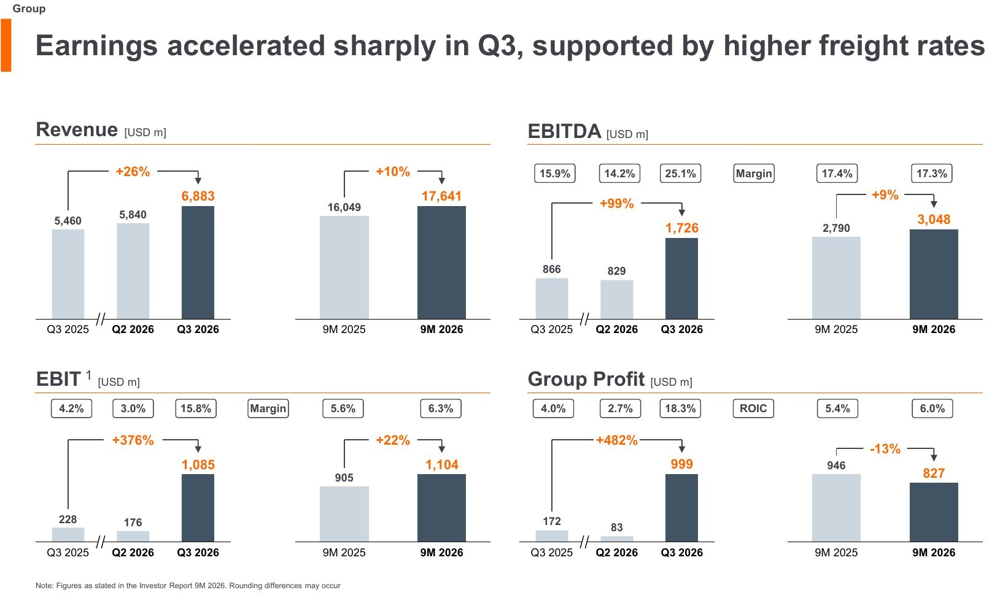
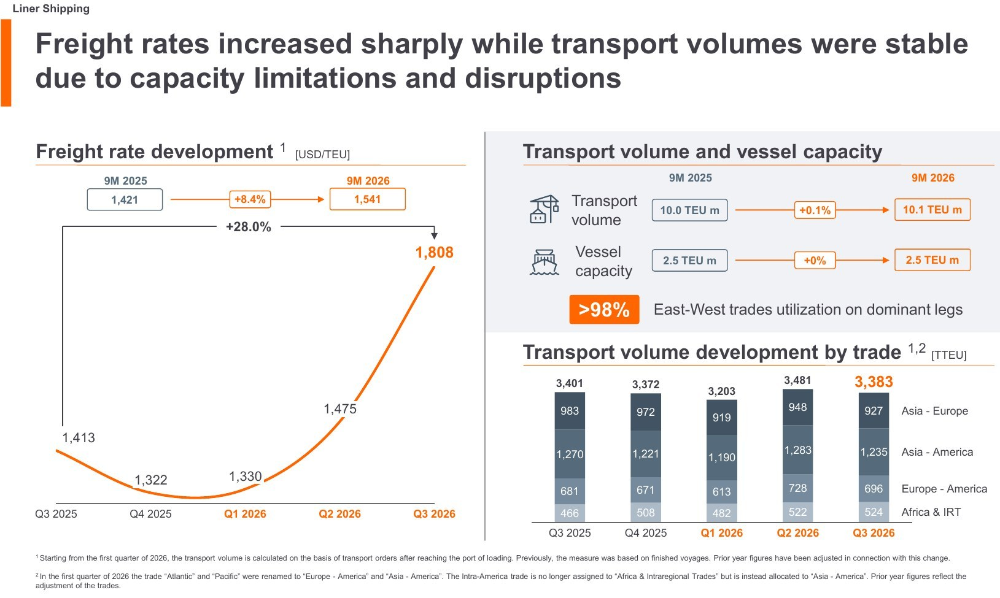
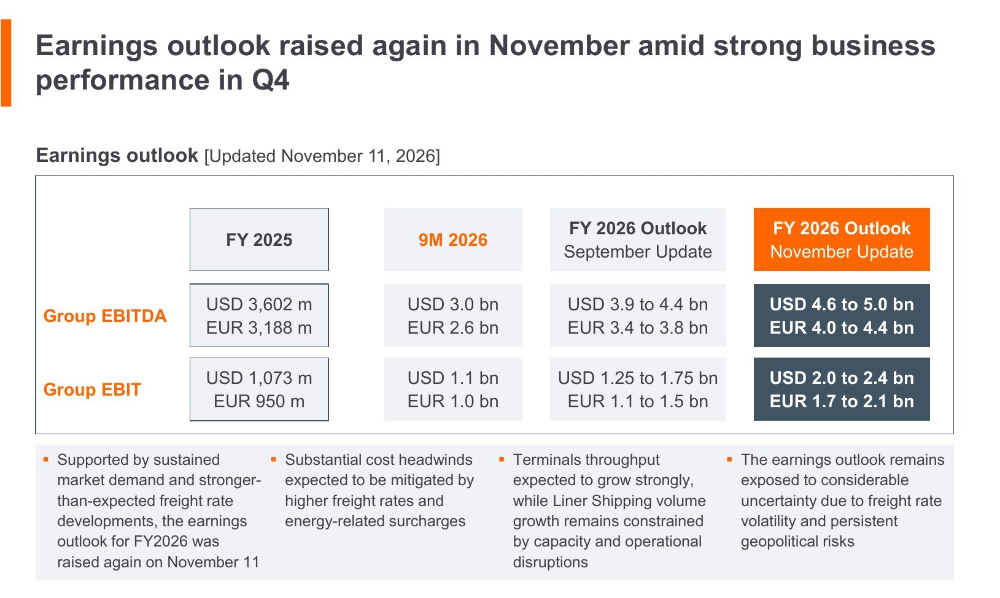

<!-- PRÜFEN: Alle Zahlen: Hapag-Lloyd Pressemitteilung vom 12.11.2026 und Investor Presentation 9M 2026 (von Divi geliefert). Die Berichtswährung ist der US-Dollar, Euro-Werte stehen in der Pressemitteilung (Q3: Umsatz 5.968 Mio., EBITDA 1.491 Mio., EBIT 935 Mio., Konzernergebnis 860 Mio. Euro). Es lag weder eine Konsens-Tabelle noch ein Aktienkurs vor, daher kein Vergleich mit Schätzungen und keine Kursangabe. Die Aussagen von CEO Rolf Habben Jansen sind sinngemäß wiedergegeben. -->
<!-- PRÜFEN: Selbst gerechnet: Veränderungen in Prozent (Konzernergebnis plus 482 % und Faktor 5,8 stehen so in der Folie bzw. folgen aus 999 zu 172), die Ergebnisse für das erste Halbjahr (9M minus Q3 minus Q2: EBIT 1.104 minus 1.085 minus 176 gleich minus 157 Mio. Dollar im ersten Quartal; Konzernergebnis 827 minus 999 minus 83 gleich minus 255 Mio. Dollar), die Marge je Container (Frachtrate minus Stückkosten: 1.808 minus 1.522 gleich 286 Dollar, Vorjahr 1.413 minus 1.373 gleich 40 Dollar), die Stückkostensteigerung (plus 10,9 %) und das für das vierte Quartal implizierte Ergebnis (EBITDA 4,6 bis 5,0 Mrd. Dollar minus 3,048 Mrd. gleich 1,55 bis 1,95 Mrd.; EBIT 2,0 bis 2,4 Mrd. minus 1,104 Mrd. gleich 0,9 bis 1,3 Mrd. Dollar). -->
<!-- PRÜFEN: Die Prognose vom September (EBITDA 3,9 bis 4,4 Mrd. Dollar, EBIT 1,25 bis 1,75 Mrd. Dollar) steht in der Folie "Earnings outlook". Die Anhebung beschloss der Vorstand laut Pressemitteilung am 11.11.2026. Ob sie am 11.11. bereits per Ad-hoc-Mitteilung öffentlich war, liegt nicht vor; Datum bitte gegen die Ad-hoc-Meldung prüfen. -->
<!-- PRÜFEN: Marktdaten (Welthandelsvolumen plus 5,0 % in 9M, Hafenwartezeit, Auftragsbuch 15,1 Mio. TEU gleich 44 % der Flotte, Auslieferungen, Nachfrageprognosen) stammen aus den Folien 3, 4, 15 und 16 mit Quellen Clarksons, Alphaliner, Drewry u. a. und sind nicht von uns geprüft. Zim-Zeitplan (Abschluss Q1 2027, Kartellfreigaben laufen, Golden-Share-Antrag in Israel steht aus) laut Folie 7. -->
<!-- PRÜFEN: Kein CEO-Foto und kein Kursbild geliefert, daher hat die Story nur die Folie. Aufmacher: Foto von hoch3fotografie auf Unsplash (Unsplash-Lizenz), von Divi ausgewählt; die genaue Foto-Adresse bei Unsplash fehlt, im Quellfeld steht die Suchseite. Logo (hlag-de.png) aus der Investor Presentation ausgeschnitten. -->

!!! kurz "Kurz gesagt (drittes Quartal 2026)"
    **Umsatz:** 6,88 Mrd. $ (+26 %)
    **Konzernergebnis:** 1,0 Mrd. $ (+482 %)

    1. **Preis statt Menge:** Die Transportmenge bleibt mit 3,4 Mio. Containern gleich, die Frachtrate steigt um 28 % auf 1.808 Dollar je Container.
    2. **Prognose erneut angehoben:** Das EBIT soll 2026 bei 2,0 bis 2,4 Mrd. Dollar liegen, im September waren es 1,25 bis 1,75 Mrd. Dollar.
    3. **Offene Punkte:** Rotes Meer, Stückkosten, ein Auftragsbuch von 44 % der Weltflotte und die geplante Übernahme von Zim.

## Ein Quartal, das ein schwaches Jahr dreht

Hapag-Lloyd hat das erste Halbjahr 2026 mit Verlust begonnen und kommt im dritten Quartal mit voller Wucht zurück. Das Konzernergebnis beträgt 999 Millionen US-Dollar, nach 172 Millionen im Vorjahresquartal und 83 Millionen im zweiten Quartal 2026. Das EBIT steigt auf 1.085 Millionen Dollar (Vorjahr 228 Millionen), das EBITDA verdoppelt sich auf 1.726 Millionen Dollar. Der Umsatz wächst um 26 % auf 6.883 Millionen Dollar. In Euro sind das 860 Millionen Euro Konzernergebnis.

Über neun Monate bleibt das Bild gemischt: Das Konzernergebnis liegt mit 827 Millionen Dollar noch 13 % unter dem Vorjahr (946 Millionen), das EBIT mit 1.104 Millionen Dollar 22 % darüber. Rechnerisch stand im ersten Quartal ein EBIT von minus 157 Millionen Dollar. Ein einziges Quartal trägt also das Jahr.

Die Reederei erklärt den Sprung mit höheren Spotraten, hoher Auslastung und dem Wachstum im Terminalgeschäft. CEO Rolf Habben Jansen verweist darauf, dass die Stückkosten wegen geopolitischer Spannungen und operativer Störungen weiter unter Druck stehen.

## Die Zahlen im Überblick

| Kennzahl (Mio. US-$) | Q3 2026 | Q3 2025 | Veränderung | 9M 2026 | 9M 2025 | Veränderung |
|---|---:|---:|---:|---:|---:|---:|
| Umsatz | 6.883 | 5.460 | +26 % | 17.641 | 16.049 | +10 % |
| EBITDA | 1.726 | 866 | +99 % | 3.048 | 2.790 | +9 % |
| EBIT | 1.085 | 228 | +376 % | 1.104 | 905 | +22 % |
| Konzernergebnis | 999 | 172 | +482 % | 827 | 946 | −13 % |
| EBITDA-Marge | 25,1 % | 15,9 % | +9,2 Punkte | 17,3 % | 17,4 % | −0,1 Punkte |
| EBIT-Marge | 15,8 % | 4,2 % | +11,6 Punkte | 6,3 % | 5,6 % | +0,7 Punkte |

## Linienschifffahrt: Der Preis macht den Unterschied

Das Hauptgeschäft Linienschifffahrt erzielt 6.718 Millionen Dollar Umsatz (Vorjahr 5.357 Millionen) und ein EBIT von 1.052 Millionen Dollar (219 Millionen). Die Transportmenge liegt mit 3.383 Tausend Containern (TEU) auf dem Niveau des Vorjahres (3.401), die Schiffe sind auf den Hauptrouten zu mehr als 98 % ausgelastet. Die Flotte ist mit 2,5 Millionen TEU Kapazität unverändert groß. Mehr Menge lässt sich im Moment nicht transportieren.

Die durchschnittliche Frachtrate steigt um 28 % von 1.413 auf 1.808 Dollar je Container. Treiber sind höhere Spotraten und Treibstoffzuschläge. Die Stückkosten steigen von 1.373 auf 1.522 Dollar (plus 10,9 %), im neun-Monats-Vergleich auf 1.463 Dollar nach 1.338 Dollar. Hapag-Lloyd nennt den Nahost-Konflikt und die Hafenüberlastung als Ursache. Die Rechnung für die Aktionäre ist trotzdem eindeutig: Die Rate wächst um 395 Dollar, die Kosten um 149 Dollar. Rechnerisch bleiben je Container 286 Dollar Spanne, nach 40 Dollar im Vorjahr.

Die Frachtrate hat sich seit Jahresbeginn deutlich erholt: von 1.330 Dollar im ersten Quartal über 1.475 im zweiten auf 1.808 im dritten. Die Pünktlichkeit der Gemini-Kooperation mit Maersk fällt im Quartal auf 80 %, der Branchenschnitt liegt laut Folie bei 58 %. Hapag-Lloyd führt Taifune und zeitweise geschlossene Häfen in Asien an, vor allem auf den Rückfahrten nach Asien. Die durchschnittliche Wartezeit großer Schiffe vor den Häfen steigt auf rund 12 Stunden, nach 10 Stunden im Durchschnitt seit Corona.

## Terminals: Klein, aber wachsend

Das Segment Terminal & Infrastruktur steigert den Umsatz auf 197 Millionen Dollar (Vorjahr 131 Millionen) und das EBIT auf 34 Millionen Dollar (9 Millionen). Der Umschlag wächst um 10 % auf 3,9 Millionen TEU, der Umsatz stärker, weil das Containergeschäft von J M Baxi in Indien erstmals voll konsolidiert wird. Für den Konzern bleibt das Segment mit rund 3 % des Quartals-EBIT eine Randgröße. Strategisch ist es das Gegengewicht zum schwankenden Frachtgeschäft: Im Oktober hat Hapag-Lloyd einen Anteil von 25 % am Terminal Maasvlakte II in Rotterdam abgeschlossen, das Terminalportfolio umfasst 27 Terminals, bis 2030 sollen es rund 30 werden.

## Cash und Bilanz

Der freie Cashflow liegt nach neun Monaten bei 2,5 Milliarden Dollar, nach 1,4 Milliarden Dollar im Vorjahreszeitraum. Davon flossen 632 Millionen Dollar als Dividende ab. Die Nettoverschuldung steigt gegenüber dem Jahresende von 1.209 auf 1.742 Millionen Dollar, das Verhältnis zum EBITDA liegt bei 0,4 (0,3). Die Liquiditätsreserve beträgt 7.155 Millionen Dollar, das Eigenkapital 21.609 Millionen Dollar bei einer Quote von 60 % (Jahresende 62 %). Schulden und Liquidität sind komfortabel, auch für die geplante Übernahme.

## Prognose: Zweites Mal in sechs Wochen angehoben

Der Vorstand hat am 11. November beschlossen, die Ergebnisprognose für 2026 erneut zu erhöhen. Das EBITDA soll nun 4,6 bis 5,0 Milliarden Dollar betragen (vorher 3,9 bis 4,4 Milliarden Dollar, 2025: 3,6 Milliarden), das EBIT 2,0 bis 2,4 Milliarden Dollar (vorher 1,25 bis 1,75 Milliarden Dollar, 2025: 1,07 Milliarden). Nach neun Monaten stehen 3,05 Milliarden Dollar EBITDA und 1,10 Milliarden Dollar EBIT in den Büchern. Für das vierte Quartal ergeben sich damit rechnerisch 1,55 bis 1,95 Milliarden Dollar EBITDA und 0,9 bis 1,3 Milliarden Dollar EBIT. Zum Vergleich: Im dritten Quartal waren es 1,73 und 1,09 Milliarden Dollar. Die Prognose setzt also voraus, dass das Niveau des dritten Quartals mindestens zum Teil hält. Hapag-Lloyd weist selbst auf erhebliche Unsicherheit durch schwankende Frachtraten und geopolitische Konflikte hin.

## Was für und gegen die Aktie spricht

**Dafür:** Die Ergebnisse haben sich innerhalb eines Quartals vervielfacht, die Prognose steigt zum zweiten Mal, die Bilanz ist solide (Nettoverschuldung 0,4-faches EBITDA, 7,2 Milliarden Dollar Liquidität). Die Nachfrage ist robust: Das Welthandelsvolumen an Containern wächst nach neun Monaten um 5,0 %, die Flotte ist ausgelastet, und die Terminals liefern ein zweites, stabileres Standbein.

**Dagegen:** Die hohen Raten sind eine Folge enger Kapazität. Mit der Rückkehr der Schiffe ins Rote Meer sinkt die Auslastung: Die Umleitung um das Kap der Guten Hoffnung ging laut Folie von rund 11 auf rund 6,7 Millionen TEU zurück, die Route durch den Suezkanal liegt bei knapp 4 Millionen. Das Auftragsbuch der Werften hat mit 15,1 Millionen TEU den Rekordwert von 44 % der Weltflotte erreicht, für 2027 und 2028 sind Auslieferungen von 3,2 und 5,2 Millionen TEU geplant, nach 1,5 Millionen TEU in diesem Jahr. Dem stehen Nachfrageprognosen von 2,5 bis 4,2 % Wachstum für 2026 gegenüber. Die Stückkosten steigen weiter, und ein Quartal trägt das Ergebnis des gesamten Jahres. Zudem bindet die Zim-Übernahme Kapital.

## Zim und die nächsten Schritte

Hapag-Lloyd will 100 % von Zim für 35 Dollar je Aktie übernehmen. Die Zim-Aktionäre haben im April zugestimmt, die Kartellfreigaben laufen und erste Zustimmungen liegen vor. Für die geplante Abspaltung der israelischen Teilstruktur („Golden Share“) steht ein neuer Antrag bei der israelischen Aufsichtsbehörde noch aus. Der Abschluss ist für das erste Quartal 2027 vorgesehen, jährliche Synergien von 300 bis 500 Millionen Dollar sind das Ziel. Entscheidend für die Aktie sind in den nächsten Monaten die Frachtratenentwicklung im Winter, die Rückkehr ins Rote Meer und das vierte Quartal.

## Quellen

- Hapag-Lloyd: Pressemitteilung „Hapag-Lloyd mit starkem dritten Quartal“, Hamburg, 12. November 2026
- Hapag-Lloyd: Investor Presentation 9M 2026, November 2026
