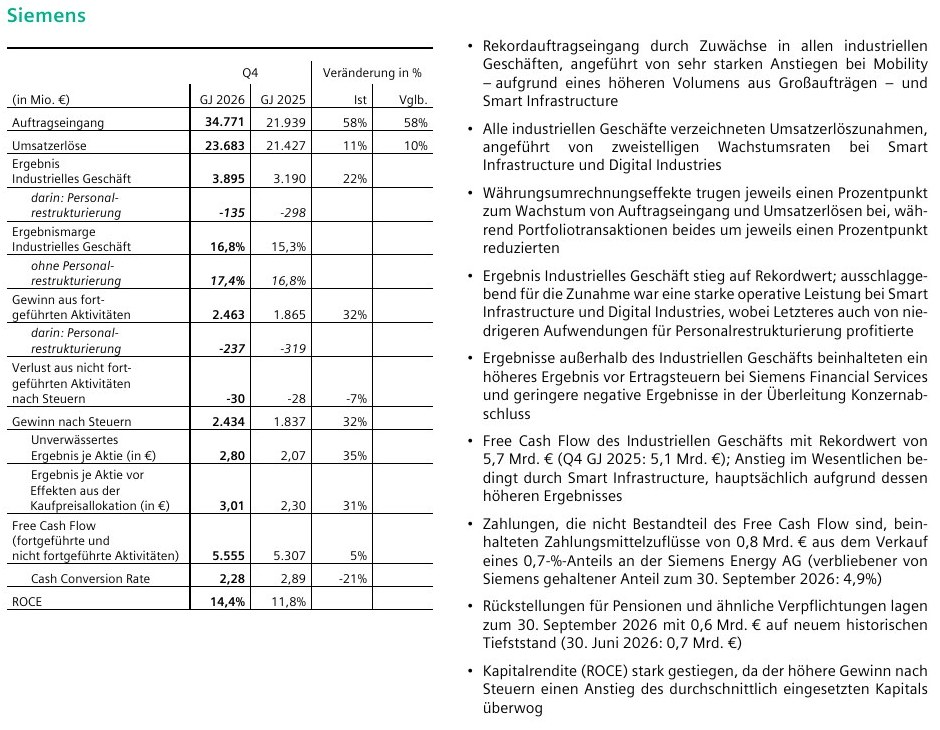

<!-- PRÜFEN: Alle Zahlen: Siemens "Ergebnisveröffentlichung Q4 GJ 2026" vom 12.11.2026 (PDF, von Divi geliefert, Angaben laut Siemens vorläufig). Siemens meldet das Geschäftsjahr bis 30.9.; "Q4" ist also Juli bis September 2026. Es lagen weder eine Konsens-Tabelle noch ein Aktienkurs vor, daher gibt es keinen Vergleich mit den Analystenschätzungen und keine Kursangabe. Die Zitate aus der Veröffentlichung sind sinngemäß wiedergegeben. -->
<!-- PRÜFEN: Selbst gerechnet: alle Veränderungen in Prozent, die Ausschüttungsquoten (5,50 Euro geteilt durch 10,94 Euro Ergebnis je Aktie gleich 50 %, geteilt durch 11,76 Euro vor Kaufpreiseffekten gleich 47 %), der Anteil des vierten Quartals am Jahres-Free-Cash-Flow (5.569 von 12.133 Mio. Euro gleich 46 %), die Spanne des Gewinnwachstums 2027 (10,20 bis 10,80 Euro gegenüber 9,27 Euro vergleichbar gleich plus 10 bis 16 %), die Überschreitung der angehobenen Prognose (11,76 Euro gegenüber der Obergrenze 11,50 Euro) und der Rückgang der industriellen Nettoverschuldung (minus 61 %). -->
<!-- PRÜFEN: Der Vorstandschef Roland Busch sagt laut Veröffentlichung, die Mittelfristziele des Konzerns würden angehoben. Die neuen Mittelfristziele stehen nicht in der Veröffentlichung (vermutlich Kapitalmarkttag oder Analystencall), daher keine Zahlen dazu. Die Dividende von 5,50 Euro ist ein Vorschlag, die Hauptversammlung entscheidet; den Termin habe ich nicht, daher nicht genannt. -->
<!-- PRÜFEN: Die Abspaltung von Siemens Healthineers ("Direktabspaltung"; 34,1 % der Beteiligung; eine Healthineers-Aktie je zwei Siemens-Aktien) steht in der Veröffentlichung als Plan. Zustimmung der Aktionäre und Zeitpunkt sind dort nicht genannt. Ob "34,1 %" Anteile an Healthineers oder Anteile von Siemens' Beteiligung meint, bitte gegen die Pressemitteilung prüfen: Laut Wortlaut ist es ein Teil der Beteiligung. -->
<!-- PRÜFEN: CEO-Foto (Freisteller medien/ceo/sie-de-busch.png) von Divi als Roland Busch geliefert, selbst freigestellt. Es gibt kein Kursbild, die Story zeigt die Kennzahlen-Seite der Veröffentlichung. Aufmacher: Konzernzentrale am Wittelsbacherplatz (CC BY-SA 3.0, Namensnennung in der Bildzeile). -->

!!! kurz "Kurz gesagt (viertes Quartal, Geschäftsjahr 2026)"
    **Auftragseingang:** 34,8 Mrd. € (+58 %)
    **Gewinn nach Steuern:** 2,43 Mrd. € (+32 %)

    1. **Rekordaufträge:** Mobility und Smart Infrastructure treiben den Auftragseingang, im Gesamtjahr stehen 108,2 Mrd. Euro und ein Auftragsbestand von 143 Mrd. Euro.
    2. **Mehr für Aktionäre:** Die Dividende steigt auf 5,50 Euro je Aktie, dazu kommt die geplante Abspaltung von Siemens Healthineers.
    3. **Ausblick 2027:** 9 bis 11 % vergleichbares Umsatzwachstum, Gewinn je Aktie vor Kaufpreiseffekten von 10,20 bis 10,80 Euro, ohne Healthineers gerechnet.

## Ein Quartal mit Rekordwerten

Siemens hat im vierten Quartal des Geschäftsjahres 2026, von Juli bis September, 34.771 Millionen Euro Aufträge eingesammelt. Das sind 58 % mehr als im Vorjahresquartal (21.939 Millionen Euro) und ein Quartalsrekord. Auf einen Euro Umsatz kommen damit 1,47 Euro neue Aufträge. Der Umsatz steigt um 11 % auf 23.683 Millionen Euro, vergleichbar, also ohne Währungs- und Portfolioeffekte, sind es 10 %.

Das Ergebnis des Industriellen Geschäfts erreicht mit 3.895 Millionen Euro einen Rekord (plus 22 %), die Marge steigt von 15,3 auf 16,8 %. Ohne Restrukturierungskosten (135 Millionen Euro, im Vorjahr 298 Millionen Euro) liegt sie bei 17,4 % nach 16,8 %. Der Gewinn nach Steuern wächst um 32 % auf 2.434 Millionen Euro, das Ergebnis je Aktie um 35 % auf 2,80 Euro. Vor Effekten aus der Kaufpreisallokation (EPS pre PPA) sind es 3,01 Euro nach 2,30 Euro (plus 31 %).

Der Free Cash Flow des Konzerns steigt auf 5.555 Millionen Euro (Vorjahr 5.307 Millionen Euro). Er macht damit allein im vierten Quartal rund 46 % des Jahreswerts von 12,1 Milliarden Euro aus, wie in den Vorjahren ist die Cash-Erzeugung also stark auf das Schlussquartal konzentriert.

Eine Gegenüberstellung mit den Analystenschätzungen können wir hier nicht liefern, eine Konsens-Tabelle lag uns nicht vor.

## Die Zahlen im Überblick

| Kennzahl | Q4 GJ 2026 | Q4 GJ 2025 | Veränderung |
|---|---:|---:|---:|
| Auftragseingang | 34.771 Mio. € | 21.939 Mio. € | +58 % |
| Umsatz | 23.683 Mio. € | 21.427 Mio. € | +11 % |
| Ergebnis Industrielles Geschäft | 3.895 Mio. € | 3.190 Mio. € | +22 % |
| Marge Industrielles Geschäft | 16,8 % | 15,3 % | +1,5 Punkte |
| Gewinn nach Steuern | 2.434 Mio. € | 1.837 Mio. € | +32 % |
| Ergebnis je Aktie | 2,80 € | 2,07 € | +35 % |
| Ergebnis je Aktie vor Kaufpreiseffekten | 3,01 € | 2,30 € | +31 % |
| Free Cash Flow | 5.555 Mio. € | 5.307 Mio. € | +5 % |
| Kapitalrendite (ROCE) | 14,4 % | 11,8 % | +2,6 Punkte |

## Das Gesamtjahr: Rekorde bei Aufträgen, Ergebnis und Cash

| Kennzahl | GJ 2026 | GJ 2025 | Veränderung |
|---|---:|---:|---:|
| Auftragseingang | 108.159 Mio. € | 88.366 Mio. € | +22 % |
| Umsatz | 83.372 Mio. € | 78.914 Mio. € | +6 % (vergleichbar +8 %) |
| Ergebnis Industrielles Geschäft | 13.292 Mio. € | 11.766 Mio. € | +13 % |
| Marge Industrielles Geschäft | 16,3 % | 15,4 % | +0,9 Punkte |
| Gewinn nach Steuern | 9.474 Mio. € | 10.387 Mio. € | −9 % |
| Ergebnis je Aktie | 10,94 € | 12,25 € | −11 % |
| Ergebnis je Aktie vor Kaufpreiseffekten | 11,76 € | 12,95 € | −9 % |
| Free Cash Flow | 12.096 Mio. € | 10.812 Mio. € | +12 % |
| Industrielle Nettoverschuldung | 4.782 Mio. € | 12.160 Mio. € | −61 % |

Der Gewinn nach Steuern liegt unter dem Vorjahr, weil 2025 ein Gewinn von 2,1 Milliarden Euro aus dem Verkauf von Innomotics darin stand. Das Ergebnis aus fortgeführten Aktivitäten steigt um 13 % auf 9.400 Millionen Euro. Das Ergebnis je Aktie vor Kaufpreiseffekten von 11,76 Euro liegt über der Prognose von 11,20 bis 11,50 Euro, die Siemens nach dem dritten Quartal ausgegeben hatte, die Obergrenze wird um 0,26 Euro übertroffen. Der Auftragsbestand beträgt 143 Milliarden Euro, das Verhältnis von Aufträgen zu Umsatz im Gesamtjahr 1,30.

Die Bilanz hat sich deutlich verbessert: Die industrielle Nettoverschuldung sinkt von 12,2 auf 4,8 Milliarden Euro, das Verhältnis zum EBITDA von 0,9 auf 0,3. Das Eigenkapital steigt auf 76,4 Milliarden Euro (Vorjahr 68,4 Milliarden Euro). Die Pensionsrückstellungen liegen mit 0,6 Milliarden Euro auf einem neuen Tiefstand. Aus dem Verkauf eines 0,7-Prozent-Anteils an Siemens Energy flossen 0,8 Milliarden Euro zu, Siemens hält dort noch 4,9 %. Die Kapitalrendite (ROCE) für das Jahr beträgt 14,1 % nach 17,8 %.

## Die Geschäfte: Digital Industries und Smart Infrastructure tragen das Ergebnis

| Quartal Q4 | Auftragseingang | Umsatz | Ergebnis | Marge | Marge Vorjahr |
|---|---:|---:|---:|---:|---:|
| Digital Industries | 6.414 (+16 %) | 5.594 (+11 %) | 1.170 (+50 %) | 20,9 % | 15,5 % |
| Smart Infrastructure | 8.665 (+40 %) | 7.239 (+16 %) | 1.468 (+26 %) | 20,3 % | 18,7 % |
| Mobility | 10.736 (>+200 %) | 3.509 (+9 %) | 333 (+22 %) | 9,5 % | 8,5 % |
| Siemens Healthineers | 8.329 (+15 %) | 6.784 (+7 %) | 924 (−5 %) | 13,6 % | 15,4 % |

(Beträge in Mio. €)

**Digital Industries** steigert das Ergebnis um 50 % auf 1.170 Millionen Euro. Ein Teil davon sind niedrigere Restrukturierungskosten (53 statt 224 Millionen Euro). Ohne sie liegt die Marge bei 21,9 % nach 19,9 %. Das Softwaregeschäft wächst um 13 % auf 2.144 Millionen Euro Umsatz, getragen vom Geschäft mit Chip-Entwicklungssoftware (EDA). Das Quartal enthält 36 Millionen Euro Integrationskosten für die Zukäufe Altair und Dotmatics, die die Marge um 0,6 Punkte drücken.

**Smart Infrastructure** erzielt Quartalsrekorde bei Aufträgen, Umsatz und Ergebnis. Die Aufträge enthalten erneut mehrere größere Bestellungen von Rechenzentrumskunden, vor allem in den USA und Europa. Das Ergebnis profitiert nach Angaben von Siemens von Zollrückerstattungen in den USA, die Höhe nennt die Veröffentlichung nicht. Die Marge von 20,3 % ist damit nicht sauber mit dem Vorjahr vergleichbar.

**Mobility** verbucht mit 10.736 Millionen Euro den höchsten Quartals-Auftragseingang der Geschichte, nach 2.522 Millionen Euro im Vorjahr. Dazu tragen ein Auftrag über 2,4 Milliarden Euro für Hochgeschwindigkeitszüge in Deutschland inklusive Instandhaltung und ein Anteil von 1,9 Milliarden Euro an einem Gemeinschaftsauftrag für S-Bahnen bei. Im November übernahm Mobility alle Anteile an Mermec in Italien, einem Anbieter von Bahnsignaltechnik.

**Siemens Healthineers** verdient mit 924 Millionen Euro 5 % weniger, die Marge sinkt auf 13,6 %. Imaging wächst, Precision Therapy geht zurück, im Diagnostikgeschäft belastet ein verändertes Marktumfeld in China. Siemens Financial Services steigert das Ergebnis vor Steuern von 91 auf 150 Millionen Euro, wegen Beteiligungsbewertungen.

Im Gesamtjahr verdient Digital Industries 3.753 Millionen Euro (Vorjahr 2.643 Millionen Euro, Marge 19,1 %), Smart Infrastructure 4.899 Millionen Euro (4.506 Millionen Euro, Marge 19,5 % nach 19,6 %) und Mobility 1.107 Millionen Euro (1.099 Millionen Euro, Marge 8,5 % nach 8,8 %). Die Mobility-Aufträge erreichen im Jahr 26.572 Millionen Euro (plus 56 %), die von Smart Infrastructure 31.373 Millionen Euro (plus 30 %).

## Dividende und Healthineers: Das bekommen Aktionäre

Siemens schlägt eine Dividende von 5,50 Euro je Aktie vor, nach 5,35 Euro im Vorjahr (plus 2,8 %). Das entspricht rechnerisch 50 % des Ergebnisses je Aktie (10,94 Euro) und 47 % des Ergebnisses vor Kaufpreiseffekten (11,76 Euro). Im Geschäftsjahr hat Siemens 4.165 Millionen Euro Dividende an die Aktionäre gezahlt, der Free Cash Flow von 12,1 Milliarden Euro deckt das reichlich. Die Dividende ist ein Vorschlag, die Hauptversammlung entscheidet.

Dazu kommt die Abspaltung von Healthineers. Siemens will 34,1 % seiner Beteiligung an Siemens Healthineers im Verhältnis eine Healthineers-Aktie für je zwei Siemens-Aktien an die Aktionäre übertragen und Healthineers im Geschäftsjahr 2027 entkonsolidieren. Die Healthineers-Zahlen werden schon vor Abschluss als nicht fortgeführte Aktivitäten ausgewiesen, voraussichtlich ab dem ersten Quartal. Für Anleger heißt das: Wer Siemens-Aktien hält, bekommt Healthineers-Aktien ins Depot, und die Ergebnisbasis des Konzerns wird kleiner. Den Steuerfolgen einer solchen Zuteilung sollten sich Privatanleger vorab widmen, wir gehen darauf in einem eigenen Beitrag ein, sobald die Details feststehen.

## Der Ausblick für 2027

Der Ausblick gilt ohne Healthineers:

| Bereich | Umsatzwachstum (vergleichbar) | Ergebnismarge |
|---|---:|---:|
| Digital Industries | 8 bis 12 % | 20 bis 22 % |
| Smart Infrastructure | 11 bis 13 % | 19,5 bis 20,5 % |
| Mobility | 6 bis 8 % | 8 bis 10 % |
| **Konzern** | **9 bis 11 %** | – |

Das Verhältnis von Auftragseingang zu Umsatz soll über 1 liegen. Das Ergebnis je Aktie vor Kaufpreiseffekten soll 10,20 bis 10,80 Euro betragen. Die Vergleichsbasis ohne Healthineers lag im Geschäftsjahr 2026 bei 9,27 Euro, die Spanne bedeutet also ein Plus von rund 10 bis 16 %. Belastungen aus rechtlichen und regulatorischen Themen sind ausgenommen. Roland Busch nennt Industrielle KI als Wachstumschance und kündigt höhere Mittelfristziele an; Zahlen dazu stehen in der Veröffentlichung nicht.

## Was für und gegen die Aktie spricht

**Dafür:** Die Auftragslage ist mit 143 Milliarden Euro Bestand außergewöhnlich, der Umsatz der kommenden Jahre ist damit zu großen Teilen gedeckt. Das Ergebnis des Industriellen Geschäfts wächst zweistellig, Free Cash Flow und Bilanz verbessern sich deutlich, die Dividende steigt. Rechenzentren treiben Smart Infrastructure, das Softwaregeschäft in Digital Industries wächst zweistellig.

**Dagegen:** Das vierte Quartal ist durch Einmaleffekte aufgebessert: Zollrückerstattungen in Smart Infrastructure und niedrigere Restrukturierungskosten in Digital Industries. Der Rekordauftragseingang von Mobility geht auf wenige Großaufträge zurück und ist nicht wiederholbar. Der Gewinn nach Steuern liegt im Gesamtjahr wegen des Innomotics-Gewinns im Vorjahr unter dem Vorjahr. Healthineers belastet mit sinkender Marge, wird aber ohnehin abgespalten. Wie die Börse das aufnimmt, können wir ohne Kurs und Konsens nicht beurteilen.

## Was als Nächstes ansteht

Entscheidend sind die Hauptversammlung für Dividende und Abspaltung sowie die Details zu den angehobenen Mittelfristzielen aus Analystencall und Präsentationen. Im ersten Quartal des Geschäftsjahres 2027 soll Healthineers als nicht fortgeführte Aktivität ausgewiesen werden, erst danach ist die neue Vergleichsbasis sauber sichtbar.

## Quellen

- Siemens: Ergebnisveröffentlichung Q4 GJ 2026 (1. Juli bis 30. September 2026), München, 12. November 2026
