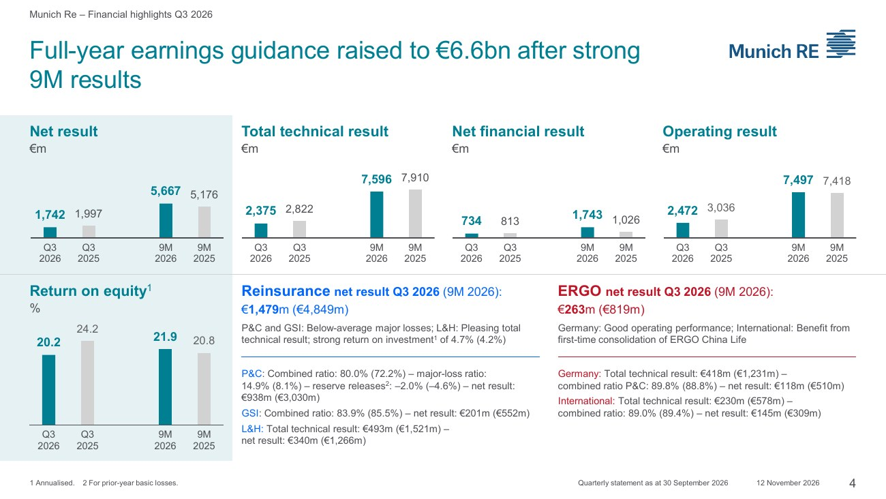
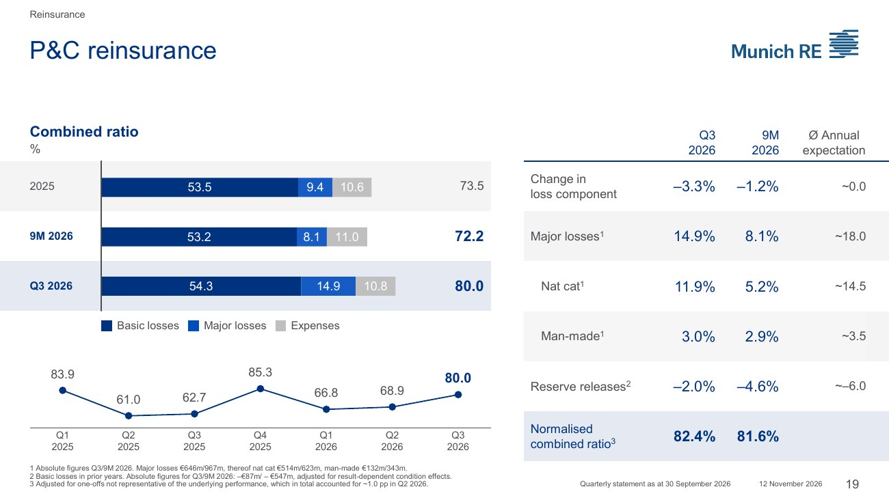
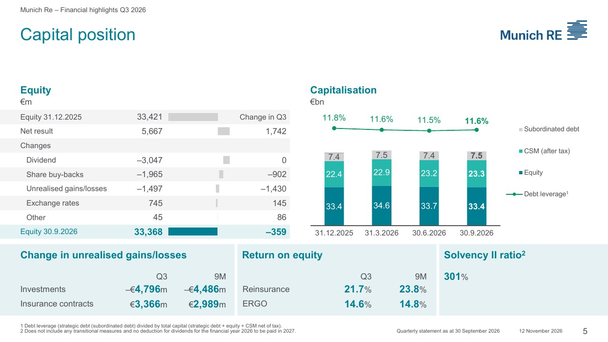

<!-- PRÜFEN: Alle Konzern-, Segment- und Kapitalzahlen: Munich Re "Quarterly statement as at 30 September 2026", Investor-Relations-Präsentation vom 12.11.2026 (CFO Andrew Buchanan), und die Konsens-Tabelle "Company-collected analysts' consensus Q3 2026" (Durchschnitt der von Munich Re gesammelten Schätzungen, keine externen Datenanbieter); beides von Divi geliefert. Die Pressemitteilung vom 12.11. und ein Aktienkurs lagen nicht vor, daher keine Kursangabe und kein Vorstandszitat. -->
<!-- PRÜFEN: Vorab-Zahlen vom 23.10.2026 (Ad-hoc-Mitteilung: Q3 rund 1,7 Mrd. Euro, Konsens 1,479 Mrd. Euro von 13 Analysten, Jahresziel von 6,3 auf 6,6 Mrd. Euro) laut Medieninformation von Munich Re und cash-online.de. Die Erneuerungszahlen (Juli: Volumen minus 9,1 %, risikoadjustierte Preise minus 5,5 %) und die Branchenstimmen zu 2027 (Hannover Rück, S&P, Fitch) stammen aus cash-online.de vom 25.10.2026, nicht aus den Unterlagen von Munich Re. -->
<!-- PRÜFEN: Selbst gerechnet: alle Veränderungen in Prozent, Abweichungen zum Konsens, Rest für das Jahresziel (6,6 Mrd. minus 5,667 Mrd. gleich rund 0,93 Mrd. Euro im vierten Quartal; Rückversicherung 5,7 Mrd. minus 4,849 Mrd. gleich 0,85 Mrd.; ERGO 0,9 Mrd. minus 0,819 Mrd. gleich 0,08 Mrd.), Aufschlüsselung der Abweichung des operativen Ergebnisses (+445 Mio. Euro) nach Segmenten. Die Prognosewerte sind in den Folien als "~" angegeben. -->
<!-- PRÜFEN: Zufall in den Folien: Das Nettoergebnis der Rückversicherung im dritten Quartal (1.479 Mio. Euro) entspricht exakt dem Konzern-Konsens (1.479 Mio. Euro). Beides steht so in den Unterlagen (340 + 938 + 201 = 1.479), bitte nicht verwechseln. -->
<!-- PRÜFEN: Der Aufbau der Solvenzquote (301 %, ohne Übergangsmaßnahmen und ohne Abzug der Dividende für 2026) steht in einer Fußnote der Kapitalfolie. Der Vorquartalswert fehlt in den Unterlagen, daher kein Quartalsvergleich. -->
<!-- PRÜFEN: Der Vorstandschef Christoph Jurecka wird nur in der Quelle cash-online.de genannt, nicht in den Unterlagen. Es gibt kein CEO-Foto und kein Kursbild, die Story hat nur die Folie. Aufmacher: Luftbild der Zentrale (CC BY-SA 4.0, Namensnennung in der Bildzeile). -->

!!! kurz "Kurz gesagt (drittes Quartal 2026)"
    **Nettoergebnis:** 1,74 Mrd. € (−12,8 %)
    **Operatives Ergebnis:** 2,47 Mrd. € (−18,6 %)

    1. **Über dem Konsens:** Das Nettoergebnis liegt 18 % über der Schätzung, das operative Ergebnis 22 %. Die Vorab-Zahlen vom 23. Oktober sind damit bestätigt.
    2. **Quelle des Überschusses:** In der Schaden-Rückversicherung kommen 400 der 406 Millionen Euro Mehrergebnis aus dem Finanzergebnis. Das Versicherungsgeschäft liegt auf Konsens.
    3. **Prognose:** Das Jahresziel steigt auf rund 6,6 Mrd. Euro, nach neun Monaten stehen 5,67 Mrd. Euro in den Büchern.

## Ein Quartal über den Schätzungen, aber unter dem Vorjahr

Munich Re hat im dritten Quartal 1.742 Millionen Euro Nettoergebnis erzielt. Die Analysten hatten im Durchschnitt 1.479 Millionen Euro erwartet, der Konzern liegt 263 Millionen Euro oder 18 % darüber. Das operative Ergebnis beträgt 2.472 Millionen Euro statt der erwarteten 2.027 Millionen Euro (plus 22 %). Gegenüber dem Vorjahresquartal sinken beide Größen: das Nettoergebnis von 1.997 auf 1.742 Millionen Euro (minus 12,8 %), das operative Ergebnis von 3.036 auf 2.472 Millionen Euro (minus 18,6 %).

Nach neun Monaten steht ein Nettoergebnis von 5.667 Millionen Euro in den Büchern, 9,5 % mehr als vor einem Jahr (5.176 Millionen Euro). Das operative Ergebnis der neun Monate liegt mit 7.497 Millionen Euro nur 1,1 % über dem Vorjahr. Das Gewinnziel für 2026 hebt Munich Re auf rund 6,6 Milliarden Euro an, vorher waren es rund 6,3 Milliarden Euro. Rechnerisch bleiben für das vierte Quartal damit rund 0,93 Milliarden Euro, deutlich weniger als in jedem der drei bisherigen Quartale dieses Jahres. Zahlen und Zielanhebung waren bereits am 23. Oktober per Ad-hoc-Mitteilung vorab bekannt, heute folgen die Details.

Die Eigenkapitalrendite liegt im dritten Quartal bei 20,2 % (Vorjahr 24,2 %), nach neun Monaten bei 21,9 % (20,8 %). Der Konsens hatte für das Quartal 16,7 % erwartet.

## Die Zahlen im Überblick

| Kennzahl | Q3 2026 | Q3 2025 | Veränderung | Konsens | Abweichung |
|---|---:|---:|---:|---:|---:|
| Nettoergebnis | 1.742 Mio. € | 1.997 Mio. € | −12,8 % | 1.479 Mio. € | +18 % |
| Operatives Ergebnis | 2.472 Mio. € | 3.036 Mio. € | −18,6 % | 2.027 Mio. € | +22 % |
| Technisches Ergebnis | 2.375 Mio. € | 2.822 Mio. € | −15,8 % | 2.177 Mio. € | +9 % |
| Finanzergebnis (netto) | 734 Mio. € | 813 Mio. € | −9,7 % | – | – |
| Kapitalanlageergebnis | 1.859 Mio. € | 2.385 Mio. € | −22,1 % | 1.887 Mio. € | −1 % |
| Eigenkapitalrendite | 20,2 % | 24,2 % | −4,0 Punkte | 16,7 % | +3,5 Punkte |
| Solvabilität II | 301 % | – | – | 311 % | −10 Punkte |

Das technische Ergebnis, der Gewinn aus dem eigentlichen Versicherungsgeschäft, liegt 198 Millionen Euro über der Schätzung. Die Abweichung des operativen Ergebnisses von 445 Millionen Euro ist doppelt so groß. Der Rest kommt aus dem Finanzergebnis, also aus Kapitalanlagen, Währungseffekten und den Zinsen auf die Versicherungsverbindlichkeiten.

## Die Segmente: Fast alles kommt aus der Schaden-Rückversicherung

| Operatives Ergebnis | Q3 2026 | Konsens | Abweichung |
|---|---:|---:|---:|
| Schaden/Unfall-Rückversicherung | 1.393 | 987 | +406 |
| Global Specialty Insurance | 266 | 187 | +79 |
| ERGO International | 172 | 137 | +35 |
| ERGO Deutschland | 186 | 191 | −5 |
| Leben/Kranken-Rückversicherung | 455 | 525 | −70 |
| **Konzern** | **2.472** | **2.027** | **+445** |

(Beträge in Mio. €)

Die Schaden- und Unfall-Rückversicherung steuert 406 Millionen Euro der Abweichung bei, ohne die schwächeren Segmente wären es mehr. Das Nettoergebnis des Konzerns verteilt sich auf die Rückversicherung mit 1.479 Millionen Euro und ERGO mit 263 Millionen Euro. Für die Rückversicherung hebt Munich Re das Jahresziel von rund 5,4 auf rund 5,7 Milliarden Euro an, für ERGO bleibt es bei rund 0,9 Milliarden Euro.

## Schaden- und Unfall-Rückversicherung: Der Überschuss steckt im Finanzergebnis

Die Schadenquote (Combined Ratio) liegt im dritten Quartal bei 80,0 % und damit 2,6 Punkte über den erwarteten 77,4 %. Im Vorjahresquartal waren es 62,7 %. Je niedriger der Wert, desto mehr bleibt von den Prämien nach Schäden und Kosten übrig. Das technische Ergebnis beträgt 892 Millionen Euro, der Konsens lag bei 884 Millionen Euro. Im Versicherungsgeschäft trifft Munich Re die Erwartungen also, aber sie übertrifft sie nicht.

Der Sprung kommt weiter unten in der Ergebnisrechnung: Das Finanzergebnis der Sparte liegt bei 636 Millionen Euro, erwartet waren 236 Millionen Euro. Das sind 400 Millionen Euro mehr und erklärt praktisch die gesamte Abweichung von 406 Millionen Euro beim operativen Ergebnis. Das Kapitalanlageergebnis der Sparte beträgt 992 Millionen Euro, dazu kommt ein Währungsergebnis von 32 Millionen Euro, abzüglich 387 Millionen Euro Zinsaufwand auf die Versicherungsverbindlichkeiten. Welche Einzelposten die Schätzung der Analysten verfehlt haben, geht aus den Unterlagen nicht hervor.

Die Zusammensetzung der Schadenquote von 80,0 %:

| Bestandteil | Q3 2026 | 9M 2026 | Erwartung pro Jahr |
|---|---:|---:|---:|
| Basisschäden | 54,3 % | 53,2 % | – |
| Großschäden | 14,9 % | 8,1 % | ~18,0 % |
| davon Naturkatastrophen | 11,9 % | 5,2 % | ~14,5 % |
| davon von Menschen verursacht | 3,0 % | 2,9 % | ~3,5 % |
| Kosten | 10,8 % | 11,0 % | – |
| Abwicklungsgewinne aus Vorjahren | −2,0 % | −4,6 % | ~−6,0 % |
| Schadenquote gesamt | 80,0 % | 72,2 % | |
| Normalisierte Schadenquote | 82,4 % | 81,6 % | |

Die Großschäden betragen im Quartal 646 Millionen Euro (14,9 % der Prämien), nach neun Monaten 967 Millionen Euro. Das größte Einzelereignis war das Erdbeben in Chocó in Kolumbien mit rund 0,3 Milliarden Euro. Gegenüber dem Erwartungswert von rund 18 % im Jahr bleibt Munich Re deutlich darunter.

Bei der Beurteilung der 80,0 % hilft die normalisierte Schadenquote: Sie liegt bei 82,4 % und bereinigt um Einmaleffekte, die nicht zum Kerngeschäft gehören. Die Differenz zeigt, wie viel der guten Quote dem schadenarmen Quartal und dem Diskonteffekt von rund 11,5 Prozentpunkten zu verdanken ist. Dazu kommt, dass Munich Re die Abwicklungsgewinne bewusst kleiner hält: Mit 2,0 % im Quartal liegen sie unter dem Jahresmittel von rund 6 %, das Unternehmen nennt das einen vorsichtigeren Umgang mit der Bilanz.

Die Prämien sinken: Der Versicherungsumsatz der Sparte liegt nach neun Monaten bei 12.413 Millionen Euro, 9,0 % unter dem Vorjahr (13.646 Millionen Euro). Gründe sind Währungseffekte (minus 271 Millionen Euro) und ein organischer Rückgang um 961 Millionen Euro durch niedrigere Raten, Geschäft ohne die verlangte Rendite und anteilige Verträge. Passend dazu berichtet cash-online.de aus den Juli-Erneuerungen ein um 9,1 % geringeres Volumen bei risikoadjustierten Preisen von minus 5,5 %. Munich Re verzichtet nach eigenen Angaben auf Geschäft, bei dem die Preise nicht zum Risiko passen.

Für das Gesamtjahr peilt Munich Re eine Schadenquote von unter 80 % an, vorher waren es rund 80 %. Nach neun Monaten steht sie bei 72,2 %.

## Leben und Kranken: Technisches Ergebnis im Plan, Konsens beim Ergebnis verfehlt

Das technische Ergebnis der Leben/Kranken-Rückversicherung beträgt 493 Millionen Euro und trifft die Schätzung exakt (Vorjahr 314 Millionen Euro). Das operative Ergebnis von 455 Millionen Euro liegt trotzdem 70 Millionen Euro unter dem Konsens von 525 Millionen Euro. Die Lücke entsteht unterhalb des technischen Ergebnisses: Das Finanzergebnis der Sparte beträgt minus 4 Millionen Euro (Vorjahr plus 117 Millionen Euro), das sonstige operative Ergebnis minus 34 Millionen Euro. Munich Re führt bei den Finanzinstrumenten die steigenden Zinsen als dämpfenden Faktor an.

Im technischen Ergebnis stehen 306 Millionen Euro Freigabe der vertraglichen Servicemarge (CSM), also des noch nicht verdienten Gewinns aus laufenden Verträgen, und 97 Millionen Euro positive Erfahrungsanpassungen, vor allem wegen günstiger Sterblichkeit. Dagegen stehen 114 Millionen Euro aus belastenden Verträgen. Das Unternehmen nennt Annahmeänderungen nach ungünstigem Verlauf in bestimmten Berufsunfähigkeitsportfolios als Hauptgrund für die Belastung im Quartal. Die CSM wächst auf 16.465 Millionen Euro, nach 15.269 Millionen Euro zum Jahresende (plus 7,8 %). Der Versicherungsumsatz der Sparte steigt nach neun Monaten um 15,4 % auf 10.420 Millionen Euro. Das Ziel für das technische Ergebnis im Gesamtjahr liegt bei rund 1,9 Milliarden Euro, nach neun Monaten stehen 1.521 Millionen Euro in den Büchern.

## Spezialversicherung und ERGO

Die Global Specialty Insurance (GSI, mit American Modern, Hartford Steam Boiler und dem Spezialgeschäft) erreicht eine Schadenquote von 83,9 % (Konsens 89,3 %, Vorjahr 82,8 %). Das technische Ergebnis liegt mit 343 Millionen Euro gut 119 Millionen Euro über der Schätzung. Munich Re nennt vor allem glimpfliche Naturkatastrophenschäden. Das Jahresziel für die Schadenquote bleibt bei unter 90 %. Der Versicherungsumsatz sinkt nach neun Monaten um 1,2 %, währungsbereinigt wächst er um 2,3 %.

ERGO Deutschland erzielt ein Nettoergebnis von 118 Millionen Euro. Im Vorjahr hatten Steuereffekte das Ergebnis belastet. Die Schadenquote in der Schaden/Unfall-Sparte beträgt 89,8 % (Konsens 88,9 %), das technische Ergebnis liegt mit 418 Millionen Euro leicht über der Schätzung von 410 Millionen Euro. ERGO International verdient netto 145 Millionen Euro und liegt beim operativen Ergebnis 35 Millionen Euro über dem Konsens. Munich Re verweist auf die erstmalige Vollkonsolidierung von ERGO China Life Insurance. Die Schadenquote liegt bei 89,0 %. Für beide ERGO-Sparten gilt weiterhin ein Ziel von rund 89 %.

## Kapital: Zinsanstieg drückt das Eigenkapital

Das Eigenkapital sinkt im dritten Quartal um 359 Millionen Euro auf 33.368 Millionen Euro, trotz 1.742 Millionen Euro Nettoergebnis. Dagegen stehen Aktienrückkäufe von 902 Millionen Euro und nicht realisierte Verluste von 1.430 Millionen Euro. Hinter den nicht realisierten Verlusten stehen die gestiegenen Zinsen: Auf den Kapitalanlagen entsteht im Quartal ein Minus von 4.796 Millionen Euro, auf den Versicherungsverträgen ein Plus von 3.366 Millionen Euro. Seit Jahresbeginn sind 3.047 Millionen Euro Dividende und 1.965 Millionen Euro Rückkäufe abgeflossen. Das Eigenkapital liegt 2,4 % unter den erwarteten 34,2 Milliarden Euro.

Die Solvabilitätsquote beträgt 301 %, der Konsens lag bei 311 %. Munich Re rechnet sie ohne Übergangsmaßnahmen und ohne Abzug einer Dividende für 2026. Die Verschuldungsquote liegt bei 11,6 %.

Auf der Anlageseite steigt die Wiederanlagerendite für drei Monate auf 4,7 %, im Vorjahresquartal waren es 4,0 %. Die laufenden Erträge betragen 2.314 Millionen Euro (4,0 % Rendite), der Marktwert der Kapitalanlagen 237 Milliarden Euro. Der Anteil alternativer Anlagen steigt auf 19 % (Vorquartal 17 %), der Anteil von Staatsanleihen sinkt auf 28 % (30 %). Die Rendite auf die Kapitalanlagen liegt im Quartal bei 3,2 % (Konsens 3,3 %), das Jahresziel liegt bei über 3,5 %.

## Was für und gegen die Aktie spricht

**Dafür:** Das Ergebnis liegt klar über den Schätzungen, das Jahresziel wird zum zweiten Mal in kurzer Zeit angehoben. Die Schadenquote steht nach neun Monaten mit 72,2 % weit unter dem Jahresziel von unter 80 %, die Großschäden bleiben unter dem Erwartungswert. Die Wiederanlagerendite von 4,7 % liegt über der laufenden Verzinsung des Portfolios, das stützt die Erträge der kommenden Jahre. Die CSM der Leben/Kranken-Rückversicherung wächst, und der Konzern kauft weiter eigene Aktien zurück (902 Millionen Euro im Quartal).

**Dagegen:** Der Überschuss zur Schätzung stammt aus dem Finanzergebnis, im Versicherungsgeschäft liegt Munich Re auf Konsens. Die normalisierte Schadenquote von 82,4 % liegt 2,4 Punkte über dem ausgewiesenen Wert. Die Prämien in der Schaden-Rückversicherung sinken um 9 %, bei sinkenden Preisen. Zum Vorjahr gehen Nettoergebnis (minus 12,8 %) und Eigenkapitalrendite zurück, die Solvabilität liegt unter dem Konsens. Für das vierte Quartal bleibt rechnerisch nur rund 0,93 Milliarden Euro, ein Großschadenquartal könnte das aufzehren. Munich Re kündigte laut Ad-hoc-Mitteilung an, die Bilanz im vierten Quartal bei Bedarf weiter zu stärken.

## Was als Nächstes ansteht

Für die Bewertung kommt es auf die Erneuerungsrunde zum 1. Januar an: cash-online.de zitiert Branchenstimmen, die auch für 2027 weiter sinkende Preise erwarten (Hannover Rück: leicht sinkend, S&P: ähnlich wie 2026, Fitch: Sektorausblick verschlechtert). Im vierten Quartal zählen Großschäden und die Entscheidung, wie viel Munich Re davon in die Bilanz zurücklegt. Die Folien mit dem vollständigen Zahlenwerk stehen auf der Investor-Relations-Seite von Munich Re.

## Quellen

- Munich Re: Quarterly statement as at 30 September 2026, Präsentation vom 12.11.2026 (Andrew Buchanan, CFO)
- Munich Re: Company-collected analysts' consensus Q3 2026
- [Munich Re: Medieninformation "Munich Re erzielt Quartalsergebnis" vom 23.10.2026](https://www.munichre.com/de/unternehmen/media-relations/medieninformationen-und-unternehmensnachrichten/medieninformationen/2026/medieninformation-2026-10-23.html)
- [cash-online.de: Munich Re verdient mehr, obwohl die Preise am Markt sinken](https://www.cash-online.de/a/munich-re-verdient-mehr-obwohl-die-preise-am-markt-sinken-728408/)
