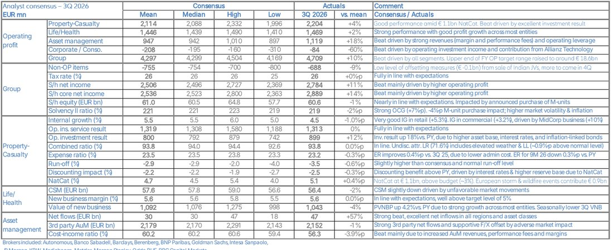

<!-- PRÜFEN: Alle Konzern-, Segment- und Kapitalzahlen: Allianz "Financial Supplement 3Q 2026" (12.11.2026) und "Analyst consensus 3Q 2026" mit den Ist-Werten (von Divi als PDF geliefert). Quartalsmitteilung, Präsentation und Pressemitteilung lagen nicht vor, daher keine Aussagen des Vorstands und kein Zitat. -->
<!-- PRÜFEN: Die Anhebung der Prognose ("Upper end of FY OP target range raised to around 18.6bn") steht nur als Kommentar in der Konsens-Tabelle. Die ursprüngliche Spanne und die Ankündigung im Wortlaut fehlen, bitte gegen die Pressemitteilung prüfen. -->
<!-- PRÜFEN: Kurs 473,00 Euro (+1,42 %, 09:30 Uhr, 15 Minuten verzögert), Vortag 466,40 Euro als Rekordhoch und 52-Wochen-Tief 344,10 Euro von der Kursseite von Börse Express vom 12.11.2026; Quelle ist nicht die Allianz. Der Kurs ändert sich im Tagesverlauf. -->
<!-- PRÜFEN: Selbst gerechnet: Veränderungen in Prozent (Segmentergebnisse, Nettoergebnis, Erfolgsgebühren), Rest-Ergebnis für das Oberende der Prognose (18,6 Mrd. minus 14,1 Mrd. = 4,5 Mrd. Euro im vierten Quartal, Vorjahr 4,5 Mrd. Euro), Abstand des Kurses zum Tief (+37 %), ausgezahlte Dividende von rund 17 Euro je Aktie (6.467 Mio. Euro geteilt durch rund 380 Mio. Aktien) und daraus eine Dividendenrendite von rund 3,6 %. Die Dividende je Aktie steht nicht in den Unterlagen, bitte gegen die Hauptversammlung 2026 prüfen. -->
<!-- PRÜFEN: "M-Units": Die Konsens-Tabelle nennt den angekündigten Kauf von M-Units als Belastung für Eigenkapital und Solvenzquote (minus 4 Punkte). Im Eigenkapital steht für das dritte Quartal eine Veränderung der Beteiligungsquoten von minus 1,6 Mrd. Euro. Die Erklärung, es handle sich um Anteile von PIMCO-Führungskräften, stammt aus dem Wissen der Redaktion und steht nicht in den Unterlagen, bitte prüfen. -->
<!-- PRÜFEN: Abwicklungsergebnis (Run-off) von minus 3,5 %: Bei Allianz bedeutet ein negativer Wert eine Entlastung der Schadenquote. Die Einordnung stammt aus dem Kommentar "Slightly higher than consensus and normal run-off level". -->
<!-- PRÜFEN: Das CEO-Foto (Freisteller, medien/ceo/alv-de.png) kam von Divi ohne Namen; angenommen ist Oliver Bäte, Vorstandsvorsitzender, bitte bestätigen. Es gibt kein Kursbild (kein Screenshot geliefert), die Story hat nur die Folie. Aufmacher Allianz-Zentrale Königinstraße (CC BY-SA 2.5, Namensnennung steht in der Bildzeile). Die Meldung zum Kauf des britischen Pannendienstes AA (Börse Express, September) ist nicht aufgenommen, weil der Stand unklar ist. -->

!!! kurz "Kurz gesagt (drittes Quartal 2026)"
    **Geschäftsvolumen:** 44,4 Mrd. € (+3,8 %)
    **Operatives Ergebnis:** 4,71 Mrd. € (+6,2 %)

    1. **Über dem Konsens:** Das operative Ergebnis liegt 10 % über der Analystenschätzung, alle drei Geschäftsfelder schlagen die Erwartungen.
    2. **Vermögensverwaltung als Motor:** PIMCO und Allianz Global Investors verdienen 35 % mehr, Schaden und Unfall leiden unter 1,1 Mrd. Euro Naturkatastrophen.
    3. **Prognose:** Die Obergrenze des Jahresziels steigt auf rund 18,6 Mrd. Euro. Der Kurs der Aktie steht auf einem Rekordhoch.

## Ein Quartal, das die Schätzungen hinter sich lässt

Wer die Allianz als gemächlichen Versicherer kennt, bekommt mit dem dritten Quartal ein anderes Bild: Das operative Ergebnis steigt um 6,2 % auf 4,71 Milliarden Euro, und es liegt 10 % über dem Durchschnitt der Analystenschätzungen von 4,30 Milliarden Euro. Die höchste Einzelschätzung lag bei 4,50 Milliarden Euro, der Wert der Allianz übertrifft also auch die optimistischste der 14 befragten Banken und Häuser. Alle drei Geschäftsfelder und auch die Konzernebene schlagen die Erwartungen.

Für das Gesamtjahr hebt die Allianz die Obergrenze ihrer Zielspanne für das operative Ergebnis auf rund 18,6 Milliarden Euro an. Nach neun Monaten stehen 14,10 Milliarden Euro in den Büchern, 7,8 % mehr als im Vorjahreszeitraum. Für das obere Ende der Spanne braucht der Konzern im vierten Quartal rechnerisch rund 4,5 Milliarden Euro, ungefähr so viel wie im Vorjahresquartal.

Die Aktie notierte am Vormittag bei 473 Euro, 1,4 % im Plus und über dem Rekordhoch des Vortags von 466,40 Euro. Der Kurs liegt damit gut 37 % über dem Tief der vergangenen zwölf Monate von 344,10 Euro. Für Dividendenanleger: Im laufenden Jahr hat die Allianz 6,5 Milliarden Euro Dividende ausgezahlt, rechnerisch rund 17 Euro je Aktie. Bei einem Kurs von 473 Euro entspricht das einer Rendite von etwa 3,6 %.

## Die Zahlen im Überblick

| Kennzahl | Q3 2026 | Q3 2025 | Veränderung | Konsens | Abweichung |
|---|---:|---:|---:|---:|---:|
| Geschäftsvolumen | 44.400 Mio. € | 42.775 Mio. € | +3,8 % | – | – |
| Operatives Ergebnis | 4.709 Mio. € | 4.433 Mio. € | +6,2 % | 4.297 Mio. € | +10 % |
| Nicht-operative Posten | −688 Mio. € | −431 Mio. € | schlechter | −755 Mio. € | besser |
| Nettoergebnis (Aktionäre) | 2.784 Mio. € | 2.847 Mio. € | −2,2 % | 2.506 Mio. € | +11 % |
| Bereinigtes Nettoergebnis (Core) | 2.889 Mio. € | 2.855 Mio. € | +1,2 % | 2.536 Mio. € | +14 % |
| Ergebnis je Aktie | 7,42 € | 7,40 € | +0,3 % | – | – |
| Core-Ergebnis je Aktie | 7,70 € | 7,44 € | +3,5 % | – | – |
| Eigenkapitalrendite (Core) | 20,1 % | 18,1 % | +2,0 Punkte | – | – |

Das operative Ergebnis wächst deutlich stärker als der Nettogewinn. Dafür sorgen die nicht-operativen Posten, die sich von minus 431 auf minus 688 Millionen Euro verschlechtern. Größter Einzelposten sind Restrukturierungskosten von 210 Millionen Euro, nach 145 Millionen Euro im Vorjahr. Der Konzern wies im Vergleich zu den Schätzungen von minus 755 Millionen Euro dennoch weniger aus. Einen Ausgleich durch den Verkauf der indischen Gemeinschaftsunternehmen gab es erst in kleinem Umfang (rund 0,1 Milliarden Euro), weitere Effekte sollen im vierten Quartal folgen.

Dass das Ergebnis je Aktie trotz des Ergebnisplus stagniert, liegt an den höheren nicht-operativen Belastungen und an der Steuer: Die Steuerquote steigt rechnerisch von 25 auf 26 %. Die Zahl der Aktien hat sich um 1,6 % verringert, was das Ergebnis je Aktie stützt.

## Die Segmente: Eine Sparte trägt den Zuwachs

| Operatives Ergebnis | Q3 2026 | Q3 2025 | Veränderung | Konsens | 9M 2026 | 9M 2025 | Veränderung |
|---|---:|---:|---:|---:|---:|---:|---:|
| Schaden/Unfall | 2.204 | 2.394 | −7,9 % | 2.114 | 7.075 | 6.858 | +3,2 % |
| Leben/Kranken | 1.469 | 1.407 | +4,4 % | 1.446 | 4.367 | 4.237 | +3,1 % |
| Asset Management | 1.119 | 828 | +35,1 % | 947 | 2.909 | 2.417 | +20,3 % |
| Konzernebene/Konsolidierung | −84 | −197 | besser | −208 | −256 | −436 | besser |
| **Konzern** | **4.709** | **4.433** | **+6,2 %** | **4.297** | **14.099** | **13.077** | **+7,8 %** |

Die Vermögensverwaltung verdient 291 Millionen Euro mehr als vor einem Jahr, mehr als der gesamte Konzern zulegt (plus 276 Millionen Euro). Das ist die eigentliche Geschichte des Quartals. Ohne sie wäre das operative Ergebnis gesunken, denn die Schaden- und Unfallversicherung verdient 190 Millionen Euro weniger.

## Asset Management: PIMCO liefert

| Asset Management | Q3 2026 | Q3 2025 | Veränderung |
|---|---:|---:|---:|
| Operatives Ergebnis | 1.119 Mio. € | 828 Mio. € | +35,1 % |
| davon PIMCO | 875 Mio. € | 653 Mio. € | +34,1 % |
| davon Allianz Global Investors | 256 Mio. € | 186 Mio. € | +37,2 % |
| Erfolgsgebühren | 179 Mio. € | 96 Mio. € | +86,7 % |
| Verhältnis Kosten zu Erträgen | 56,3 % | 60,3 % | −4,0 Punkte |
| Netto-Zuflüsse Dritter | 47 Mrd. € | 51 Mrd. € | −8,3 % |
| Verwaltetes Vermögen Dritter | 2.152 Mrd. € | 1.928 Mrd. € | +11,6 % |

Die Gründe stehen in den Zahlen: Die Erträge wachsen um 23 %, die Kosten nur um 15 %. Das Verhältnis von Kosten zu Erträgen verbessert sich damit auf 56,3 %. Dazu kommen höhere Erfolgsgebühren, die sich fast verdoppeln, und ein verwaltetes Vermögen, das binnen eines Jahres um 11,6 % auf 2,15 Billionen Euro gewachsen ist. Netto flossen 47 Milliarden Euro zu, davon 41 Milliarden bei PIMCO und 6 Milliarden bei Allianz Global Investors. Die Analysten hatten im Durchschnitt mit 30 Milliarden gerechnet, in allen Regionen und Anlageklassen kam Geld herein.

Gegenüber dem Vorquartal hat das verwaltete Vermögen von Dritten leicht abgenommen (2.161 auf 2.152 Milliarden Euro), weil Marktbewegungen die Zuflüsse und die günstigen Wechselkurse mehr als aufzehrten. Vermögensverwalter leben von den Märkten: Fallen die Kurse, sinken die Gebühren, und Erfolgsgebühren sind am wenigsten planbar. Die Eigenkapitalrendite der Sparte liegt mit 27,2 % allerdings weit über der des Konzerns.

## Schaden/Unfall: Das Wetter zehrt

| Schaden/Unfall | Q3 2026 | Q3 2025 | Veränderung |
|---|---:|---:|---:|
| Geschäftsvolumen | 20.924 Mio. € | 19.734 Mio. € | +6,0 % |
| Operatives Ergebnis | 2.204 Mio. € | 2.394 Mio. € | −7,9 % |
| Kapitalanlageergebnis | 899 Mio. € | 763 Mio. € | +17,8 % |
| Schaden-Kosten-Quote | 93,8 % | 91,9 % | +1,9 Punkte |
| davon Kostenquote | 23,2 % | 23,6 % | −0,4 Punkte |
| davon Naturkatastrophen | 5,1 % | 0,3 % | +4,8 Punkte |
| Schaden-Kosten-Quote Privatkunden | 94,0 % | 91,3 % | +2,7 Punkte |
| Schaden-Kosten-Quote Firmenkunden | 93,5 % | 92,0 % | +1,5 Punkte |

Die Zahl hinter dem Rückgang heißt Naturkatastrophen. Sie kosten 1,1 Milliarden Euro, das sind 5,1 % der Prämien nach 0,3 % im Vorjahr. Europäische Stürme und Waldbrände machen davon 0,9 Milliarden Euro aus. Das Budget sah rund 3 % vor, die Allianz lag also deutlich darüber. Rechnerisch hätte die Schaden-Kosten-Quote ohne den Anstieg bei den Naturkatastrophen (plus 4,8 Punkte) unter dem Vorjahreswert gelegen: Die Kostenquote sinkt um 0,4 Punkte, und die Abzinsung sowie das Abwicklungsergebnis früherer Schadenjahre entlasten die Quote stärker als vor einem Jahr.

Gleichzeitig wächst das Geschäft. Das Prämienvolumen steigt um 6,0 %, intern gerechnet um 4,5 %. Im Privatkundengeschäft liegt das interne Wachstum bei 5,3 %, bei Firmenkunden bei 3,2 %, wo das Geschäft mit mittelständischen Kunden um 10 % zulegt. Das Kapitalanlageergebnis steigt um 17,8 %, weil das angelegte Vermögen gewachsen ist, die Zinsen höher liegen und inflationsgebundene Anleihen Erträge abwerfen. Die Schaden-Kosten-Quote entspricht mit 93,8 % genau der Analystenschätzung. Nach neun Monaten liegt sie bei 92,2 %, nach 91,6 % im Vorjahr.

## Leben/Kranken: Solides Ergebnis, schwächere Zukunftsmarge

Das Ergebnis der Lebens- und Krankenversicherung liegt mit 1.469 Millionen Euro um 4,4 % über dem Vorjahr und 2 % über der Schätzung. Der Blick nach vorn fällt gemischter aus. Die vertragliche Servicemarge (CSM), der noch nicht verdiente Gewinn aus bestehenden Verträgen, sinkt brutto im Quartal von 57,3 auf 56,4 Milliarden Euro. Marktbewegungen und Wechselkurse kosten 1,1 Milliarden Euro. Das neue Geschäft (1,2 Milliarden Euro) und die erwartete Verzinsung (0,8 Milliarden Euro) übertreffen die Freisetzung ins Ergebnis von 1,6 Milliarden Euro. Der Rückgang geht allein auf die Marktseite zurück.

Das Neugeschäft bleibt hinter den Erwartungen zurück: Der Wert des Neugeschäfts liegt im Quartal bei 1.043 Millionen Euro, 4 % unter der Schätzung, saisonal bedingt ist das dritte Quartal schwächer. Nach neun Monaten beträgt er 3.398 Millionen Euro nach 3.612 Millionen Euro im Vorjahr, ein Minus von 5,9 %. Die Marge auf das Neugeschäft liegt mit 5,6 % im Quartal (neun Monate: 5,5 % nach 5,7 %) weiter über dem Zielwert von 5 %. Der Barwert der Neugeschäftsprämien wuchs im Quartal um 4,2 %.

## Kapital: Rückkäufe und M-Units drücken die Quote

| Kapital und Eigenkapital | 30.09.2026 | 30.06.2026 | 31.12.2025 |
|---|---:|---:|---:|
| Solvenzquote (Solvency II) | 219 % | 225 % | 218 % |
| Eigenmittel | 93,7 Mrd. € | 97,0 Mrd. € | 94,5 Mrd. € |
| Eigenkapital (Aktionäre) | 60,6 Mrd. € | 62,9 Mrd. € | 62,7 Mrd. € |

Die Solvenzquote sinkt im dritten Quartal um 6 Punkte von 225 auf 219 %, zwei Punkte unter dem Durchschnitt der Analysten (221 %). Das operative Geschäft hat sie um 7 Punkte erhöht, die Marktentwicklung kostet 4 Punkte, Dividenden und Aktienrückkäufe weitere 4 Punkte, und rund 5 Punkte gehen auf Managemententscheidungen, Schulden und Sonstiges zurück. Darin steckt der angekündigte Kauf von M-Units mit 4 Punkten Belastung. Nach den ersten neun Monaten liegt die Quote um einen Punkt über dem Jahresanfang, obwohl 17 Punkte für Dividende und Rückkäufe abgeflossen sind.

Das Eigenkapital sinkt im Quartal um 2,3 Milliarden Euro auf 60,6 Milliarden Euro. Dem Gewinn von 2,8 Milliarden Euro stehen nicht realisierte Verluste, Aktienrückkäufe von 1,1 Milliarden Euro und die Änderung der Beteiligungsquoten von 1,6 Milliarden Euro gegenüber. Nach neun Monaten hat die Allianz 2,5 Milliarden Euro in eigene Aktien investiert und 6,5 Milliarden Euro Dividende ausgezahlt. Die nicht realisierten Verluste aus Kapitalanlagen stiegen im Quartal von 2,6 auf 5,4 Milliarden Euro und liegen damit doppelt so hoch wie zum Jahreswechsel (2,5 Milliarden Euro), in einem Quartal mit höheren Zinsen.

## Was für und gegen die Aktie spricht

Für den Konzern spricht die Breite des Ergebnisses: Alle Segmente liegen über den Schätzungen, die Eigenkapitalrendite von 20,1 % ist hoch, und der Konzern kann Wetterschäden von 1,1 Milliarden Euro verkraften und trotzdem die Prognose anheben. Die Kapitalausstattung liegt mit 219 % deutlich über den Anforderungen, und die Rückkäufe verringern die Aktienzahl weiter.

Dagegen steht, dass der Zuwachs auf einem Geschäftsfeld ruht, das stark vom Marktumfeld abhängt. Die Erträge aus Performance-Gebühren schwanken, und Zuflüsse bei PIMCO sind nicht garantiert. Bei der Lebensversicherung schmilzt die Zukunftsmarge, und das Neugeschäft liegt unter dem Vorjahr. Nach dem Kursanstieg um mehr als ein Drittel gegenüber dem Jahrestief sind die Erwartungen hoch. Der Gewinn je Aktie stagniert, weil nicht-operative Posten und Steuern zunehmen.

## Was als Nächstes ansteht

Die Unterlagen zum Quartal hat die Allianz am Morgen um 7 Uhr veröffentlicht. Im vierten Quartal rücken der Verkauf der indischen Gemeinschaftsunternehmen, der weitere Effekte bringen soll, und die Umsetzung des Kaufs von M-Units in den Blick. Termine für die Zahlen zum Gesamtjahr nennen die vorliegenden Unterlagen nicht.

## Quellen

- Allianz, „Financial Supplement 3Q 2026" (12.11.2026)
- Allianz, „Analyst consensus 3Q 2026" mit den Ist-Werten des Quartals
- Börse Express, Kursdaten Allianz-Aktie (12.11.2026)

*Dieser Beitrag fasst die Berichterstattung der genannten Quellen in eigenen Worten zusammen. Alle Angaben ohne Gewähr. Keine Anlageberatung.*
