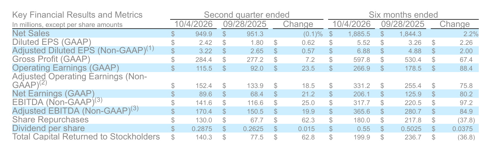
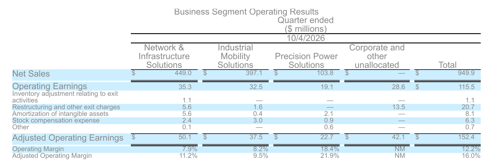

<!-- PRÜFEN: Alle Konzern-, Segment- und Cashflow-Zahlen aus der Pressemitteilung "EnerSys Reports Second Quarter Fiscal Year 2027 Results" (11.11.2026, PDF von Divi), Tabellen S. 3, 8, 10, 13. Das zweite Geschäftsquartal endete am 4. Oktober 2026, das Geschäftsjahr endet am 31. März. -->
<!-- PRÜFEN: Nicht aus der Meldung: Konsens Umsatz 972 Mio. Dollar und bereinigter Gewinn je Aktie 3,20 Dollar, 52-Wochen-Hoch 244,30 Dollar (Investing.com, Vorschau vom 11.11.2026); Kursminus von rund 15 % im letzten Monat (StockStory/FinancialContent, 10.11.2026); Kaufpreis Ultralife 320 Mio. Dollar in bar (EnerSys 8-K vom 27./28.10.2026, Finviz). Kurs 147,65 Dollar zum Schluss (−2,43 %) und 145,01 Dollar nachbörslich (−1,79 %) aus dem Yahoo-Screenshot von Divi (11.11.2026, 22:24 Uhr). -->
<!-- PRÜFEN: Selbst gerechnet: Steuergutschrift-Anteil am bereinigten Gewinn je Aktie 3,22 − 2,02 = 1,20 Dollar (37 %); Nettogewinn +31 % (89,6 / 68,4); Dividendenerhöhung 0,2875 / 0,2625 = +9,5 %; Rendite 4 × 0,2875 / 147,65 = 0,8 %; Durchschnittspreis Rückkauf 130 Mio. / 679.000 Aktien = rund 191 Dollar; Abstand zum Hoch 147,65 / 244,30 = −40 %; Vorjahreswert bereinigt ohne Steuergutschrift 1,62 Dollar aus +25 % zurückgerechnet, Vorjahres-Bruttomarge 29,1 % aus +80 Basispunkten. -->
<!-- PRÜFEN: Aufmacherfoto fehlt noch, die Fotoanfrage (Batterien, Rechenzentrum, Gabelstapler) ist angelegt, der Bot ergänzt es. Das von Divi geschickte Kraftwerksfoto zeigt kein EnerSys-Motiv und hat keine erkennbare Lizenz, deshalb nicht verwendet. CEO-Freisteller von Divi (Shawn O'Connell), Geländerrest rechts unten entfernt, abgelegt als medien/ceo/ens.png. -->

!!! kurz "Kurz gesagt (zweites Quartal Geschäftsjahr 2027)"
    **Umsatz:** 950 Mio. $ (Vorjahr 951 Mio. $)
    **Nettogewinn:** 89,6 Mio. $ (+31 %)

    1. **Mehr Gewinn aus gleichem Umsatz:** Die Bruttomarge steigt auf 29,9 %, der verwässerte Gewinn je Aktie um 34 % auf 2,42 Dollar. Beim Umsatz bleibt EnerSys unter der eigenen Prognose, nach Firmenangaben wegen der Wechselkurse.
    2. **Rüstung statt Lagerhalle:** Die Sparte für militärische Batterien wächst um 21 %, Rechenzentren stützen die Netzsparte, das Geschäft mit Antriebsbatterien für Gabelstapler schrumpft um fast 8 %.
    3. **Geld für Aktionäre und Zukauf:** 130 Mio. Dollar für Rückkäufe im Quartal, die Dividende steigt um 9,5 %, für 320 Mio. Dollar soll Ultralife übernommen werden.

## Ein Quartal, das vor allem die Marge erklärt

Wer EnerSys nur über den Umsatz beurteilt, sieht ein Unternehmen, das seit Monaten nicht vom Fleck kommt. 949,9 Millionen Dollar im zweiten Geschäftsquartal, 951,3 Millionen ein Jahr zuvor. Die eigene Spanne von 955 bis 995 Millionen Dollar hat der Batteriehersteller aus Reading in Pennsylvania verfehlt, Analysten hatten mit gut 970 Millionen gerechnet. Das Management macht die Wechselkurse dafür verantwortlich.

Die eigentliche Geschichte steht eine Zeile tiefer. Die Bruttomarge stieg auf 29,9 %, der Nettogewinn um 31 % auf 89,6 Millionen Dollar. Je Aktie blieben 2,42 Dollar, ein Drittel mehr als im Vorjahr. Bereinigt um Umbaukosten und andere Sondereffekte waren es 3,22 Dollar, ziemlich genau die Mitte der eigenen Prognose und knapp über der Erwartung der Analysten.

| Kennzahl | Q2 GJ 2027 | Q2 GJ 2026 | Veränderung |
|---|---:|---:|---:|
| Umsatz | 949,9 Mio. $ | 951,3 Mio. $ | −0,1 % |
| Bruttomarge | 29,9 % | 29,1 % | +0,8 Prozentpunkte |
| Bereinigtes operatives Ergebnis | 152,4 Mio. $ | 133,9 Mio. $ | +13,7 % |
| Bereinigte operative Marge | 16,0 % | 14,1 % | +1,9 Prozentpunkte |
| Nettogewinn | 89,6 Mio. $ | 68,4 Mio. $ | +31 % |
| Gewinn je Aktie (verwässert) | 2,42 $ | 1,80 $ | +34 % |
| Gewinn je Aktie (bereinigt) | 3,22 $ | 2,65 $ | +22 % |
| Bereinigt ohne Steuergutschrift | 2,02 $ | 1,62 $ | +25 % |
| Freier Cashflow | 130,4 Mio. $ | 197,1 Mio. $ | −34 % |

## Die Steuergutschrift trägt einen großen Teil des Gewinns

Ein Detail gehört in jede Bewertung dieses Quartals. EnerSys profitiert von einer Steuergutschrift aus dem amerikanischen Inflation Reduction Act, die Unternehmen für die heimische Fertigung bestimmter Bauteile erhalten, darunter Batterien. Im Abschluss heißt sie IRC 45X. Ohne sie läge die Bruttomarge bei 25,2 % statt 29,9 %, der bereinigte Gewinn je Aktie bei 2,02 statt 3,22 Dollar. Gut ein Drittel des bereinigten Gewinns hängt damit an einer politischen Förderung.

Positiv ist: Auch ohne die Gutschrift wächst der bereinigte Gewinn je Aktie um ein Viertel. Die Effizienz verbessert sich also im Kerngeschäft. Wie lange es die Förderung gibt, entscheidet allerdings die Politik in Washington.

## Drei Sparten, drei Richtungen

| Sparte | Umsatz | Veränderung | Bereinigte Marge (Vorjahr) |
|---|---:|---:|---:|
| Netze und Infrastruktur | 449,0 Mio. $ | +3,3 % | 11,2 % (8,3 %) |
| Industrielle Mobilität | 397,1 Mio. $ | −7,8 % | 9,5 % (10,1 %) |
| Präzisionsenergie (Rüstung, Luftfahrt) | 103,8 Mio. $ | +21,0 % | 21,9 % (18,5 %) |

Am schnellsten wächst die kleinste Sparte. Batterien für Soldatenausrüstung und Munition steigerten den Umsatz um 21 %, die bereinigte Marge liegt bei fast 22 %. Die Netzsparte, die Notstromlösungen für Telekommunikation und Rechenzentren liefert, wuchs gegen ein starkes Vorjahresquartal um gut 3 %. Bei Rechenzentren meldet EnerSys zweistellige Zuwächse und den ersten Auftrag für die neue Lithium-Lösung DataSafe Noir.

Schwach bleibt die größte Baustelle. Antriebsbatterien für Gabelstapler und Lagertechnik setzten fast 8 % weniger um, die Marge sank leicht. Finanzchefin Andrea Funk erwartet hier für das dritte Quartal eine erste Erholung, warnt aber vor Druck auf die Marge, weil das Transportgeschäft schneller wächst als die profitablere Lagertechnik.

## Rückkäufe, Dividende und ein Zukauf für die Rüstung

Beim Geld zeigt sich EnerSys großzügig. Im Quartal flossen 130 Millionen Dollar in den Rückkauf von 679.000 eigenen Aktien, im Schnitt also zu rund 191 Dollar je Stück. Die Quartalsdividende steigt von 0,2625 auf 0,2875 Dollar, zahlbar am 31. Dezember an alle, die am 18. Dezember Aktien halten. Auf den aktuellen Kurs gerechnet sind das nur rund 0,8 % Rendite im Jahr, EnerSys gibt seinen Aktionären das meiste Geld über Rückkäufe zurück. Der freie Cashflow lag im Quartal bei 130 Millionen Dollar und damit unter dem Vorjahr, das eine Steuererstattung enthielt. Im Halbjahr hat er sich auf 348 Millionen Dollar mehr als verdoppelt. Die Nettoverschuldung entspricht dem 0,8-Fachen des operativen Ergebnisses vor Abschreibungen, vor einem Jahr war es das 1,3-Fache.

Der Spielraum wird gebraucht. Ende Oktober hat EnerSys vereinbart, den Batteriehersteller Ultralife für 320 Millionen Dollar in bar zu übernehmen. Ultralife liefert Batterien und Energiesysteme für das US-Militär und verbündete Streitkräfte. Konzernchef Shawn O’Connell spricht von einem passenden Baustein für eine breitere Plattform im Rüstungsgeschäft. Abschließen will EnerSys den Kauf im vierten Geschäftsquartal, also bis Ende März 2027. In der Prognose ist er noch nicht enthalten.

## Ausblick und Reaktion der Börse

Für das dritte Quartal erwartet EnerSys einen Umsatz von 935 bis 975 Millionen Dollar und einen bereinigten Gewinn je Aktie von 3,05 bis 3,15 Dollar, einschließlich der Steuergutschrift. Das liegt unter den 3,22 Dollar des abgelaufenen Quartals. Das Management begründet die Spanne mit außergewöhnlich starken Margen in den Projektgeschäften der Vorquartale.

Die Aktie schloss am Mittwoch bei 147,65 Dollar, 2,4 % im Minus, und gab nachbörslich auf rund 145 Dollar nach. Sie hat im vergangenen Monat rund 15 % verloren und liegt etwa 40 % unter ihrem Jahreshoch von 244 Dollar. Am Donnerstag erläutert das Management die Zahlen in einer Telefonkonferenz.

## Quellen

- EnerSys, „EnerSys Reports Second Quarter Fiscal Year 2027 Results" (11.11.2026)
- EnerSys, Mitteilung zur geplanten Übernahme von Ultralife (27.10.2026)
- Investing.com, Vorschau auf die Zahlen von EnerSys (11.11.2026)
- StockStory/FinancialContent, „EnerSys (ENS) earnings: what to expect" (10.11.2026)

*Alle Angaben ohne Gewähr. Keine Anlageberatung.*
