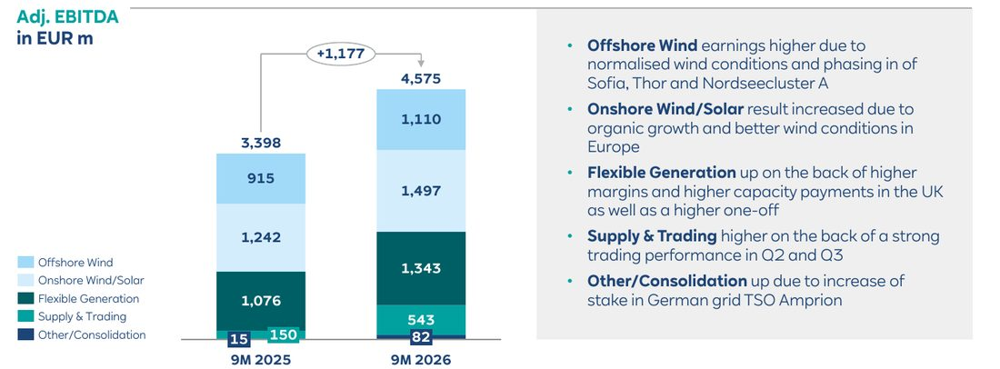
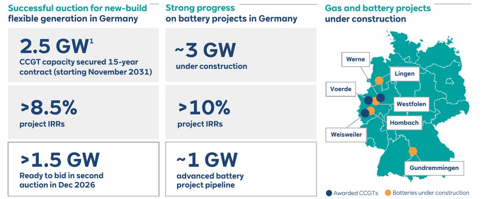
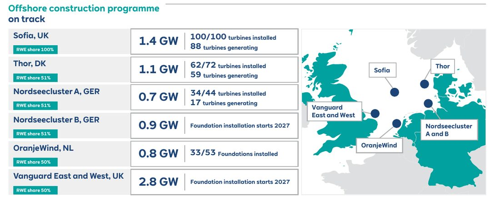
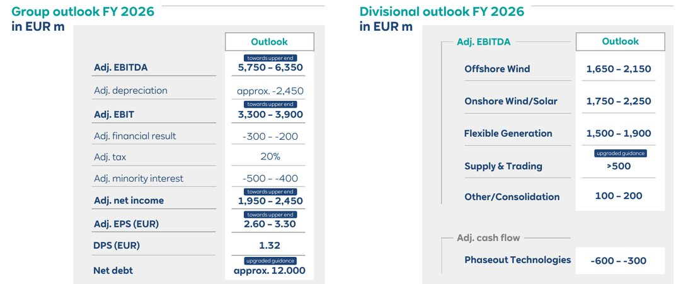

<!-- PRÜFEN: Konzernzahlen, Segmentzahlen, Ausblick, Nettoschulden, Offshore-Projekte, Auktion und Batterien: Präsentation "9M 2026 Results" von RWE (11.11.2026, Folien 3 bis 18, von Divi als PDF geliefert). Eine Pressemitteilung mit Zitat des Vorstandschefs lag nicht vor, deshalb kein Zitat im Text. -->
<!-- PRÜFEN: Aus dem finanzen.net-Text (dpa-AFX, 11.11.2026, von Divi geliefert) und nicht in den Folien: Handel habe die Erwartungen der vom Unternehmen befragten Analysten übertroffen, übrige Bereiche entsprachen den Schätzungen, Kursreaktion vorbörslich leicht im Plus (Xetra zeitweise +0,89 % auf 58,66 Euro). Der Kurs von 58,46 Euro (+0,55 %, 09:39 Uhr) stammt aus dem onvista-Screenshot von Divi. -->
<!-- PRÜFEN: Verlust des Energiehandels im ersten Quartal (minus 84 Mio. Euro) stammt aus einer Börsenkolumne zum ersten Quartal (stock3, 13.05.2026, Bernecker Börsenbriefe), nicht aus RWE-Unterlagen. Die Folie nennt nur "starke Handelsleistung im zweiten und dritten Quartal". -->
<!-- PRÜFEN: Selbst gerechnet: Veränderungen in Prozent (EBITDA +34,6 %, EBIT +48,6 %, Nettoergebnis +42,8 %, EPS +42,4 %, Segmente), Flexible Erzeugung ohne Einmalposten 1.011 gegen 851 Mio. Euro (+18,8 %), Rest-Ergebnis je Aktie von 0,78 Euro im vierten Quartal für das obere Ende von 3,30 Euro, Abstand des Kurses zum 52-Wochen-Hoch (minus 5,7 %) und -Tief (plus 37 %, Werte 62,00 und 42,62 Euro aus onvista), Dividendenrendite 2,3 % und Ausschüttungsquote 40 bis 51 % (1,32 Euro durch 58,46 Euro bzw. durch 3,30 und 2,60 Euro; die Folie nennt nur den Dividendenwert 1,32 Euro, nicht ob er bestätigt oder verändert ist). -->
<!-- PRÜFEN: Nettoschulden: Die Folie zeigt 17,0 Mrd. Euro zum 30.09., die Jahresprognose liegt bei rund 12 Mrd. Euro ("upgraded guidance"). Die Folien nennen keinen Grund für den erwarteten Rückgang um rund 5 Mrd. Euro im vierten Quartal, deshalb im Text nur als offene Frage. Vorjahreswert der Prognose nicht bekannt. -->
<!-- PRÜFEN: Auslaufende Technologien: Cashflow minus 669 Mio. Euro nach neun Monaten, Prognose für das Gesamtjahr minus 600 bis minus 300 Mio. Euro. Der Neun-Monats-Wert liegt bereits darunter, die Folie erklärt das nicht. -->
<!-- PRÜFEN: Das CEO-Foto (Freisteller) kam von Divi ohne Namen; angenommen ist Markus Krebber, Vorstandsvorsitzender. Name im Archiv vor dem Zitat-Einsatz bestätigen. Aufmacher: Amrumbank West (CC0), kein RWE-Pressebild; der Park gehört nach Kenntnis der Redaktion zu RWE, bitte Eigentümerangabe gegenprüfen. -->

!!! kurz "Kurz gesagt (neun Monate 2026)"
    **Ebitda (bereinigt):** 4,58 Mrd. € (+34,6 %)
    **Nettoergebnis (bereinigt):** 1,85 Mrd. € (+42,8 %)

    1. **Handel als Treiber:** Der Energiehandel erreicht 543 Mio. Euro Ergebnis, ein Jahr zuvor waren es 150 Mio. Euro. Auch die drei Erzeugungssparten legen um 20 bis 25 % zu.
    2. **Oberes Ende der Spanne:** RWE erwartet für 2026 Ergebnisse im oberen Bereich der Prognose und hebt die Erwartung an den Energiehandel und an die Nettoschulden an.
    3. **Zubau mit Rendite:** Drei Gaskraftwerke mit 2,5 Gigawatt haben Zuschläge für 15 Jahre bekommen, dazu kommen Batteriespeicher und Offshore-Wind in Milliardenhöhe.

## Ein Versorger, der wie ein Wachstumswert rechnet

Wer RWE noch als Kohlekonzern im Rückzug kennt, sieht in diesem Zwischenbericht ein anderes Unternehmen. Nach neun Monaten steht ein bereinigtes Ergebnis vor Zinsen, Steuern und Abschreibungen (Ebitda) von 4,58 Milliarden Euro, gut ein Drittel mehr als im Vorjahreszeitraum. Der bereinigte Nettogewinn steigt um 43 % auf 1,85 Milliarden Euro, je Aktie sind es 2,52 Euro nach 1,77 Euro. RWE gibt an, damit 85 % des Jahresziels für das Ergebnis je Aktie erreicht zu haben.

Die Folge ist eine Anhebung der Erwartung innerhalb der bestehenden Spannen. Ebitda, Nettogewinn und Ergebnis je Aktie sollen für 2026 „towards the upper end", also im oberen Bereich der Prognose landen. Beim Nettogewinn liegt die Spanne bei 1,95 bis 2,45 Milliarden Euro, das untere Ende fehlt nach neun Monaten nur noch um gut 100 Millionen Euro. Für das obere Ende von 3,30 Euro je Aktie müsste im vierten Quartal rechnerisch noch ein Ergebnis von etwa 0,78 Euro hinzukommen.

Die Aktie notierte am Vormittag bei 58,46 Euro, 0,55 % im Plus. Das sind knapp 6 % unter dem Hoch der vergangenen zwölf Monate von 62,00 Euro und gut 37 % über dem Tief von 42,62 Euro. Der Handel war die positive Überraschung, in den übrigen Bereichen entsprachen die Ergebnisse den Schätzungen.

## Die Zahlen im Überblick

| Kennzahl (bereinigt) | 9M 2026 | 9M 2025 | Veränderung |
|---|---:|---:|---:|
| Ebitda | 4.575 Mio. € | 3.398 Mio. € | +34,6 % |
| Abschreibungen | −1.806 Mio. € | −1.535 Mio. € | +17,7 % |
| Ebit | 2.769 Mio. € | 1.863 Mio. € | +48,6 % |
| Finanzergebnis | −42 Mio. € | −79 Mio. € | besser |
| Steuern (20 %) | −545 Mio. € | −357 Mio. € | +52,7 % |
| Minderheiten | −336 Mio. € | −134 Mio. € | +150,7 % |
| Nettoergebnis | 1.846 Mio. € | 1.293 Mio. € | +42,8 % |
| Ergebnis je Aktie | 2,52 € | 1,77 € | +42,4 % |

Der Gewinn wächst schneller als das Ebitda, weil die Abschreibungen langsamer steigen und das Finanzergebnis besser ausfällt. Es profitiert von höheren aktivierten Zinsen: Bei großen Bauprojekten wie den Offshore-Parks darf ein Teil der Zinsen in der Bauphase in die Anlage eingerechnet werden. Die Gewinnrechnung wird dadurch zunächst entlastet, die Zinskosten verteilen sich auf die Jahre danach.

Gegenläufig wirken die Minderheiten. Sie haben sich mehr als verdoppelt, weil Partner an den Gewinnen beteiligt sind: der Finanzinvestor Apollo mit seinem Anteil von 25,1 % an Amprion und die Mitgesellschafter bei den Offshore-Parks, deren Ergebnis ebenfalls besser ausfällt. Von jedem zusätzlichen Euro Ebitda bleibt bei RWE deshalb nicht alles hängen.

## Vier Segmente, ein klarer Gewinner

| Segment (Ebitda, bereinigt) | 9M 2026 | 9M 2025 | Veränderung | Prognose 2026 |
|---|---:|---:|---:|---:|
| Offshore Wind | 1.110 Mio. € | 915 Mio. € | +21,3 % | 1.650–2.150 Mio. € |
| Onshore Wind/Solar | 1.497 Mio. € | 1.242 Mio. € | +20,5 % | 1.750–2.250 Mio. € |
| Flexible Erzeugung | 1.343 Mio. € | 1.076 Mio. € | +24,8 % | 1.500–1.900 Mio. € |
| Energiehandel (Supply & Trading) | 543 Mio. € | 150 Mio. € | ×3,6 | über 500 Mio. € |
| Sonstiges/Konsolidierung | 82 Mio. € | 15 Mio. € | – | 100–200 Mio. € |
| **Konzern** | **4.575 Mio. €** | **3.398 Mio. €** | **+34,6 %** | **5.750–6.350 Mio. €** |

Der Energiehandel liefert mit 393 Millionen Euro mehr Ergebnis ein Drittel des gesamten Zuwachses von 1.177 Millionen Euro. Er ist zugleich das schwankungsanfälligste Geschäft. Im ersten Quartal hatte die Sparte noch einen Verlust von 84 Millionen Euro geschrieben, die Gewinne stammen also aus dem zweiten und dritten Quartal. Die angehobene Erwartung für das Gesamtjahr von über 500 Millionen Euro ist nach neun Monaten mit 543 Millionen Euro bereits übertroffen.

**Offshore-Wind** verdient 195 Millionen Euro mehr. Dahinter stehen normalisierte Windverhältnisse nach schwachen Vorjahresquartalen und die Inbetriebnahme der Parks Sofia in Großbritannien, Thor in Dänemark und Nordseecluster A. Belastend wirkten niedrigere abgesicherte Strompreise und Währungseffekte beim Pfund.

**Onshore Wind/Solar** wächst um 255 Millionen Euro, getragen vom Zubau und besseren Windverhältnissen in Europa. Der Dollar drückt, weil ein Teil des Geschäfts in den USA entsteht. Die Abschreibungen steigen um 140 Millionen Euro auf 820 Millionen Euro und damit stärker als in den anderen Sparten, ein Zeichen für den Zubau der letzten Jahre.

**Flexible Erzeugung** steigt um 267 Millionen Euro. Zwei Treiber stehen auf der Folie: höhere Margen und höhere vertraglich gesicherte Zahlungen aus dem britischen Kapazitätsmarkt. Dazu kommt ein Einmalposten. Die niederländische Regierung entschädigt RWE mit 332 Millionen Euro für Produktionsbeschränkungen am Kraftwerk Eemshaven aus dem Jahr 2022. Im Vorjahr waren es 225 Millionen Euro an Einmalposten. Ohne diese Posten liegt das Segment bei 1.011 Millionen Euro nach 851 Millionen Euro, ein Plus von knapp 19 %. Auch bereinigt wächst das Geschäft, aber weniger stark als die Überschrift vermuten lässt.

## Wohin das Geld fließt

Der Konzern investiert in einem Tempo, das sich in der Bilanz niederschlägt. Die Nettoschulden liegen zum 30. September bei 17,0 Milliarden Euro, zum Jahresende 2025 waren es 10,9 Milliarden Euro.

| Entwicklung der Nettoschulden, 9M 2026 | Mrd. € |
|---|---:|
| Stand 31.12.2025 | 10,9 |
| Operativer Cashflow (bereinigt) | −1,9 |
| Netto-Investitionen | +10,7 |
| Dividenden | +1,1 |
| Sonstige Veränderungen (u. a. Kapitalerhöhung, Absicherung, Handel, abzüglich Aktienrückkauf) | −3,4 |
| Veränderung der Rückstellungen | −0,5 |
| **Stand 30.09.2026** | **17,0** |

Die Netto-Investitionen von 10,7 Milliarden Euro enthalten 3,6 Milliarden Euro für den Ausbau der Beteiligung am Übertragungsnetzbetreiber Amprion, an dem RWE nun 58 % hält. Die Folie nennt für den Kauf das 1,07-Fache des für 2027 erwarteten Werts der regulierten Anlagen (EV/RAB). Der Preis liegt damit nur wenig über dem regulierten Anlagevermögen des Netzbetreibers. Außerdem hat RWE in diesem Jahr eine Kapitalerhöhung durchgeführt und im Juni ein Aktienrückkaufprogramm abgeschlossen.

Der bereinigte operative Cashflow beträgt 1,9 Milliarden Euro, gut 2,6 Milliarden Euro weniger als das Ebitda. Zwei Posten ziehen ihn nach unten: 1,5 Milliarden Euro aus Rückstellungen und Zahlungen für auslaufende Technologien sowie 1,2 Milliarden Euro Mittelbindung im Umlaufvermögen, vor allem weil mehr Gas in den Speichern liegt und Forderungen und Verbindlichkeiten sich ungünstig verschoben haben. RWE ordnet das als saisonal ein, ob das stimmt, zeigt das vierte Quartal.

Das Ziel für die Nettoschulden zum Jahresende ist auf rund 12 Milliarden Euro angehoben. Von 17,0 Milliarden Euro auf 12 Milliarden Euro in drei Monaten ist ein Rückgang um 5 Milliarden Euro. Einzelposten für diesen Sprung nennen die Folien nicht, die Telefonkonferenz am Nachmittag dürfte Klarheit bringen.

Die auslaufenden Technologien, also unter anderem die Braunkohle, belasten den bereinigten Cashflow mit minus 669 Millionen Euro nach minus 355 Millionen Euro im Vorjahr. Die Erwartung für das Gesamtjahr liegt bei minus 600 bis minus 300 Millionen Euro, der Neun-Monats-Wert ist damit schon darunter. Als Gründe nennt RWE niedrigere abgesicherte Margen und Kosten für den Tagebau, Kostensenkungen wirken dagegen.

## Gaskraftwerke und Batterien: Der Zubau mit Zielrendite

In der ersten deutschen Ausschreibung für neue steuerbare Kraftwerke hat RWE drei Gaskraftwerke mit gemeinsam 2,5 Gigawatt gesichert, nach den Regeln der Auktion zählen davon 2,1 Gigawatt. Die Anlagen bekommen Kapazitätsverträge über 15 Jahre ab November 2031 und sollen Renditen von mehr als 8,5 % erzielen. Die Auktion zeigt, wie RWE den Kohleausstieg in Anlagen übersetzt, die bei wenig Wind und Sonne einspringen: Ein Kapazitätsvertrag vergütet die Bereitschaft der Kraftwerke und sichert so über 15 Jahre einen Zahlungsstrom. Bis zum Start 2031 müssen die Anlagen allerdings gebaut werden, und bis dahin tragen die Baukosten das Risiko.

Parallel baut RWE in Deutschland rund 3 Gigawatt Batteriespeicher mit angestrebten Renditen von mehr als 10 %, weitere rund 1 Gigawatt stehen in einer fortgeschrittenen Planung. Für die zweite Auktion im Dezember 2026 hält RWE über 1,5 Gigawatt bereit. Die Renditen sind Zielwerte für Projekte, die noch nicht am Netz sind, und die Erlöse von Batteriespeichern hängen von den Preisschwankungen am Strommarkt ab.

## Offshore: Das Programm liegt im Plan

RWE baut 4,5 Gigawatt Offshore-Wind, und die Folie zeigt den Stand je Park:

| Park | Leistung | RWE-Anteil | Stand |
|---|---:|---:|---|
| Sofia, Großbritannien | 1,4 GW | 100 % | 100 von 100 Turbinen installiert, 88 liefern Strom |
| Thor, Dänemark | 1,1 GW | 51 % | 62 von 72 installiert, 59 liefern Strom |
| Nordseecluster A, Deutschland | 0,7 GW | 51 % | 34 von 44 installiert, 17 liefern Strom |
| Nordseecluster B, Deutschland | 0,9 GW | 51 % | Fundamente ab 2027 |
| OranjeWind, Niederlande | 0,8 GW | 50 % | 33 von 53 Fundamenten installiert |
| Vanguard East und West, Großbritannien | 2,8 GW | 50 % | Fundamente ab 2027 |

Für Vanguard hat RWE die Projektfinanzierung abgeschlossen. 35 internationale Banken stellen 13 Milliarden Pfund bereit, der Park hat eine staatlich garantierte Einspeisevergütung (Contract for Difference). Dass so viele Banken mitgehen, spricht für die Verlässlichkeit der gesicherten Erlöse. Insgesamt sind 13,5 Gigawatt im Bau, am 30. September 2026 hatte RWE 41,3 Gigawatt in Betrieb, nach Abschluss der Projekte wären es 54,8 Gigawatt.

Die Vorabdaten zum Kraftwerkspark vom 23. Oktober zeigen den Zubau an Land: Das Segment Onshore Wind/Solar kommt anteilig auf 19,0 Gigawatt Leistung, nach 16,5 Gigawatt vor einem Jahr (+15,6 %). Darin stecken 1,4 Gigawatt Batteriespeicher nach 0,8 Gigawatt im Vorjahr. Offshore-Wind steht bei 3,2 Gigawatt, leicht unter dem Vorjahr (3,3 Gigawatt). Der Zuwachs dort kommt erst mit den Parks, die gerade gebaut werden.

## Der Ausblick im Detail

| Prognose 2026 | Spanne | Einordnung |
|---|---|---|
| Ebitda (bereinigt) | 5.750–6.350 Mio. € | oberes Ende |
| Ebit (bereinigt) | 3.300–3.900 Mio. € | oberes Ende |
| Nettoergebnis (bereinigt) | 1.950–2.450 Mio. € | oberes Ende |
| Ergebnis je Aktie (bereinigt) | 2,60–3,30 € | oberes Ende |
| Dividende je Aktie | 1,32 € | – |
| Nettoschulden | rund 12.000 Mio. € | Prognose angehoben |
| Energiehandel (Ebitda) | über 500 Mio. € | Prognose angehoben |

Wer RWE wegen der Dividende hält, kann mit 1,32 Euro je Aktie rechnen. Bei einem Kurs von 58,46 Euro entspricht das einer Dividendenrendite von rund 2,3 %. Gemessen am erwarteten Ergebnis je Aktie von 2,60 bis 3,30 Euro schüttet RWE damit 40 bis 51 % des bereinigten Gewinns aus. Der größere Teil des Geldes fließt in den Zubau, und die Schulden wachsen mit.

## Was für und gegen die Aktie spricht

Für den Konzern spricht, dass der Ergebniszuwachs breit abgestützt ist: Alle drei Erzeugungssparten legen um 20 bis 25 % zu, der Zuwachs steht auf mehreren Beinen. Die Erlöse der neuen Kraftwerke und Batterien sind über Kapazitätszahlungen und staatliche Verträge langfristig abgesichert, und die Offshore-Parks gehen planmäßig ans Netz.

Dagegen steht, dass ein beträchtlicher Teil des Zuwachses aus Quellen kommt, die sich nicht wiederholen müssen. Die Entschädigung für Eemshaven mit 332 Millionen Euro ist einmalig, der Handel schwankt stark, und der Wind kann im nächsten Jahr wieder schwächer wehen. Hinzu kommen Nettoschulden von 17 Milliarden Euro, ein Anstieg um mehr als die Hälfte in neun Monaten, und ein Cashflow, der nur einen Bruchteil des Ebitda erreicht. Wer die Aktie kauft, setzt darauf, dass die Bauprogramme in den nächsten Jahren die Erträge liefern, die die Folien in Aussicht stellen.

## Was als Nächstes ansteht

Am Mittwochnachmittag um 13 Uhr hält RWE die Telefonkonferenz zu den Zahlen. Danach geht das Management auf Reisen: Ab dem 16. November stehen Termine in den USA an, am 30. November die Konferenz von JP Morgan. Die zweite Auktion für Gaskraftwerke findet im Dezember 2026 statt. Die Zahlen für das Gesamtjahr 2026 legt RWE am 4. März 2027 vor, die Hauptversammlung ist am 29. April 2027.

## Quellen

- RWE, Präsentation „9M 2026 Results" (11.11.2026)
- RWE, Vorabdaten zu installierter Leistung und Stromerzeugung, neun Monate 2026 (23.10.2026)
- RWE, Investor Relations: Finanzkalender
- finanzen.net / dpa-AFX, „RWE-Aktie gefragt: Energiehandel auch im dritten Quartal stark – Erwartungen geschlagen" (11.11.2026)
- stock3 / Bernecker Börsenbriefe, „RWE unspektakulär" (13.05.2026)
- onvista, Kursdaten RWE-Aktie (11.11.2026)

*Dieser Beitrag fasst die Berichterstattung der genannten Quellen in eigenen Worten zusammen. Alle Angaben ohne Gewähr. Keine Anlageberatung.*
