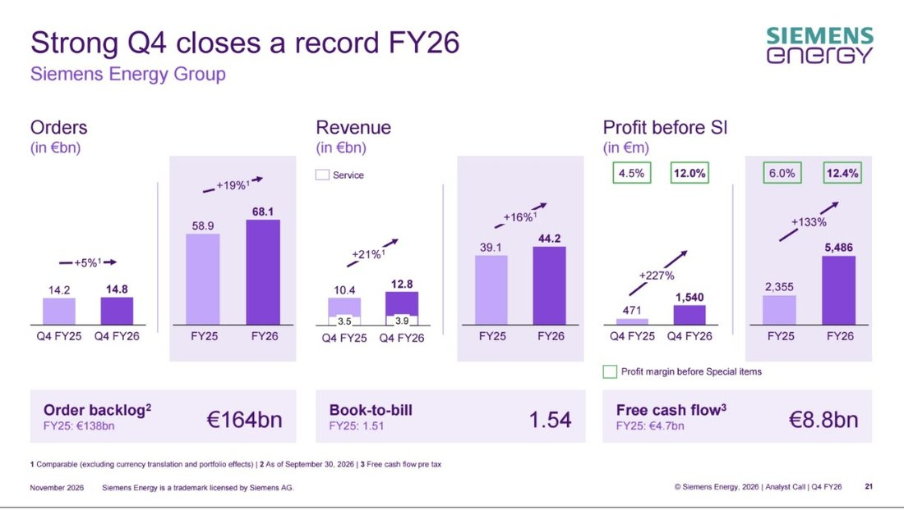
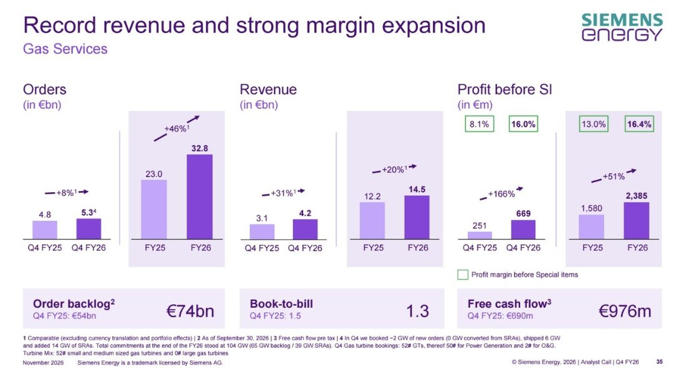
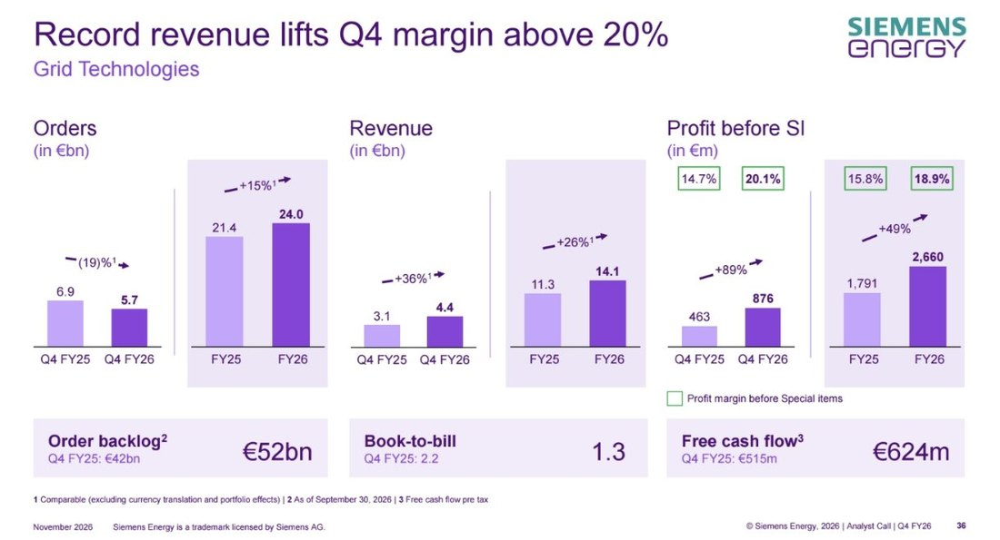
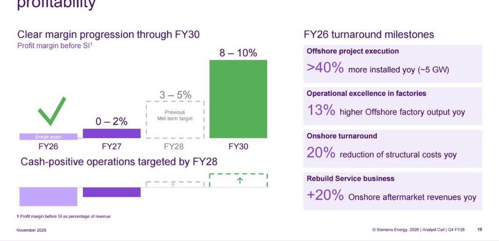
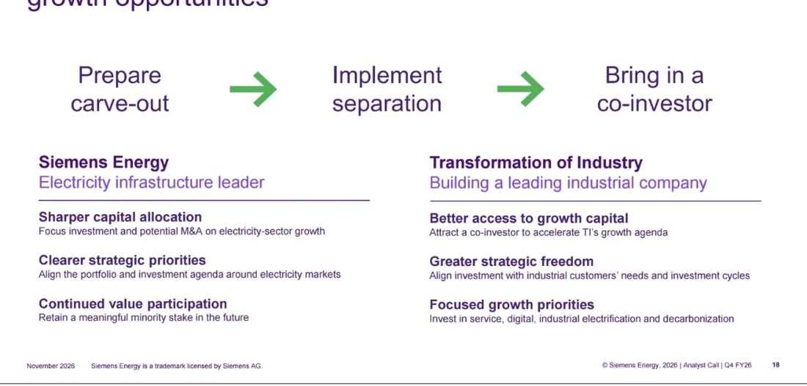
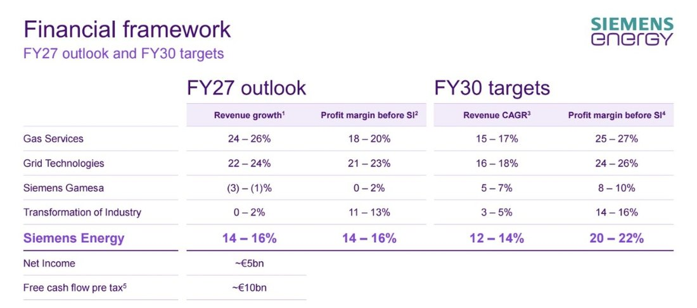
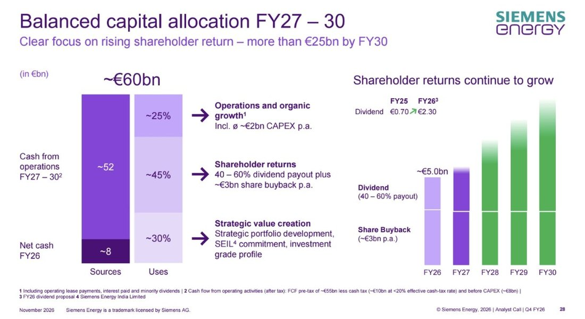

<!-- PRÜFEN: Konzern- und Segmentzahlen: Meldung "Q4 FY26 Earnings Release" auf der IR-Seite von Siemens Energy (11.11.2026) und Folien der Analystenpräsentation Q4 FY26 (Screenshots von Divi, Folien 3 bis 29 und 34 bis 37). Folie 38 (Transformation of Industry, Quartal) lag nicht vor, die Aussagen zur Industriesparte beruhen auf den Folien 17, 18, 22 und 29. -->
<!-- PRÜFEN: Nur aus dem Handelsblatt (11.11.2026, Screenshots von Divi) und in den Unternehmensunterlagen nicht gefunden: Aktienkurs von rund 120 Euro, Hoch von 187 Euro, Kursverlust von rund einem Drittel seit dem Frühjahr, Kurs von rund sieben Euro im Herbst 2023, Trench-Verkauf an GE Vernova für 8,4 Milliarden Euro (zuletzt gut eine Milliarde Umsatz), früherer Trench-Verkauf an Triton, GE-Vernova-Zahlen (Umsatz +18 % auf 12,6 Mrd. Dollar, bereinigtes Ebitda 811 Mio. auf 1,9 Mrd. Dollar), Verkaufsprozess der Industriesparte "Anfang des Jahres" nach Angaben aus Industriekreisen, Marktstimmen zur Aufspaltung. Das Handelsblatt spricht von einem Verkauf, die Folie 18 von einem Co-Investor mit verbleibender Minderheitsbeteiligung. Text folgt der Folie. -->
<!-- PRÜFEN: Selbst gerechnet aus Folien: Quartalsmarge Gesamtkonzern 12,0 % steht auf Folie 21. Verhältnis Auftragsbestand zu Jahresumsatz 164 / 44,2 = 3,7. Dividendensumme rund 1,9 Mrd. Euro = Aktionärsrückfluss 5,0 Mrd. abzüglich Rückkauf 3,1 Mrd. (Folien 4 und 28), Ausschüttungsquote 1,9 / 4,1 = 46 %. Umsatz und Gewinn 2030 je Sparte aus FY26-Werten mit der angegebenen Wachstumsrate und dem Gewinnfaktor hochgerechnet, nur als Größenordnung. Rendite auf den Kurs 2,30 / 119,84 = 1,9 %. -->
<!-- PRÜFEN: Folie 12 Netze: Aufteilung der Nachfrage nach Treibern (Gebäude 30 %, Industrie 27 %, Verkehr 23 %, Rechenzentren 20 %) ist aus der Legende zugeordnet, die Farbzuordnung im Kreisdiagramm war auf dem Screenshot nicht eindeutig. -->
<!-- PRÜFEN: Gamesa: Free Cashflow Gesamtjahr minus 1,6 Mrd. Euro, Auftragseingang Gesamtjahr 5,9 Mrd. Euro (minus 31 % vergleichbar), Gewinn Gesamtjahr 8 Mio. Euro stammen aus den Folien 22 und 37, Screenshot an der Stelle teils verdeckt. -->
<!-- PRÜFEN: Kein CEO-Foto (Christian Bruch) und kein Kursbild von Divi, deshalb Story mit der Konzernfolie. Aufmacherfoto: von Divi geliefertes Pressebild (Gasturbinen-Läufer, Siemens-Helm). Lizenz/Freigabe von Siemens Energy nicht geprüft, redaktionelle Nutzung als markierte Ausnahme; Quelle-Link im Front Matter ist nur die allgemeine Pressebereichsseite, bitte durch die genaue Bildquelle ersetzen. -->

!!! kurz "Kurz gesagt"
    **Umsatz Q4:** 12,8 Mrd. Euro (+21,5 % vergleichbar)
    **Gewinn vor Sondereffekten Q4:** 1,54 Mrd. Euro (Vorjahr 471 Mio.)

    1. **Rekordquartal:** Der Umsatz erreicht einen Höchstwert, der Auftragsbestand wächst auf 164 Mrd. Euro, der Jahresüberschuss auf 4,1 Mrd. Euro (Vorjahr 1,7 Mrd.).
    2. **Vier Sparten, vier Wege:** Gasturbinen und Netze liefern Margen von 16 bis 19 %, die Windkraft erreicht die Gewinnschwelle, die Industriesparte soll mit einem Co-Investor eigenständig werden.
    3. **Hohe Ziele:** Bis 2030 sollen die Umsätze jährlich um 12 bis 14 % wachsen und die Marge vor Sondereffekten auf 20 bis 22 % steigen. Die Dividende steigt von 0,70 auf 2,30 Euro je Aktie.

## Ein Konzern, der geliefert hat und trotzdem rechtfertigen muss

Wer Siemens Energy vor drei Jahren abgeschrieben hat, muss sich heute eine andere Zahlenreihe ansehen. Im Herbst 2023 stand der Konzern nach den Qualitätsproblemen bei Siemens Gamesa unter massivem Druck, die Aktie kostete zeitweise rund sieben Euro. Am Mittwoch meldete das Unternehmen einen Jahresüberschuss von 4,1 Milliarden Euro, nach 1,7 Milliarden im Vorjahr, und ein viertes Quartal, das in fast jeder Zeile ein Rekord ist. Christian Bruch, der Vorstandsvorsitzende, sagte, das Team habe alle angehobenen Prognosen erfüllt, das Ergebnis deutlich gesteigert und im Windgeschäft die Gewinnschwelle erreicht.

Und doch steht die Aktie bei rund 120 Euro, ein gutes Drittel unter dem Hoch von 187 Euro aus dem Frühjahr. Das ist die eigentliche Geschichte dieses Berichts. Siemens Energy muss an diesem Tag belegen, dass die Zahlen über Jahre tragen. Die neuen Mittelfristziele, die Dividende von 2,30 Euro und das Rückkaufprogramm sind die Antwort auf diese Frage. Eine Antwort gibt auch die Bilanz der Versprechen: Auf dem Kapitalmarkttag im November 2025 hatte der Konzern für das Geschäftsjahr 2026 eine Marge von 9 bis 11 % in Aussicht gestellt, erreicht hat er 12,4 %. Auch beim Cashflow und beim Nettogewinn liegt er klar über den damaligen Spannen.

| Ziel vom Kapitalmarkttag 2025 | Versprochen | Erreicht 2025/26 |
|---|---|---|
| Marge vor Sondereffekten | 9 bis 11 % | 12,4 % |
| Freier Cashflow vor Steuern | 4 bis 5 Mrd. € | 8,8 Mrd. € |
| Nettogewinn | 3 bis 4 Mrd. € | 4,1 Mrd. € |
| Marge von 14 bis 16 % | für 2027/28 vorgesehen | bereits für 2026/27 prognostiziert |
| Rückfluss an Aktionäre | 10 Mrd. € bis 2028 | rund 5,0 Mrd. € allein 2025/26 |

## Das vierte Quartal in Zahlen

Der Umsatz stieg auf vergleichbarer Basis, also ohne Währungs- und Portfolioeffekte, um 21,5 % auf 12,8 Milliarden Euro. Beide großen Sparten, Gas Services und Grid Technologies, erreichten Höchststände. Der Auftragseingang wuchs mit 5,2 % auf 14,8 Milliarden Euro deutlich langsamer. Das Unternehmen hatte diese Abkühlung angekündigt: Nach drei außergewöhnlich starken Quartalen verteilen sich Großprojekte ungleichmäßig. Das Verhältnis von Aufträgen zu Umsatz liegt mit rund 1,2 weiter klar über eins, und der Auftragsbestand wächst auf den neuen Rekord von 164 Milliarden Euro.

| Kennzahl | Q4 2025/26 | Q4 2024/25 | Veränderung |
|---|---:|---:|---:|
| Auftragseingang | 14,8 Mrd. € | 14,2 Mrd. € | +5,2 % (vergleichbar) |
| Umsatz | 12,8 Mrd. € | 10,4 Mrd. € | +21,5 % (vergleichbar) |
| Gewinn vor Sondereffekten | 1.540 Mio. € | 471 Mio. € | ×3,3 |
| Marge vor Sondereffekten | 12,0 % | 4,5 % | +7,5 Prozentpunkte |
| Sondereffekte | +184 Mio. € | −143 Mio. € | – |
| Gewinn | 1.725 Mio. € | 328 Mio. € | ×5,3 |
| Nettogewinn | 1.360 Mio. € | 236 Mio. € | ×5,8 |
| Ergebnis je Aktie (unverwässert) | 1,49 € | 0,19 € | ×7,8 |
| Freier Cashflow vor Steuern | 1.636 Mio. € | 1.327 Mio. € | +23 % |

Ein Teil des Gewinnsprungs ist buchhalterisch. Die Sondereffekte waren diesmal positiv, vor allem weil Wertberichtigungen auf Anlagen für kleine Flugzeugturbinen aufgelöst wurden. Wer die Qualität des Quartals beurteilen will, hält sich deshalb an den Gewinn vor Sondereffekten. Dessen Marge sprang von 4,5 auf 12,0 %, im Gesamtjahr liegt sie bei 12,4 %. Das Quartal war also stark, aber kein Ausreißer nach oben, und das spricht für Verlässlichkeit.

Beim Cashflow zeigt sich, wie das Geschäft finanziert wird. Der freie Cashflow vor Steuern lag bei 1,64 Milliarden Euro, und das Unternehmen nennt zwei Treiber: den höheren Gewinn sowie Anzahlungen und Reservierungsgebühren von Kunden, die wegen der anhaltend hohen Bestellungen weiter fließen. Für Anleger heißt das: Ein Teil dieses Geldes gehört wirtschaftlich den Kunden, solange die Turbinen und Transformatoren nicht geliefert sind.

## Das Gesamtjahr: Marge von 12,4 %, Nettogewinn von 4,1 Milliarden

| Kennzahl | 2025/26 | 2024/25 | Veränderung |
|---|---:|---:|---:|
| Auftragseingang | 68,1 Mrd. € | 58,9 Mrd. € | +19 % (vergleichbar) |
| Umsatz | 44,2 Mrd. € | 39,1 Mrd. € | +15,5 % (vergleichbar) |
| Gewinn vor Sondereffekten | 5.486 Mio. € | 2.355 Mio. € | +133 % |
| Marge vor Sondereffekten | 12,4 % | 6,0 % | +6,4 Prozentpunkte |
| Nettogewinn | 4,1 Mrd. € | 1,7 Mrd. € | ×2,4 |
| Freier Cashflow vor Steuern | 8,8 Mrd. € | 4,7 Mrd. € | +87 % |
| Auftragsbestand | 164 Mrd. € | 138 Mrd. € | +26 Mrd. € |
| Dividende je Aktie (Vorschlag) | 2,30 € | 0,70 € | ×3,3 |

Die Marge hat sich innerhalb eines Jahres verdoppelt, vor zwei Jahren lag sie bei 1,0 %. Der Konzern profitiert vom wachsenden Strombedarf, der aus mehreren Richtungen zugleich kommt: Rechenzentren für künstliche Intelligenz, Elektrifizierung von Industrie und Verkehr, der Ersatz alter Anlagen und der Ausbau der Netze. Dass der Auftragsbestand mit 164 Milliarden Euro fast das Vierfache des Jahresumsatzes beträgt, sichert die Auslastung der Werke für Jahre. Rund 85 % des Umsatzes im Geschäftsjahr 2026/27 sind nach Angaben des Unternehmens bereits durch Aufträge gedeckt, und der Servicebestand allein umfasst rund 71 Milliarden Euro.

## Gas Services: Marge verdoppelt, Bestellbuch bis in die 2030er

Die Gasturbinen-Sparte ist der größte Gewinnbringer des Konzerns und der Grund, warum Siemens Energy an der Börse zum Profiteur des Rechenzentren-Booms wurde. Im vierten Quartal stieg der Umsatz um 31 % auf 4,2 Milliarden Euro, das Ergebnis vor Sondereffekten sprang von 251 auf 669 Millionen Euro. Die Marge verdoppelte sich damit von 8,1 auf 16,0 %. Über das Gesamtjahr kommt die Sparte auf 14,5 Milliarden Euro Umsatz (+20 %), 2.385 Millionen Euro Ergebnis (+51 %) und eine Marge von 16,4 % nach 13,0 % im Vorjahr. Die Prognose von 14 bis 16 % hat sie damit übertroffen. Der Auftragseingang des Jahres wuchs um 46 % auf 32,8 Milliarden Euro, und der Auftragsbestand liegt mit 74 Milliarden Euro um 20 Milliarden über dem Vorjahr. Der freie Cashflow der Sparte erreichte im Gesamtjahr 6,4 Milliarden Euro.

Das Quartal hat allerdings eine Besonderheit, die man nicht überlesen darf. Im vierten Quartal buchte die Sparte nur rund zwei Gigawatt neue Turbinenleistung als feste Aufträge, lieferte aber sechs Gigawatt aus. Gleichzeitig kamen 14 Gigawatt an Reservierungsvereinbarungen für Produktionsplätze dazu, mit denen sich Kunden Fertigungskapazität sichern, bevor sie fest bestellen. Umgewandelt in feste Aufträge wurde im Quartal keine einzige davon. Zum Jahresende summieren sich die Verpflichtungen auf 104 Gigawatt, davon 65 Gigawatt im Auftragsbestand und 39 Gigawatt in Reservierungen. Diese 39 Gigawatt sollen im Geschäftsjahr 2026/27 zu festen Aufträgen werden, und zwar mit besseren Margen als im abgelaufenen Jahr. Das Verhältnis von Aufträgen zu Umsatz fiel im Quartal von 1,5 auf 1,3. Das ist kein Warnzeichen, solange sich die Reservierungen tatsächlich in Aufträge verwandeln, aber es ist der Punkt, den Analysten in den kommenden Quartalen beobachten werden.

Auch die Mischung der Aufträge hat sich verschoben. Im Quartal gingen 52 Turbinen in die Bücher, 50 davon für die Stromerzeugung. Es waren ausschließlich kleine und mittlere Turbinen, große Maschinen waren nicht dabei. Über das Gesamtjahr hat der Konzern bei großen Turbinen rund doppelt so viele Einheiten bestellt bekommen wie 2024, bei mittleren und kleinen etwa dreimal so viele, und bei den kleinen Flugzeugturbinen sind es 30 Stück nach null. Die Aufträge aus dem Gesamtjahr 2025/26 umfassen 42 Gigawatt, und die Marge im Auftragsbestand für neue Turbinen hat sich im Jahr um 14 Prozentpunkte verbessert, seit 2022 sogar um 26 Prozentpunkte. Darin steckt ein Großteil der künftigen Gewinnsteigerung: Die Margen von morgen sind heute schon verkauft.

Der Markt dahinter ist nach Einschätzung des Konzerns strukturell größer geworden. Weltweit wurden 2024 rund 64 Gigawatt Gasturbinenleistung zugebaut, 2025 waren es 108 und 2026 voraussichtlich 140 bis 150 Gigawatt. Für die Jahre 2027 bis 2030 rechnet Siemens Energy mit durchschnittlich 130 bis 150 Gigawatt, für 2031 bis 2035 mit 120 bis 150. Die Fertigungskapazität der gesamten Branche beträgt rund 130 Gigawatt und liegt damit unter der erwarteten Nachfrage. Siemens Energy beziffert den eigenen Marktanteil auf rund 30 % und sieht sich in jeder Region unter den beiden größten Anbietern: In Europa, im Nahen Osten und in Afrika ist der Konzern mit einem stabilen Anteil von über 50 % die Nummer eins, in Amerika und im asiatisch-pazifischen Raum die Nummer zwei, und in Asien hat er seinen Anteil um 16 Prozentpunkte ausgebaut.

Das zweite Standbein ist das Servicegeschäft. Die installierte Flotte soll bis 2030 um rund 250 Gigawatt wachsen, und jedes Gigawatt bringt über 20 Jahre mehr als 400 Millionen Euro Serviceumsatz. Daraus ergeben sich über 100 Milliarden Euro zusätzlicher Serviceumsatz, und die Servicesparte soll sich bis 2035 von heute rund acht Milliarden Euro mehr als verdoppeln. Das ist die stabilere Gewinnquelle, weil sie nicht von einzelnen Großaufträgen abhängt.

| Gas Services | 2025/26 | 2026/27 (Prognose) | 2030 (Ziel) |
|---|---:|---:|---:|
| Umsatzwachstum (vergleichbar) | +20,3 % | 24 bis 26 % | 15 bis 17 % pro Jahr |
| Marge vor Sondereffekten | 16,4 % | 18 bis 20 % | 25 bis 27 % |
| Ergebnis vor Sondereffekten | 2,4 Mrd. € | – | rund das Dreifache von heute |

Rechnerisch ergäbe das 2030 einen Umsatz von etwa 25 bis 27 Milliarden Euro und ein Ergebnis von rund sieben Milliarden Euro, fast so viel wie der gesamte Konzern im abgelaufenen Jahr verdient hat. Das ist der Teil der Geschichte, den der Markt am genauesten prüfen wird.

## Grid Technologies: Stromnetze als zweiter Rekordtreiber

Die Netzsparte wächst noch schneller, verdient aber etwas weniger. Der Umsatz stieg im vierten Quartal um 36 % auf 4,4 Milliarden Euro, das Ergebnis vor Sondereffekten fast um das Doppelte von 463 auf 876 Millionen Euro. Die Marge kletterte von 14,7 auf 20,1 %. Im Gesamtjahr erwirtschaftete die Sparte 14,1 Milliarden Euro Umsatz (+26 %) und 2.660 Millionen Euro Gewinn (+49 %), die Marge stieg von 15,8 auf 18,9 %. Die Prognose lag bei 18 bis 20 %, und auch die Umsatzprognose von 25 bis 27 % hat die Sparte mit 26,2 % getroffen. Der freie Cashflow betrug im Gesamtjahr 4,1 Milliarden Euro.

Beim Auftragseingang zeigt sich das gleiche Bild wie bei den Gasturbinen: Die Zahlen sind im Quartal schwächer, im Jahr aber hoch. Die Aufträge fielen im vierten Quartal um 19 % auf 5,7 Milliarden Euro, weil im Vorjahresquartal ein großer Block aufgelaufen war. Über das Gesamtjahr stehen 24,0 Milliarden Euro (+15 %) in den Büchern, und der Auftragsbestand wuchs von 42 auf 52 Milliarden Euro. Seit 2022 hat sich der Bestand der Sparte vervierfacht, und die Marge im Auftragsbestand stieg um zwölf Prozentpunkte. Das Verhältnis von Aufträgen zu Umsatz sank im Quartal von 2,2 auf 1,3.

Die Sichtbarkeit ist hier noch länger als bei den Gasturbinen. Bei Gleichstrom-Fernleitungen (HVDC) reicht der Bestand fünf bis acht Jahre, bei großen Leistungstransformatoren vier bis sechs Jahre, bei Netzstabilisierung drei bis vier und bei Umspannwerken zwei bis vier Jahre. Siemens Energy sieht sich bei Lösungen wie HVDC, Umspannwerken und Netzstabilisierung sowie bei Produkten wie Transformatoren und Schaltanlagen auf Platz eins.

Die Nachfrage kommt aus langfristigen Entwicklungen. Nach einer Prognose des Zertifizierers DNV, auf die sich der Konzern stützt, steigt der weltweite Stromverbrauch bis 2040 um 61 %. Rund 70 % der Investitionen in die Netze gehen auf Nachfragewachstum zurück, etwa 20 % auf den Ersatz alter Leitungen und etwa 10 % auf die Energiewende. In den Industrieländern müssen bis 2040 mehr als die Hälfte der Netze ersetzt werden, und die Kapazität der erneuerbaren Energien soll sich bis dahin verdreifachen. Auffällig ist, wie breit die Nachfrage verteilt ist: Rechenzentren stehen bei den Treibern des zusätzlichen Strombedarfs mit rund einem Fünftel an letzter Stelle, hinter Gebäuden, Industrie und Verkehr. Wer Siemens Energy als reine KI-Wette sieht, übersieht diesen Teil der Nachfrage. Er ist weniger anfällig, wenn die KI-Investitionen nachlassen.

Um die Aufträge abzuarbeiten, baut Siemens Energy sein Netz von 37 Fabriken an 26 Standorten aus und investiert dafür bis 2030 rund vier Milliarden Euro. In Nordamerika und im Nahen Osten entstehen neue Werke, in mehreren Regionen soll sich die Kapazität verdoppeln. Zugleich steigt die Produktivität: Die Montage der Schaltanlagen für 145 Kilovolt ist zu über 40 % automatisiert, das Stapeln der Transformatorkerne läuft viermal so schnell, und die Lagerkapazität stieg durch Automatisierung um mehr als die Hälfte. Der Konzern arbeitet außerdem an Festkörpertransformatoren, ein erster Prototyp soll 2028 fertig sein, und an Schaltanlagen ohne das Treibhausgas SF6. Die digitale Sparte Digital Grid soll bis 2030 mehr als 2,5 Milliarden Euro Umsatz erreichen.

| Grid Technologies | 2025/26 | 2026/27 (Prognose) | 2030 (Ziel) |
|---|---:|---:|---:|
| Umsatzwachstum (vergleichbar) | +26,2 % | 22 bis 24 % | 16 bis 18 % pro Jahr |
| Marge vor Sondereffekten | 18,9 % | 21 bis 23 % | 24 bis 26 % |
| Ergebnis vor Sondereffekten | 2,7 Mrd. € | – | rund das 2,5-Fache von heute |

## Siemens Gamesa: erstmals schwarze Zahlen, aber noch kein Geldsegen

Für Anleger, die die Krise von 2023 erlebt haben, ist diese Sparte die wichtigste Zeile der Folien. Siemens Gamesa schrieb im vierten Quartal einen Gewinn von 23 Millionen Euro, nach einem Verlust von 303 Millionen im Vorjahresquartal, und damit zum zweiten Mal in Folge schwarze Zahlen. Die Marge stieg von minus 11,0 auf plus 0,8 %. Im Gesamtjahr steht ein Ergebnis von acht Millionen Euro bei einer Marge von 0,1 % nach minus 13,1 % im Vorjahr. Das Ziel, die Gewinnschwelle zu erreichen, ist damit erfüllt. Der Umsatz stieg im Quartal um 9 % auf 2,9 Milliarden Euro und im Gesamtjahr um 7 % auf 10,6 Milliarden Euro, und der Quartalsauftragseingang sprang um 148 % auf 2,4 Milliarden Euro.

Die Zahl, die die Euphorie bremst, steht weiter unten: Der freie Cashflow der Sparte lag im Gesamtjahr bei minus 1,6 Milliarden Euro. Siemens Gamesa verbrennt also trotz Gewinnschwelle noch Geld. Im Schlussquartal drehte der Cashflow immerhin auf plus 136 Millionen Euro nach minus 96 Millionen im Vorjahr. Das Unternehmen peilt einen positiven Cashflow der Sparte bis 2028 an. Auch der Auftragseingang des Gesamtjahres fiel um 31 % auf 5,9 Milliarden Euro, und der Auftragsbestand schrumpfte von 36 auf 31 Milliarden Euro, weil der Altbestand an Aufträgen deutlich abgebaut wurde. Das Verhältnis von Aufträgen zu Umsatz liegt im Quartal bei 0,8, nach 0,4 vor einem Jahr.

Wie die Wende gelungen ist, zeigen vier Kennzahlen aus dem Geschäftsjahr: Die installierte Offshore-Leistung lag um mehr als 40 % höher als im Vorjahr, das sind rund fünf Gigawatt. Der Ausstoß der Offshore-Fabriken stieg um 13 %, die Fixkosten im Onshore-Geschäft sanken um 20 %, und die Erlöse im Onshore-Service legten um 20 % zu. Der Konzern setzt vier Hebel an: die Offshore-Führung mit der Plattform SG15, von der mehr als 25 Gigawatt gesichert sind, den Ausbau von Service und Nachmarkt auf einer installierten Basis von über 155 Gigawatt, den Hochlauf des Onshore-Geschäfts mit den Turbinen SG5 und SG7 und den Abbau von Komplexität in Organisation und Lieferkette.

| Siemens Gamesa | 2025/26 | 2026/27 (Prognose) | 2030 (Ziel) |
|---|---:|---:|---:|
| Umsatzwachstum (vergleichbar) | +6,7 % | −3 bis −1 % | 5 bis 7 % pro Jahr |
| Marge vor Sondereffekten | 0,1 % | 0 bis 2 % | 8 bis 10 % |
| Ergebnis vor Sondereffekten | rund 0 | – | von null auf rund 1 Mrd. € |

Auffällig ist, dass das Management das mittelfristige Ziel angehoben hat: Statt der früher angepeilten 3 bis 5 % Marge nennt der Konzern nun 8 bis 10 % bis 2030. Der Umsatz soll im kommenden Jahr leicht sinken, bevor er wieder wächst. Das zeigt den Kurs der Sparte: weniger Volumen um jeden Preis, mehr Marge pro Projekt.

## Transformation of Industry: gut, aber nicht Kern

Die Industriesparte bündelt Dampfturbinen, Verdichter, Unterseetechnik, Elektrolyseure und Antriebe für Schiffe. Sie erwirtschaftete im Gesamtjahr 5,8 Milliarden Euro Umsatz (+3,4 %), 0,7 Milliarden Euro Ergebnis vor Sondereffekten und eine Marge von 12,1 %. Beim Umsatzwachstum blieb die Sparte unter der Prognose von 5 bis 7 %. Der freie Cashflow lag bei 0,7 Milliarden Euro, der Auftragsbestand bei acht Milliarden Euro. Die Sparte ist damit solide profitabel, aber im Vergleich zu den Stromgeschäften klein und langsam: Für die kommenden Jahre rechnet der Konzern hier nur mit null bis zwei Prozent Wachstum im Jahr 2026/27 und mit drei bis fünf Prozent jährlich bis 2030.

Die Marktpositionen sind trotzdem stark. Nach Angaben des Konzerns ist die Sparte Marktführer bei Dampfturbinenpaketen, bei Unterseetechnik und bei Elektrolyseuren, die Nummer zwei bei Verdichtern und bei Schiffsantrieben für die Marine, bei zivilen Schiffsantrieben die Nummer vier. Der adressierbare Markt soll von 36 Milliarden Euro im Geschäftsjahr 2025 auf 64 Milliarden bis 2035 wachsen, das sind sechs Prozent im Jahr ohne die Wasserstoff-Chance. Die Kunden kommen aus Öl und Gas, Chemie, Prozessindustrie, Schiffbau, Rechenzentren und Wasserstoff, also aus Branchen mit ganz anderen Investitionszyklen als die Energieversorger.

Genau darin liegt der Grund für die Abspaltung, die Siemens Energy im August angekündigt hat. Die Folie beschreibt drei Schritte: Ausgliederung vorbereiten, Trennung umsetzen, Co-Investor an Bord holen. Siemens Energy soll sich damit auf die Elektrizitätsinfrastruktur konzentrieren, mit schärferer Kapitalallokation und der Möglichkeit zu Zukäufen im Stromsektor, und dabei eine nennenswerte Minderheitsbeteiligung an der Industriesparte behalten. Die Industriesparte soll mit einem Partner leichter an Wachstumskapital kommen und ihre Investitionen an die Zyklen ihrer Kunden anpassen. Siemens Energy bleibt damit an der Sparte beteiligt, anders als es manche Berichte zuletzt nahelegten. In Industriekreisen heißt es, es gebe reges Interesse von Finanzinvestoren, auch strategische Bieter hätten sich gemeldet, und ein Verfahren könnte Anfang des Jahres beginnen.

Ein Blick auf den Markt zeigt, warum der Zeitpunkt günstig sein könnte. Vor zwei Wochen übernahm der US-Konkurrent GE Vernova die frühere Siemens-Energy-Tochter Trench, einen Spezialisten für Hochspannungstechnik, für umgerechnet 8,4 Milliarden Euro, bei zuletzt gut einer Milliarde Euro Umsatz. Siemens Energy hatte Trench in der Krise vor drei Jahren für einen mittleren dreistelligen Millionenbetrag an den Finanzinvestor Triton verkauft. Der Käufer wertete die Firma mit Übernahmen und einem neuen Werk auf und reichte sie mit hohem Gewinn weiter. Das ist eine unbequeme Lehre für jeden Konzern, der Teile zum falschen Zeitpunkt verkauft. Bei der Industriesparte will Siemens Energy sie nicht wiederholen, und die behaltene Minderheitsbeteiligung ist die Absicherung dagegen.

| Transformation of Industry | 2025/26 | 2026/27 (Prognose) | 2030 (Ziel) |
|---|---:|---:|---:|
| Umsatzwachstum (vergleichbar) | +3,4 % | 0 bis 2 % | 3 bis 5 % pro Jahr |
| Marge vor Sondereffekten | 12,1 % | 11 bis 13 % | 14 bis 16 % |
| Ergebnis vor Sondereffekten | 0,7 Mrd. € | – | rund das 1,4-Fache von heute |

## Der Weg zu 20 bis 22 %: Wo die Marge herkommt

Auf Konzernebene sollen 2026/27 die Umsätze um 14 bis 16 % wachsen und die Marge ebenfalls 14 bis 16 % erreichen, der Nettogewinn soll auf rund fünf Milliarden Euro steigen und der freie Cashflow vor Steuern auf rund zehn Milliarden. Bis 2030 will der Konzern den Umsatz im Schnitt um 12 bis 14 % pro Jahr steigern, auf mehr als 70 Milliarden Euro, und die Marge auf 20 bis 22 % bringen. Das Ergebnis vor Sondereffekten würde sich damit etwa verdreifachen. Beim Ergebnis je Aktie nennt das Unternehmen zweistelliges Wachstum im nächsten Jahr und fortgesetztes Wachstum darüber hinaus.

| Konzern | 2025/26 | 2026/27 (Prognose) | 2030 (Ziel) |
|---|---:|---:|---:|
| Umsatz | 44,2 Mrd. € | +14 bis 16 % | über 70 Mrd. €, +12 bis 14 % pro Jahr |
| Marge vor Sondereffekten | 12,4 % | 14 bis 16 % | 20 bis 22 % |
| Nettogewinn | 4,1 Mrd. € | rund 5 Mrd. € | – |
| Freier Cashflow vor Steuern | 8,8 Mrd. € | rund 10 Mrd. € | im Schnitt rund 15 Mrd. € pro Jahr (2028 bis 2030) |

Den Weg dorthin zeichnet das Unternehmen in vier Stufen. Die größte Wirkung sollen höhere Margen im Auftragsbestand und eine bessere Mischung haben, gefolgt von operativer Exzellenz und Kostenkontrolle, der Erholung bei Siemens Gamesa und schließlich dem Wegfall der Markenlizenzgebühr. Die Gebühr zahlt Siemens Energy an Siemens für die Nutzung des Namens und bereitet derzeit eine eigene Marke vor. Das Ziel für 2030 ist ohne diese Gebühr gerechnet, die Prognose für das kommende Jahr enthält sie noch. Wer die Ziele einordnet, sollte das wissen: Ein Teil des Margensprungs entsteht, weil eine Kostenposition entfällt, und ergibt sich nur zum Teil aus dem Geschäft selbst.

Zwei Folgerungen liegen nahe. Erstens beruhen die Ziele für 2026/27 größtenteils auf Aufträgen, die schon gebucht sind. Die Margenprognose von 14 bis 16 % hatte der Konzern ursprünglich erst für das Jahr 2027/28 vorgesehen und zieht sie nun um ein Jahr vor. Zweitens liegt die Messlatte für 2030 deutlich höher. Hier entscheidet, ob die 39 Gigawatt Reservierungen bei den Gasturbinen zu Aufträgen mit besseren Margen werden und ob Siemens Gamesa den Weg von null auf rund eine Milliarde Euro Ergebnis schafft.

## Cashflow und Kapitalrückgabe: Dividende und Rückkauf

Der freie Cashflow vor Steuern ist von 1,9 Milliarden Euro im Geschäftsjahr 2024 auf 4,7 Milliarden im Jahr darauf und nun 8,8 Milliarden gestiegen. Für 2026/27 sind rund zehn Milliarden vorgesehen, für 2028 bis 2030 im Schnitt rund 15 Milliarden pro Jahr. Dafür gibt der Konzern zunächst mehr aus: Die Investitionen steigen im kommenden Jahr auf fünf bis sechs Prozent des Umsatzes nach 4,5 % im abgelaufenen, sollen aber im Durchschnitt bei rund zwei Milliarden Euro im Jahr bleiben und danach wieder unter vier Prozent fallen, weil der Kapazitätsausbau bis 2028 weitgehend abgeschlossen ist. Die Ratingagenturen honorieren das: S&P bewertet mit BBB+ bei stabilem Ausblick, Moody's mit Baa1 bei positivem Ausblick.

Für die Jahre 2027 bis 2030 stehen dem Konzern rund 60 Milliarden Euro zur Verfügung, davon rund 52 Milliarden aus dem laufenden Geschäft und rund acht Milliarden als Nettoliquidität zum Ende des Geschäftsjahres. Etwa 25 % davon fließen in das operative Geschäft und das organische Wachstum, etwa 45 % an die Aktionäre und etwa 30 % in strategische Projekte, also Portfolioumbau, Zusagen für Siemens Energy India und den Erhalt eines Investment-Grade-Profils. Die Zusage an die Anteilseigner ist deutlich: Der Konzern will 40 bis 60 % des Gewinns als Dividende ausschütten und zusätzlich rund drei Milliarden Euro im Jahr für Aktienrückkäufe aufwenden. Bis 2030 summiert sich das auf mehr als 25 Milliarden Euro.

Für Dividendenanleger ist das ein Wendepunkt. Ein Unternehmen, das vor drei Jahren um sein Fundament rang, zahlt heute mehr als das Dreifache an die Aktionäre aus und kauft zusätzlich eigene Aktien zurück. Allein im abgelaufenen Jahr flossen rund 5,0 Milliarden Euro an die Anteilseigner, davon 3,1 Milliarden über Rückkäufe, die dritte Tranche des Sechs-Milliarden-Programms hat Siemens Energy im September angekündigt. Aus der Differenz ergibt sich eine Dividendensumme von rund 1,9 Milliarden Euro, das entspricht etwa 46 % des Nettogewinns und liegt damit in der künftigen Spanne. Zu beachten bleibt, dass die Dividende ein Vorschlag ist, den die Hauptversammlung beschließt, und dass die Rendite auf den heutigen Kurs bei knapp 2 % liegt. Ein klassischer Dividendenwert bleibt Siemens Energy damit noch nicht, der Rückkauf trägt den größeren Teil der Rückgabe.

## Warum die Aktie trotzdem unter Druck steht

Zwei Dinge liegen übereinander. Zum einen hatte der Kurs 2024 und 2025 einen Lauf, der aus einem Krisenfall den Dax-Liebling machte, getragen von der Fantasie, dass Siemens Energy vom KI-Boom profitiert. Seit dem Frühjahr wich die Luft aus diesem Thema, und weil der Markt den Konzern zunehmend als Gewinner dieses Booms bewertet hatte, wurde auch er mitgezogen. Der Kursrückgang von rund einem Drittel spiegelt daher vor allem enttäuschte Erwartungen an das Thema, die Zahlen des Konzerns selbst haben sich verbessert. Wie breit die Nachfrage ist, zeigen die Folien: Rechenzentren sind nur ein Treiber unter mehreren, und der größte Teil der Netzinvestitionen kommt aus allgemeinem Nachfragewachstum und dem Ersatz alter Leitungen.

Zum anderen fehlte dem Markt Klarheit über die Struktur. Solange offen war, ob und wann Teile abgespalten werden, ließen sich die Fortschritte schwer einordnen. Mit der Ankündigung der Abspaltung und den Mittelfristzielen liefert das Management nun beides. Ob der Kurs darauf anspringt, hängt an zwei Fragen: Hält die Nachfrage, wenn die KI-Investitionen stocken, und gelingt es, die 39 Gigawatt Reservierungen bei den Gasturbinen in Aufträge zu verwandeln?

## Einordnung: Siemens Energy im Vergleich mit GE Vernova

Der amerikanische Rivale GE Vernova meldete für sein drittes Quartal organisch 18 % mehr Umsatz auf 12,6 Milliarden Dollar, und das bereinigte Ebitda stieg von 811 Millionen auf gut 1,9 Milliarden Dollar. Siemens Energy wuchs im selben Zeitraum um 21,5 % auf 12,8 Milliarden Euro. Beide Unternehmen sind also etwa gleich groß und wachsen ähnlich schnell, und beide haben ihre Prognosen zuletzt angehoben. Das stützt die These, dass die gesamte Branche von der Nachfrage getragen wird und Siemens Energy keinen Sonderfall darstellt. Es erinnert aber auch daran, dass beide an denselben Zyklus gebunden sind.

Für Anleger bleibt eine nüchterne Rechnung. Siemens Energy zeigt für 2025/26 einen Jahresüberschuss von 4,1 Milliarden Euro, und für 2026/27 sind rund fünf Milliarden in Sicht. Dem steht ein Börsenwert gegenüber, der sich aus dem Kurs von knapp 120 Euro und der Aktienzahl ergibt und das Wachstum bereits zu großen Teilen vorwegnimmt. Wer jetzt einsteigt, setzt auf die Margenziele für die kommenden Jahre, die Rekorde der Vergangenheit sind im Kurs enthalten.

## Was als Nächstes ansteht

Am Mittwoch folgen die Pressekonferenz (ab 8 Uhr) und die Analystenkonferenz (ab 11 Uhr). In den nächsten Wochen stellt sich das Management auf Roadshows in London, Paris und Frankfurt sowie auf dem Eigenkapitalforum am 24. November den Investoren. Der Geschäftsbericht erscheint am 10. Dezember, das erste Quartal 2026/27 folgt am 11. Februar 2027. Auf der Hauptversammlung steht der Dividendenvorschlag von 2,30 Euro zur Abstimmung.

## Quellen

- Siemens Energy, Q4 FY26 Earnings Release und Präsentation Analystenkonferenz (11.11.2026)
- Siemens Energy, Investor Relations: Finanzkalender
- Handelsblatt, „Siemens Energy mit neuen Zielen – Aktie soll profitieren“ (11.11.2026)

*Dieser Beitrag fasst die Berichterstattung der genannten Quellen in eigenen Worten zusammen. Alle Angaben ohne Gewähr. Keine Anlageberatung.*
