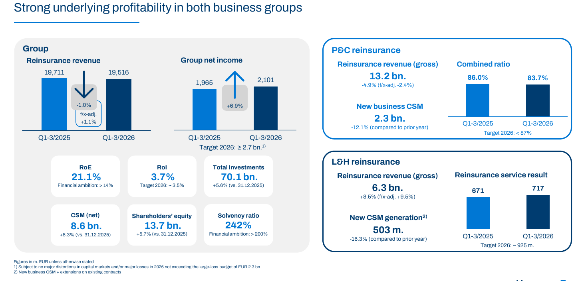

!!! kurz "Kurz gesagt"
    **Umsatz:** 19,5 Mrd. Euro (−1,0 %)
    **Konzerngewinn:** 2,1 Mrd. Euro (+6,9 %)
    **Eigenkapitalrendite:** 21,1 % (Vorjahr 22,0 %)

    Die Großschäden liegen 470 Mio. Euro unter dem Plan, gebucht wurde das volle Budget. Das Jahresziel von mindestens 2,7 Mrd. Euro bleibt bestehen.

Was halte ich von der Hannover Rück? Ein Geschäft, das gerade in einem Marktumfeld sinkender Preise zeigt, wie es arbeitet: Der Umsatz schrumpft leicht, der Gewinn wächst trotzdem um 6,9 % auf 2,1 Mrd. Euro. Möglich macht das ein ruhiges Schadenjahr, dessen Vorteil der Konzern zum Teil als Polster in der Bilanz behält. Wer die Aktie hält, bekommt damit mehr Sicherheit für die Dividende. Auf Wachstum wartet er vorerst.

## Das Polster in den Reserven

Die Hannover Rück plant jedes Jahr ein Budget für Großschäden ein, 2026 sind es 2,3 Mrd. Euro. In den ersten neun Monaten fielen 1,3 Mrd. Euro an, gut 470 Mio. Euro weniger als das anteilige Budget von 1,8 Mrd. Euro. Gebucht hat das Unternehmen trotzdem das volle Budget und die Reserven zusätzlich gestärkt. Der Gewinn von 2,1 Mrd. Euro enthält die ruhige Schadenlage also nur zum Teil.

Die größten Einzelschäden waren das Erdbeben in Kolumbien im August (216 Mio. Euro), die Atlantikstürme auf der Iberischen Halbinsel und in Marokko (136 Mio. Euro) und der Wintersturm „Fern" in Nordamerika (108 Mio. Euro). Für mögliche Folgen des Irankriegs hat das Unternehmen im zweiten Quartal rund 200 Mio. Euro zurückgestellt. Die kombinierte Schaden-Kostenquote liegt bei 83,7 % nach 86,0 % im Vorjahr, das Ziel für das Gesamtjahr ist unter 87 %.

## Wo das Geschäft Gegenwind hat

Der Umsatz der Schadenrückversicherung sinkt um 4,9 % auf 13,2 Mrd. Euro, währungsbereinigt um 2,4 %. Das Geschäft mit klassischen Verträgen wächst währungsbereinigt um 1,4 %, bei strukturierten Verträgen und Katastrophenanleihen liegt der Rückgang bei 16,3 %. Preise und Provisionen drücken auf den Neugeschäftswert (CSM), der in der Schadensparte um 11,9 % auf 2,3 Mrd. Euro fällt. Der Markt für Rückversicherung ist weicher geworden, die Preise geben nach.

Auch das dritte Quartal allein war schwächer: Das operative Ergebnis der Schadensparte stieg auf 721 Mio. Euro (574 Mio. Euro), die Schaden-Kostenquote lag mit 84,5 % aber über den 80,8 % des Vorjahresquartals. Dazu kommt das Währungsergebnis, das von plus 217 Mio. Euro auf minus 91 Mio. Euro gekippt ist, weil der Vorjahreswert vom schwächeren US-Dollar im ersten Halbjahr 2025 profitierte und der Dollar 2026 aufgewertet hat.

## Leben und Gesundheit wächst schneller

Die Personen-Rückversicherung legt beim Umsatz um 8,5 % auf 6,3 Mrd. Euro zu, währungsbereinigt um 9,5 %. Treiber sind Finanzlösungen in den USA und das klassische Geschäft in mehreren Regionen. Das Serviceergebnis steigt auf 717 Mio. Euro (671 Mio. Euro), das Jahresziel liegt bei rund 925 Mio. Euro. Der Neugeschäftswert fällt dagegen auf 503 Mio. Euro (585 Mio. Euro). Belastet hat das Geschäft mit Berufsunfähigkeit in Australien.

## Kapitalanlagen: Rendite hoch, stille Lasten wachsen

Das Kapitalanlageergebnis springt um 40,4 % auf 1,9 Mrd. Euro. Der größte Teil des Sprungs kommt daher, dass die Hannover Rück im Vorjahr aktiv Verluste realisiert hatte (302 Mio. Euro, in diesem Jahr 26 Mio. Euro). Die laufenden Erträge steigen auf 2,1 Mrd. Euro (1,8 Mrd. Euro), die Rendite beträgt 3,7 % bei einem Ziel von rund 3,5 %. Das Portfolio wächst auf 70,1 Mrd. Euro.

Die nicht realisierten Verluste auf das gesamte Portfolio haben sich von 1,7 Mrd. Euro zum Jahresende auf 3,5 Mrd. Euro mehr als verdoppelt, vor allem durch höhere Zinsen bei Anleihen. Sie belasten das Eigenkapital über die Rücklagen, den Gewinn aber erst, wenn Papiere vor Fälligkeit verkauft werden. Die Solvenzquote ging von 256 % auf 242 % zurück, die eigene Untergrenze liegt bei 200 %.

## Dividende und Prognose

Der Buchwert je Aktie steigt auf 113,34 Euro (107,21 Euro zum Jahresende), das Ergebnis je Aktie liegt bei 17,42 Euro nach 16,29 Euro. Im Frühjahr hat die Hannover Rück 1,5 Mrd. Euro an Dividende ausgezahlt, das waren 12,50 Euro je Aktie. Die Prognose bleibt bei mindestens 2,7 Mrd. Euro Konzerngewinn, gerechnet mit Großschäden im Rahmen des Budgets. Nach neun Monaten sind 78 % davon erreicht, im vierten Quartal braucht es also noch rund 600 Mio. Euro. Bleiben die Großschäden unter der Erwartung, will das Unternehmen die Bilanz weiter stärken, statt den Überschuss sofort auszuweisen.

## Fazit

Die Zahlen bestätigen ein Geschäft mit hoher Profitabilität, das über die Preissenkungen im Markt hinweg stabil bleibt. Die Eigenkapitalrendite von 21 % liegt weit über dem Ziel von mehr als 14 %. Dagegen stehen ein schrumpfender Umsatz, ein sinkender Neugeschäftswert und die Frage, wie lange der Markt noch weicher wird. Für Anleger, die die Dividende im Blick haben, ist das Polster in den Reserven das stärkste Argument, für Wachstumshoffnungen sind es die sinkenden Preise.

## Quellen

- Hannover Rück SE, Pressemitteilung „Hannover Rück steigert Konzerngewinn und bekräftigt Gesamtjahresziele", 9.11.2026 (EQS-News)
- Hannover Rück SE, Präsentation zum Conference Call zum dritten Quartal 2026, 9.11.2026
- Eigene Berechnungen: Anteil am Gewinnziel (2,1 von 2,7 Mrd. Euro), Abstand der Großschäden zum anteiligen Budget

*Dieser Beitrag fasst Unternehmensangaben in eigenen Worten zusammen. Eigene Berechnungen sind als solche gekennzeichnet. Keine Anlageberatung, alle Angaben ohne Gewähr.*
