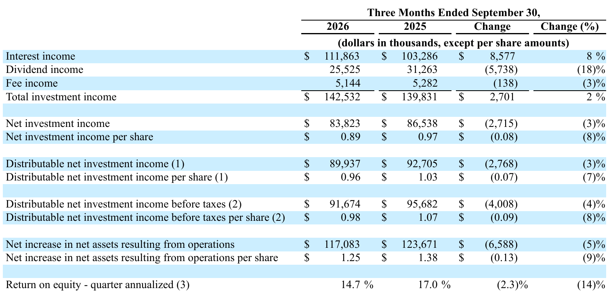

!!! kurz "Kurz gesagt"
    **Erträge:** 142,5 Mio. US-Dollar (+2 %)
    **Nettoanlageergebnis:** 83,8 Mio. US-Dollar (−3 %)
    **Dividende:** 0,265 US-Dollar je Monat (+3,9 %)

    Das Geschäft wächst, der Gewinn je Aktie schrumpft, weil die Aktienzahl schneller steigt. Der Substanzwert klettert weiter, der Kurs liegt allerdings weit darüber.

Was halte ich von Main Street Capital? Ein sehr gutes Geschäftsmodell, bei dem die Zahlen im Quartal wenig Schwung zeigen: Das Unternehmen aus Houston finanziert kleine und mittlere US-Firmen und zahlt jeden Monat eine Dividende, dazu gibt es regelmäßig eine Sonderausschüttung. Der Gewinn je Aktie liegt 8 % unter dem Vorjahr, die Eigenkapitalrendite fällt von 17,0 auf 14,7 %. Gleichzeitig hat sich der Substanzwert je Aktie zum 17. Mal in Folge erhöht, und das bei einer wachsenden Aktienzahl. Wer Main Street kauft, bezahlt allerdings einen Aufschlag von rund 65 % auf diesen Substanzwert, und das zieht den Wert aus dem Bereich der Schnäppchen.

## Was Main Street macht

Main Street ist eine Business Development Company, also eine börsennotierte Beteiligungs- und Kreditgesellschaft. Sie vergibt langfristige Kredite und nimmt Eigenkapitalbeteiligungen an Firmen mit 10 bis 150 Mio. US-Dollar Jahresumsatz, im Fachjargon Lower Middle Market. Dazu kommen Kredite an größere, von Finanzinvestoren gehaltene Firmen (Private Loans) mit 25 bis 500 Mio. US-Dollar Umsatz. Die Firma braucht für ihre Investoren keine externe Verwaltungsgesellschaft, die Kosten liegen bei 1,2 % der Anlagen im Jahr, ein sehr niedriger Wert für diese Branche.

Der Ertrag besteht aus Zinsen auf die Kredite, aus Dividenden der Beteiligungen und aus Gebühren. Weil Main Street als BDC den größten Teil des Gewinns ausschütten muss, kommt die Dividende direkt aus diesem Ergebnis.

## Das Quartal im Detail

Die Zinserträge stiegen um 8 % auf 111,9 Mio. US-Dollar, weil das Portfolio gewachsen ist. Die Dividendenerträge sanken dagegen um 18 % auf 25,5 Mio. US-Dollar, vor allem durch geringere Ausschüttungen der Beteiligungen im Lower Middle Market (−6,9 Mio. US-Dollar). Die Kosten stiegen um 15 % auf 50,9 Mio. US-Dollar, der größte Teil davon sind höhere Zinsen auf die eigene Verschuldung (+6,4 Mio. US-Dollar). So blieb ein Nettoanlageergebnis von 83,8 Mio. US-Dollar, 3 % weniger als im Vorjahr. Je Aktie sind es 8 % weniger, weil das Unternehmen über seine Aktienprogramme 4,6 % mehr Anteile ausgegeben hat.

Konzernchef Dwayne Hyzak spricht von einem weiteren Quartal starker operativer Ergebnisse und verweist auf die nachhaltige Stärke der Plattform. Das ausschüttbare Ergebnis vor Steuern von 0,98 US-Dollar je Aktie entspricht den Erwartungen aus der Prognose des Unternehmens.

## Dividende: Sonderzahlung übersteigt den Gewinn

Die regulären Monatsdividenden steigen für das vierte Quartal auf 0,265 US-Dollar je Monat (zusammen 0,795 US-Dollar, +3,9 %), die 13. Erhöhung seit dem vierten Quartal 2021. Das ausschüttbare Ergebnis von 0,96 US-Dollar je Aktie deckt diese regulären Zahlungen 1,2-fach. Hinzu kommt eine Sonderdividende von 0,30 US-Dollar, die 21. in Folge. Im dritten Quartal flossen so 1,095 US-Dollar je Aktie an die Anleger, mehr als die 0,96 US-Dollar Ergebnis. Der Substanzwert ist trotzdem gestiegen, weil Beteiligungen im Wert zulegten (+68,5 Mio. US-Dollar nicht realisierte Wertsteigerung).

Bei einem Kurs von rund 56 US-Dollar (Stand 3. November) bringen die regulären Zahlungen etwa 5,6 % im Jahr, mit den Sonderdividenden gut 7 %.

## Wo die Risiken liegen

Das Unternehmen hat im Quartal 27,6 Mio. US-Dollar Verluste aus Verkäufen und Umschuldungen realisiert, darunter 15,0 Mio. US-Dollar bei dem vollständigen Ausstieg aus einer Beteiligung. Der Wert der Beteiligungen liegt mit 117 % über den Anschaffungskosten, und gerade diese Gewinne sind noch nicht realisiert. Kredite ohne Zinszahlung machen 0,9 % des Portfolios zum Zeitwert aus (3,5 % zu Anschaffungskosten), das ist ein ordentlicher Wert, aber kein Puffer für eine Rezession. Dazu kommen fallende Leitzinsen, die bei variabel verzinsten Krediten die Zinserträge drücken, und höhere Finanzierungskosten: Im Oktober hat Main Street Anleihen über 500 Mio. US-Dollar mit 6,55 % Zins aufgelegt, nachdem im Juli 500 Mio. US-Dollar mit 3,00 % zurückgezahlt wurden. Die Liquidität von 1,2 Mrd. US-Dollar und das Investment-Grade-Rating (BBB−) geben Spielraum.

## Bewertung und Fazit

Der Substanzwert beträgt 34,22 US-Dollar je Aktie, der Kurs lag zuletzt bei rund 56 US-Dollar, ein Aufschlag von etwa 65 %. Dafür sprechen die Konstanz: ein Substanzwert, der seit 17 Quartalen steigt, eine Dividende, die seit Jahren wächst, und niedrige Kosten. Dagegen spricht, dass ein solcher Aufschlag schrumpfen kann, wenn Stimmung oder Substanzwert nachgeben, und dass der Gewinn je Aktie gerade sinkt.

Wer laufende Ausschüttungen sucht, bekommt eine verlässliche monatliche Dividende. Wer neu einsteigt, sollte den hohen Aufschlag im Kopf haben und eher in Etappen kaufen, etwa über einen Sparplan.

## Quellen

- Main Street Capital Corporation, Ergebnis des dritten Quartals 2026, Form 8-K, 5.11.2026
- Main Street Capital Corporation, Form 10-Q für das Quartal zum 30.9.2026
- Main Street Capital Corporation, Vorläufige Schätzung der Ergebnisse des dritten Quartals 2026, Form 8-K
- 24/7 Wall St., „Main Street Capital Just Boosted Its Monthly Dividend. Is Its Premium Valuation Justified?", 3.11.2026
- Eigene Berechnungen: Aufschlag auf den Substanzwert (Kurs 56,43 US-Dollar zu 34,22 US-Dollar), Dividendenrendite, Deckung der regulären Dividende

*Dieser Beitrag fasst Unternehmensangaben und Berichterstattung der genannten Quellen in eigenen Worten zusammen. Eigene Berechnungen sind als solche gekennzeichnet. Keine Anlageberatung, alle Angaben ohne Gewähr.*
