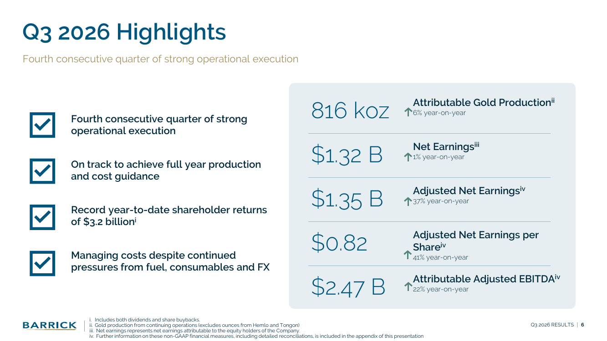
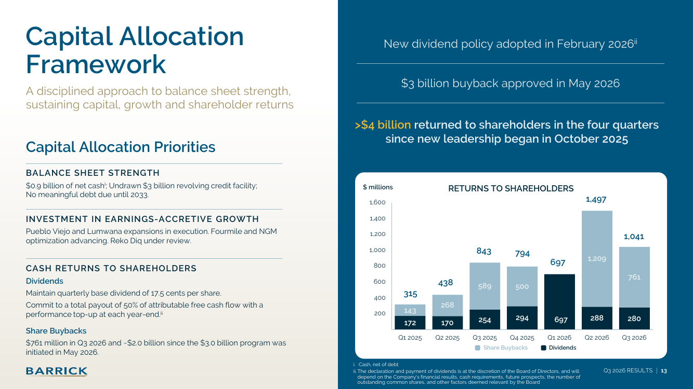

!!! kurz "Kurz gesagt"
    **Umsatz:** 5,1 Mrd. US-Dollar (+22 %)
    **Nettogewinn:** 1,3 Mrd. US-Dollar (+1 %)
    **Bereinigter Gewinn je Aktie:** 0,82 US-Dollar (+41 %)

    Der Goldpreis treibt die Zahlen, die Kosten steigen schneller als die Förderung. Die Prognose für 2026 bleibt unverändert.

Barrick liefert das, was ein Goldkonzern bei einem Preis von über 4.200 Dollar je Unze liefern soll: viel Geld. Der Umsatz steigt um 22 % auf 5,1 Mrd. US-Dollar, das um Sondereffekte bereinigte Ergebnis je Aktie um 41 % auf 0,82 Dollar. Der ausgewiesene Nettogewinn von 1,3 Mrd. Dollar liegt dagegen nur 1 % über dem Vorjahr, weil im dritten Quartal 2025 eine Neubewertung der Beteiligung an Loulo-Gounkoto in Mali gebucht war und diesmal Nachzahlungen dort anfallen. Das eigentliche Thema des Quartals sind die Kosten.

## Der Preis trägt, die Kosten fressen mit

Barrick hat Gold zu 4.243 Dollar je Unze verkauft, 23 % mehr als vor einem Jahr, aber 4 % weniger als im zweiten Quartal. Gleichzeitig steigen die Gesamtkosten je Unze (AISC) von 1.538 auf 1.911 Dollar. Die Gründe nennt der Konzern selbst: höhere Abgaben auf den gestiegenen Goldpreis, teurer Diesel, schwächere Erzgehalte und höhere Investitionen in den laufenden Betrieb. Die Kosten liegen mit 1.911 Dollar innerhalb der Jahresspanne von 1.760 bis 1.950 Dollar, aber im oberen Teil.

Beim Kupfer ist der Abstand größer: Die Gesamtkosten steigen um 44 % auf 4,52 Dollar je Pfund, bei einer Spanne von 3,45 bis 3,75 Dollar für das Jahr. Der Konzern erwartet, am oberen Ende der Kostenprognose zu landen. Dazu kommen die starke Währung in Sambia und ein planmäßiger Umbau in der Mühle von Lumwana. Die Kupfermenge fällt um 9 % auf 50.000 Tonnen.

## Förderung: Nevada trägt, Westafrika erholt sich

Die Goldförderung steigt um 3 % gegenüber dem zweiten Quartal auf 816.000 Unzen. Gegenüber dem Vorjahr ist sie um 2 % niedriger, ohne die verkauften Minen Hemlo und Tongon aber um 6 % höher. Nevada Gold Mines liefert 400.000 Unzen, in Carlin erreichte die Röstanlage einen Quartalsrekord und in Cortez wächst die Goldrush-Grube. Die Mine Loulo-Gounkoto in Mali, die nach der Wiederinbetriebnahme hochfährt, förderte 16 % mehr als im zweiten Quartal und liegt vor dem Plan. Gebremst haben extremes Wetter in Argentinien und Papua-Neuguinea sowie verzögerter Zugang zu hochgradigem Erz in Tansania.

Beim Thema Sicherheit ist die Bilanz schwächer: Acht Unfälle mit Ausfalltagen im Quartal sind der höchste Wert seit mindestens neun Quartalen (im Vorquartal sechs), auch wenn die allgemeine Unfallrate von 0,77 auf 0,71 sank.

## Geld für die Aktionäre

Barrick hat im Quartal 1,04 Mrd. Dollar an die Aktionäre zurückgegeben: 761 Mio. Dollar für Aktienrückkäufe und 280 Mio. Dollar Dividende. Seit Jahresbeginn sind es 3,2 Mrd. Dollar, ein Rekord. Das Rückkaufprogramm über 3 Mrd. Dollar ist seit Mai zu etwa 2 Mrd. Dollar ausgeschöpft, die Zahl der Aktien ist binnen Jahresfrist um 4 % gesunken. Die Dividende bleibt bei 17,5 Cent je Quartal (Stichtag 30. November, Zahlung am 15. Dezember). Dazu kommt zum Jahresende ein Zuschlag, sodass insgesamt 50 % des auf Barrick entfallenden freien Cashflows ausgeschüttet werden.

Der freie Cashflow auf Barrick entfallend fiel auf 642 Mio. Dollar (Vorjahr 1.154 Mio. Dollar), weil die Investitionen um 53 % auf 1,2 Mrd. Dollar stiegen und die Minderheitsgesellschafter in Nevada und Pueblo Viejo ihren Anteil mitnehmen. Die Bilanz ist trotzdem stark: Den Schulden von 4,7 Mrd. Dollar stehen 5,6 Mrd. Dollar Barmittel gegenüber, ein Nettoguthaben von 0,9 Mrd. Dollar (Vorjahr 0,3 Mrd. Dollar). Bedeutende Schulden werden erst 2033 fällig.

## Ausblick: Ziel in Reichweite, Börsengang und Reko Diq offen

Die Prognose für 2026 bleibt bei 2,90 bis 3,25 Mio. Unzen Gold und 190.000 bis 220.000 Tonnen Kupfer. Nach neun Monaten stehen 2,33 Mio. Unzen zu Buche, das vierte Quartal soll leicht über dem dritten liegen. Das ergäbe nach eigener Rechnung rund 3,15 Mio. Unzen im Gesamtjahr, in der oberen Hälfte der Spanne. Die Kostenprognose basiert auf einem Goldpreis von 4.500 Dollar je Unze. Der Marktpreis lag im dritten Quartal im Schnitt bei 4.262 Dollar und damit 5 % unter dem zweiten Quartal.

Bei den Wachstumsprojekten liegt die Erweiterung von Lumwana in Sambia im Plan: Die Kupferförderung soll von 117.000 auf 240.000 Tonnen steigen, die Kosten liegen bei 2 Mrd. Dollar, die erste Produktion ist für Ende des ersten Quartals 2028 vorgesehen. In Pueblo Viejo in der Dominikanischen Republik steht der Ausbau der Anlage für Abraum im Mittelpunkt. Das Projekt Reko Diq in Pakistan wird überprüft, die Investitionen für 2026 wurden auf 3,8 bis 4,2 Mrd. Dollar gesenkt (zuvor 4,0 bis 4,45 Mrd. Dollar). Der Börsengang der nordamerikanischen Minen soll Ende 2026 oder Anfang 2027 folgen, vorbehaltlich der Marktlage.

## Fazit

Das Quartal zeigt, wie stark Barrick vom Goldpreis lebt und wie schnell die Kosten mitwachsen. Für Anleger spricht, dass die Bilanz sauber ist, die Rückkäufe die Aktienzahl verringern und die Förderung wieder wächst. Dagegen steht, dass der freie Cashflow bei hohen Investitionen sinkt, die Kosten im oberen Teil der Prognose liegen und der Gewinn stark an einem Goldpreis hängt, der zuletzt schon 5 % nachgegeben hat. Wer Barrick wegen der Dividende hält, bekommt mit 17,5 Cent im Quartal einen festen Sockel und im Jahresverlauf je nach Cashflow einen Aufschlag.

## Quellen

- Barrick Mining Corporation, Pressemitteilung „Barrick Reports Third Quarter 2026 Results“, 9.11.2026
- Barrick Mining Corporation, Präsentation zum dritten Quartal 2026 und Fact Sheet
- Eigene Berechnungen: Gesamtproduktion 2026 aus neun Monaten und Annahme eines leicht höheren vierten Quartals

*Dieser Beitrag fasst Unternehmensangaben in eigenen Worten zusammen. Eigene Berechnungen sind als solche gekennzeichnet. Keine Anlageberatung, alle Angaben ohne Gewähr.*
