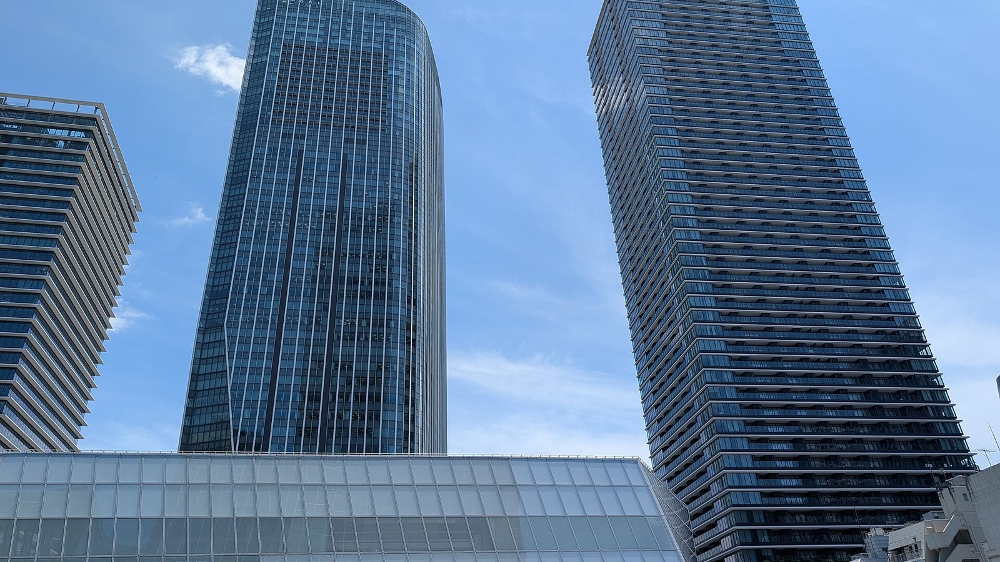
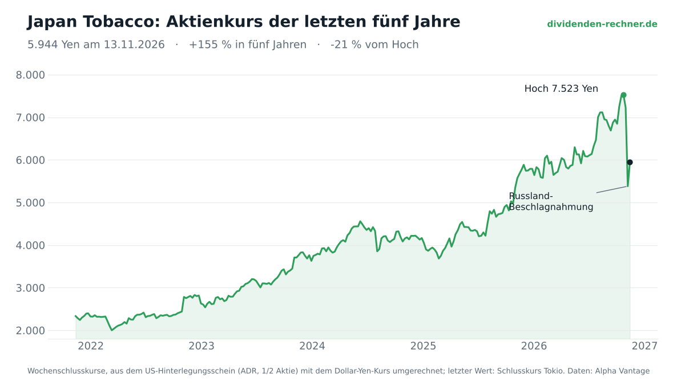

<!-- PRÜFEN (Stand 14.11.): Umsatz, Gewinn, Prognose, Dividende, Ausschüttungsquote, FCF, Nettoverschuldung und Eigenkapitalquote stammen aus dem Q3-Bericht vom 29.10.2026 und der Investor-Präsentation 2025. Die Zeile „ohne Russland“ und die Russland-Anteile sind eigene Rechnung auf Basis der Mitteilung vom 9.11. und als grobe Schätzung gekennzeichnet. Kurse: Reuters-Angaben (Donnerstag 7.769, Montag 5.269, Freitag 6.269 Yen) und Kurs 13.11. (5.944 Yen). Aufmacher: Foto Javad Esmaeili, Unsplash. Nicht einzeln geprüft: der Status von Mondelez, PepsiCo und Procter & Gamble in Russland. Offen: die Erholung von rund 7 % am Folgetag, die im Text nicht als Zahl steht, und der Euro-Wert des Umsatzes. -->

!!! kurz "Kurz gesagt"
    **Kern:** Japan Tobacco hat Russland im Gegensatz zu vielen Konkurrenten nie verlassen. Jetzt stellt Moskau alle Gesellschaften des Konzerns unter vorläufige Verwaltung. Damit stehen rund ein Zehntel des Umsatzes und ein Viertel des bereinigten operativen Gewinns auf dem Spiel.

    1. **Kurs:** Die Aktie verlor in zwei Tagen ein Drittel. Bis zum 13. November erholte sie sich auf 5.944 Yen. Vorher lag sie seit Jahresbeginn rund 40 % im Plus.
    2. **Zahlen:** Der übrige Konzern wächst weiter. Nach neun Monaten stieg der bereinigte operative Gewinn um 21,6 % (währungsbereinigt 16,9 %), die Prognose für 2026 hat der Konzern im Oktober angehoben.
    3. **Bewertung:** Vor dem Dekret kostete die Aktie etwa das 21-Fache des erwarteten Gewinns. Mit dem kleineren Gewinn ohne Russland liegt sie beim Kurs vom 13. November wieder etwa beim 21-Fachen. Der Kurs preist den Verlust also weitgehend ein.
    4. **Fazit:** Eine Kaufgelegenheit wäre der Einbruch nur, wenn Russland dauerhaft verloren ist und der Rest des Konzerns die Dividende trägt. Beides ist offen.

Japan Tobacco war für mich bis vor Kurzem eine ruhige Dividendenaktie. Dann kam am 9. November das Dekret aus Moskau, und von einem Tag auf den anderen stand die Frage im Raum, wie viel vom Russland-Geschäft überhaupt noch dem Konzern gehört. Die Aktie hatte in diesem Jahr knapp 40 % zugelegt und verlor danach rund ein Drittel. Deshalb lohnt der genaue Blick, was dort eigentlich passiert ist.

## Das Risiko für Aktionäre

Wer während eines Krieges sein Geschäft in Russland weiterführt, geht ein Risiko ein. Japan Tobacco steht dabei nicht allein da. Philip Morris verkauft dort weiter, und auch die amerikanischen Konzerne Mondelez und Procter & Gamble sind aktiv.

Dass dieses Risiko real ist, zeigen Nestlé und die Metro Group, deren Russland-Gesellschaften unter vorläufige Verwaltung gestellt wurden. Für Aktionäre heißt das: Wer in Firmen investiert ist, die noch in Russland tätig sind, muss damit rechnen, dass so etwas passieren kann. Es muss nicht passieren, und das ist keine Wertung gegen einzelne Unternehmen.

## Was der Verlust für den Konzern bedeutet

Japan Tobacco gehört zu den größten Tabakkonzernen der Welt. Mit der Übernahme verliert der Konzern nun rund ein Zehntel seines Umsatzes und etwa ein Viertel des bereinigten operativen Gewinns. Der Gewinnverlust ist also deutlich größer als der Umsatzverlust, weil Russland überdurchschnittlich profitabel war.

Im dritten Quartal wuchs die Region Osteuropa, Nahost und Afrika (EMA), zu der Russland gehört, beim Kernumsatz um 12,8 %. Ein Teil davon kam aus Preiserhöhungen, die sich durchsetzten, obwohl das Volumen sank. Dieses Wachstum fällt mit dem Dekret weg.

*Foto: Japan Tobacco, bearbeitet*

Im dritten Quartal sank das Volumen in Russland um 3,6 %. Preise und Mix glichen das aus, Winston und Camel gewannen dort Marktanteile. Bis zum Dekret zählte Russland also zu den soliden Märkten des Konzerns.

Rechnet man den Anteil der Mitteilung vom 9. November auf die Prognose für 2026 um, ergibt sich grob:

- **Umsatz:** rund 390 Mrd. Yen von 3.903 Mrd. Yen
- **Bereinigter operativer Gewinn:** rund 270 Mrd. Yen von 1.079 Mrd. Yen
- **Gewinn je Aktie:** rund 280 Yen von 373 Yen

Diese Rechnung ist grob. Sie setzt voraus, dass Russland dauerhaft wegfällt und es keine Entschädigung gibt.

## Die Aktie in Zahlen

Trotz des Einbruchs liegt die Aktie noch gut 150 % über dem Stand von vor fünf Jahren. Vom Hoch im Oktober ist sie rund 20 % entfernt.

- **Kurs (Tokio, 13.11.2026):** 5.944 Yen
- **Börsenwert:** 9,9 Billionen Yen
- **KGV auf Prognose 2026:** 15,9
- **KGV ohne Russland (grobe Schätzung):** 21,2
- **Dividende je Aktie 2026 (Prognose):** 272 Yen
- **Dividendenrendite:** 4,6 %
- **Ausschüttungsquote 2026 (Prognose):** 73 %, Konzernziel rund 75 %
- **Umsatzwachstum 2026 (Prognose):** +12,6 %
- **Gewinnwachstum 2026 (bereinigter operativer Gewinn, Prognose):** +21,9 %

Die Dividende kostet bei rund 1,67 Milliarden Aktien etwa 450 Milliarden Yen im Jahr. Die Prognosewerte stammen vom 29. Oktober und damit von vor dem Dekret.

## Ist die Dividende in Gefahr?

Mit 272 Yen je Aktie ist die Dividende heute gedeckt, und der Freie Cashflow soll 2026 bei 596 Mrd. Yen liegen. Ohne Russland steigt die Ausschüttungsquote aber auf rund 97 %, das Konzernziel liegt bei etwa 75 %.

Eine Kürzung ist damit nicht sofort nötig, aber sie ist realistisch, falls der Gewinn dauerhaft fehlt. Die Bilanz trägt den Schlag mit einer Nettoverschuldung von rund 618 Mrd. Yen und einer Eigenkapitalquote von knapp 49 % zunächst. Die Investitionen in RRP sind aber hoch, und ein Gewinnausfall würde sie schwerer finanzierbar machen.

## Die positiven Seiten

Der übrige Konzern wächst weiter. In Japan legt vor allem das risikoreduzierte Geschäft zu: Der RRP-Absatz stieg dort um 28,5 %, weil das Heizstäbchen-System Ploom Anteile gewinnt. In Asien steigt der Kernumsatz um 6,7 %, der bereinigte operative Gewinn um 23,5 %.

Dagegen wächst der Gewinn in Westeuropa kaum, der bereinigte operative Gewinn stieg nur um 0,6 %. Die Menge sinkt, der Preis trägt das Geschäft. Das Wachstum im übrigen Konzern ist also ungleich verteilt, und es reicht nicht allein, um den Ausfall aus Russland auszugleichen.

## War der Kurssturz übertrieben?

Der Maßstab ist das Kurs-Gewinn-Verhältnis (KGV). Die Liste zeigt, wie teuer die Aktie auf dem Prognosegewinn zu den drei Zeitpunkten ist:

- **Donnerstag, 5.11. (vor dem Absturz):** 7.769 Yen, KGV 20,8 mit Prognose, 27,7 ohne Russland
- **Montag, 9.11. (Tief):** 5.269 Yen, KGV 14,1 mit Prognose, 18,8 ohne Russland
- **Freitag, 13.11.:** 5.944 Yen, KGV 15,9 mit Prognose, 21,2 ohne Russland

Vor dem Absturz war die Aktie auf dem Prognosegewinn schon teuer. Ein Viertel weniger Gewinn hätte bei gleichem Kurs ein KGV von knapp 28 bedeutet. Ein Teil des Kursplus seit Jahresbeginn beruhte auf der Annahme, Russland sei sicher, und diese Annahme ist weggefallen.

Am 13. November stand die Aktie bei 5.944 Yen, und auf dem kleineren Gewinn entspricht das ungefähr dem alten Bewertungsniveau. Der Markt hat den Verlust damit weitgehend eingepreist. Das Tief vom Montag lag darunter, bei einem KGV von knapp 19 auf dem kleineren Gewinn, und von dort hat sich die Aktie bis Freitag um rund 13 % erholt. Ich halte den Kurs am Montag für eine Überreaktion. Also war offensichtlich Potenzial nach oben, und noch ist der Drops nicht ganz gelutscht.

!!! kurz "Fazit"
    Die Zahlen erklären den Einbruch, machen ihn aber nicht automatisch zur Chance. Dafür müssten drei Dinge zusammenkommen: Der übrige Konzern muss weiter wachsen, die Dividende muss zu tragen sein, und Russland muss verloren oder angemessen entschädigt sein. Das ist eine Einordnung und keine Anlageberatung. Ob der Einbruch eine Chance ist, muss jeder Leser für sich entscheiden.

## Quellen

- Japan Tobacco, Third Quarter Earnings Report 2026 (29.10.2026)
- Japan Tobacco, 2025 Investor Meeting, Business Plan 2026 (Präsentation, 2026)
- Japan Tobacco, Mitteilung zum Russland-Geschäft (9.11.2026)
- Reuters, „Japan Tobacco nach Beschlagnahmung von Einheiten in Russland den zweiten Tag in Folge am Tageslimit im Minus" (9.11.2026, übersetzt von MarketScreener)
- Kurs 13.11.2026 und Kursverlauf: aktien.guide sowie eigene Berechnung aus Wochenkursen des ADR (Alpha Vantage) und dem Dollar-Yen-Kurs
- Philip Morris International, Geschäftsbericht 10-K für 2025
- Russische Verwaltung von Nestlé und Auchan: [Euronews](https://es.euronews.com/business/2026/09/18/rusia-toma-el-control-de-activos-de-nestle-y-de-empresas-francesas), [Swissinfo](https://www.swissinfo.ch/eng/russia-grabs-nestle%2c-auchan-assets-in-biggest-seizure-since-2024/92078072)
