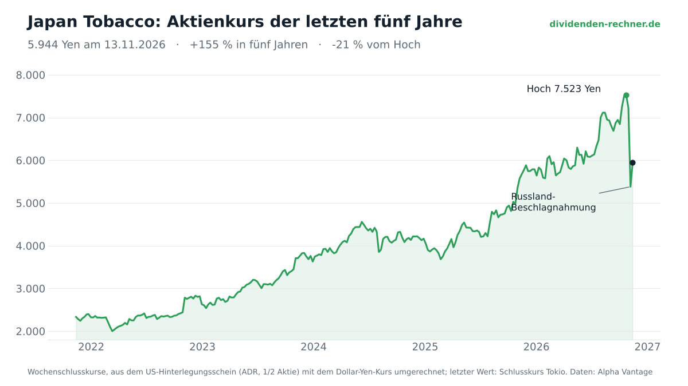
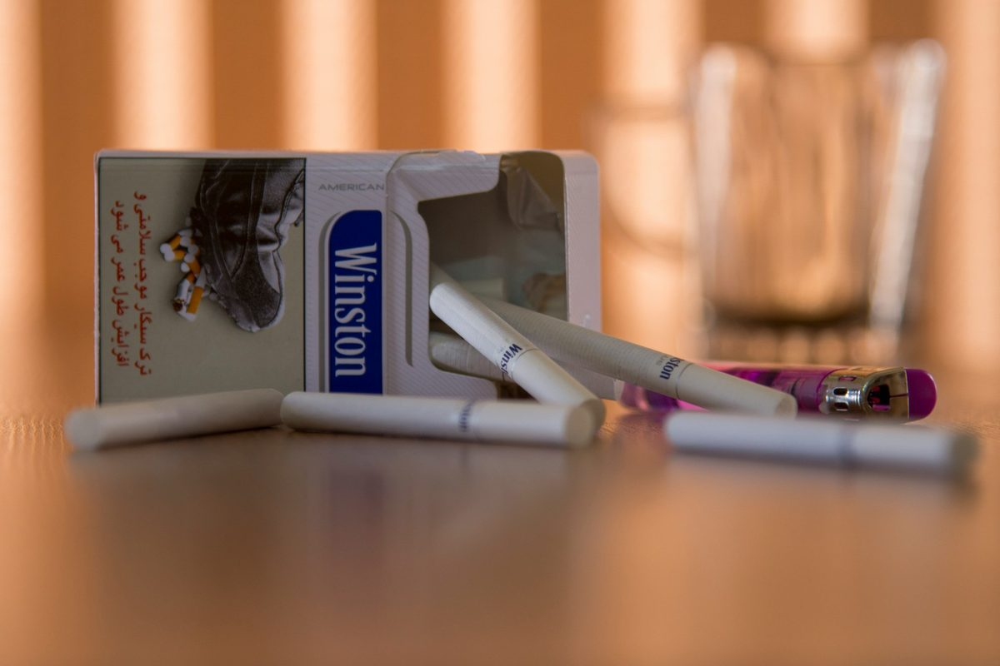

<!-- PRÜFEN (Stand 14.11.): Umsatz, Gewinn, Prognose, Dividende, Ausschüttungsquote, FCF, Nettoverschuldung und Eigenkapitalquote stammen aus dem Q3-Bericht vom 29.10.2026 und der Investor-Präsentation 2025 (nicht mehr aus aktien.guide). Die Zeile „ohne Russland“ und die Russland-Anteile sind eigene Rechnung auf Basis der Mitteilung vom 9.11. und sind als grobe Schätzung gekennzeichnet. Kurse: Reuters-Angaben (Donnerstag 7.769, Montag 5.269, Freitag 6.269 Yen) und Kurs 13.11. (5.944 Yen). Nicht geprüft: der Status von Mondelez, PepsiCo und Procter & Gamble in Russland; diese Angaben sind als Stand „nach unserem Stand, nicht einzeln geprüft“ formuliert. -->

!!! kurz "Kurz gesagt"
    **Kern:** Japan Tobacco hat Russland im Gegensatz zu vielen Konkurrenten nie verlassen. Jetzt stellt Moskau alle Gesellschaften des Konzerns unter vorläufige Verwaltung. Damit stehen rund ein Zehntel des Umsatzes und ein Viertel des bereinigten operativen Gewinns auf dem Spiel.

    1. **Kurs:** Die Aktie verlor in zwei Tagen ein Drittel. Bis zum 13. November erholte sie sich auf 5.944 Yen. Vorher lag sie seit Jahresbeginn rund 40 % im Plus.
    2. **Zahlen:** Der übrige Konzern wächst weiter. Nach neun Monaten stieg der bereinigte operative Gewinn um 21,6 % (währungsbereinigt 16,9 %), die Prognose für 2026 hat der Konzern im Oktober angehoben.
    3. **Bewertung:** Vor dem Dekret kostete die Aktie etwa das 21-Fache des erwarteten Gewinns. Mit dem kleineren Gewinn ohne Russland liegt sie beim Kurs von 13. November wieder etwa beim 21-Fachen. Der Kurs preist den Verlust also weitgehend ein.
    4. **Fazit:** Eine Kaufgelegenheit wäre der Einbruch nur, wenn Russland dauerhaft verloren ist und der Rest des Konzerns die Dividende trägt. Beides ist offen.

## Die Aktie in Zahlen

Trotz des Einbruchs liegt die Aktie noch gut 150 % über dem Stand von vor fünf Jahren, vom Hoch im Oktober ist sie rund 20 % entfernt.

| Kennzahl | Wert |
|---|---|
| Kurs (Tokio, 13.11.2026) | 5.944 Yen |
| Börsenwert | 9,9 Billionen Yen |
| KGV auf Prognose 2026 (372,88 Yen je Aktie) | 15,9 |
| KGV ohne Russland (grobe Schätzung, rund 280 Yen je Aktie) | 21,2 |
| Dividende je Aktie 2026 (Prognose) | 272 Yen |
| Dividendenrendite | 4,6 % |
| Ausschüttungsquote 2026 (Prognose) | 73 %, Konzernziel rund 75 % |
| Umsatz 2026 (Prognose) | 3.903 Mrd. Yen |
| Bereinigter operativer Gewinn 2026 (Prognose) | 1.079 Mrd. Yen (+21,9 %) |
| Gewinn 2026 (Prognose, nach Canada-Anpassung) | 662 Mrd. Yen |
| Freier Cashflow 2026 (Prognose) | 596 Mrd. Yen (2025: 273 Mrd. Yen) |
| Nettoverschuldung (30.9.2026) | rund 618 Mrd. Yen |
| Eigenkapitalquote (30.9.2026) | knapp 49 % |

Die Dividende kostet bei rund 1,67 Milliarden Aktien etwa 450 Milliarden Yen im Jahr. Die Prognosewerte stammen vom 29. Oktober und damit von vor dem Dekret.

## Wie der Konzern aufgestellt ist

Japan Tobacco macht rund 96 Prozent seines Umsatzes mit Tabak, das Lebensmittelgeschäft ist mit gut 4 Prozent klein. Das Pharmageschäft hat der Konzern 2025 an Shionogi übertragen. Im Tabak gibt es zwei Bereiche: die klassischen Zigaretten (Winston, Camel, Mevius, LD, dazu die integrierte Vector Group) und die risikoreduzierten Produkte (RRP), vor allem das Heizstäbchen-System Ploom.

Bei den Zigaretten kommt das Wachstum vor allem aus dem Preis. Der Preisbeitrag lag 2025 bei 10,8 %, im Schnitt der Jahre 2022 bis 2024 bei 7,1 %. Die Menge schrumpft dagegen. Der Zigarettenmarkt verlor 2025 rund 2,7 % Volumen, in den ersten neun Monaten 2026 setzte sich der Rückgang fort. Der Konzern gewinnt Marktanteile, verkauft aber insgesamt nicht mehr Zigaretten.

Das eigentliche Wachstumsfeld ist RRP. Der RRP-Umsatz stieg in den ersten neun Monaten 2026 um 30,6 % auf 119,3 Mrd. Yen, das sind gut 4 % des Tabakumsatzes. Bis 2028 will der Konzern rund 800 Mrd. Yen in dieses Geschäft investieren. Für den Zeitraum 2026 bis 2028 stellt er einen bereinigten operativen Gewinn im hohen einstelligen Prozentbereich pro Jahr in Aussicht.

*Foto: Javad Esmaeili, Unsplash*

Regional zeigt sich, wo der Konzern wächst. In den ersten neun Monaten 2026, bereinigt um Wechselkurse:
- **Asien** (u. a. Japan, Philippinen, Taiwan): Kernumsatz +6,7 %, bereinigter operativer Gewinn +23,5 %. In Japan steigt der RRP-Absatz um 28,5 %, weil Ploom Anteile gewinnt.
- **Westeuropa**: Kernumsatz +2,3 %, bereinigter operativer Gewinn +0,6 %. Die Menge sinkt, der Preis trägt das Geschäft. Hier wächst der Gewinn kaum.
- **Osteuropa, Nahost und Afrika (EMA)**: Kernumsatz +12,8 %, bereinigter operativer Gewinn +23,5 %. Diese Region ist mit gut der Hälfte des Tabakumsatzes und fast der Hälfte des Tabakgewinns der größte Block. Hier liegt Russland.

## Wie groß das Russland-Loch ist

Im dritten Quartal sank das Volumen in Russland um 3,6 %. Preise und Mix glichen das aus, Winston und Camel gewannen dort Marktanteile. Russland zählt also bis zum Dekret zu den soliden Märkten des Konzerns.

Die Mitteilung vom 9. November nennt einen Anteil von rund einem Zehntel am Umsatz und einem Viertel am bereinigten operativen Gewinn. Rechnet man das auf die Prognose für 2026 um, ergibt sich grob:
- **Umsatz:** rund 390 Mrd. Yen von 3.903 Mrd. Yen
- **Bereinigter operativer Gewinn:** rund 270 Mrd. Yen von 1.079 Mrd. Yen
- **Gewinn je Aktie:** Wenn der Gewinnanteil proportional zum operativen Gewinn wegfällt, bleiben rund 280 Yen von 373 Yen übrig.

Diese Rechnung ist grob. Sie setzt voraus, dass Russland dauerhaft wegfällt und es keine Entschädigung gibt. Auffällig ist das Verhältnis: Ein Zehntel des Umsatzes bringt ein Viertel des Gewinns. Russland war also überdurchschnittlich profitabel, und genau deshalb trifft der Verlust so stark.

## War der Kurssturz übertrieben?

Der Maßstab ist das Kurs-Gewinn-Verhältnis (KGV). Die Tabelle zeigt, wie teuer die Aktie auf dem Prognosegewinn je Zeitpunkt ist:

| Zeitpunkt | Kurs (Yen) | KGV mit Prognose (373 Yen) | KGV ohne Russland (rund 280 Yen) |
|---|---|---|---|
| Donnerstag, 5.11. (vor dem Absturz) | 7.769 | 20,8 | 27,7 |
| Montag, 9.11. (Tief) | 5.269 | 14,1 | 18,8 |
| Freitag, 13.11. | 5.944 | 15,9 | 21,2 |

Vor dem Absturz war die Aktie auf dem Prognosegewinn schon teuer. Ein Viertel weniger Gewinn hätte bei gleichem Kurs ein KGV von knapp 28 bedeutet. Ein Teil der rund 40 % Kursplus seit Jahresbeginn beruhte auf der Annahme, Russland sei sicher. Diese Annahme ist weggefallen.

Am 13. November stand die Aktie bei 5.944 Yen. Auf dem kleineren Gewinn entspricht das ungefähr dem alten Bewertungsniveau. Der Markt hat den Verlust damit weitgehend eingepreist. Nur das Tief am Montag lag darunter, bei einem KGV von knapp 19 auf dem kleineren Gewinn. Das wäre eine Überreaktion gewesen, und die Aktie hat sich davon wieder gelöst.

## Kaufgelegenheit oder nicht?

Die Zahlen erklären den Einbruch, machen ihn aber nicht automatisch zur Chance. Dafür müssten drei Dinge zusammenkommen.

Erstens muss der übrige Konzern weiter wachsen. Die Zahlen des dritten Quartals sprechen dafür, vor allem in Asien: Der Gewinn stieg dort stark, und RRP legt kräftig zu. In Westeuropa wächst der Gewinn dagegen kaum. Dazu kommt die Prognose vom Oktober, die vor dem Dekret angehoben wurde und jetzt überprüft werden muss.

Zweitens muss die Dividende zu tragen sein. Mit 272 Yen je Aktie kostet sie rund 450 Mrd. Yen im Jahr, der Freie Cashflow soll 2026 bei 596 Mrd. Yen liegen. Die Dividende ist damit gedeckt. Ohne Russland steigt die Ausschüttungsquote aber auf rund 97 %, und das Konzernziel liegt bei rund 75 %. Eine Kürzung ist nicht sofort nötig, aber auf Dauer wird der Puffer eng.

Drittens muss Russland verloren sein oder zumindest angemessen entschädigt werden. Eine vorläufige Verwaltung kann in eine dauerhafte Übernahme übergehen, eine Entschädigung ist bisher nicht festgelegt. Für Euro-Anleger kommt das Yen-Risiko dazu.

Die Bilanz ist für den Schlag stark genug, mit einer Nettoverschuldung von rund 618 Mrd. Yen und einer Eigenkapitalquote von knapp 49 %. Die Investitionen in RRP sind aber hoch, und ein Gewinnausfall würde sie schwerer finanzierbar machen.

Das ist eine Einordnung und keine Anlageberatung. Ob der Einbruch eine Chance ist, muss jeder Leser für sich entscheiden.

## Die anderen Konzerne und die Frage nach dem Schutz

Nestlé, Auchan, Metro und Lemana PRO hat Moskau in diesem Jahr ebenfalls unter vorläufige Verwaltung gestellt. Bei Nestlé hat der Konzern die Werte abgeschrieben, weil Russland nur einen kleinen Teil von Umsatz und Gewinn ausmacht. Schon 2023 traf es Danone und Carlsberg.

Philip Morris erzielt nach seinem Geschäftsbericht für 2025 rund 6 % seines Umsatzes in Russland. Das dortige Vermögen lag bei etwa 4,8 Mrd. US-Dollar, davon rund 2,3 Mrd. Dollar Barmittel. Auch Mondelez, PepsiCo und Procter & Gamble sind in Russland aktiv.

Ob Moskau bei ihnen ebenso zugreift, bleibt abzuwarten. Bisher traf es Konzerne aus Europa und Japan, keine US-Firma.

Trump dürfte großes Interesse daran haben, dass Putin amerikanische Konzerne nicht enteignet. Ein Zugriff auf US-Firmen wäre ein politischer Konflikt, den Washington eher vermeiden möchte. Das ist eine Vermutung, belegt ist sie nicht. Ob dieser Schutz hält, ist offen, denn die politische Lage kann sich schnell ändern.

Für Anleger entscheidet am Ende, wie viel Gewinn und wie viel Geld im Land festsitzt.

## Quellen

- Japan Tobacco, Third Quarter Earnings Report 2026 (29.10.2026)
- Japan Tobacco, 2025 Investor Meeting, Business Plan 2026 (Präsentation, 2026)
- Japan Tobacco, Mitteilung zum Russland-Geschäft (9.11.2026)
- Reuters, „Japan Tobacco nach Beschlagnahmung von Einheiten in Russland den zweiten Tag in Folge am Tageslimit im Minus" (9.11.2026, übersetzt von MarketScreener)
- Kurs 13.11.2026 und Kursverlauf: aktien.guide sowie eigene Berechnung aus Wochenkursen des ADR (Alpha Vantage) und dem Dollar-Yen-Kurs
- Philip Morris International, Geschäftsbericht 10-K für 2025
- Russische Verwaltung von Nestlé und Auchan: [Euronews](https://es.euronews.com/business/2026/09/18/rusia-toma-el-control-de-activos-de-nestle-y-de-empresas-francesas), [Swissinfo](https://www.swissinfo.ch/eng/russia-grabs-nestle%2c-auchan-assets-in-biggest-seizure-since-2024/92078072)
